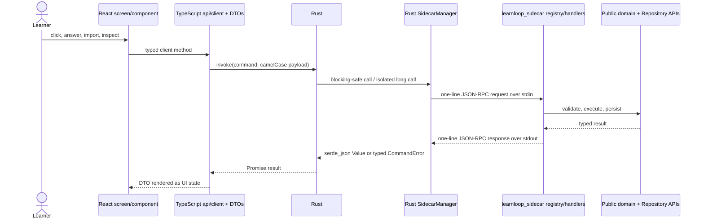

# Desktop Architecture

The desktop application is a React/TypeScript presentation client inside a Tauri/Rust shell. It does not reimplement the learning algorithm or open `state.sqlite` as an application database. User actions cross a four-layer bridge to the Python sidecar, whose public handlers call the same domain and persistence APIs documented in [[Architecture Overview]].

## Four-layer bridge



The difficult invariant is registration continuity: a frontend `invoke` must have a registered Rust command, and that command must delegate to a registered Python sidecar method. `tests/test_desktop_rpc_contract.py` checks all four layers as sets so a method cannot exist on only one side. ^desktop-rpc-bridge

## Layer ownership

| Layer | Primary sources | Owns | Must not own |
|---|---|---|---|
| React application | `src/app`, `src/screens`, `src/components` | navigation, overlays, drafts, visual state, accessibility/input behavior | grading, scheduling, SQL, provider protocol |
| TypeScript API/DTO | `src/api/client.ts`, `src/api/dto.ts` | command names, request/response types, Tauri invocation; per-mutation cache invalidation tags (`mutating*` wrappers) | domain interpretation or persistence |
| Query cache | `src/api/queryCache.ts`, `src/api/useCachedQuery.ts`, `src/api/queryTags.ts`, `src/components/pdfDocumentCache.ts` | stale-while-revalidate memo of sidecar reads keyed by `[command, ...args]`, tag invalidation, `clear()` on vault switch, one in-flight request per key | authority over any state (the sidecar snapshot is; a cached value is never trusted past its next revalidation) |
| Tauri host | `src-tauri/src/main.rs`, `commands.rs` | native window/protocol/plugin setup, command registration, blocking boundary | learning policy |
| sidecar process manager | `src-tauri/src/sidecar.rs`, `errors.rs` | Python process lifecycle, request ids, timeouts, reconnect, vault-selection generation, isolated long calls, typed `CommandError`s | silently retrying outcome-unknown mutations |
| Python sidecar | `src/learnloop_sidecar` | protocol validation/serialization and delegation | adapter-specific learning forks |

Use [[Desktop Module Catalog]] for every TypeScript/TSX/Rust file, its importers, tests, and modification guidance. Use [[Adapter Architecture]] for the boundary shared with CLI and TUI.

## Application composition

`main.tsx` applies the saved palette and mounts `App`. `App.tsx` is the desktop composition root: it loads the selected vault, maintains top-level screen/overlay/session state, listens for native vault-change events, and routes typed DTOs into screens. Screen modules own page-level interactions; components own reusable presentations; `api/client.ts` is the only ordinary route to native commands.

The heavier screens (Reader, Graph, Ingest, Exam, Library, Proposals, Registry Review, Golden Path) are loaded with `React.lazy`, so each is a separate chunk fetched on first use; pdf.js is imported statically only by the Reader's `PdfReaderPane` and dynamically by `pdfDocumentCache`, so it stays out of the main chunk. The screen body renders inside `ScreenErrorBoundary` around a `<Suspense>` fallback. The boundary catches render errors, most importantly a lazy chunk that failed to load (React caches the rejected import, so only a page reload fetches it again): it shows the error with a **reload app** button, and it clears when the active tab (`resetKey`) changes so the other screens stay usable.

The UI keeps ephemeral interaction state—open overlays, current tab, local draft mirror—but the authoritative attempt, queue, ingest, goal, and learner state remains behind the sidecar. Reloading the UI must reconstruct supported state from backend snapshots and checkpoints.

- **Offer attribution.** `practiceOffer.schedulerCandidateForServe` decides which scheduler candidate a practice serve sends as `schedulerCandidateId`. It sends none for a primed retry, a guided redo, an offer for another item, or a resumed retry key (a restored `submissionId`): the sidecar binds each retry key to the first offer it receives, and every queue rebuild mints fresh candidate ids. See [[Continue a Learning Cycle]].
- **Close flush.** `PracticeScreen` registers `useCloseWithFlush`: while its draft is being saved, every window close request is prevented, and the window is destroyed once the flush settles. A save failure is reported as an error toast and the window still closes.
- **Vault switch.** `changeVault` first freezes and flushes every registered draft owner (`vaultTransition.selectWithDraftFlush`); a failed flush aborts the switch and resumes the owners. After the backend selection commits, the screens unmount synchronously, the query and PDF caches are cleared, and `resetShellForVault()` drops every piece of shell state that refers to the old vault (overlays, draft mirror, practice offer, pending redo, ingest job, reader source, tab) before `loadVault()` reads the new snapshot. If that read fails, the app stays on a retryable startup-error surface for the new vault rather than restoring the old snapshot.

## Sidecar lifecycle and concurrency

`SidecarManager` launches the Python server with piped stdin/stdout, sends `rpc.ping`, initializes it against a selected vault, and preserves that vault across a transport restart. Typed application errors keep the client alive; broken pipes, malformed protocol boundaries, or timeouts invalidate it so the next request starts a clean process.

The primary process is serialized behind a mutex for interactive calls. Only `run_cli_command` uses `call_isolated`, a fresh sidecar initialized against the selected vault and reaped after the one call, so a long CLI command cannot occupy the interactive client's mutex. Every other command runs on the primary client (each Tauri command hands its blocking call to `spawn_blocking`); long model work is queued as durable jobs that the sidecar's own job workers execute, so the RPC returns once the work is queued (for example `generate_commissioning_practice`). A timed-out mutation is reported as outcome unknown; the shell does not guess that retry is safe.

Two typed errors come from the manager rather than from Python:

- **`vault_changed`** (not retryable). `call()` records the vault-selection generation when a command is issued, and `call_issued_in` refuses to run it if the generation has changed by the time it holds the state lock: the state mutex is not FIFO, so a command issued for the old vault could otherwise run against the newly selected vault's sidecar. `call_isolated` applies the same check after its call and refuses to return a result from the previous vault. The vault watcher skips refreshes that fail this way, since its paths belong to the old vault.
- **`grading_provider_reset`** (retryable). A reconnect to the same vault replays the learner's grading-provider choice with `restore_grading_override`. If the replacement sidecar refuses it with a typed error (for example the provider was removed from the vault config), the manager drops the override, keeps the new client installed, and returns this error once with the provider and the cause; grading then uses the vault's configured provider. A transport failure during the replay aborts the reconnect instead. `select_vault` treats this error as a successful selection.

> [!important] The ingest ownership fence, not process shutdown, protects a vault
> Vault switching stops the previous sidecar before initializing the next, but correctness does not depend on every worker it started having exited. Each claimed ingest job attempt is owned by `JobOwner(worker_id, attempt_count)` and holds a renewable lease; `guard_ingest_writes` checks that the job row is still `running` for that worker and attempt before the first write of every write transaction and before every vault-file mutation (`guard_vault_mutations`). A superseded or expired attempt raises `JobOwnershipLost` instead of publishing. See [[Import Canonical Sources]].

## Filesystem refresh

Rust's `vault_watcher` coalesces create/modify/remove bursts for Markdown, YAML, TOML, and JSON under the active vault. It ignores runtime/build/raw-original paths, sends normalized relative paths to Python's `refresh_vault_files`, and emits `learnloop://vault-files-changed` back to React.

Python remains the authority for incremental versus full refresh. A backend rescan/error or directory-only mutation deliberately selects the conservative full-refresh arm. Read events do not feed back into another refresh loop.

Every `learnloop://vault-files-changed` event whose mode is not `noop` also marks the whole query cache stale (coalesced to one invalidation per quiet second, since ingests write in bursts); mounted screens keep painting their cached data while they revalidate. SQLite-only mutations are invisible to the watcher, so each mutation wrapper in `client.ts` names the tags it affects — a new RPC that writes state must pick its tags there, and a new cached read must declare the tags that cover it. The Reader's per-source reads are the one sanctioned imperative use of `getOrFetch` (its open sequence has side effects); everything else reads through `useCachedQuery`.

## Native capabilities and trust boundaries

- Tauri dialog/opener plugins provide explicit native file selection and opening.
- The `llpdf://` custom protocol serves content-addressed vault originals to the PDF reader without making arbitrary filesystem paths a web URL. `llmedia://` serves rendered explainer animations from the vault's `media/animations/` store under the same content-addressed-name rule. Both are registered with `register_asynchronous_uri_scheme_protocol` and read files on a blocking worker (`spawn_blocking`), never through the sidecar mutex.
- `llmedia://` supports HTTP Range requests for video seeking: a satisfiable range returns `206` with `Content-Range`, capped at 4 MiB per response (`MAX_MEDIA_RANGE_BYTES`) so an open-ended `bytes=0-` never loads a whole clip into memory; the media element requests the remainder with follow-up ranges. An unsatisfiable range returns `416`. A request without a Range header returns the whole file with `200`.
- Provider credentials are resolved by the backend environment/config machinery; React DTOs do not become a secret store.
- `SqliteBrowser` is an owner-gated maintenance surface; normal screens use domain RPCs rather than arbitrary SQL.
- DTOs are transport contracts, not domain authorities. See [[Privacy and Trust Boundaries]].

## Larger workflows

- [[Initialize a Vault]] — `NewVaultWizard` calls the same bootstrap lifecycle and selects the result.
- [[Import Canonical Sources]] / [[Build a Study Map]] — ingest, library, outline, proposal, and study-map screens orchestrate durable backend jobs.
- [[Start a Learning Cycle]] / [[Continue a Learning Cycle]] — Today, Practice, Feedback, Review, repair, and diagnostic overlays present the shared session/attempt APIs.
- [[Reader to Practice Workflow]] and [[Tutor and Teach-Back Workflow]] — dedicated screens/components render source-grounded interactions.
- [[Inspect Persistent State]] / [[Doctor Migrations and Recovery]] — maintenance views expose supported reports and explicitly gated operator tools.

The workflow notes own user procedure. Desktop module notes point here and to those workflows rather than restating the learning algorithm.

## Tests and build checks

```bash
cd apps/learnloop-tauri
npm run typecheck
npm test                 # vitest run (jsdom, @testing-library/react)
npm run frontend:build
cargo test --manifest-path src-tauri/Cargo.toml

cd ../..
.venv/bin/pytest -q tests/test_desktop_rpc_contract.py tests/test_sidecar_contract.py tests/test_sidecar_serializer_snapshot.py
```

- TypeScript checks component/client/DTO coherence.
- `npm test` runs the vitest files matched by `src/**/*.test.{ts,tsx}` (`vitest.config.mjs`): `app/practiceOffer.test.ts` (offer attribution), `app/ScreenErrorBoundary.test.tsx`, `app/useCloseWithFlush.test.tsx` (close requests during a pending save), `components/pdfDocumentCache.test.ts`, `screens/PracticeScreen.test.tsx` (draft, recovery and vault-switch lifecycle), and `screens/reader/useReaderRequests.test.tsx`.
- Rust tests cover watcher/path/transport behavior colocated with the modules, including the reconnect override reset, the `vault_changed` fence, and bounded `llmedia` ranges.
- the desktop RPC contract pins frontend → Rust registration → sidecar method continuity;
- sidecar contract and golden serializer tests pin backend results visible to the client.

## Modification guide

- New learning behavior: change the owning Python domain first, then add a public sidecar method and the narrow client surface.
- New desktop RPC: update Python registry/handler, Rust command declaration and handler list, TypeScript client, DTO, and `test_desktop_rpc_contract.py` atomically.
- New screen: keep orchestration in the screen, reusable rendering in a component, and persistence behind the client.
- Long-running work: enqueue a durable backend job, or use the isolated sidecar boundary for a one-off CLI command; do not block the primary interactive mutex.
- New watched file type/path: change Rust filtering and Python refresh semantics together; test that reads/runtime artifacts cannot create loops.
- Public response changes: update the sidecar serializer snapshot and affected DTOs before UI rendering.

## Related notes

- [[Desktop Module Catalog]]
- [[Adapter Architecture]]
- [[Architecture Overview]]
- [[Privacy and Trust Boundaries]]
- [[AI Architecture]]
