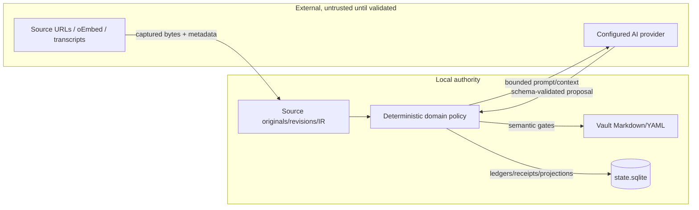

# Privacy and Trust Boundaries

LearnLoop is local-first, not “never networked.” Vault state and source artifacts are stored locally; network egress occurs only through an acquisition or configured provider path that the workflow makes visible.

## Trust zones

External output crosses two boundaries: transport/schema validation and feature semantic validation. It never writes canonical content or learner state directly.

## Source acquisition egress

Local files are read locally. URLs, websites, arXiv, YouTube transcripts/metadata, and other remote sources require network fetches. Acquisition captures immutable bytes/revision identity before later synthesis. PDF extraction is local (optional Marker may load local model resources) unless `[ingest.pdf] engine = "native"`, which sends the whole PDF to the `canonical_ingest` chat provider as a file content part; `[ingest.audio] mode = "native"` likewise sends mp3/wav audio to that provider, and other audio follows its separately configured transcription provider. Both native paths require the routed profile to declare the modality in `input_modalities`, cap uploads with `[ingest.native] max_pdf_mb` / `max_audio_mb`, and are named on the acquisition consent card before any bytes leave the machine. See [[Legacy Configuration Compatibility]] for the retired `[ingest.native]` gates.

## AI egress

Every feature resolves a named route through [[AI Architecture#Resolution path]]. The operation builds a bounded context rather than handing a provider the whole vault. Provider/profile/model identity and token usage are recorded in run provenance. Manual mode sends nothing.

## Prompts and responses stored locally

Model calls made under a model-call observer (desktop sidecar RPCs, durable ingest jobs, and CLI practice grading) write a [[Reference/Database/Tables/model_call_receipts|model_call_receipts]] row when the call starts. The row keeps the prompt text of the top-level call (`input_text`), its output schema, and the returned text (`output_text`), alongside provider, model, endpoint, status and usage. Prompts routinely contain learner answers and source excerpts, so `state.sqlite` holds that text for every observed call; it is a `RECEIPT` table and is never cleared by a rebuild.

## Dataset export

`learnloop dataset-export OUTPUT` copies learner data out of the vault. The output directory must not already exist. It contains:

- `snapshot.sqlite`, a complete SQLite backup of the vault database (every table, not a selection);
- one JSONL file for every `RAW_LEDGER` and `RECEIPT` table, which includes `model_call_receipts` prompt and response text, `raw_grade_events`, `practice_attempts`, and `practice_item_snapshots` (full item text);
- JSONL files for the captured workflow tables `proposed_patches`, `proposed_patch_items`, `synthesis_runs`, `model_work_checkpoints`, `ingest_batches`, `ingest_jobs`, and `attempt_completion_work`;
- `outcome_contract.jsonl` and `split_assignments.jsonl`;
- `manifest.json`, with the hashes of the snapshot and of every artifact.

Source originals are referenced by hash and not copied. Every artifact is fsynced, and the manifest is written last by atomic rename, so its presence marks a complete export; a failed export removes the directory it created. Treat an export as containing everything the learner typed and every prompt sent to a provider. See [[Collection and Dataset Contract]].

## Secrets and machine-specific values

API keys are referenced by environment-variable names, not stored as plaintext vault values. Machine paths and global defaults belong in environment/global settings layers described by [[Environment and Machine Settings]]. A vault may inherit AI settings when first created, but existing vaults are not overwritten.

## Diagnostics

Plain doctor is physically database-read-only and does not probe providers. A provider diagnostic happens only when explicitly requested by an AI workflow. This keeps “inspect my vault” from becoming an unexpected mutation or egress event.

## Instruction and evidence trust

Reader/tutor output may reveal source content and therefore records familiarity/exposure; it cannot become ability evidence merely because a model supplied it. Assessment output is treated as a proposal and checked against the frozen contract. See [[Evidence and Measurement]] and [[Reader Tutor and Teach-Back]].

## Modification guidance

- Document every new egress path, required consent, payload scope, retry, and provenance.
- Keep secrets out of TOML/Markdown examples; reference environment variables.
- Make offline/manual behavior explicit.
- Add a no-egress test for unsupported capability/fallback cases.
- Never add a provider call to plain doctor or a read-only data inspection path.
- A new table classified `RAW_LEDGER` or `RECEIPT` is exported by `dataset-export` automatically; decide whether its contents belong in an export before choosing the role.

