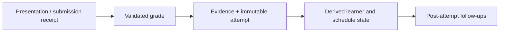

# State and Persistence

LearnLoop separates authored authority, historical evidence, mutable workflow state, and reproducible projections. SQLite is not “the source of truth” as one undifferentiated whole; every table has an explicit lifecycle role.

## State surfaces

- `learnloop.toml` — configuration and algorithm/provider selection.
- Markdown/YAML — authored subjects, concepts, learning objects, items, goals, rubrics, and user-facing records.
- source artifact directories — captured originals, immutable revisions, and extracted IR.
- `state.sqlite` — observations, receipts, projections, queues, sessions, and compatibility state.

See [[Data and State Map#^authority-map]] and [[Vault Lifecycle]].

## Table roles

`learnloop.db.table_roles.TABLE_ROLES` exactly matches the 259 migration-head user tables. Classification is explicit rather than inferred from a suffix:

| Role | Policy |
|---|---|
| RAW_LEDGER | authoritative input; never cleared by rebuild |
| DERIVED | clearable and exactly reconstructed by one replayer |
| RECEIPT | append-only decision/audit history |
| WORKFLOW | mutable queue/session/lease state preserved across replay |
| COMPAT | frozen historical seam |

Only ten tables are currently `DERIVED`; every one has a real clear-and-replay source. Captured calibration, reviewed rows, debug evidence, and mixed-authority tables remain raw rather than pretending preservation is a rebuild.

## Write ownership

Every writable family has one SQL owner. Stores such as `db/stores/ingest_queue.py` own their table-family SQL; `Repository` composes extracted store mixins while retaining a compatibility facade for the remaining API. Cross-family read models are allowed and named, but a second write owner is not.

`tests/test_architecture.py` recognizes literal and f-string SQL and rejects unregistered writers. SQLite admin is a deliberate owner-gated power hatch, not application ownership.

^write-ownership

## Open modes and migrations

Application entry points call `open_vault_repository(vault_root, sqlite_path)`. The factory:

1. takes the vault mutation lock;
2. applies pending migrations to the configured, possibly relocatable database path;
3. attaches a writable repository without remigrating.

Plain doctor uses an explicit read-only attachment and does not create directories, migrate schemas, or write pragmas. `Repository.attach(path, read_only=True|False)` separates migration from access mode.

Incremental migrations execute complete statements inside `BEGIN IMMEDIATE` with the schema receipt in the same transaction. Foreign-key-rebuild scripts disable enforcement before the transaction, run `foreign_key_check` before commit, roll back body plus receipt on failure/interruption, and restore enforcement in `finally`. Fresh databases are built under a temporary path, switched to WAL and closed, then atomically renamed.

## Journal mode and durability

Vault databases run in WAL mode with `synchronous = FULL` ([[ADR-015 SQLite runs in WAL mode with synchronous FULL]]). Readers keep a consistent snapshot while a writer commits, and every commit is fsynced before it is acknowledged. Writers are still serialized.

- **Where the mode is set.** The journal mode is stored in the database header. `apply_migrations` switches an existing database once, before its pending migrations, and `connect()` never changes the mode. The switch needs every other connection to be free of open transactions. If one holds a transaction, migration fails with `JournalModeSwitchError` and leaves the header unchanged.
- **Companion files.** While any connection is open, `state.sqlite-wal` holds recent commits and `state.sqlite-shm` holds the shared index. Closing the last writable connection checkpoints and removes both. Read-only connections cannot remove them, so an empty `-wal` and a `-shm` can remain after a read-only command.
- **Checkpoints.** SQLite checkpoints automatically every 1000 pages. `learnloop.db.checkpoint.checkpoint_wal` truncates the `-wal` after a live rebuild, when an ingest batch finishes, and in `doctor --fix-state`. It is best effort: when a reader is busy it logs the result and returns. Doctor reports the `-wal` size and warns above 64 MiB.
- **Read-only opens.** `connect(read_only=True)` uses `mode=ro`. In a directory the process cannot write, a WAL database with no `-shm` cannot be opened that way. The connection then falls back to `immutable=1`, but only if there is no non-empty `-wal`: no writer can work in that directory, so the file cannot change. A read-only directory holding an uncheckpointed `-wal` fails with a message to open a writable copy.

## Where a vault may live

A vault must live on a local disk. Rules:

- **No network or FUSE mounts.** Do not put a vault on NFS, SMB/CIFS, 9p, virtiofs, sshfs or any other network or FUSE mount. WAL's `-shm` index is shared memory, and those filesystems do not share it between hosts. On Linux, doctor reports the filesystem and warns with `storage:network_filesystem`.
- **Sync folders.** A vault in a file-sync folder (Dropbox, OneDrive, iCloud Drive, Syncthing, Nextcloud) must not be synced while LearnLoop is running, and must never be opened on two machines at once. A sync client can upload `state.sqlite` and `state.sqlite-wal` from different moments, or replace one without the other, and the result is a lost or corrupted database. Pause syncing or exclude `state.sqlite*` while the app runs, and let it sync only after every LearnLoop process has exited, which checkpoints and removes the companions.

## Copying and backing up a vault

In WAL mode a committed transaction can live in `state.sqlite-wal` until a checkpoint. Copying `state.sqlite` alone can drop those commits, and copying it together with a `-wal` that a writer is still changing can pair two moments.

- **In code.** Every copy of a database goes through `learnloop.db.copies`: `backup_database` (SQLite's backup API, one consistent snapshot) and the tree copiers that never byte-copy a database or its companions. `tests/test_sqlite_file_copies.py` fails on any unaudited `copyfile`, `copy2`, `copytree` or `shutil.copy` under `src/`, `tests/` or `scripts/`.
- **By hand.** Quit the desktop app, the TUI and every CLI command first, then copy the vault folder. Without companion files, `state.sqlite` alone is complete. To back up a running vault, use `sqlite3 state.sqlite ".backup /path/to/backup.sqlite"`, which reads a consistent snapshot.
- **Never delete companions of a live database.** Deleting a `-wal` beside a database discards its recent commits. Beside a missing database, fresh creation deletes orphaned companions itself.

## Attempt write order

The canonical lifecycle is:

The exact order is instrumented by `tests/test_attempt_write_order.py`. Post-attempt work may schedule cold probes, persist feedback metadata, or mint intervention needs, but cannot precede accepted evidence.

The attempt transaction ends by writing `attempt_completion_work` (WORKFLOW role): the applied result and, while the row is `pending`, the probe episode the attempt was applied under. Post-attempt completion marks the row `completed` with the frozen learner route in the same transaction as the follow-up writes. A pending row is therefore an interrupted completion, which a retry of the same submission id resumes from the saved result without regrading; see [[Continue a Learning Cycle#After a lost submission response]].

^attempt-write-order

## Replay and rebuild

The umbrella rebuild validates that every `DERIVED` table has exactly one owner, orders owners by dependencies, accounts for every raw attempt, clears each owned family, reconstructs it, and appends one rebuild receipt. Current true projection families are learning state, canonical projection, and identifiability; activity substrate backfill is a prerequisite but owns no derived table.

The golden oracle plants stale rows in every derived family, freezes the clock, rebuilds once, and compares every column to the expected projection. A second run proves idempotence.

## Shadow rebuild

Shadow rebuild attaches the live DB read-only, computes a baseline snapshot, validates dotted configuration overrides, copies the database into a temporary file with the backup API, rebuilds the copy, and returns semantic mastery/facet/schedule differences. A before/after SHA-256 of the database file followed by its `-wal` guarantees the live database did not change even if candidate validation fails.

> [!important] Evaluation boundary
> Use shadow rebuild before changing algorithm defaults. A green replay only proves reproducibility; a useful candidate also needs acceptable learning/scheduling deltas and simulation metrics.

## Modification guidance

- Add a table through a migration and classify it in `table_roles.py` in the same change.
- If `DERIVED`, register exactly one clearing replayer and extend golden equivalence.
- If raw/receipt, never mutate history to “fix” semantics; append a correction or reinterpretation event.
- Add SQL to the existing family owner or extract a new store; do not expand `repositories.py` ownership accidentally.
- Open databases through application factories; use `attach` only when migration/access policy is explicit.
- Copy a database only through `learnloop.db.copies`, and never set the journal mode outside `migrate.switch_to_wal`.
- Follow [[Algorithm Versions and Reproducibility]] for persisted semantic changes.

## References and tests

- [[Database Catalog]] and [[Inspect Persistent State]]
- `tests/test_table_roles.py`
- `tests/test_persistence_open.py`
- `tests/test_sqlite_wal.py` and `tests/test_sqlite_wal_lifecycle.py`
- `tests/test_sqlite_file_copies.py` and `tests/test_tracked_fixture_databases.py`
- `tests/test_migration_coordinator.py`
- `tests/test_migrations.py`
- `tests/test_rebuild_orchestrator.py`
- `tests/test_shadow_rebuild.py`
- `tests/test_ingest_queue_store.py`

