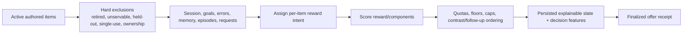

# Scheduling and Selection

The scheduler builds an explainable slate by applying hard eligibility and ownership rules before comparing action value. It does not simply sort `due_at` or mastery.

## Candidate pipeline

Hard rules prevent an attractive score from serving an invalid surface.

## Eligibility examples

- learner-retired or state-inactive items are excluded;
- held-out exam pool items are quarantined from routine practice;
- a diagnostic-probe surface is single-use and reserved for explicit diagnostic flows;
- a pending easier/harder variant can hold its source item;
- unrenderable instruments are not schedulable;
- staged-controller-owned commitments are excluded from the legacy controller;
- source-revealed cold follow-ups are deferred;
- ephemeral diagnostic dialogue turns never enter ordinary practice.

## Reward components

The legacy priority reads four weighted components: forgetting risk, recent error, goal-frontier value, and probe information gain. Richer selection reward code incorporates intent, predicted recall, quality, uncertainty, and configuration while keeping non-priority telemetry separate. Familiarity discounts repeated goal/probe evidence rather than pretending it is independent.

## Intent-first session planning is shadow-only

The **live** reward path classifies each eligible item as `probe`, `practice`, `repair`, `review`, or `transfer`, then scores it and applies requested-item floors, goal quotas, short-session behavior, teach-back caps, contrast/follow-up ordering, same-day rotation, exploration, and any staged-controller ownership rules. That per-item classification is not a choose-one-session-intent-first policy.

`intent_planner.py` separately groups the already composed queue into `diagnose_uncertainty`, `repair_misconception`, `restore_retrievability`, `build_missing_knowledge`, `develop_transfer`, or `practice_integration`. It records the hypothetical first intent and within-intent rankings in scheduler telemetry only.

> [!warning] No live authority
> The six-way planner does not reorder or filter the live queue. Promotion requires held-out predictive gains and an explicit product/algorithm decision; changing its priority today changes shadow evaluation, not learner-facing selection.

## FSRS

FSRS maintains item/card memory and produces forgetting risk/intervals from review ratings. Ratings derive from validated rubric score and assistance caps. FSRS is one selection input; it does not own goal readiness or canonical mastery.

The forgetting curve (FSRS-6's power curve: recall after `elapsed` days at stability `S`, 0.9 when `elapsed = S`, decay from weight 20) is written once, in `scheduling/fsrs.py`. Every read of a learner's recall calls `fsrs.retrievability` (scalar: the queue's forgetting risk, the goal projection, the decision receipt, the knowledge map, re-entry, the chat context) or `fsrs.retrievability_array` (arrays: the router objective's rollouts and its combiner inputs). FSRS's own update, the weight fit and its evaluation call `fsrs.forgetting_curve`, the same curve at plain stability. `tests/test_one_retrievability.py` fails on any other copy or caller. The two read forms agree to one ulp, not bit for bit (numpy's `power` against the C library's `pow`), so a caller keeps the form it has.

## Probe EIG

During an in-progress diagnostic episode, only admitted instruments bound to the locked hypothesis set receive probe EIG. Predictive EIG is primary when the target set is adequate; normalized hypothesis EIG is fallback. The score is familiarity-discounted and logged separately from coverage value.

## The daily plan's block router

Today's plan picks its next block at each block boundary (`daily_plan.engine.decide`), separately from the scheduler's slate. The plan policy's chooser draws from the staged frame's top-k support: the objective chooser (`daily_plan/objective_chooser.py`) mixes the router LLM's policy with the numeric policy and logs the Decider and the staged rule as advice, and below its tag the R2 mixture (`daily_plan/router_chooser.py`) mixes the Decider and the LLM. The models run in background threads keyed by the decision's boundary key (`daily_plan/router_runtime.py`), from the prefetch at Today's open or after feedback. A read whose models are still out leaves the boundary open. A serve waits up to `router.timeout_seconds`, and a model still out is a timeout whose share goes to the staged rule. If the chooser raises, the lane-quota rule chooses (`fallback_reason = chooser_error`). `decide` writes nothing, but it is not pure: its chooser reads the vault, starts the model threads and waits on them.

The container logs each decision as a `plan_block` row in `router_decisions` in the block's own transaction. Since refactor B2 it also writes the decision's records there (ADR-017; `daily_plan/boundary_records.py`). A `plan_block` record is `chosen`, or `fallback` with the rule that made it. It names the support with each option's probability and why it lost, the configured waits and how long the serve waited, the boundary key and the prefetch's trace. On a crash it adds the exception's type and `module:function:line`, never its message. Each component (Decider, LLM, numeric, staged) gets a child `model_answer` record: `chosen`, `timeout`, `failed`, `refused`, `excluded` or `discarded`. `learnloop why <trace>` reads the calls of the serving trace and the prefetch's trace, and lists every call that finished after the decision as discarded. See [[Inspect Persistent State]].

## Explainability and evaluation

`ScheduledItem` carries component values, readiness, selected mode/intent, plain-English reasons, and optional reward debug. `explain_practice_item` exposes why an item did or did not rank.

A saved queue build persists a [[scheduler_slates|slate]] (`selection_policy` `composed_offer_v2`) with one [[scheduler_slate_candidates|candidate]] row per considered item, plus a selection [[decision_features]] row for each candidate whose learning object resolves. The adapter then records the ordered list it actually showed in [[scheduler_offer_receipts]] (`finalize_scheduler_offer`), and an attempt links to the candidate it answered through [[submission_intents]]. See [[Collection and Dataset Contract]].

> [!warning] Composed offers carry no selection propensity
> The queue is composed after the exploration draw (floors, quotas, ordering, adapter filtering) and the learner then chooses from it, so no candidate probability of the served action exists. Every candidate of a composed slate stores `selection_propensity = NULL` with `propensity_kind = unavailable_composed_offer`; the pre-composition draw is kept as `components.base_selection_propensity` and is not an importance weight. `learnloop eval` counts such chosen candidates under `unavailable_propensities` and judges off-policy readiness only on `recorded_chosen_candidates`; when every chosen candidate is a composed offer it reports `UNAVAILABLE`. Slates, candidates and linked attempts still explain and replay what was offered and chosen; they do not support off-policy estimates of alternative policies.

## Modification guidance

- Add a hard safety/servability rule before reward computation.
- Add a reward term with explicit scale, configuration, explanation, and evaluation metric.
- Do not mix display-only telemetry into `_priority` accidentally.
- Update scheduler golden tests and seeded exploration tests; a policy that records a real propensity must also record a `propensity_kind` other than `unavailable_composed_offer`.
- Evaluate default changes with simulation and shadow rebuild before versioning.

## Tests

- `tests/test_scheduler.py`
- `tests/test_scheduler_golden.py`
- `tests/test_scheduler_probe_eig.py`
- constraint, controller, requested-floor, short-session and exam-quarantine suites
