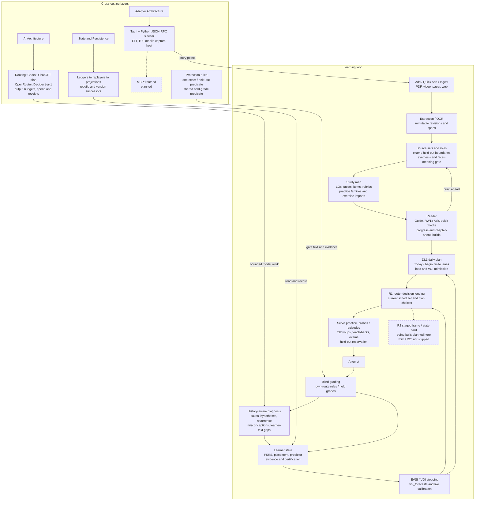
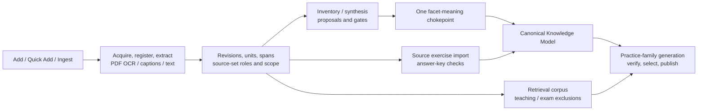
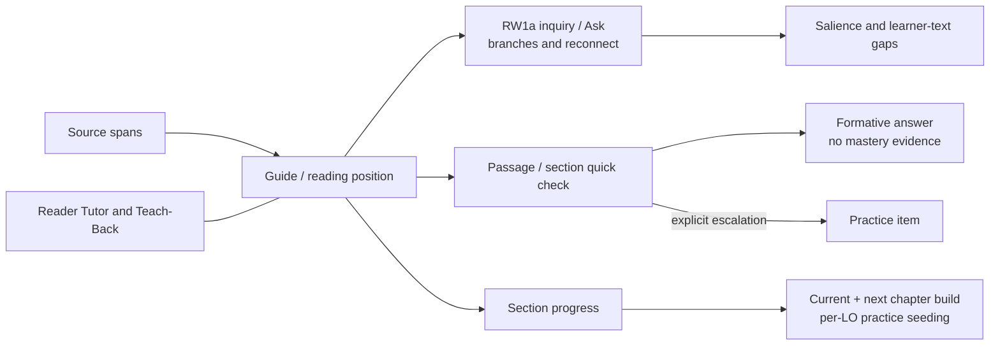
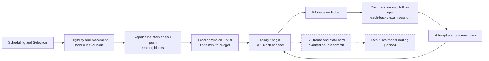
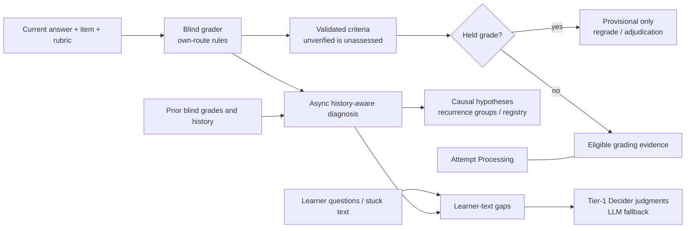
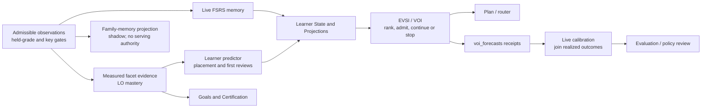
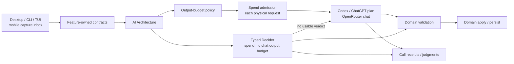
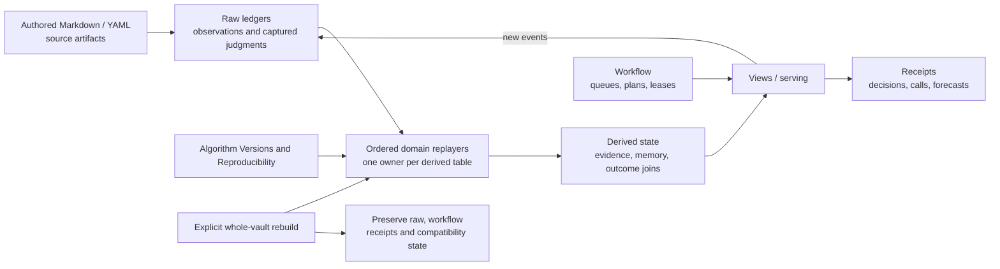

# LearnLoop Pipeline Map

## How to read this

Start with the loop, then open the stage you need. Arrows show data or control flow, not a requirement to visit every surface in order. Side layers apply across stages. Dashed arrows and dashed boxes identify planned work; labeled solid side connections identify shipped support layers. LO means learning object; VOI means value of information; EVSI is expected value of sample information.

Note-name nodes are clickable through `class NodeId internal-link;`, with the node text exactly matching the note name, as documented in [Obsidian's diagram-link convention](https://obsidian.md/help/advanced-syntax#Linking%20files%20in%20a%20diagram). Prose WikiLinks provide navigation and backlinks too. Existing notes remain the conceptual authorities; their recorded review dates may precede this map. In particular, older Reader defaults, scheduler propensity descriptions, and table counts should not be read as a new audit of this commit.

**Version authority:** `src/learnloop/algorithm_versions.py` ([source](../../../src/learnloop/algorithm_versions.py)) sets `LATEST_ALGORITHM_VERSION` to `mvp-0.22` through the successor chain: sources at `mvp-0.18`/`mvp-0.19`, own-route grading rules at `mvp-0.20`, VOI stopping at `mvp-0.21`, Decider tier-1 at `mvp-0.22`. Reviews sometimes retain branch placeholders; use their landing sections and this code. Individual vault upgrades and feature switches still gate serving.

## End-to-end loop

Grading measures the current answer; diagnosis interprets it across time. State updates do not wait for every diagnosis, and Reader text can enter the gap pipeline without becoming an attempt. The Decider handles bounded judgments, not blind grading or the whole learning policy. See [[Learning System]], [[Architecture Map]] and [[Data and State Map]].

## Ingest and content

- The durable acquisition/build ladder is [[Content Pipeline#Durable checkpoint ladder]]; identity and roles are [[Source Authority and Provenance#Authority chain]]. Entry modules are `src/learnloop/content/pipeline/add_source.py` ([source](../../../src/learnloop/content/pipeline/add_source.py)), `src/learnloop/content/pipeline/quick_add.py` ([source](../../../src/learnloop/content/pipeline/quick_add.py)) and `src/learnloop/content/pipeline/source_ingestion.py` ([source](../../../src/learnloop/content/pipeline/source_ingestion.py)). Add can expose the original PDF while background work builds questions; Quick Add retains its own plan/confirm/enqueue path.
- Extraction produces addressable blocks and spans. `src/learnloop/content/sources/pdf_extraction.py` ([source](../../../src/learnloop/content/sources/pdf_extraction.py)) distinguishes OCR-capable paths from plain pypdf extraction; `src/learnloop/content/pipeline/runner.py` ([source](../../../src/learnloop/content/pipeline/runner.py)) owns durable execution. Key tables: [[source_revisions]], [[source_document_units]], [[source_document_blocks]], [[ingest_jobs]].
- `src/learnloop/content/synthesis/source_set_synthesis.py` ([source](../../../src/learnloop/content/synthesis/source_set_synthesis.py)) builds proposals for LOs, facets, practice items and rubrics. [[Canonical Knowledge Model]] and [[Build a Study Map]] explain the authored model and application workflow.
- Every facet meaning mutation passes `src/learnloop/content/facet_identity/authority.py` ([source](../../../src/learnloop/content/facet_identity/authority.py)): `check_meaning_write`, proposal application and the guarded registry writer share authority. `src/learnloop/content/sources/role_authority.py` ([source](../../../src/learnloop/content/sources/role_authority.py)) permits exam material to align assessment, never independently establish facet meaning. Model rewords can be held for owner confirmation; the Decider span-support check fails closed to that confirmation path. See the [facet authority review](../../reviews/facet-authority-fixes.md) and [reword review](../../reviews/facet-reword-confirm.md).
- Practice families use `src/learnloop/ops/pf_generation.py` ([source](../../../src/learnloop/ops/pf_generation.py)) to generate, verify, filter, select and publish stored instances. Exercise imports use `src/learnloop/content/authoring/source_exercise_import.py` ([source](../../../src/learnloop/content/authoring/source_exercise_import.py)), with checks bound to the current prompt/key/rubric in [[reference_key_checks]]. An unverified imported answer key can support practice but gives no certification credit at `mvp-0.18+`; `mvp-0.19+` adds source-first fulfillment of eligible follow-up needs. See the [sources track](../../reviews/sources-spec.md).
- **Exam protection is one predicate.** `src/learnloop/content/sources/exam_material.py` ([source](../../../src/learnloop/content/sources/exam_material.py)) answers whether a span, unit, extraction or item is exam or held-out material: exam members and units count in any revision of their source, `held_out_evaluation` units count whatever their role, and unresolvable units fail closed. The corpus exclusions in `src/learnloop/source_retrieval/corpus.py` ([source](../../../src/learnloop/source_retrieval/corpus.py)), facet citation resolution (which keeps its separate rule that an explanatory citation can support a facet beside an exam one), the leakage inventory, practice-family generation, imports, automatic builds, the reading step and the Reader's Ask and checks all route through it. Material the learner has seen never becomes an exam item or a cold check. See the [exam-protection review](../../reviews/exam-protection.md).

## Reader

- [[Reader Tutor and Teach-Back]] and [[Reader to Practice Workflow]] explain instruction versus assessment. `src/learnloop/reader/reader_guidance.py` ([source](../../../src/learnloop/reader/reader_guidance.py)) assembles source-grounded guidance; `src/learnloop/reader/reader_inquiry.py` ([source](../../../src/learnloop/reader/reader_inquiry.py)) owns RW1a status/reconnect over [[question_events]] and [[interaction_events]]. See the [RW1a landing review](../../reviews/rw1a-inquiry.md) for the newer inquiry UX.
- `src/learnloop/reader/reader_quick_check.py` ([source](../../../src/learnloop/reader/reader_quick_check.py)) produces passage/section-grounded questions in [[reader_authored_questions]]. Their answers are formative, not attempts or mastery updates; explicit collection/escalation can create a practice item. Owner-reviewed placements take precedence over automatically authored section checks.
- [[reader_section_progress]] records progress. `src/learnloop/reader/reader_progression.py` ([source](../../../src/learnloop/reader/reader_progression.py)) seeds practice for reached LOs under an `as_you_read` build; `src/learnloop/content/pipeline/add_source.py` ([source](../../../src/learnloop/content/pipeline/add_source.py)) separately keeps the current and next chapter built, subject to route, consent, cost and build gates. See [UX Phase 1](../../reviews/ux-phase1.md) and its [completion review](../../reviews/ux-phase1-finish.md).
- Reading and Ask can affect salience, familiarity and gap handling without granting ability evidence. Practice, diagnostic checks and a completed teach-back cross into the shared attempt pipeline; [[Tutor and Teach-Back Workflow]] describes that boundary.

## Daily plan, router and serving

- `src/learnloop/daily_plan/engine.py` ([source](../../../src/learnloop/daily_plan/engine.py)) implements DL1 (`daily_plan_v1`, `mvp-0.14+` with `plan.enabled`): finite remembered minutes, feasible blocks, re-entry and learner picks. `src/learnloop/daily_plan/lanes.py` ([source](../../../src/learnloop/daily_plan/lanes.py)) assigns repair, maintain, new and push; `src/learnloop/daily_plan/admission.py` ([source](../../../src/learnloop/daily_plan/admission.py)) controls new-material review load. See the [DL1 review](../../reviews/daily-loop-dl1.md).
- VOI admission is distinct from new-material load admission: `src/learnloop/diagnosis/voi_stopping.py` ([source](../../../src/learnloop/diagnosis/voi_stopping.py)) values due project probes for the plan and teach-backs for offers, alongside probe continuation and follow-ups. The finite plan still owns available minutes. Key workflow tables: [[daily_plans]], [[attention_blocks]]; block receipts: [[attention_block_events]].
- `src/learnloop/router/decisions.py` ([source](../../../src/learnloop/router/decisions.py)) and `src/learnloop/router/plan_log.py` ([source](../../../src/learnloop/router/plan_log.py)) record R1 choices, candidates, selection design and available propensities in [[router_decisions]]; [[router_outcomes]] is a derived join. R1 can record an exact focused-head probability under seeded exploration; it does not make every learner pick or full composed slate a randomized action. See [R1 review](../../reviews/router-r1.md) and [[Collection and Dataset Contract]].
- **R2 is planned here.** The [action-router spec](../../specs/spec_action_router_v1.md) and [R2 handoff](../../specs/implementation_handoffs.md#router-r2-the-decider-router-live-for-the-daily-plan) describe the learner-state card, staged daily-plan frame and model choice. This commit's router package contains logging/outcome modules, not that live chooser. R2b/R2c are future work labels; their detailed split is not established by the checked-in handoff. R1's staged P2 logging bridge also lacks the desktop production caller described in the review.
- [[Scheduling and Selection]] owns eligibility and ranking; [[Diagnosis and Remediation]] owns probes/episodes and follow-ups. Serving authorities include `src/learnloop/diagnosis/probe_episodes.py` ([source](../../../src/learnloop/diagnosis/probe_episodes.py)), `src/learnloop/diagnosis/followups.py` ([source](../../../src/learnloop/diagnosis/followups.py)) and `src/learnloop/tutor/teach_back.py` ([source](../../../src/learnloop/tutor/teach_back.py)). Teach-back grades only asked-and-answered criteria.
- Exams reserve held-out surfaces through `src/learnloop/goals/exam_pool.py` ([source](../../../src/learnloop/goals/exam_pool.py)) and `src/learnloop/goals/exam_session.py` ([source](../../../src/learnloop/goals/exam_session.py)); they do not make reserved items ordinary practice. See [[Goals and Certification]] and [[Goals Exams and Certification Workflow]].

## Grading and diagnosis

- [[Attempt Processing]] describes validation and application. `src/learnloop/attempts/blind_grading.py` ([source](../../../src/learnloop/attempts/blind_grading.py)) structurally excludes learner history from grading context; diagnosis gets history afterward. Raw tables include [[practice_attempts]], [[blind_grade_records]] and [[grading_evidence]].
- `src/learnloop/attempts/grading_support.py` ([source](../../../src/learnloop/attempts/grading_support.py)) applies `mvp-0.20+` own-route rules inside one grading call: a divergent-route mark-down without a failing quote actually present in the answer becomes unverified/unassessed. The former separate route-check model call is removed from serving. `proof_check.enabled` gates new own-route grading; stored historical checks retain their meaning. See the [route-rules landing review](../../reviews/route-check-in-grader.md).
- `src/learnloop/held_grades.py` ([source](../../../src/learnloop/held_grades.py)) evaluates the shared predicate defined in `src/learnloop/outcome_contract.py` ([source](../../../src/learnloop/outcome_contract.py)): the latest blind record holds the grade **and** no current criterion is assessed. Held grades supply no evidence, FSRS review, success/failure or outcome label. Regrading or assessed owner adjudication can release them. See the [held-grade review](../../reviews/held-grade-evidence.md).
- `src/learnloop/diagnosis/split/diagnoser.py` ([source](../../../src/learnloop/diagnosis/split/diagnoser.py)) assembles and validates a history-aware diagnosis; `src/learnloop/diagnosis/split/live.py` ([source](../../../src/learnloop/diagnosis/split/live.py)) handles the live path. [[attempt_diagnoses]] and [[causal_hypotheses]] retain interpretations; `src/learnloop/diagnosis/recurrence/live.py` ([source](../../../src/learnloop/diagnosis/recurrence/live.py)) and `src/learnloop/diagnosis/misconceptions.py` ([source](../../../src/learnloop/diagnosis/misconceptions.py)) connect recurrence groups and registry beliefs. See [[Diagnosis and Remediation]].
- `src/learnloop/diagnosis/text_gaps/pipeline.py` ([source](../../../src/learnloop/diagnosis/text_gaps/pipeline.py)) reads questions, stuck answers and diagnoses into [[learner_text_gaps]], with actions/undo and earlier-check receipts; a named gap is not itself mastery evidence. See the [learner-text-gap review](../../reviews/learner-text-gaps.md).
- `src/learnloop/decider_judgments.py` ([source](../../../src/learnloop/decider_judgments.py)) moves selected small judgments to tier-1 at `mvp-0.22+`, under individual `decider_routes` switches. A unique top probability decides; unavailable, spend-refused, failed or tied results fall back to the caller's LLM judgment. Cancellation propagates. [[judgment_ledger]] records distributions and fallback verdicts; the diagnoser and blind grader remain separate model tasks. See the [Decider landing review](../../reviews/decider-migration.md).

## Learner state and value of information

- [[Learner State and Projections]] separates prediction, memory and evidence. `src/learnloop/scheduling/fsrs.py` ([source](../../../src/learnloop/scheduling/fsrs.py)) computes memory updates; `src/learnloop/substrate/family_memory.py` ([source](../../../src/learnloop/substrate/family_memory.py)) replays **shadow** family memory, never read by the live scheduler. [[family_memory_state]], [[learning_object_mastery]] and [[facet_capability_evidence]] are derived, with distinct meanings.
- `src/learnloop/placement/predictor.py` ([source](../../../src/learnloop/placement/predictor.py)) exposes the active `LearnerPredictor`: incumbent `mastery_ekf`, reading persisted per-LO mastery, with no cross-LO sharing. `src/learnloop/placement/state.py` ([source](../../../src/learnloop/placement/state.py)) applies placement/first-review rules and diagnosis-informed returns. Assumptions and predictions never certify knowledge; see [[Evidence and Measurement]] and the [placement review](../../reviews/placement-owner-decisions.md).
- `src/learnloop/substrate/canonical_projection.py` ([source](../../../src/learnloop/substrate/canonical_projection.py)) projects qualified observations into facet/capability evidence. [[Goals and Certification]] reads that evidence under coldness, independence and source-key rules, rather than interpreting every high prediction as achievement.
- `src/learnloop/scheduling/evsi.py` ([source](../../../src/learnloop/scheduling/evsi.py)) values diagnostic information in expected learner-minutes saved. Ranking by value per minute differs from stopping when value cannot pay for cost; robustness can require abstention. See [[Diagnosis and Remediation]] and the [decision-value spec](../../specs/decision_value_and_commissioning_spec_v1.md).
- `src/learnloop/diagnosis/voi_stopping.py` ([source](../../../src/learnloop/diagnosis/voi_stopping.py)) replaces four count-cap decisions at `mvp-0.21+`: probe continuation, follow-up intervention, teach-back admission and due project-probe admission. `voi_stopping.enabled` and site switches retain fallback paths. Its second part makes the probe lane read the diagnosis overlay and omit pending diagnoses when enabled. See the [VOI stopping review](../../reviews/voi-stopping.md).
- `src/learnloop/scheduling/voi_forecasts.py` ([source](../../../src/learnloop/scheduling/voi_forecasts.py)) and `src/learnloop/diagnosis/voi_forecasting.py` ([source](../../../src/learnloop/diagnosis/voi_forecasting.py)) write [[voi_forecasts]] beside live decisions. `src/learnloop/evsi_calibration/live_report.py` ([source](../../../src/learnloop/evsi_calibration/live_report.py)) joins realized outcomes for calibration, preserving missing/pending cases. This is measurement and review, not an automatic feedback loop that silently retunes policy. See the [calibration review](../../reviews/evsi-calibration.md) and [[Parameter Governance and Evaluation]].

## AI layer and adapters

- [[AI Architecture#Resolution path]] and [[AI Architecture#Output trust boundary]] explain routing and validation. `src/learnloop/ai/routing.py` ([source](../../../src/learnloop/ai/routing.py)) resolves task/profile clients; feature contracts determine what a provider may see and what returned output means.
- Provider implementations are `src/learnloop/ai/providers/codex.py` ([source](../../../src/learnloop/ai/providers/codex.py)), `src/learnloop/ai/providers/chatgpt_plan.py` ([source](../../../src/learnloop/ai/providers/chatgpt_plan.py)), `src/learnloop/ai/providers/openrouter.py` ([source](../../../src/learnloop/ai/providers/openrouter.py)) and `src/learnloop/ai/providers/decider.py` ([source](../../../src/learnloop/ai/providers/decider.py)). Decider typed choice requests are distinct from chat generation; tier-1 fallback does not imply that R2 model routing is already live. See the [ChatGPT plan review](../../reviews/chatgpt-plan-provider.md).
- `src/learnloop/ai/output_budget.py` ([source](../../../src/learnloop/ai/output_budget.py)) supplies the shared LLM output policy, route overrides, profile ceilings and bounded truncation retry. Typed Decider answers and owner-set synthesis budgets are explicit exceptions. `src/learnloop/ai/spend.py` ([source](../../../src/learnloop/ai/spend.py)) admits each physical paid request, including retries; metered routes enforce finite cost bounds while subscription routes retain call/retry controls with estimated usage. See [source spend accounting](../../reviews/sources-spend-accounting.md).
- [[model_call_receipts]] records calls; [[judgment_ledger]] is a **raw ledger**, despite its audit-like name. Typed verdicts and model outputs are captured inputs for later interpretation, never a license to bypass domain validation or rebuild them by asking a model again.
- [[Desktop Architecture]] and [[Adapter Architecture]] cover Tauri/React → JSON-RPC → Python domain adapters: `apps/learnloop-tauri/src/api/client.ts` ([source](../../../apps/learnloop-tauri/src/api/client.ts)), `src/learnloop_sidecar/server.py` ([source](../../../src/learnloop_sidecar/server.py)), `src/learnloop/cli/app.py` ([source](../../../src/learnloop/cli/app.py)) and `src/learnloop/tui/app.py` ([source](../../../src/learnloop/tui/app.py)). The desktop Today entry is `apps/learnloop-tauri/src/screens/TodayScreen.tsx` ([source](../../../apps/learnloop-tauri/src/screens/TodayScreen.tsx)).
- `src/learnloop_mobile/host.py` ([source](../../../src/learnloop_mobile/host.py)) is the shipped M1 capture-only host; it does not host desktop runtime or unrestricted practice RPC. See the [mobile landing review](../../reviews/mobile-m1.md). The MCP frontend/learning service remains deferred in the [Reader workbench spec](../../specs/spec_reader_workbench_v1.md); it is not another shipped adapter.

## Persistence and replay

- [[State and Persistence]] and [[Data and State Map]] distinguish durable authority from computed views. `src/learnloop/db/table_roles.py` ([source](../../../src/learnloop/db/table_roles.py)) is the current lifecycle registry; older catalog counts are snapshots, not this map's counts.
- `src/learnloop/substrate/rebuild_orchestrator.py` ([source](../../../src/learnloop/substrate/rebuild_orchestrator.py)) validates exclusive derived-table ownership before rebuilding in dependency order. Its “R2 umbrella” comment refers to the rebuild refactor, not action-router R2. [[Rebuild and Shadow Compare]] explains the maintenance workflow.
- Replayers reconstruct evidence, recurrence, memory, search indexes and outcome joins from recorded inputs. Paid generation, verification and diagnosis are not rerun. [[router_decisions]] is raw; [[router_outcomes]] is derived; [[voi_forecasts]] is a receipt. Key audit table: [[derived_state_rebuilds]].
- `src/learnloop/algorithm_versions.py` ([source](../../../src/learnloop/algorithm_versions.py)) makes successor gates cumulative through `mvp-0.22`, while those successors retain the `mvp-0.8` projection namespace. Per-record meaning still matters: replay reads historical grade/diagnosis facts rather than applying today's serving switches retroactively. See [[Algorithm Versions and Reproducibility]].

### Where state lives

The [role registry](../../../src/learnloop/db/table_roles.py), `src/learnloop/db/table_roles.py`, controls rebuild treatment. [[Database Catalog#Role indexes]] links to table notes; names alone do not determine lifecycle.

| Kind | What it holds | Example tables | Rebuild treatment |
|---|---|---|---|
| Raw ledgers | Captured answers, grades, diagnoses and decisions | [[practice_attempts]], [[grading_evidence]] | Preserve; replay consumes recorded facts |
| Derived | Reconstructible learner projections | [[learning_object_mastery]], [[facet_capability_evidence]] | Clear/reconstruct under a registered owner |
| Workflow | Mutable plans, jobs and lease lifecycle | [[daily_plans]], [[ingest_jobs]] | Preserve; do not synthesize from evidence |
| Receipts | Calls, forecasts and audit outputs | [[model_call_receipts]], [[voi_forecasts]] | Preserve; do not regenerate in place |

Authored Markdown/YAML and immutable source files live alongside `state.sqlite`; they are not interchangeable with projections. Compatibility tables are a separate preserved role, including [[practice_item_state]]; do not infer that every memory-looking table is rebuild-owned. See [[Vault Lifecycle]].

## Gaps in this vault

These links supply the recent details that the older concept notes do not yet cover; this map does not duplicate their specifications.

- **Decider tier-1 and facet span support:** [landing review](../../reviews/decider-migration.md).
- **VOI stopping and live calibration:** [stopping](../../reviews/voi-stopping.md), [calibration](../../reviews/evsi-calibration.md).
- **Own-route grading and held evidence:** [route rules](../../reviews/route-check-in-grader.md), [held-grade predicate](../../reviews/held-grade-evidence.md).
- **Sources track and exam protection:** [sources](../../reviews/sources-spec.md), [source practice/probe spec](../../specs/spec_source_practice_and_probes_v1.md), [exam protection](../../reviews/exam-protection.md) (one predicate, landed after this map was first written).
- **UX Phase 1 and RW1a:** [UX completion](../../reviews/ux-phase1-finish.md), [inquiry](../../reviews/rw1a-inquiry.md).
- **DL1 and R1/R2:** [daily loop](../../reviews/daily-loop-dl1.md), [R1](../../reviews/router-r1.md), [R2 spec](../../specs/spec_action_router_v1.md). R2's live frame/card and later R2b/R2c are not verified as shipped; the checked-in plan does not define that finer phase split.
- **Learner-text gaps and mobile/MCP:** [gaps](../../reviews/learner-text-gaps.md), [mobile M1](../../reviews/mobile-m1.md), [deferred Reader learning service](../../specs/spec_reader_workbench_v1.md).
