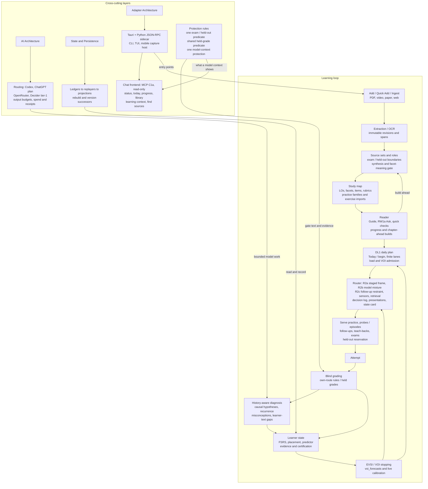
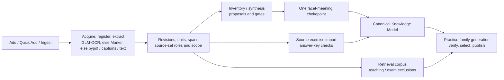
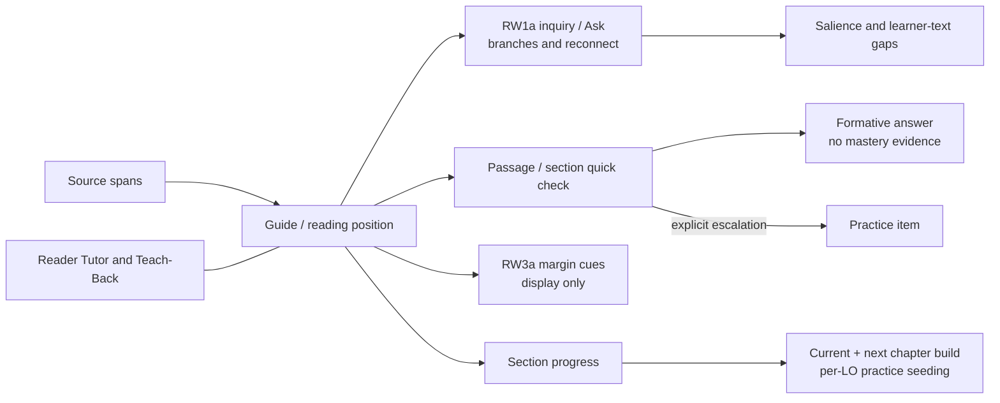
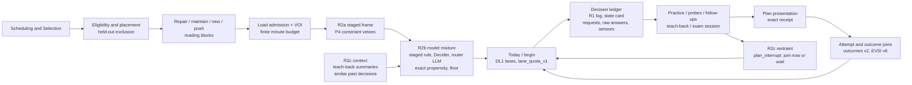
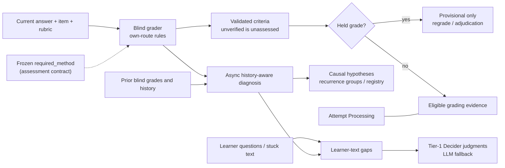
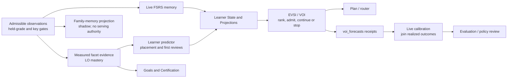
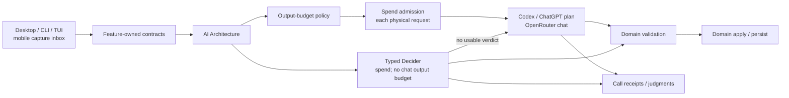
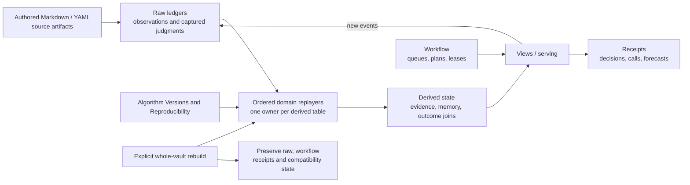

# LearnLoop Pipeline Map

## How to read this

Start with the loop, then open the stage you need. Arrows show data or control flow, not a requirement to visit every surface in order. Side layers apply across stages. Dashed arrows and dashed boxes identify planned work; labeled solid side connections identify shipped support layers. LO means learning object; VOI means value of information; EVSI is expected value of sample information.

Note-name nodes are clickable through `class NodeId internal-link;`, with the node text exactly matching the note name, as documented in [Obsidian's diagram-link convention](https://obsidian.md/help/advanced-syntax#Linking%20files%20in%20a%20diagram). Prose WikiLinks provide navigation and backlinks too. Existing notes remain the conceptual authorities; their recorded review dates may precede this map. In particular, older Reader defaults, scheduler propensity descriptions, and table counts should not be read as a new audit of this commit.

**Version authority:** `src/learnloop/algorithm_versions.py` ([source](../../../src/learnloop/algorithm_versions.py)) sets `LATEST_ALGORITHM_VERSION` to `mvp-0.25` through the successor chain: sources at `mvp-0.18`/`mvp-0.19`, own-route grading rules at `mvp-0.20`, VOI stopping at `mvp-0.21`, Decider tier-1 at `mvp-0.22`, router R2a's staged frame on Today at `mvp-0.23`, router R2b + R2c's model mixture and restraint at `mvp-0.24`, method-explicit items' required-method grading (`own-route-v2`) at `mvp-0.25`. Reviews sometimes retain branch placeholders; use their landing sections and this code. Individual vault upgrades and feature switches still gate serving.

## End-to-end loop

Grading measures the current answer; diagnosis interprets it across time. State updates do not wait for every diagnosis, and Reader text can enter the gap pipeline without becoming an attempt. The Decider handles bounded judgments, not blind grading or the whole learning policy. See [[Learning System]], [[Architecture Map]] and [[Data and State Map]].

## Ingest and content

- The durable acquisition/build ladder is [[Content Pipeline#Durable checkpoint ladder]]; identity and roles are [[Source Authority and Provenance#Authority chain]]. Entry modules are `src/learnloop/content/pipeline/add_source.py` ([source](../../../src/learnloop/content/pipeline/add_source.py)), `src/learnloop/content/pipeline/quick_add.py` ([source](../../../src/learnloop/content/pipeline/quick_add.py)) and `src/learnloop/content/pipeline/source_ingestion.py` ([source](../../../src/learnloop/content/pipeline/source_ingestion.py)). Add can expose the original PDF while background work builds questions; Quick Add retains its own plan/confirm/enqueue path.
- Extraction produces addressable blocks and spans. **GLM-OCR is the primary document reader** for PDFs, PNGs and JPGs: `src/learnloop/ingest/extractors/glm_ocr.py` ([source](../../../src/learnloop/ingest/extractors/glm_ocr.py)) runs its complete layout-and-recognition pipeline through z.ai's hosted `layout_parsing` (after the one-time whole-file OK naming z.ai, with a `model_call` receipt per request) or a self-hosted glmocr server (`[ingest.pdf.glm_ocr]`). Under `engine = "auto"`, `pdf_extractor_for` in `src/learnloop/ingest/extractors/__init__.py` ([source](../../../src/learnloop/ingest/extractors/__init__.py)) falls back to local Marker, then pypdf, recording why in extraction health; a GLM-OCR failure at run time falls back the same way, and only GLM-OCR reads an image. An import that cannot ask the OK reads a PDF locally until it is given, and a repair the learner OK'd as local never leaves the computer. `src/learnloop/content/sources/pdf_extraction.py` ([source](../../../src/learnloop/content/sources/pdf_extraction.py)) is the legacy one-shot path; `src/learnloop/content/pipeline/runner.py` ([source](../../../src/learnloop/content/pipeline/runner.py)) owns durable execution. Key tables: [[source_revisions]], [[source_document_units]], [[source_document_blocks]], [[ingest_jobs]]. See the [GLM-OCR review](../../reviews/glm-ocr-ingest.md). Local Marker reads in a worker process started for each reading, which ends with it (`src/learnloop/ingest/extractors/marker_worker.py` ([source](../../../src/learnloop/ingest/extractors/marker_worker.py))): pdfium is not thread-safe, so the Reader's page renders in `src/learnloop/reader/span_view.py` ([source](../../../src/learnloop/reader/span_view.py)), one at a time under a lock, are the only pdfium use in the sidecar's process. A Marker worker that crashes or runs out of time falls back to pypdf under `auto`, flagged `marker_worker_crashed` or `marker_worker_timed_out`; see the [pdfium worker review](../../reviews/marker-pdfium-worker.md).
- **GLM-OCR's normaliser repairs what the service returns and recovers what it drops** (`MAP_VERSION` 2; `model_versions` records `text_layer`, so caches re-map the saved answers without paying again): `responses_to_ir` in `src/learnloop/ingest/extractors/glm_ocr.py` ([source](../../../src/learnloop/ingest/extractors/glm_ocr.py)) unwraps HTML wrappers, takes heading depth from the PDF's bookmarks or numbering, joins split numbers only with evidence, escapes currency dollars and types an `algorithm` region Code only when it holds code; `src/learnloop/ingest/extractors/glm_text_layer.py` ([source](../../../src/learnloop/ingest/extractors/glm_text_layer.py)) reads the PDF's own text layer in a pdfium worker process (never in the sidecar's, where the Reader renders) to recover footnotes and equation numbers (`\tag{n}`), with health flags for each recovery and for a scan with no text layer. See the [quality review](../../reviews/glm-ocr-quality.md).
- `src/learnloop/content/synthesis/source_set_synthesis.py` ([source](../../../src/learnloop/content/synthesis/source_set_synthesis.py)) builds proposals for LOs, facets, practice items and rubrics. [[Canonical Knowledge Model]] and [[Build a Study Map]] explain the authored model and application workflow.
- Every facet meaning mutation passes `src/learnloop/content/facet_identity/authority.py` ([source](../../../src/learnloop/content/facet_identity/authority.py)): `check_meaning_write`, proposal application and the guarded registry writer share authority. `src/learnloop/content/sources/role_authority.py` ([source](../../../src/learnloop/content/sources/role_authority.py)) permits exam material to align assessment, never independently establish facet meaning. Model rewords can be held for owner confirmation; the Decider span-support check fails closed to that confirmation path. See the [facet authority review](../../reviews/facet-authority-fixes.md) and [reword review](../../reviews/facet-reword-confirm.md).
- Practice families use `src/learnloop/ops/pf_generation.py` ([source](../../../src/learnloop/ops/pf_generation.py)) to generate, verify, filter, select and publish stored instances. Exercise imports use `src/learnloop/content/authoring/source_exercise_import.py` ([source](../../../src/learnloop/content/authoring/source_exercise_import.py)), with checks bound to the current prompt/key/rubric in [[reference_key_checks]]. An unverified imported answer key can support practice but gives no certification credit at `mvp-0.18+`; `mvp-0.19+` adds source-first fulfillment of eligible follow-up needs. See the [sources track](../../reviews/sources-spec.md).
- **Exam protection is one predicate.** `src/learnloop/content/sources/exam_material.py` ([source](../../../src/learnloop/content/sources/exam_material.py)) answers whether a span, unit, extraction or item is exam or held-out material: exam members and units count in any revision of their source, `held_out_evaluation` units count whatever their role, and unresolvable units fail closed. The corpus exclusions in `src/learnloop/source_retrieval/corpus.py` ([source](../../../src/learnloop/source_retrieval/corpus.py)), facet citation resolution (which keeps its separate rule that an explanatory citation can support a facet beside an exam one), the leakage inventory, practice-family generation, imports, automatic builds, the reading step and the Reader's Ask and checks all route through it. Material the learner has seen never becomes an exam item or a cold check. Every protection mark names the reading it was made on (a source-set scope's `scope_extraction_id`, a unit selection's `marks_made_on`, the `source_held_out_signal_marks` ledger for inventory signals), and a reading of a protected book that is not marked exactly is held back whole until the owner marks it from the book's card. See the [exam-protection review](../../reviews/exam-protection.md) and [exam protection by extraction identity](../../reviews/exam-protection-identity.md).

## Reader

- [[Reader Tutor and Teach-Back]] and [[Reader to Practice Workflow]] explain instruction versus assessment. `src/learnloop/reader/reader_guidance.py` ([source](../../../src/learnloop/reader/reader_guidance.py)) assembles source-grounded guidance; `src/learnloop/reader/reader_inquiry.py` ([source](../../../src/learnloop/reader/reader_inquiry.py)) owns RW1a status/reconnect over [[question_events]] and [[interaction_events]]. See the [RW1a landing review](../../reviews/rw1a-inquiry.md) for the newer inquiry UX.
- `src/learnloop/reader/reader_quick_check.py` ([source](../../../src/learnloop/reader/reader_quick_check.py)) produces passage/section-grounded questions in [[reader_authored_questions]]. Their answers are formative, not attempts or mastery updates; explicit collection/escalation can create a practice item. Owner-reviewed placements take precedence over automatically authored section checks. Every Reader offer path (guide cards, rail badge, section breaks, RW1a's reconnect line) asks one check-offer rule, `apps/learnloop-tauri/src/screens/reader/checkOffer.ts` ([source](../../../apps/learnloop-tauri/src/screens/reader/checkOffer.ts)): a resume, jump or video seek offers nothing until the learner reads in this visit, and a held-out section's check is refused before anything is sent.
- [[reader_section_progress]] records progress. `src/learnloop/reader/reader_progression.py` ([source](../../../src/learnloop/reader/reader_progression.py)) seeds practice for reached LOs under an `as_you_read` build; `src/learnloop/content/pipeline/add_source.py` ([source](../../../src/learnloop/content/pipeline/add_source.py)) separately keeps the current and next chapter built, subject to route, consent, cost and build gates. Its one-per-book reading request is level-triggered: a 30 s sweep with backoff acts on every due request, and enqueue, cancel and settle commit together at the revision read. The per-book AI opt-out (`keep_local`) is retired and never consulted. See [UX Phase 1](../../reviews/ux-phase1.md), its [completion review](../../reviews/ux-phase1-finish.md) and the [reading-hardening review](../../reviews/reading-hardening.md).
- The Reader screen's orchestration lives in hooks under `apps/learnloop-tauri/src/screens/reader/` (`useReaderVisit`, `useReadingProgress`, `useReaderInquiry`, `useReaderCues`, with the YouTube watch panel its own module); only `useReadingProgress` and `useReaderInquiry` call `checkOffer.ts`. RW3a margin cues, `src/learnloop/reader/reader_cues.py` ([source](../../../src/learnloop/reader/reader_cues.py)), mark the Guide's own `recent_misunderstanding` passages with fixed-template notes (open, check me, not relevant, fewer, off) within a per-section density budget and one per screenful, never on held-out or exam material; they are display only (salience events and `passage_cue` learner-card verdicts, no evidence), configured by `[cues]`. *Check me* opens one proposed item as a learner pick through `plan_learner_pick`, and its answer binds to that pick's presentation. See the [Reader hooks and RW3a review](../../reviews/reader-hook-rw3a.md).
- What the tutor reads of its sources is `src/learnloop/tutor/context_delivery.py` ([source](../../../src/learnloop/tutor/context_delivery.py)): a Reader question gets the nearest content blocks on both sides of the passage in view (i-1, i+1, then widening), every passage arrives as its whole block under one `tutor_qa.context_token_budget` (24,000 tokens; the first passage past it is trimmed and the rest dropped, recorded on `source_context.delivery`), and "Theorem 3.2", "Example 1.4.13", "Equation (3.4)" or a bare "by 1.32" resolve deterministically to the numbered block of the same extraction, never held-out or exam material. The relevance judges read complete passages under `source_retrieval.passage_token_budget` (4,000); with embeddings on, a completed import or repair queues its source's block-vector backfill (`embedding.source_backfill_max_cost_usd`), and `learnloop doctor` reports dense coverage per source. Context only, no evidence; kill switches `tutor_qa.expanded_delivery`, `tutor_qa.resolve_references`, `source_retrieval.complete_passages`. See the [tutor delivery fixes review](../../reviews/tutor-delivery-fixes.md).
- Reading and Ask can affect salience, familiarity and gap handling without granting ability evidence. Practice, diagnostic checks and a completed teach-back cross into the shared attempt pipeline; [[Tutor and Teach-Back Workflow]] describes that boundary.

## Daily plan, router and serving

- `src/learnloop/daily_plan/engine.py` ([source](../../../src/learnloop/daily_plan/engine.py)) implements DL1 (`daily_plan_v1`, `mvp-0.14+` with `plan.enabled`): finite remembered minutes, feasible blocks, re-entry and learner picks. `src/learnloop/daily_plan/lanes.py` ([source](../../../src/learnloop/daily_plan/lanes.py)) assigns repair, maintain, new and push; `src/learnloop/daily_plan/admission.py` ([source](../../../src/learnloop/daily_plan/admission.py)) controls new-material review load. See the [DL1 review](../../reviews/daily-loop-dl1.md).
- VOI admission is distinct from new-material load admission: `src/learnloop/diagnosis/voi_stopping.py` ([source](../../../src/learnloop/diagnosis/voi_stopping.py)) values due project probes for the plan and teach-backs for offers, alongside probe continuation and follow-ups. The finite plan still owns available minutes. Key workflow tables: [[daily_plans]], [[attention_blocks]]; block receipts: [[attention_block_events]].
- `src/learnloop/router/decisions.py` ([source](../../../src/learnloop/router/decisions.py)) and `src/learnloop/router/plan_log.py` ([source](../../../src/learnloop/router/plan_log.py)) record R1 choices, candidates, selection design and available propensities in [[router_decisions]]; [[router_outcomes]] is a derived join. R1 can record an exact focused-head probability under seeded exploration; it does not make every learner pick or full composed slate a randomized action. See [R1 review](../../reviews/router-r1.md) and [[Collection and Dataset Contract]].
- **R2a is live from `mvp-0.23`** (kill switch `router.enabled`; R2a itself calls no model). At every plan boundary `src/learnloop/daily_plan/staged_frame.py` ([source](../../../src/learnloop/daily_plan/staged_frame.py)) runs the P4 constraint engine over the pool VOI already admitted, against one bounded controller snapshot, and drops what a named hard constraint refuses (a seen or unknown-freshness quick check, a surface reserved for an assessment, an inactive or unrenderable item); `staged_v1` is DL1's `lane_quota_v1` over the rest, so the order is DL1's wherever nothing is refused. The frame has no exam rule of its own: exam reservations and held-out items never reach it (the scheduler's routine exclusions). Each served plan item writes an append-only [[plan_presentations]] row that an answer binds to (`practice_attempts.plan_presentation_id`), so [[router_outcomes]] v2 and the EVSI report v6 join by exact receipt, R1's session rule a labelled fallback. Each routed block stores a learner-state card (`src/learnloop/daily_plan/router_card.py` ([source](../../../src/learnloop/daily_plan/router_card.py)) gathers it, `src/learnloop/router/card.py` ([source](../../../src/learnloop/router/card.py)) builds it) in [[router_decision_payloads]], never sent; it withholds questions and answers on protected material (exam and held-out material by the one exam predicate, reservations, cold checks, probes, unreadable items) and statements written from it, by the protection it shares with the chat frontend (`src/learnloop/learner_protection.py` ([source](../../../src/learnloop/learner_protection.py)); its own text rule is G5). `golden_path.advance` goes through the P2 bridge (`controller_cutover.advance_live`). See the [R2a review](../../reviews/router-r2a.md) and the [R2 plan](../../specs/plan_router_r2_v1.md).
- **R2b and R2c are live at `mvp-0.24`** (kill switches `router.mode = "staged"`, `router.restraint = false`). At each plan boundary `src/learnloop/daily_plan/router_chooser.py` ([source](../../../src/learnloop/daily_plan/router_chooser.py)) draws the next block from the logged model mixture (`router_mixture_v1`, `src/learnloop/router/mixture.py` ([source](../../../src/learnloop/router/mixture.py))): the staged rule's pick, the Decider's and the router LLM's distributions over the top-k reversible candidates (`src/learnloop/router/requests.py` ([source](../../../src/learnloop/router/requests.py)) builds and strictly parses both requests), with an exact propensity and a floor for each; a model that times out, fails, answers outside its contract or is refused for spend gives its weight to the rule (`fallback`). `src/learnloop/daily_plan/router_runtime.py` ([source](../../../src/learnloop/daily_plan/router_runtime.py)) asks the models off the hot path (a read never waits; a serving step waits at most `router.timeout_seconds`; Today prefetches its first block) and admits every metered request, the query embedding and the summaries included, against the `$5/day` guard `router.max_daily_cost_usd` in its own start receipt. A placeable mid-block follow-up is a `plan_interrupt` decision (join now or wait for the next block) after the P4 constraint engine has checked it. The models' `teach_first` / `will_pass_next` sensors are logged only; `src/learnloop/daily_plan/router_teach_back.py` ([source](../../../src/learnloop/daily_plan/router_teach_back.py)) summarizes graded teach-back dialogues into the card's typed evidence; `src/learnloop/daily_plan/router_retrieval.py` ([source](../../../src/learnloop/daily_plan/router_retrieval.py)) retrieves similar matured past decisions (`decision/context` embeddings) and shows them on a logged random half. Both models' requests and raw answers are stored beside the card in [[router_decision_payloads]]; replay never asks a model. See the [R2b + R2c review](../../reviews/router-r2bc.md), the [action-router spec](../../specs/spec_action_router_v1.md) and the [R2 plan](../../specs/plan_router_r2_v1.md).
- **Staged plans are deterministic** (kill switch `plan.deterministic_staged_plans`): wherever the router composes Today, `plan_scheduler_session` in `src/learnloop/daily_plan/engine.py` ([source](../../../src/learnloop/daily_plan/engine.py)) builds the plan's pool in the scheduler's greedy order (no R1 seeded exploration) and draws a contrast pair's member order per pair, not per session, so the same vault state plans the same blocks in every session, Start's sessionless build included; at `mvp-0.24` the mixture draws over that fixed candidate order with its own seed, floor and logged propensities. See the [plan-determinism review](../../reviews/plan-determinism.md).
- [[Scheduling and Selection]] owns eligibility and ranking; [[Diagnosis and Remediation]] owns probes/episodes and follow-ups. Serving authorities include `src/learnloop/diagnosis/probe_episodes.py` ([source](../../../src/learnloop/diagnosis/probe_episodes.py)), `src/learnloop/diagnosis/followups.py` ([source](../../../src/learnloop/diagnosis/followups.py)) and `src/learnloop/tutor/teach_back.py` ([source](../../../src/learnloop/tutor/teach_back.py)). Teach-back grades only asked-and-answered criteria.
- Exams reserve held-out surfaces through `src/learnloop/goals/exam_pool.py` ([source](../../../src/learnloop/goals/exam_pool.py)) and `src/learnloop/goals/exam_session.py` ([source](../../../src/learnloop/goals/exam_session.py)); they do not make reserved items ordinary practice. See [[Goals and Certification]] and [[Goals Exams and Certification Workflow]].

## Grading and diagnosis

- [[Attempt Processing]] describes validation and application. `src/learnloop/attempts/blind_grading.py` ([source](../../../src/learnloop/attempts/blind_grading.py)) structurally excludes learner history from grading context; diagnosis gets history afterward. Raw tables include [[practice_attempts]], [[blind_grade_records]] and [[grading_evidence]].
- `src/learnloop/attempts/grading_support.py` ([source](../../../src/learnloop/attempts/grading_support.py)) applies `mvp-0.20+` own-route rules inside one grading call: a divergent-route mark-down without a failing quote actually present in the answer becomes unverified/unassessed. The former separate route-check model call is removed from serving. `proof_check.enabled` gates new own-route grading; stored historical checks retain their meaning. See the [route-rules landing review](../../reviews/route-check-in-grader.md).
- **Method-explicit items (`mvp-0.25+`, kill switch `required_method.enabled`).** Rubric criteria name the fact a step establishes; an item whose target IS a method records it as `PracticeItem.required_method`, the one authority, frozen with its assessment contract. "Use {method} in your answer." is never stored in the statement: `src/learnloop/vault/required_method.py` ([source](../../../src/learnloop/vault/required_method.py)) renders it from the field (`presented_prompt`; `fit_presented_prompt` keeps it whole when a surface shortens the question; `answered_prompt` renders a recorded answer's question from its graded contract) on every surface that shows the item, and into the grader's question from the frozen contract. At `own-route-v2` a criterion tied to the required method is graded on use of the method, so another route fails it without a quoted step. A textbook exercise's statement (at import) and a PF variant's stem (at selection) get a one-time judgment in `src/learnloop/content/proposals/method_statement_judge.py` ([source](../../../src/learnloop/content/proposals/method_statement_judge.py)): the Decider (a Tier-1 content task, `decider_routes.required_method_statement`; `ai.routing.rubric_phrasing_judge`, else the Tier-1 Decider's profile), else the LLM judge, ledgered in [[judgment_ledger]] (task `required_method_statement`); the owner overrides with `learnloop grading required-method`. The answer key's identity (`reference_content_hash`) includes the method, so changing only the method needs a fresh check. See the [method-explicit review](../../reviews/method-explicit-items.md).
- `src/learnloop/held_grades.py` ([source](../../../src/learnloop/held_grades.py)) evaluates the shared predicate defined in `src/learnloop/outcome_contract.py` ([source](../../../src/learnloop/outcome_contract.py)): the latest blind record holds the grade **and** no current criterion is assessed. Held grades supply no evidence, FSRS review, success/failure or outcome label. Regrading or assessed owner adjudication can release them. See the [held-grade review](../../reviews/held-grade-evidence.md).
- `src/learnloop/diagnosis/split/diagnoser.py` ([source](../../../src/learnloop/diagnosis/split/diagnoser.py)) assembles and validates a history-aware diagnosis; `src/learnloop/diagnosis/split/live.py` ([source](../../../src/learnloop/diagnosis/split/live.py)) handles the live path. [[attempt_diagnoses]] and [[causal_hypotheses]] retain interpretations; `src/learnloop/diagnosis/recurrence/live.py` ([source](../../../src/learnloop/diagnosis/recurrence/live.py)) and `src/learnloop/diagnosis/misconceptions.py` ([source](../../../src/learnloop/diagnosis/misconceptions.py)) connect recurrence groups and registry beliefs. See [[Diagnosis and Remediation]].
- `src/learnloop/diagnosis/text_gaps/pipeline.py` ([source](../../../src/learnloop/diagnosis/text_gaps/pipeline.py)) reads questions, stuck answers and diagnoses into [[learner_text_gaps]], with actions/undo and earlier-check receipts; a named gap is not itself mastery evidence. See the [learner-text-gap review](../../reviews/learner-text-gaps.md).
- `src/learnloop/decider_judgments.py` ([source](../../../src/learnloop/decider_judgments.py)) moves selected small judgments to tier-1 at `mvp-0.22+`, under individual `decider_routes` switches. A unique top probability decides; unavailable, spend-refused, failed or tied results fall back to the caller's LLM judgment. Cancellation propagates. [[judgment_ledger]] records distributions and fallback verdicts; the diagnoser and blind grader remain separate model tasks. See the [Decider landing review](../../reviews/decider-migration.md).

## Learner state and value of information

- [[Learner State and Projections]] separates prediction, memory and evidence. `src/learnloop/scheduling/fsrs.py` ([source](../../../src/learnloop/scheduling/fsrs.py)) computes memory updates; `src/learnloop/substrate/family_memory.py` ([source](../../../src/learnloop/substrate/family_memory.py)) replays **shadow** family memory, never read by the live scheduler. [[family_memory_state]], [[learning_object_mastery]] and [[facet_capability_evidence]] are derived, with distinct meanings.
- `src/learnloop/placement/predictor.py` ([source](../../../src/learnloop/placement/predictor.py)) exposes the active `LearnerPredictor`: incumbent `mastery_ekf`, reading persisted per-LO mastery, with no cross-LO sharing. `src/learnloop/placement/state.py` ([source](../../../src/learnloop/placement/state.py)) applies placement/first-review rules and diagnosis-informed returns. Assumptions and predictions never certify knowledge; see [[Evidence and Measurement]] and the [placement review](../../reviews/placement-owner-decisions.md).
- `src/learnloop/substrate/canonical_projection.py` ([source](../../../src/learnloop/substrate/canonical_projection.py)) projects qualified observations into facet/capability evidence. [[Goals and Certification]] reads that evidence under coldness, independence and source-key rules, rather than interpreting every high prediction as achievement.
- `src/learnloop/scheduling/evsi.py` ([source](../../../src/learnloop/scheduling/evsi.py)) values diagnostic information in expected learner-minutes saved. Ranking by value per minute differs from stopping when value cannot pay for cost; robustness can require abstention. See [[Diagnosis and Remediation]] and the [decision-value spec](../../specs/decision_value_and_commissioning_spec_v1.md).
- `src/learnloop/diagnosis/voi_stopping.py` ([source](../../../src/learnloop/diagnosis/voi_stopping.py)) replaces four count-cap decisions at `mvp-0.21+`: probe continuation, follow-up intervention, teach-back admission and due project-probe admission. `voi_stopping.enabled` and site switches retain fallback paths. Its second part makes the probe lane read the diagnosis overlay and omit pending diagnoses when enabled. See the [VOI stopping review](../../reviews/voi-stopping.md).
- `src/learnloop/scheduling/voi_forecasts.py` ([source](../../../src/learnloop/scheduling/voi_forecasts.py)) and `src/learnloop/diagnosis/voi_forecasting.py` ([source](../../../src/learnloop/diagnosis/voi_forecasting.py)) write [[voi_forecasts]] beside live decisions. `src/learnloop/evsi_calibration/live_report.py` ([source](../../../src/learnloop/evsi_calibration/live_report.py)) joins realized outcomes for calibration, preserving missing/pending cases. This is measurement and review, not an automatic feedback loop that silently retunes policy. See the [calibration review](../../reviews/evsi-calibration.md) and [[Parameter Governance and Evaluation]].

## AI layer and adapters

- [[AI Architecture#Resolution path]] and [[AI Architecture#Output trust boundary]] explain routing and validation. `src/learnloop/ai/routing.py` ([source](../../../src/learnloop/ai/routing.py)) resolves task/profile clients; feature contracts determine what a provider may see and what returned output means.
- Provider implementations are `src/learnloop/ai/providers/codex.py` ([source](../../../src/learnloop/ai/providers/codex.py)), `src/learnloop/ai/providers/chatgpt_plan.py` ([source](../../../src/learnloop/ai/providers/chatgpt_plan.py)), `src/learnloop/ai/providers/openrouter.py` ([source](../../../src/learnloop/ai/providers/openrouter.py)) and `src/learnloop/ai/providers/decider.py` ([source](../../../src/learnloop/ai/providers/decider.py)). Decider typed choice requests are distinct from chat generation. The router's two models (R2b + R2c, `mvp-0.24`) use the `router_decider` and `router_llm` routes under the router's own daily guard; the Decider never falls back to a chat model, and the router LLM resolves to the active provider when its route is unset. See the [ChatGPT plan review](../../reviews/chatgpt-plan-provider.md).
- `src/learnloop/ai/output_budget.py` ([source](../../../src/learnloop/ai/output_budget.py)) supplies the shared LLM output policy, route overrides, profile ceilings and bounded truncation retry. Typed Decider answers and owner-set synthesis budgets are explicit exceptions. `src/learnloop/ai/spend.py` ([source](../../../src/learnloop/ai/spend.py)) admits each physical paid request, including retries; metered routes enforce finite cost bounds while subscription routes retain call/retry controls with estimated usage. See [source spend accounting](../../reviews/sources-spend-accounting.md).
- [[model_call_receipts]] records calls; [[judgment_ledger]] is a **raw ledger**, despite its audit-like name. Typed verdicts and model outputs are captured inputs for later interpretation, never a license to bypass domain validation or rebuild them by asking a model again.
- [[Desktop Architecture]] and [[Adapter Architecture]] cover Tauri/React → JSON-RPC → Python domain adapters: `apps/learnloop-tauri/src/api/client.ts` ([source](../../../apps/learnloop-tauri/src/api/client.ts)), `src/learnloop_sidecar/server.py` ([source](../../../src/learnloop_sidecar/server.py)), `src/learnloop/cli/app.py` ([source](../../../src/learnloop/cli/app.py)) and `src/learnloop/tui/app.py` ([source](../../../src/learnloop/tui/app.py)). The desktop Today entry is `apps/learnloop-tauri/src/screens/TodayScreen.tsx` ([source](../../../apps/learnloop-tauri/src/screens/TodayScreen.tsx)).
- `src/learnloop_mobile/host.py` ([source](../../../src/learnloop_mobile/host.py)) is the shipped M1 capture-only host; it does not host desktop runtime or unrestricted practice RPC. See the [mobile landing review](../../reviews/mobile-m1.md).
- **The chat frontend (MCP, C1a; read-only).** `src/learnloop_mcp/server.py` ([source](../../../src/learnloop_mcp/server.py)) is an independent entry point (the official MCP SDK, the optional extra `mcp`) over stdio or streamable HTTP bound to 127.0.0.1:8769 behind a secret path, exact Host and Origin allowlists and a 64 KiB body cap (`learnloop mcp serve | token show | token rotate | activity`). It attaches as a second process (`src/learnloop/remote/runtime.py` ([source](../../../src/learnloop/remote/runtime.py)): read-only views; a vault at another migration head is refused with exit 78) and offers six read tools: `status`, `today`, `progress`, `library`, `learning_context` and `find_sources`. Each call appends one [[interaction_events]] row (kind `chat_tool_call`, origin `chat_host`, migration 203) and each passage shown a [[source_exposure_events]] row; nothing else is written, and no model is called except `find_sources`' own routes. **Shown:** structure (ids, statuses, results, held state, counts, dates, evidence and repairs tried, retention risks, plan blocks and minutes), authored vault text (topic names; the question as graded, from the pinned contract with its frozen method's instruction), the learner's own answers on pinned attempts that state no answer key, and verbatim passages that are not exam, reference-solution or held-for-a-check material. **Held back:** everything a model wrote (misconception, candidate, hypothesis and recurrence-group statements, diagnosis summaries, what a gap was matched to, a generated topic's name and id, shown under an opaque keyed alias) and a question the learner typed, with the fixed reason "Held back until LearnLoop records what this was written from" (`TextGuard` in `src/learnloop/learner_context.py` ([source](../../../src/learnloop/learner_context.py))) until the follow-up "diagnosis input provenance" stage records what each text was written from. Its protection is the router card's: one module, `src/learnloop/learner_protection.py` ([source](../../../src/learnloop/learner_protection.py)) (exam and held-out material, reservations, cold checks and repair cold retries, probes, unreadable items, held grades, pinned revisions, and the leakage rule for derived text); each reader keeps its own text rule. Until OAuth the URL is the credential. See the [C1a record](../../reviews/mcp-c1a.md) (its landing section), the [narrow stage](../../reviews/mcp-c1a-narrow.md) and the [C1 spec](../../specs/spec_mcp_frontend_c1.md).

## Persistence and replay

- [[State and Persistence]] and [[Data and State Map]] distinguish durable authority from computed views. `src/learnloop/db/table_roles.py` ([source](../../../src/learnloop/db/table_roles.py)) is the current lifecycle registry; older catalog counts are snapshots, not this map's counts.
- `src/learnloop/substrate/rebuild_orchestrator.py` ([source](../../../src/learnloop/substrate/rebuild_orchestrator.py)) validates exclusive derived-table ownership before rebuilding in dependency order. Its “R2 umbrella” comment refers to the rebuild refactor, not action-router R2. [[Rebuild and Shadow Compare]] explains the maintenance workflow.
- Replayers reconstruct evidence, recurrence, memory, search indexes and outcome joins from recorded inputs. Paid generation, verification and diagnosis are not rerun. [[router_decisions]] is raw; [[router_outcomes]] is derived; [[voi_forecasts]] is a receipt. Key audit table: [[derived_state_rebuilds]].
- `src/learnloop/algorithm_versions.py` ([source](../../../src/learnloop/algorithm_versions.py)) makes successor gates cumulative through `mvp-0.25`, while those successors retain the `mvp-0.8` projection namespace. Per-record meaning still matters: replay reads historical grade/diagnosis facts rather than applying today's serving switches retroactively. See [[Algorithm Versions and Reproducibility]].

### Where state lives

The [role registry](../../../src/learnloop/db/table_roles.py), `src/learnloop/db/table_roles.py`, controls rebuild treatment. [[Database Catalog#Role indexes]] links to table notes; names alone do not determine lifecycle.

| Kind | What it holds | Example tables | Rebuild treatment |
|---|---|---|---|
| Raw ledgers | Captured answers, grades, diagnoses and decisions | [[practice_attempts]], [[grading_evidence]] | Preserve; replay consumes recorded facts |
| Derived | Reconstructible learner projections | [[learning_object_mastery]], [[facet_capability_evidence]] | Clear/reconstruct under a registered owner |
| Workflow | Mutable plans, jobs and lease lifecycle | [[daily_plans]], [[ingest_jobs]] | Preserve; do not synthesize from evidence |
| Receipts | Calls, forecasts and audit outputs | [[model_call_receipts]], [[voi_forecasts]] | Preserve; do not regenerate in place |

Authored Markdown/YAML and immutable source files live alongside `state.sqlite`; they are not interchangeable with projections. Compatibility tables are a separate preserved role, including [[practice_item_state]]; do not infer that every memory-looking table is rebuild-owned. See [[Vault Lifecycle]].

## Gaps in this vault

These links supply the recent details that the older concept notes do not yet cover; this map does not duplicate their specifications.

- **Decider tier-1 and facet span support:** [landing review](../../reviews/decider-migration.md).
- **VOI stopping and live calibration:** [stopping](../../reviews/voi-stopping.md), [calibration](../../reviews/evsi-calibration.md).
- **Own-route grading and held evidence:** [route rules](../../reviews/route-check-in-grader.md), [held-grade predicate](../../reviews/held-grade-evidence.md), [method-explicit items](../../reviews/method-explicit-items.md) (required methods rendered from the field, `own-route-v2`, landed at `mvp-0.25`).
- **Sources track and exam protection:** [sources](../../reviews/sources-spec.md), [source practice/probe spec](../../specs/spec_source_practice_and_probes_v1.md), [exam protection](../../reviews/exam-protection.md) (one predicate, landed after this map was first written).
- **UX Phase 1 and RW1a:** [UX completion](../../reviews/ux-phase1-finish.md), [inquiry](../../reviews/rw1a-inquiry.md).
- **DL1 and R1/R2:** [daily loop](../../reviews/daily-loop-dl1.md), [R1](../../reviews/router-r1.md), [R2a](../../reviews/router-r2a.md) (the staged frame, exact receipts and the stored card, landed at `mvp-0.23`), [R2b + R2c](../../reviews/router-r2bc.md) (the model mixture, the restraint, sensors, teach-back summaries and retrieval, landed at `mvp-0.24`), [R2 plan](../../specs/plan_router_r2_v1.md), [R2 spec](../../specs/spec_action_router_v1.md).
- **Learner-text gaps and mobile/MCP:** [gaps](../../reviews/learner-text-gaps.md), [mobile M1](../../reviews/mobile-m1.md), [chat frontend C1a](../../reviews/mcp-c1a.md) (read-only MCP tools, the shared model-context protection, landed with migration 203), [deferred Reader learning service](../../specs/spec_reader_workbench_v1.md).
