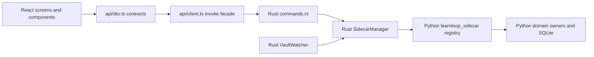

# Desktop Module Catalog

> [!abstract] Exact coverage
> One generated note exists for each of the **435 live TypeScript/TSX modules** under `apps/learnloop-tauri/src` and **6 authored Rust crate modules** under `src-tauri/src`. Cargo `target/` output and `build.rs` are not runtime crate modules and are intentionally excluded.

^desktop-catalog-coverage

## Runtime bridge



The diagram makes the cross-language request boundary explicit: TypeScript presents and adapts, Rust owns native transport/process concerns, and Python remains the learning and persistent-state authority. See [[Architecture/Adapter Architecture#Request flow|request flow]].

## Area maps

| Area | Direct modules | Responsibility |
|---|---:|---|
| [[Reference/Desktop/Rust/_area|Rust]] | 6 | The native Tauri shell, command bridge, sidecar process manager, error contract, and vault watcher. |
| [[Reference/Desktop/TypeScript/_area|TypeScript]] | 5 | The React renderer entry point and cross-cutting frontend modules. |
| [[Reference/Desktop/TypeScript/api/_area|TypeScript/api]] | 8 | Typed DTOs and the renderer-to-Tauri invocation facade. |
| [[Reference/Desktop/TypeScript/app/_area|TypeScript/app]] | 34 | Desktop shell orchestration, keyboard policy, configuration helpers, and recent-vault state. |
| [[Reference/Desktop/TypeScript/components/_area|TypeScript/components]] | 81 | Reusable learner-facing controls and composite interaction surfaces. |
| [[Reference/Desktop/TypeScript/components/goldenpath/_area|TypeScript/components/goldenpath]] | 1 | Shared Reader controls (the two buttons, the disposition picker, the affect tap), first built for the retired Golden Path. |
| [[Reference/Desktop/TypeScript/components/graphedit/_area|TypeScript/components/graphedit]] | 5 | Study-map editing widgets, pending edits, and geometry previews. |
| [[Reference/Desktop/TypeScript/components/pdfSelection/_area|TypeScript/components/pdfSelection]] | 6 | The PDF text-layer selection model: tokens, geometry, highlights, and the selection layer over a rendered page. |
| [[Reference/Desktop/TypeScript/components/pdfSelection/testing/_area|TypeScript/components/pdfSelection/testing]] | 2 | Synthetic PDFs and books built in memory for the PDF selection vitest files (test support, outside the Vite build). |
| [[Reference/Desktop/TypeScript/components/recipeedit/_area|TypeScript/components/recipeedit]] | 1 | Recipe-tree editing for structured learning plans. |
| [[Reference/Desktop/TypeScript/copy/_area|TypeScript/copy]] | 4 | Learner-facing copy policy: the jargon deny-list the vitest lints apply, and plain-language ingest error wording. |
| [[Reference/Desktop/TypeScript/fixtures/_area|TypeScript/fixtures]] | 3 | Deterministic renderer fixtures used to demonstrate or restore known states. |
| [[Reference/Desktop/TypeScript/fixtures/desks/_area|TypeScript/fixtures/desks]] | 14 | The Reader workbench's synthetic workspace (project-authored sources, desks, an in-memory desk server) and its visual harness page (test support, outside the Vite build). |
| [[Reference/Desktop/TypeScript/render/_area|TypeScript/render]] | 8 | Markdown, mathematics, and live-editor rendering adapters. |
| [[Reference/Desktop/TypeScript/screens/_area|TypeScript/screens]] | 32 | Top-level routed workflow screens in the desktop shell. |
| [[Reference/Desktop/TypeScript/screens/desks/_area|TypeScript/screens/desks]] | 8 | The Reader workbench's desks: the shell, the window lifecycle contract, the shelf, reading-view geometry and the desk outbox. |
| [[Reference/Desktop/TypeScript/screens/desks/carried/_area|TypeScript/screens/desks/carried]] | 1 | Carried questions resurfacing beside related passages: a question's section by the union read, its judged correspondents in the other open readings, and every page of the carried list. |
| [[Reference/Desktop/TypeScript/screens/desks/checks/_area|TypeScript/screens/desks/checks]] | 6 | Inline cold checks on the desks: a due check's closed marker before its host passage (no cues), check now with what is visible, the server's veils laid on the page with their pills and show it anyway (check.expose at once), check.protect_more for what comes into view, the card at the host passage or centred near the top, submit and its reason in plain words, not now, and restart. |
| [[Reference/Desktop/TypeScript/screens/desks/companion/_area|TypeScript/screens/desks/companion]] | 5 | The app-wide companion: its docks, summon, dissolve, hand-off and pill (geometry and state machine), its questions as polled companion.ask jobs, the panel with the desk's thread and the history, and previewed diffs. |
| [[Reference/Desktop/TypeScript/screens/desks/goal/_area|TypeScript/screens/desks/goal]] | 6 | The goal lens on the desks: the goal band under the top bar, criticality marks with their why card, dimming, section callouts, a pad stack's goal line and the path view, all read from goal.band and goal.lens. |
| [[Reference/Desktop/TypeScript/screens/desks/keys/_area|TypeScript/screens/desks/keys]] | 2 | The desks' key router (the scope and precedence matrix, the bare-Alt hold rule) and the one listener router for every window. |
| [[Reference/Desktop/TypeScript/screens/desks/lesson/_area|TypeScript/screens/desks/lesson]] | 4 | Teacher lessons as windows and stack tabs: the lesson's paper with its modes (review, your additions), LessonView in its window frame, the additions pad, openings in flight, and the path view's Teacher lesson row, read from lesson.view and lesson.list. |
| [[Reference/Desktop/TypeScript/screens/desks/menu/_area|TypeScript/screens/desks/menu]] | 5 | The context-aware right-click: one menu and one listener for passages, cues, highlights, margin notes, window headers and pad lines, its promoted rows (passage.promoted and the judged job on the poller, labelled per row), the verbs wired to their server entries, and What this knows. |
| [[Reference/Desktop/TypeScript/screens/desks/model/_area|TypeScript/screens/desks/model]] | 1 | The client workspace model: desks, windows, slots and pairs, mirroring desk.apply op for op. |
| [[Reference/Desktop/TypeScript/screens/desks/notebook/_area|TypeScript/screens/desks/notebook]] | 6 | A marimo notebook in a window: the frame served by the sidecar's sandboxed session, its honest states, the window lifecycle, the bridge's four messages checked by source, origin and shape, and a pad's marimo cells with their one live framed group. |
| [[Reference/Desktop/TypeScript/screens/desks/overview/_area|TypeScript/screens/desks/overview]] | 5 | The desks' overview: the zoom engine (layout, camera, frame function, spring, wheel), its one frame writer, cards, curved links, gather and live miniatures. |
| [[Reference/Desktop/TypeScript/screens/desks/pads/_area|TypeScript/screens/desks/pads]] | 8 | The scratchpads: pad stack windows (sticky tabs, the running pad, the live editor writing through pad.apply), provenance, gutter marks and hover cards, the pad menu, arrange and split, sketch blocks, submitting a block, passage marks for links and carried questions, and the desk drain. |
| [[Reference/Desktop/TypeScript/screens/desks/pen/_area|TypeScript/screens/desks/pen]] | 8 | Pen and ink on sources: pen input (pressure, tilt, the barrel eraser, palm rejection), the recognizer (underline, bracket, margin note, lasso, strike), the ink layer inside a source window's scroller, the annotations each mark becomes, ink saved in the one write sequence, the margin note's transcription, and ink pads (lined or dotted paper, ink lines and their readings through the central poller, the learner's corrections). |
| [[Reference/Desktop/TypeScript/screens/desks/problem/_area|TypeScript/screens/desks/problem]] | 2 | RW2 problems on the desks: one problem pad per workbench session (its id derived from the session's), found from any view of the desks, with the workbench's steps, help ladder, checks and submit. |
| [[Reference/Desktop/TypeScript/screens/desks/search/_area|TypeScript/screens/desks/search]] | 2 | Search in context: the groups of search.everything with the client's open-on-this-desk group, the meaning job, insert mode and the panel. |
| [[Reference/Desktop/TypeScript/screens/desks/sideBySide/_area|TypeScript/screens/desks/sideBySide]] | 1 | Side by side on the desks as paired windows: the pair a book opens in, which window leads, follow along between the two, and the way back. |
| [[Reference/Desktop/TypeScript/screens/desks/video/_area|TypeScript/screens/desks/video]] | 6 | Video windows on the desks: follow-along (a book's chip, its followed passage and the scroll, from reader.follow_along), the suggested chapters under a player (a polled judged job; accept and not this), the accepted chapters' ticks and minimap ranges, and the players' clocks for the timestamp key. |
| [[Reference/Desktop/TypeScript/screens/desks/windows/_area|TypeScript/screens/desks/windows]] | 3 | Desk windows: the Reader's source pane as a scoped source or video window, thread windows, and the panel windows hosting v1 Reader surfaces. |
| [[Reference/Desktop/TypeScript/screens/feedback/_area|TypeScript/screens/feedback]] | 6 | The post-answer feedback surface: answer exposure, method comparison, and its exposure contract. |
| [[Reference/Desktop/TypeScript/screens/practice/_area|TypeScript/screens/practice]] | 7 | Practice-screen help: hints, the hint panel, help-style settings, difficulty taps, and why an item was chosen. |
| [[Reference/Desktop/TypeScript/screens/reader/_area|TypeScript/screens/reader]] | 85 | Reader request-state coordination extracted from the main reader screen. |
| [[Reference/Desktop/TypeScript/screens/reader/figures/_area|TypeScript/screens/reader/figures]] | 10 | Reader "show me" figures: the figure grammar and spec, inline figures, panels, predictions, and their state. |
| [[Reference/Desktop/TypeScript/screens/reader/figures/sketch/_area|TypeScript/screens/reader/figures/sketch]] | 13 | The sandboxed sketch tier: the pinned engine host, its Worker protocol and runner, and the scene renderer. |
| [[Reference/Desktop/TypeScript/screens/startBackdrops/_area|TypeScript/screens/startBackdrops]] | 8 | Canvas/SVG simulations and workers used as the start-screen visual backdrop. |
| [[Reference/Desktop/TypeScript/screens/today/_area|TypeScript/screens/today]] | 9 | The Today place: the daily plan view and re-entry after time away. |
| [[Reference/Desktop/TypeScript/screens/underhood/_area|TypeScript/screens/underhood]] | 1 | Under the hood's thin tool entry points (SQLite browser, inspector, calibration, mistake history, AI routes). |
| [[Reference/Desktop/TypeScript/screens/workbench/_area|TypeScript/screens/workbench]] | 13 | The Reader workbench: steps, Check my work, the help ladder, step hints, and the session state behind them. |

## Status and evidence

| Refactor status | Modules | Positive evidence required |
|---|---:|---|
| `ACTIVE` | 441 | Current entry/build reachability, an explicit compiler inclusion, or (test support) an import from a vitest file. |
| `DORMANT` | 0 | An owned retained seam plus evidence that no primary workflow uses it. |
| `COMPAT` | 0 | An explicitly frozen compatibility contract. |
| `EVALUATION` | 0 | A simulation/audit surface that measures rather than serves the learner. |

The audit proves **410 TypeScript/TSX files** are reachable through static imports from `src/main.tsx`, **2 ambient declarations** are included by `tsconfig.json`, **21 test-support files** are imported only by vitest files (they run under `npm test`, never in the app bundle), and **6 Rust modules** are reachable by `mod`/`crate` edges from native `main.rs`.

The reachability set includes all **1 app fixture modules** through current Reader screens (the other 16 fixture modules are vitest support) and all **8 backdrop/worker modules** through StartScreen's supported optional presentation paths. Entry files are active roots. Therefore all 441 files are `ACTIVE`; none has positive evidence for `DORMANT`, `COMPAT`, or `EVALUATION`.

> [!warning] Static graph limits
> Import and symbol-reference edges are reproducible build evidence, not runtime tracing. The generator refuses an unclassified file instead of treating a missing caller as proof of dormancy; a new implicit entry requires an explicit audit rule.

## Find a desktop module

```query
path:"Reference/Desktop" tag:#learnloop/desktop/typescript
```

```query
path:"Reference/Desktop" section:("Modification guidance") "RPC"
```

> [!tip] Optional Dataview index
> The vault works without Dataview; when enabled, this produces a sortable source table.

```dataview
TABLE language AS Language, area AS Area, source_path AS Source
FROM "Reference/Desktop"
WHERE type = "desktop-module-reference"
SORT source_path ASC
```

## How to change the desktop safely

1. Locate a module through its area map and inspect inbound consumers and outbound dependencies.
2. Follow the canonical workflow/concept links for semantics; do not derive learning policy from UI wording.
3. For an RPC shape change, keep TypeScript DTO/client, Rust command registration/bridge, and Python handler/registry synchronized.
4. Run the focused cross-boundary tests, frontend typecheck/build, and Rust tests named in the module note.
5. Regenerate and validate this reference.

## Maintenance

```bash
.venv/bin/python docs/learnloop-architecture-vault/_scripts/desktop_generate.py
.venv/bin/python docs/learnloop-architecture-vault/_scripts/desktop_validate.py
```

Use `desktop_generate.py --check` in CI to verify byte-for-byte reproducibility without writing files.

Notes carry no commit of their own: the commit they were generated from is `desktop_generate.py`'s row in [[Reference/_generated|Generated Reference Provenance]].
