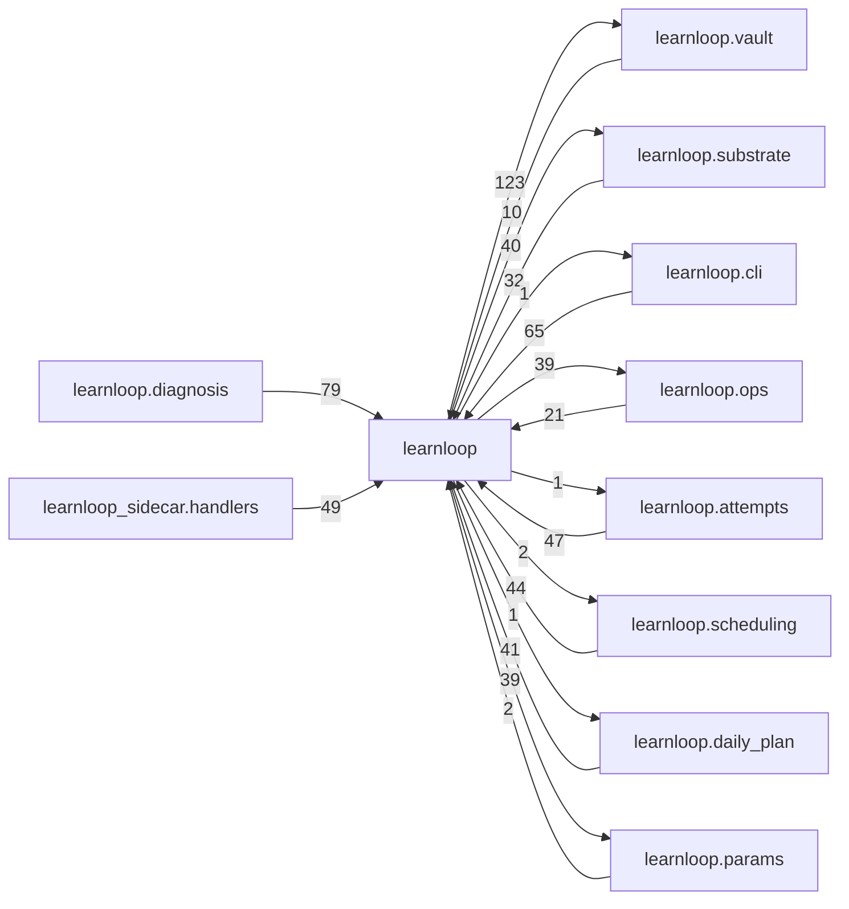

# `learnloop` package map

> [!info] Generated package map
> This map is generated from live modules and their static imports. Follow module links for source-level facts and canonical concept/workflow links for system behavior.

Up: [[Module Catalog]]

## Responsibility

Application-level coordinators and dependency-neutral authorities shared across LearnLoop.

For system intent, use [[Architecture Overview]].

^package-purpose

## Module index

| Module | Purpose | Status | Direct importers | Direct test files |
|---|---|---:|---:|---:|
| [[Reference/Modules/learnloop/__init__|learnloop]] | [[Reference/Modules/learnloop/__init__#^module-purpose|purpose]] | `ACTIVE` | 0 | 6 |
| [[Reference/Modules/learnloop/__main__|learnloop.__main__]] | [[Reference/Modules/learnloop/__main__#^module-purpose|purpose]] | `ACTIVE` | 0 | 0 |
| [[Reference/Modules/learnloop/activation_journal|learnloop.activation_journal]] | [[Reference/Modules/learnloop/activation_journal#^module-purpose|purpose]] | `ACTIVE` | 25 | 13 |
| [[Reference/Modules/learnloop/ad_successor_upgrade|learnloop.ad_successor_upgrade]] | [[Reference/Modules/learnloop/ad_successor_upgrade#^module-purpose|purpose]] | `ACTIVE` | 2 | 1 |
| [[Reference/Modules/learnloop/adf_numeric|learnloop.adf_numeric]] | [[Reference/Modules/learnloop/adf_numeric#^module-purpose|purpose]] | `ACTIVE` | 5 | 1 |
| [[Reference/Modules/learnloop/algorithm_versions|learnloop.algorithm_versions]] | [[Reference/Modules/learnloop/algorithm_versions#^module-purpose|purpose]] | `ACTIVE` | 83 | 161 |
| [[Reference/Modules/learnloop/app_launch|learnloop.app_launch]] | [[Reference/Modules/learnloop/app_launch#^module-purpose|purpose]] | `ACTIVE` | 2 | 1 |
| [[Reference/Modules/learnloop/attempt_content_state_upgrade|learnloop.attempt_content_state_upgrade]] | [[Reference/Modules/learnloop/attempt_content_state_upgrade#^module-purpose|purpose]] | `ACTIVE` | 2 | 1 |
| [[Reference/Modules/learnloop/attempt_types|learnloop.attempt_types]] | [[Reference/Modules/learnloop/attempt_types#^module-purpose|purpose]] | `ACTIVE` | 8 | 2 |
| [[Reference/Modules/learnloop/bootstrap|learnloop.bootstrap]] | [[Reference/Modules/learnloop/bootstrap#^module-purpose|purpose]] | `ACTIVE` | 3 | 6 |
| [[Reference/Modules/learnloop/causal_activity_policy|learnloop.causal_activity_policy]] | [[Reference/Modules/learnloop/causal_activity_policy#^module-purpose|purpose]] | `ACTIVE` | 8 | 1 |
| [[Reference/Modules/learnloop/claim_fixes_upgrade|learnloop.claim_fixes_upgrade]] | [[Reference/Modules/learnloop/claim_fixes_upgrade#^module-purpose|purpose]] | `ACTIVE` | 20 | 3 |
| [[Reference/Modules/learnloop/clock|learnloop.clock]] | [[Reference/Modules/learnloop/clock#^module-purpose|purpose]] | `ACTIVE` | 441 | 547 |
| [[Reference/Modules/learnloop/cold_retry_reschedule_upgrade|learnloop.cold_retry_reschedule_upgrade]] | [[Reference/Modules/learnloop/cold_retry_reschedule_upgrade#^module-purpose|purpose]] | `ACTIVE` | 2 | 1 |
| [[Reference/Modules/learnloop/confidence_events|learnloop.confidence_events]] | [[Reference/Modules/learnloop/confidence_events#^module-purpose|purpose]] | `ACTIVE` | 6 | 5 |
| [[Reference/Modules/learnloop/daily_plan_upgrade|learnloop.daily_plan_upgrade]] | [[Reference/Modules/learnloop/daily_plan_upgrade#^module-purpose|purpose]] | `ACTIVE` | 2 | 1 |
| [[Reference/Modules/learnloop/data_capture_upgrade|learnloop.data_capture_upgrade]] | [[Reference/Modules/learnloop/data_capture_upgrade#^module-purpose|purpose]] | `ACTIVE` | 2 | 1 |
| [[Reference/Modules/learnloop/decider_judgments|learnloop.decider_judgments]] | [[Reference/Modules/learnloop/decider_judgments#^module-purpose|purpose]] | `ACTIVE` | 22 | 10 |
| [[Reference/Modules/learnloop/decider_upgrade|learnloop.decider_upgrade]] | [[Reference/Modules/learnloop/decider_upgrade#^module-purpose|purpose]] | `ACTIVE` | 2 | 1 |
| [[Reference/Modules/learnloop/delayed_checks|learnloop.delayed_checks]] | [[Reference/Modules/learnloop/delayed_checks#^module-purpose|purpose]] | `ACTIVE` | 4 | 2 |
| [[Reference/Modules/learnloop/delayed_completion|learnloop.delayed_completion]] | [[Reference/Modules/learnloop/delayed_completion#^module-purpose|purpose]] | `ACTIVE` | 5 | 3 |
| [[Reference/Modules/learnloop/deliverable_plan_upgrade|learnloop.deliverable_plan_upgrade]] | [[Reference/Modules/learnloop/deliverable_plan_upgrade#^module-purpose|purpose]] | `ACTIVE` | 2 | 2 |
| [[Reference/Modules/learnloop/eligibility_decision_upgrade|learnloop.eligibility_decision_upgrade]] | [[Reference/Modules/learnloop/eligibility_decision_upgrade#^module-purpose|purpose]] | `ACTIVE` | 2 | 1 |
| [[Reference/Modules/learnloop/figure_admission|learnloop.figure_admission]] | [[Reference/Modules/learnloop/figure_admission#^module-purpose|purpose]] | `ACTIVE` | 18 | 6 |
| [[Reference/Modules/learnloop/followup_serve_upgrade|learnloop.followup_serve_upgrade]] | [[Reference/Modules/learnloop/followup_serve_upgrade#^module-purpose|purpose]] | `ACTIVE` | 2 | 1 |
| [[Reference/Modules/learnloop/grading_epochs|learnloop.grading_epochs]] | [[Reference/Modules/learnloop/grading_epochs#^module-purpose|purpose]] | `ACTIVE` | 9 | 3 |
| [[Reference/Modules/learnloop/held_grades|learnloop.held_grades]] | [[Reference/Modules/learnloop/held_grades#^module-purpose|purpose]] | `ACTIVE` | 50 | 17 |
| [[Reference/Modules/learnloop/help_fold_attach_upgrade|learnloop.help_fold_attach_upgrade]] | [[Reference/Modules/learnloop/help_fold_attach_upgrade#^module-purpose|purpose]] | `ACTIVE` | 2 | 2 |
| [[Reference/Modules/learnloop/hint_window|learnloop.hint_window]] | [[Reference/Modules/learnloop/hint_window#^module-purpose|purpose]] | `ACTIVE` | 3 | 1 |
| [[Reference/Modules/learnloop/ids|learnloop.ids]] | [[Reference/Modules/learnloop/ids#^module-purpose|purpose]] | `ACTIVE` | 167 | 54 |
| [[Reference/Modules/learnloop/intent_upgrade|learnloop.intent_upgrade]] | [[Reference/Modules/learnloop/intent_upgrade#^module-purpose|purpose]] | `ACTIVE` | 2 | 1 |
| [[Reference/Modules/learnloop/interval_factor_upgrade|learnloop.interval_factor_upgrade]] | [[Reference/Modules/learnloop/interval_factor_upgrade#^module-purpose|purpose]] | `ACTIVE` | 2 | 1 |
| [[Reference/Modules/learnloop/learner_context|learnloop.learner_context]] | [[Reference/Modules/learnloop/learner_context#^module-purpose|purpose]] | `ACTIVE` | 4 | 10 |
| [[Reference/Modules/learnloop/learner_protection|learnloop.learner_protection]] | [[Reference/Modules/learnloop/learner_protection#^module-purpose|purpose]] | `ACTIVE` | 24 | 21 |
| [[Reference/Modules/learnloop/learner_text_gap_upgrade|learnloop.learner_text_gap_upgrade]] | [[Reference/Modules/learnloop/learner_text_gap_upgrade#^module-purpose|purpose]] | `ACTIVE` | 2 | 2 |
| [[Reference/Modules/learnloop/lesson_opportunity_upgrade|learnloop.lesson_opportunity_upgrade]] | [[Reference/Modules/learnloop/lesson_opportunity_upgrade#^module-purpose|purpose]] | `ACTIVE` | 3 | 1 |
| [[Reference/Modules/learnloop/lesson_suggestions_upgrade|learnloop.lesson_suggestions_upgrade]] | [[Reference/Modules/learnloop/lesson_suggestions_upgrade#^module-purpose|purpose]] | `ACTIVE` | 2 | 3 |
| [[Reference/Modules/learnloop/method_explicit_upgrade|learnloop.method_explicit_upgrade]] | [[Reference/Modules/learnloop/method_explicit_upgrade#^module-purpose|purpose]] | `ACTIVE` | 2 | 2 |
| [[Reference/Modules/learnloop/migration_coordinator|learnloop.migration_coordinator]] | [[Reference/Modules/learnloop/migration_coordinator#^module-purpose|purpose]] | `ACTIVE` | 3 | 4 |
| [[Reference/Modules/learnloop/numeric|learnloop.numeric]] | [[Reference/Modules/learnloop/numeric#^module-purpose|purpose]] | `ACTIVE` | 20 | 2 |
| [[Reference/Modules/learnloop/one_ask_upgrade|learnloop.one_ask_upgrade]] | [[Reference/Modules/learnloop/one_ask_upgrade#^module-purpose|purpose]] | `ACTIVE` | 2 | 3 |
| [[Reference/Modules/learnloop/outcome_contract|learnloop.outcome_contract]] | [[Reference/Modules/learnloop/outcome_contract#^module-purpose|purpose]] | `ACTIVE` | 31 | 14 |
| [[Reference/Modules/learnloop/probe_tie_upgrade|learnloop.probe_tie_upgrade]] | [[Reference/Modules/learnloop/probe_tie_upgrade#^module-purpose|purpose]] | `ACTIVE` | 2 | 1 |
| [[Reference/Modules/learnloop/proof_check_upgrade|learnloop.proof_check_upgrade]] | [[Reference/Modules/learnloop/proof_check_upgrade#^module-purpose|purpose]] | `ACTIVE` | 2 | 1 |
| [[Reference/Modules/learnloop/reader_followups_upgrade|learnloop.reader_followups_upgrade]] | [[Reference/Modules/learnloop/reader_followups_upgrade#^module-purpose|purpose]] | `ACTIVE` | 2 | 1 |
| [[Reference/Modules/learnloop/reader_learner_state|learnloop.reader_learner_state]] | [[Reference/Modules/learnloop/reader_learner_state#^module-purpose|purpose]] | `ACTIVE` | 1 | 3 |
| [[Reference/Modules/learnloop/reading_path_plan_upgrade|learnloop.reading_path_plan_upgrade]] | [[Reference/Modules/learnloop/reading_path_plan_upgrade#^module-purpose|purpose]] | `ACTIVE` | 2 | 1 |
| [[Reference/Modules/learnloop/reading_sources|learnloop.reading_sources]] | [[Reference/Modules/learnloop/reading_sources#^module-purpose|purpose]] | `ACTIVE` | 5 | 0 |
| [[Reference/Modules/learnloop/recurrence|learnloop.recurrence]] | [[Reference/Modules/learnloop/recurrence#^module-purpose|purpose]] | `ACTIVE` | 10 | 6 |
| [[Reference/Modules/learnloop/regrade_contract_upgrade|learnloop.regrade_contract_upgrade]] | [[Reference/Modules/learnloop/regrade_contract_upgrade#^module-purpose|purpose]] | `ACTIVE` | 21 | 2 |
| [[Reference/Modules/learnloop/replay_ledger_upgrade|learnloop.replay_ledger_upgrade]] | [[Reference/Modules/learnloop/replay_ledger_upgrade#^module-purpose|purpose]] | `ACTIVE` | 2 | 2 |
| [[Reference/Modules/learnloop/reveal_coverage|learnloop.reveal_coverage]] | [[Reference/Modules/learnloop/reveal_coverage#^module-purpose|purpose]] | `ACTIVE` | 8 | 3 |
| [[Reference/Modules/learnloop/route_rules_upgrade|learnloop.route_rules_upgrade]] | [[Reference/Modules/learnloop/route_rules_upgrade#^module-purpose|purpose]] | `ACTIVE` | 2 | 3 |
| [[Reference/Modules/learnloop/router_calibration_upgrade|learnloop.router_calibration_upgrade]] | [[Reference/Modules/learnloop/router_calibration_upgrade#^module-purpose|purpose]] | `ACTIVE` | 2 | 2 |
| [[Reference/Modules/learnloop/router_followups_upgrade|learnloop.router_followups_upgrade]] | [[Reference/Modules/learnloop/router_followups_upgrade#^module-purpose|purpose]] | `ACTIVE` | 2 | 1 |
| [[Reference/Modules/learnloop/router_learned_tail_upgrade|learnloop.router_learned_tail_upgrade]] | [[Reference/Modules/learnloop/router_learned_tail_upgrade#^module-purpose|purpose]] | `ACTIVE` | 2 | 2 |
| [[Reference/Modules/learnloop/router_mixture_upgrade|learnloop.router_mixture_upgrade]] | [[Reference/Modules/learnloop/router_mixture_upgrade#^module-purpose|purpose]] | `ACTIVE` | 2 | 1 |
| [[Reference/Modules/learnloop/router_objective_switches|learnloop.router_objective_switches]] | [[Reference/Modules/learnloop/router_objective_switches#^module-purpose|purpose]] | `ACTIVE` | 24 | 16 |
| [[Reference/Modules/learnloop/router_objective_upgrade|learnloop.router_objective_upgrade]] | [[Reference/Modules/learnloop/router_objective_upgrade#^module-purpose|purpose]] | `ACTIVE` | 2 | 1 |
| [[Reference/Modules/learnloop/router_staged_upgrade|learnloop.router_staged_upgrade]] | [[Reference/Modules/learnloop/router_staged_upgrade#^module-purpose|purpose]] | `ACTIVE` | 2 | 1 |
| [[Reference/Modules/learnloop/section_map|learnloop.section_map]] | [[Reference/Modules/learnloop/section_map#^module-purpose|purpose]] | `ACTIVE` | 5 | 1 |
| [[Reference/Modules/learnloop/serve_eligibility|learnloop.serve_eligibility]] | [[Reference/Modules/learnloop/serve_eligibility#^module-purpose|purpose]] | `ACTIVE` | 20 | 7 |
| [[Reference/Modules/learnloop/sources_upgrade|learnloop.sources_upgrade]] | [[Reference/Modules/learnloop/sources_upgrade#^module-purpose|purpose]] | `ACTIVE` | 2 | 1 |
| [[Reference/Modules/learnloop/stuck_prompt_upgrade|learnloop.stuck_prompt_upgrade]] | [[Reference/Modules/learnloop/stuck_prompt_upgrade#^module-purpose|purpose]] | `ACTIVE` | 2 | 1 |
| [[Reference/Modules/learnloop/superseded_claims_upgrade|learnloop.superseded_claims_upgrade]] | [[Reference/Modules/learnloop/superseded_claims_upgrade#^module-purpose|purpose]] | `ACTIVE` | 2 | 1 |
| [[Reference/Modules/learnloop/symbolic_view|learnloop.symbolic_view]] | [[Reference/Modules/learnloop/symbolic_view#^module-purpose|purpose]] | `ACTIVE` | 12 | 1 |
| [[Reference/Modules/learnloop/teacher_probes_upgrade|learnloop.teacher_probes_upgrade]] | [[Reference/Modules/learnloop/teacher_probes_upgrade#^module-purpose|purpose]] | `ACTIVE` | 2 | 2 |
| [[Reference/Modules/learnloop/teacher_upgrade|learnloop.teacher_upgrade]] | [[Reference/Modules/learnloop/teacher_upgrade#^module-purpose|purpose]] | `ACTIVE` | 2 | 1 |
| [[Reference/Modules/learnloop/text_canon|learnloop.text_canon]] | [[Reference/Modules/learnloop/text_canon#^module-purpose|purpose]] | `ACTIVE` | 5 | 1 |
| [[Reference/Modules/learnloop/vault_lock|learnloop.vault_lock]] | [[Reference/Modules/learnloop/vault_lock#^module-purpose|purpose]] | `ACTIVE` | 43 | 6 |
| [[Reference/Modules/learnloop/voi_stopping_upgrade|learnloop.voi_stopping_upgrade]] | [[Reference/Modules/learnloop/voi_stopping_upgrade#^module-purpose|purpose]] | `ACTIVE` | 2 | 1 |
| [[Reference/Modules/learnloop/workbench_field_signals_upgrade|learnloop.workbench_field_signals_upgrade]] | [[Reference/Modules/learnloop/workbench_field_signals_upgrade#^module-purpose|purpose]] | `ACTIVE` | 2 | 1 |

## Child package maps

- [[Reference/Modules/learnloop/adaptive_difficulty/_package|learnloop.adaptive_difficulty]] — Adaptive difficulty: logged reading opportunities and outside forecasters, the readiness model, guarded selection near the target band, and its receipts.
- [[Reference/Modules/learnloop/ai/_package|learnloop.ai]] — Provider-neutral structured transport, routing, provider composition, capability checks, and usage accounting.
- [[Reference/Modules/learnloop/attempts/_package|learnloop.attempts]] — Attempt acceptance, grading, interaction evidence, feedback, and post-attempt processing.
- [[Reference/Modules/learnloop/capture/_package|learnloop.capture]] — The shared capture domain (the capture inbox); importing it never attaches or migrates.
- [[Reference/Modules/learnloop/cli/_package|learnloop.cli]] — Typer command adapters, rendering, argument contracts, and command registration.
- [[Reference/Modules/learnloop/config/_package|learnloop.config]] — Typed configuration schema, compatibility normalization, loading, and template emission.
- [[Reference/Modules/learnloop/content/_package|learnloop.content]] — Source-derived content, authoring, synthesis, proposal, and canonical pipeline ownership.
- [[Reference/Modules/learnloop/curriculum/_package|learnloop.curriculum]] — Commitments, blueprints, depth structures, concept relationships, and golden paths.
- [[Reference/Modules/learnloop/daily_plan/_package|learnloop.daily_plan]] — The finite daily plan: remembered minutes split across repair, maintain, new and push, chosen block by block, and the router card.
- [[Reference/Modules/learnloop/data_capture/_package|learnloop.data_capture]] — What later evaluation needs, recorded now: its switches, prefilter receipts, and the one read of Reader exposures with the sweep that freezes them.
- [[Reference/Modules/learnloop/db/_package|learnloop.db]] — SQLite connections, migrations, repository compatibility, table roles, rebuilds, and persistence infrastructure.
- [[Reference/Modules/learnloop/diagnosis/_package|learnloop.diagnosis]] — Diagnostic probes, causal attribution, error classification, and remediation decisions.
- [[Reference/Modules/learnloop/evsi_calibration/_package|learnloop.evsi_calibration]] — EVSI/EIG calibration: read-only measurement of the numbers value-of-information runs on, labelled honestly where they cannot be measured.
- [[Reference/Modules/learnloop/experiments/_package|learnloop.experiments]] — Research experiments on backup copies of vaults; never part of production serving (no production package imports it).
- [[Reference/Modules/learnloop/field/_package|learnloop.field]] — Replay-only learner-field contracts (the LearnerPredictor contract, signals, outcomes); no serving policy or evidence writes.
- [[Reference/Modules/learnloop/figures/_package|learnloop.figures]] — Explorable figures: declarative specs and sketches, their authoring routes, verification, labels, help records and the figure service.
- [[Reference/Modules/learnloop/followup_run/_package|learnloop.followup_run]] — FG1's composition, imported only by the sidecar: lanes, the frontier authoring operation, machine admission, the router's itemless decision, what the feedback screen and Next read, and the generation worker.
- [[Reference/Modules/learnloop/followup_serve/_package|learnloop.followup_serve]] — FG1's leaf: the kill switch, the durable workflow's record, the generation queue's writes and the generated probe's single-use identity, read by the domain packages.
- [[Reference/Modules/learnloop/goals/_package|learnloop.goals]] — Learning goals, forecasts, certification, readiness, and exam workflows.
- [[Reference/Modules/learnloop/hints/_package|learnloop.hints]] — Adaptive hints: telemetry and report, approach maps, the hint service and its outcomes.
- [[Reference/Modules/learnloop/ingest/_package|learnloop.ingest]] — Acquisition intermediate representation, locators, fetchers, originals, and ingestion orchestration.
- [[Reference/Modules/learnloop/instructional/_package|learnloop.instructional]] — Canonical sources as a shared instructional service: a composition layer for the tutor's offers, source exercises, exposure and the tools.
- [[Reference/Modules/learnloop/intent/_package|learnloop.intent]] — The single intent control: commitments carrying intent, optional deadlines and settled checks.
- [[Reference/Modules/learnloop/learner/_package|learnloop.learner]] — Mastery, recall, evidence, claims, ability transitions, and learner-state views.
- [[Reference/Modules/learnloop/local_embeddings/_package|learnloop.local_embeddings]] — Local contextual source retrieval: the local document space's pins, capped batch worker, GPU meter, locks and owner-run commands.
- [[Reference/Modules/learnloop/matching/_package|learnloop.matching]] — The one 'same or different?' step: registered match kinds, embedding shortlists and LLM judges, recorded in the judgment ledger.
- [[Reference/Modules/learnloop/ops/_package|learnloop.ops]] — Vault diagnostics, locks, settings, startup, upgrades, and operator-facing maintenance.
- [[Reference/Modules/learnloop/params/_package|learnloop.params]] — Algorithm parameter registry, fitted values, and sensitivity certificates.
- [[Reference/Modules/learnloop/placement/_package|learnloop.placement]] — Placement for new material through the LearnerPredictor contract; writes only its own receipts, never evidence.
- [[Reference/Modules/learnloop/practice_index/_package|learnloop.practice_index]] — The practice index: facet dossiers and find_practice (recall by search, an LLM decides, the scheduler admits).
- [[Reference/Modules/learnloop/projects/_package|learnloop.projects]] — Project understanding: captured agent-written diffs and delayed comprehension probes on them.
- [[Reference/Modules/learnloop/reader/_package|learnloop.reader]] — Reader-mode source exploration, annotations, quick checks, and authoring handoffs.
- [[Reference/Modules/learnloop/remote/_package|learnloop.remote]] — Application services for frontends outside the desktop (the MCP chat adapter's only door); no learning policy of its own.
- [[Reference/Modules/learnloop/router/_package|learnloop.router]] — The action router: decisions logged on today's serving paths and their derived outcomes; a leaf that chooses nothing yet.
- [[Reference/Modules/learnloop/router_objective/_package|learnloop.router_objective]] — The router objective's logging (spec_router_objective_v1 §4, RO0): additive receipts at every version behind [router_objective] receipts, read by nothing serving, scheduling or certification.
- [[Reference/Modules/learnloop/scheduling/_package|learnloop.scheduling]] — Selection, review timing, progression, controller decisions, and scheduling projections.
- [[Reference/Modules/learnloop/sim/_package|learnloop.sim]] — Offline simulation, benchmark, sweep, synthetic-student, and algorithm evaluation tools.
- [[Reference/Modules/learnloop/source_retrieval/_package|learnloop.source_retrieval]] — Source retrieval and the Reader's sources side: keyword and dense search, section coverage, deliverables and paths, and the learner's notes.
- [[Reference/Modules/learnloop/substrate/_package|learnloop.substrate]] — Activity, card, surface, and identity substrate plus canonical projections.
- [[Reference/Modules/learnloop/teacher/_package|learnloop.teacher]] — Lessons on the latent learner state: the brief, the teacher's turn contract and actions, guards, checks, delayed checks and receipts.
- [[Reference/Modules/learnloop/tui/_package|learnloop.tui]] — Textual UI adapter, screens, widgets, state, and presentation behavior.
- [[Reference/Modules/learnloop/tutor/_package|learnloop.tutor]] — Tutoring, hints, teach-back, and tutor question-and-answer workflows.
- [[Reference/Modules/learnloop/vault/_package|learnloop.vault]] — Filesystem layout, Markdown/YAML I/O, hashes, models, loading, and writing.
- [[Reference/Modules/learnloop/workbench/_package|learnloop.workbench]] — The Reader workbench's checks and the help ladder's Reader side: Check my work, declared symbolic checks and the ladder.

## Cross-package dependencies

### This package imports

- [[Reference/Modules/learnloop/vault/_package|learnloop.vault]] — 123 static module edges
- [[Reference/Modules/learnloop/substrate/_package|learnloop.substrate]] — 40 static module edges
- [[Reference/Modules/learnloop/ops/_package|learnloop.ops]] — 39 static module edges
- [[Reference/Modules/learnloop/params/_package|learnloop.params]] — 39 static module edges
- [[Reference/Modules/learnloop/db/stores/_package|learnloop.db.stores]] — 9 static module edges
- [[Reference/Modules/learnloop/ai/_package|learnloop.ai]] — 8 static module edges
- [[Reference/Modules/learnloop/db/_package|learnloop.db]] — 5 static module edges
- [[Reference/Modules/learnloop/learner/_package|learnloop.learner]] — 4 static module edges
- [[Reference/Modules/learnloop/adaptive_difficulty/_package|learnloop.adaptive_difficulty]] — 2 static module edges
- [[Reference/Modules/learnloop/config/_package|learnloop.config]] — 2 static module edges
- [[Reference/Modules/learnloop/content/sources/_package|learnloop.content.sources]] — 2 static module edges
- [[Reference/Modules/learnloop/diagnosis/split/_package|learnloop.diagnosis.split]] — 2 static module edges
- [[Reference/Modules/learnloop/scheduling/_package|learnloop.scheduling]] — 2 static module edges
- [[Reference/Modules/learnloop/attempts/_package|learnloop.attempts]] — 1 static module edge
- [[Reference/Modules/learnloop/cli/_package|learnloop.cli]] — 1 static module edge
- [[Reference/Modules/learnloop/content/synthesis/_package|learnloop.content.synthesis]] — 1 static module edge
- [[Reference/Modules/learnloop/daily_plan/_package|learnloop.daily_plan]] — 1 static module edge
- [[Reference/Modules/learnloop/diagnosis/recurrence/_package|learnloop.diagnosis.recurrence]] — 1 static module edge
- [[Reference/Modules/learnloop/diagnosis/text_gaps/_package|learnloop.diagnosis.text_gaps]] — 1 static module edge
- [[Reference/Modules/learnloop/followup_serve/_package|learnloop.followup_serve]] — 1 static module edge
- [[Reference/Modules/learnloop/ingest/_package|learnloop.ingest]] — 1 static module edge
- [[Reference/Modules/learnloop/tui/_package|learnloop.tui]] — 1 static module edge
- [[Reference/Modules/learnloop/tutor/_package|learnloop.tutor]] — 1 static module edge

### Packages that import this package

- [[Reference/Modules/learnloop/diagnosis/_package|learnloop.diagnosis]] — 79 static module edges
- [[Reference/Modules/learnloop/cli/_package|learnloop.cli]] — 65 static module edges
- [[Reference/Modules/learnloop_sidecar/handlers/_package|learnloop_sidecar.handlers]] — 49 static module edges
- [[Reference/Modules/learnloop/attempts/_package|learnloop.attempts]] — 47 static module edges
- [[Reference/Modules/learnloop/scheduling/_package|learnloop.scheduling]] — 44 static module edges
- [[Reference/Modules/learnloop/daily_plan/_package|learnloop.daily_plan]] — 41 static module edges
- [[Reference/Modules/learnloop/source_retrieval/_package|learnloop.source_retrieval]] — 36 static module edges
- [[Reference/Modules/learnloop/adaptive_difficulty/_package|learnloop.adaptive_difficulty]] — 34 static module edges
- [[Reference/Modules/learnloop/substrate/_package|learnloop.substrate]] — 32 static module edges
- [[Reference/Modules/learnloop/db/stores/_package|learnloop.db.stores]] — 31 static module edges
- [[Reference/Modules/learnloop/learner/_package|learnloop.learner]] — 28 static module edges
- [[Reference/Modules/learnloop/reader/_package|learnloop.reader]] — 27 static module edges
- [[Reference/Modules/learnloop/goals/_package|learnloop.goals]] — 24 static module edges
- [[Reference/Modules/learnloop/teacher/_package|learnloop.teacher]] — 24 static module edges
- [[Reference/Modules/learnloop/curriculum/_package|learnloop.curriculum]] — 23 static module edges
- [[Reference/Modules/learnloop/ops/_package|learnloop.ops]] — 21 static module edges
- [[Reference/Modules/learnloop/router_objective/_package|learnloop.router_objective]] — 20 static module edges
- [[Reference/Modules/learnloop/diagnosis/split/_package|learnloop.diagnosis.split]] — 19 static module edges
- [[Reference/Modules/learnloop/instructional/_package|learnloop.instructional]] — 19 static module edges
- [[Reference/Modules/learnloop/figures/_package|learnloop.figures]] — 18 static module edges
- [[Reference/Modules/learnloop/workbench/_package|learnloop.workbench]] — 18 static module edges
- [[Reference/Modules/learnloop/hints/_package|learnloop.hints]] — 17 static module edges
- [[Reference/Modules/learnloop/content/proposals/_package|learnloop.content.proposals]] — 16 static module edges
- [[Reference/Modules/learnloop/content/pipeline/_package|learnloop.content.pipeline]] — 15 static module edges
- [[Reference/Modules/learnloop/content/authoring/_package|learnloop.content.authoring]] — 14 static module edges
- [[Reference/Modules/learnloop/tutor/_package|learnloop.tutor]] — 14 static module edges
- [[Reference/Modules/learnloop/field/_package|learnloop.field]] — 13 static module edges
- [[Reference/Modules/learnloop/content/synthesis/_package|learnloop.content.synthesis]] — 12 static module edges
- [[Reference/Modules/learnloop/db/_package|learnloop.db]] — 12 static module edges
- [[Reference/Modules/learnloop/diagnosis/text_gaps/_package|learnloop.diagnosis.text_gaps]] — 12 static module edges
- [[Reference/Modules/learnloop/practice_index/_package|learnloop.practice_index]] — 12 static module edges
- [[Reference/Modules/learnloop/router/_package|learnloop.router]] — 11 static module edges
- [[Reference/Modules/learnloop/vault/_package|learnloop.vault]] — 10 static module edges
- [[Reference/Modules/learnloop/diagnosis/recurrence/_package|learnloop.diagnosis.recurrence]] — 9 static module edges
- [[Reference/Modules/learnloop/followup_run/_package|learnloop.followup_run]] — 9 static module edges
- [[Reference/Modules/learnloop/placement/_package|learnloop.placement]] — 9 static module edges
- [[Reference/Modules/learnloop/remote/_package|learnloop.remote]] — 8 static module edges
- [[Reference/Modules/learnloop/scheduling/intent/_package|learnloop.scheduling.intent]] — 8 static module edges
- [[Reference/Modules/learnloop/content/facet_identity/_package|learnloop.content.facet_identity]] — 7 static module edges
- [[Reference/Modules/learnloop_sidecar/_package|learnloop_sidecar]] — 7 static module edges
- [[Reference/Modules/learnloop/data_capture/_package|learnloop.data_capture]] — 6 static module edges
- [[Reference/Modules/learnloop/intent/_package|learnloop.intent]] — 6 static module edges
- [[Reference/Modules/learnloop/projects/_package|learnloop.projects]] — 6 static module edges
- [[Reference/Modules/learnloop/diagnosis/offline_review/_package|learnloop.diagnosis.offline_review]] — 5 static module edges
- [[Reference/Modules/learnloop/sim/_package|learnloop.sim]] — 5 static module edges
- [[Reference/Modules/learnloop/capture/_package|learnloop.capture]] — 4 static module edges
- [[Reference/Modules/learnloop/content/sources/_package|learnloop.content.sources]] — 4 static module edges
- [[Reference/Modules/learnloop/followup_serve/_package|learnloop.followup_serve]] — 4 static module edges
- [[Reference/Modules/learnloop/evsi_calibration/_package|learnloop.evsi_calibration]] — 3 static module edges
- [[Reference/Modules/learnloop/ops/contamination/_package|learnloop.ops.contamination]] — 3 static module edges
- [[Reference/Modules/learnloop/params/_package|learnloop.params]] — 2 static module edges
- [[Reference/Modules/learnloop/substrate/compat/_package|learnloop.substrate.compat]] — 2 static module edges
- [[Reference/Modules/learnloop/tui/_package|learnloop.tui]] — 2 static module edges
- [[Reference/Modules/learnloop/tui/screens/_package|learnloop.tui.screens]] — 2 static module edges
- [[Reference/Modules/learnloop/ai/_package|learnloop.ai]] — 1 static module edge
- [[Reference/Modules/learnloop/config/_package|learnloop.config]] — 1 static module edge
- [[Reference/Modules/learnloop/experiments/contextual_embeddings/_package|learnloop.experiments.contextual_embeddings]] — 1 static module edge
- [[Reference/Modules/learnloop/matching/_package|learnloop.matching]] — 1 static module edge

### Dependency neighborhood

This diagram compresses package-level static imports; edge labels are distinct module-to-module import counts.



Interpretation: arrow direction is static import direction and the label is the number of distinct module-to-module edges. It shows coupling pressure, not runtime call frequency or ownership permission.

## Workflow entry points

- [[Initialize a Vault]]
- [[Start a Learning Cycle]]

## Find and filter

Use Obsidian's native search:

```query
path:"Reference/Modules/learnloop" tag:#docs/module
```

To change this package, start with a module's [[#Module index|purpose link]], then follow its callers, tests, and modification guidance. Re-run the generator after source changes.
