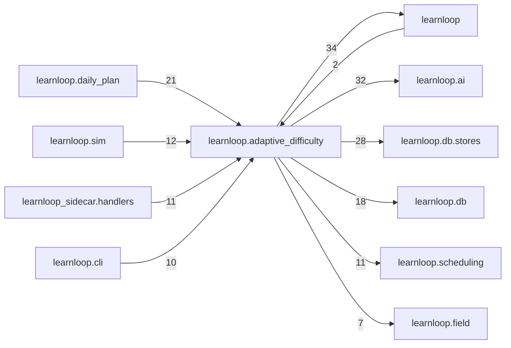

# `learnloop.adaptive_difficulty` package map

> [!info] Generated package map
> This map is generated from live modules and their static imports. Follow module links for source-level facts and canonical concept/workflow links for system behavior.

Up: [[Module Catalog]]

## Responsibility

Adaptive difficulty: logged reading opportunities and outside forecasters, the readiness model, guarded selection near the target band, and its receipts.

For system intent, use [[Architecture Overview]].

^package-purpose

## Module index

| Module | Purpose | Status | Direct importers | Direct test files |
|---|---|---:|---:|---:|
| [[Reference/Modules/learnloop/adaptive_difficulty/__init__|learnloop.adaptive_difficulty]] | [[Reference/Modules/learnloop/adaptive_difficulty/__init__#^module-purpose|purpose]] | `ACTIVE` | 0 | 0 |
| [[Reference/Modules/learnloop/adaptive_difficulty/arms|learnloop.adaptive_difficulty.arms]] | [[Reference/Modules/learnloop/adaptive_difficulty/arms#^module-purpose|purpose]] | `ACTIVE` | 2 | 3 |
| [[Reference/Modules/learnloop/adaptive_difficulty/backfill|learnloop.adaptive_difficulty.backfill]] | [[Reference/Modules/learnloop/adaptive_difficulty/backfill#^module-purpose|purpose]] | `ACTIVE` | 1 | 6 |
| [[Reference/Modules/learnloop/adaptive_difficulty/background|learnloop.adaptive_difficulty.background]] | [[Reference/Modules/learnloop/adaptive_difficulty/background#^module-purpose|purpose]] | `ACTIVE` | 3 | 9 |
| [[Reference/Modules/learnloop/adaptive_difficulty/claims|learnloop.adaptive_difficulty.claims]] | [[Reference/Modules/learnloop/adaptive_difficulty/claims#^module-purpose|purpose]] | `ACTIVE` | 5 | 3 |
| [[Reference/Modules/learnloop/adaptive_difficulty/column_classes|learnloop.adaptive_difficulty.column_classes]] | [[Reference/Modules/learnloop/adaptive_difficulty/column_classes#^module-purpose|purpose]] | `ACTIVE` | 1 | 4 |
| [[Reference/Modules/learnloop/adaptive_difficulty/data_check|learnloop.adaptive_difficulty.data_check]] | [[Reference/Modules/learnloop/adaptive_difficulty/data_check#^module-purpose|purpose]] | `ACTIVE` | 1 | 0 |
| [[Reference/Modules/learnloop/adaptive_difficulty/denial_log|learnloop.adaptive_difficulty.denial_log]] | [[Reference/Modules/learnloop/adaptive_difficulty/denial_log#^module-purpose|purpose]] | `ACTIVE` | 3 | 4 |
| [[Reference/Modules/learnloop/adaptive_difficulty/dose|learnloop.adaptive_difficulty.dose]] | [[Reference/Modules/learnloop/adaptive_difficulty/dose#^module-purpose|purpose]] | `ACTIVE` | 2 | 7 |
| [[Reference/Modules/learnloop/adaptive_difficulty/dose_report|learnloop.adaptive_difficulty.dose_report]] | [[Reference/Modules/learnloop/adaptive_difficulty/dose_report#^module-purpose|purpose]] | `ACTIVE` | 3 | 2 |
| [[Reference/Modules/learnloop/adaptive_difficulty/feature_audit|learnloop.adaptive_difficulty.feature_audit]] | [[Reference/Modules/learnloop/adaptive_difficulty/feature_audit#^module-purpose|purpose]] | `ACTIVE` | 11 | 17 |
| [[Reference/Modules/learnloop/adaptive_difficulty/forecasters|learnloop.adaptive_difficulty.forecasters]] | [[Reference/Modules/learnloop/adaptive_difficulty/forecasters#^module-purpose|purpose]] | `ACTIVE` | 5 | 0 |
| [[Reference/Modules/learnloop/adaptive_difficulty/generation|learnloop.adaptive_difficulty.generation]] | [[Reference/Modules/learnloop/adaptive_difficulty/generation#^module-purpose|purpose]] | `ACTIVE` | 5 | 9 |
| [[Reference/Modules/learnloop/adaptive_difficulty/history_audit|learnloop.adaptive_difficulty.history_audit]] | [[Reference/Modules/learnloop/adaptive_difficulty/history_audit#^module-purpose|purpose]] | `ACTIVE` | 1 | 1 |
| [[Reference/Modules/learnloop/adaptive_difficulty/history_card|learnloop.adaptive_difficulty.history_card]] | [[Reference/Modules/learnloop/adaptive_difficulty/history_card#^module-purpose|purpose]] | `ACTIVE` | 2 | 4 |
| [[Reference/Modules/learnloop/adaptive_difficulty/history_forecast|learnloop.adaptive_difficulty.history_forecast]] | [[Reference/Modules/learnloop/adaptive_difficulty/history_forecast#^module-purpose|purpose]] | `ACTIVE` | 3 | 3 |
| [[Reference/Modules/learnloop/adaptive_difficulty/history_resolve|learnloop.adaptive_difficulty.history_resolve]] | [[Reference/Modules/learnloop/adaptive_difficulty/history_resolve#^module-purpose|purpose]] | `ACTIVE` | 3 | 5 |
| [[Reference/Modules/learnloop/adaptive_difficulty/lessons|learnloop.adaptive_difficulty.lessons]] | [[Reference/Modules/learnloop/adaptive_difficulty/lessons#^module-purpose|purpose]] | `ACTIVE` | 1 | 0 |
| [[Reference/Modules/learnloop/adaptive_difficulty/logs|learnloop.adaptive_difficulty.logs]] | [[Reference/Modules/learnloop/adaptive_difficulty/logs#^module-purpose|purpose]] | `ACTIVE` | 12 | 0 |
| [[Reference/Modules/learnloop/adaptive_difficulty/material_view|learnloop.adaptive_difficulty.material_view]] | [[Reference/Modules/learnloop/adaptive_difficulty/material_view#^module-purpose|purpose]] | `ACTIVE` | 24 | 21 |
| [[Reference/Modules/learnloop/adaptive_difficulty/model|learnloop.adaptive_difficulty.model]] | [[Reference/Modules/learnloop/adaptive_difficulty/model#^module-purpose|purpose]] | `ACTIVE` | 11 | 12 |
| [[Reference/Modules/learnloop/adaptive_difficulty/monitoring|learnloop.adaptive_difficulty.monitoring]] | [[Reference/Modules/learnloop/adaptive_difficulty/monitoring#^module-purpose|purpose]] | `ACTIVE` | 5 | 2 |
| [[Reference/Modules/learnloop/adaptive_difficulty/operation|learnloop.adaptive_difficulty.operation]] | [[Reference/Modules/learnloop/adaptive_difficulty/operation#^module-purpose|purpose]] | `ACTIVE` | 28 | 25 |
| [[Reference/Modules/learnloop/adaptive_difficulty/outcomes|learnloop.adaptive_difficulty.outcomes]] | [[Reference/Modules/learnloop/adaptive_difficulty/outcomes#^module-purpose|purpose]] | `ACTIVE` | 4 | 3 |
| [[Reference/Modules/learnloop/adaptive_difficulty/outside|learnloop.adaptive_difficulty.outside]] | [[Reference/Modules/learnloop/adaptive_difficulty/outside#^module-purpose|purpose]] | `ACTIVE` | 6 | 21 |
| [[Reference/Modules/learnloop/adaptive_difficulty/predict|learnloop.adaptive_difficulty.predict]] | [[Reference/Modules/learnloop/adaptive_difficulty/predict#^module-purpose|purpose]] | `ACTIVE` | 6 | 4 |
| [[Reference/Modules/learnloop/adaptive_difficulty/priors|learnloop.adaptive_difficulty.priors]] | [[Reference/Modules/learnloop/adaptive_difficulty/priors#^module-purpose|purpose]] | `ACTIVE` | 16 | 12 |
| [[Reference/Modules/learnloop/adaptive_difficulty/projection|learnloop.adaptive_difficulty.projection]] | [[Reference/Modules/learnloop/adaptive_difficulty/projection#^module-purpose|purpose]] | `ACTIVE` | 3 | 0 |
| [[Reference/Modules/learnloop/adaptive_difficulty/protected_tables|learnloop.adaptive_difficulty.protected_tables]] | [[Reference/Modules/learnloop/adaptive_difficulty/protected_tables#^module-purpose|purpose]] | `ACTIVE` | 2 | 24 |
| [[Reference/Modules/learnloop/adaptive_difficulty/protection|learnloop.adaptive_difficulty.protection]] | [[Reference/Modules/learnloop/adaptive_difficulty/protection#^module-purpose|purpose]] | `ACTIVE` | 5 | 5 |
| [[Reference/Modules/learnloop/adaptive_difficulty/readiness|learnloop.adaptive_difficulty.readiness]] | [[Reference/Modules/learnloop/adaptive_difficulty/readiness#^module-purpose|purpose]] | `ACTIVE` | 9 | 9 |
| [[Reference/Modules/learnloop/adaptive_difficulty/reading|learnloop.adaptive_difficulty.reading]] | [[Reference/Modules/learnloop/adaptive_difficulty/reading#^module-purpose|purpose]] | `ACTIVE` | 7 | 21 |
| [[Reference/Modules/learnloop/adaptive_difficulty/reading_cache|learnloop.adaptive_difficulty.reading_cache]] | [[Reference/Modules/learnloop/adaptive_difficulty/reading_cache#^module-purpose|purpose]] | `ACTIVE` | 3 | 2 |
| [[Reference/Modules/learnloop/adaptive_difficulty/relatedness|learnloop.adaptive_difficulty.relatedness]] | [[Reference/Modules/learnloop/adaptive_difficulty/relatedness#^module-purpose|purpose]] | `ACTIVE` | 6 | 9 |
| [[Reference/Modules/learnloop/adaptive_difficulty/relatedness_jobs|learnloop.adaptive_difficulty.relatedness_jobs]] | [[Reference/Modules/learnloop/adaptive_difficulty/relatedness_jobs#^module-purpose|purpose]] | `ACTIVE` | 1 | 1 |
| [[Reference/Modules/learnloop/adaptive_difficulty/replay|learnloop.adaptive_difficulty.replay]] | [[Reference/Modules/learnloop/adaptive_difficulty/replay#^module-purpose|purpose]] | `ACTIVE` | 12 | 18 |
| [[Reference/Modules/learnloop/adaptive_difficulty/report|learnloop.adaptive_difficulty.report]] | [[Reference/Modules/learnloop/adaptive_difficulty/report#^module-purpose|purpose]] | `ACTIVE` | 2 | 14 |
| [[Reference/Modules/learnloop/adaptive_difficulty/scoring|learnloop.adaptive_difficulty.scoring]] | [[Reference/Modules/learnloop/adaptive_difficulty/scoring#^module-purpose|purpose]] | `ACTIVE` | 5 | 4 |
| [[Reference/Modules/learnloop/adaptive_difficulty/selection|learnloop.adaptive_difficulty.selection]] | [[Reference/Modules/learnloop/adaptive_difficulty/selection#^module-purpose|purpose]] | `ACTIVE` | 8 | 7 |
| [[Reference/Modules/learnloop/adaptive_difficulty/sending|learnloop.adaptive_difficulty.sending]] | [[Reference/Modules/learnloop/adaptive_difficulty/sending#^module-purpose|purpose]] | `ACTIVE` | 6 | 5 |
| [[Reference/Modules/learnloop/adaptive_difficulty/serve|learnloop.adaptive_difficulty.serve]] | [[Reference/Modules/learnloop/adaptive_difficulty/serve#^module-purpose|purpose]] | `ACTIVE` | 1 | 7 |
| [[Reference/Modules/learnloop/adaptive_difficulty/serve_inputs|learnloop.adaptive_difficulty.serve_inputs]] | [[Reference/Modules/learnloop/adaptive_difficulty/serve_inputs#^module-purpose|purpose]] | `ACTIVE` | 3 | 1 |
| [[Reference/Modules/learnloop/adaptive_difficulty/serving|learnloop.adaptive_difficulty.serving]] | [[Reference/Modules/learnloop/adaptive_difficulty/serving#^module-purpose|purpose]] | `ACTIVE` | 5 | 2 |
| [[Reference/Modules/learnloop/adaptive_difficulty/spend|learnloop.adaptive_difficulty.spend]] | [[Reference/Modules/learnloop/adaptive_difficulty/spend#^module-purpose|purpose]] | `ACTIVE` | 9 | 3 |
| [[Reference/Modules/learnloop/adaptive_difficulty/state|learnloop.adaptive_difficulty.state]] | [[Reference/Modules/learnloop/adaptive_difficulty/state#^module-purpose|purpose]] | `ACTIVE` | 4 | 6 |
| [[Reference/Modules/learnloop/adaptive_difficulty/successor|learnloop.adaptive_difficulty.successor]] | [[Reference/Modules/learnloop/adaptive_difficulty/successor#^module-purpose|purpose]] | `ACTIVE` | 15 | 5 |
| [[Reference/Modules/learnloop/adaptive_difficulty/switches|learnloop.adaptive_difficulty.switches]] | [[Reference/Modules/learnloop/adaptive_difficulty/switches#^module-purpose|purpose]] | `ACTIVE` | 17 | 2 |

## Cross-package dependencies

### This package imports

- [[Reference/Modules/learnloop/_package|learnloop]] — 34 static module edges
- [[Reference/Modules/learnloop/ai/_package|learnloop.ai]] — 32 static module edges
- [[Reference/Modules/learnloop/db/stores/_package|learnloop.db.stores]] — 28 static module edges
- [[Reference/Modules/learnloop/db/_package|learnloop.db]] — 18 static module edges
- [[Reference/Modules/learnloop/scheduling/_package|learnloop.scheduling]] — 11 static module edges
- [[Reference/Modules/learnloop/field/_package|learnloop.field]] — 7 static module edges
- [[Reference/Modules/learnloop/practice_index/_package|learnloop.practice_index]] — 7 static module edges
- [[Reference/Modules/learnloop/content/sources/_package|learnloop.content.sources]] — 5 static module edges
- [[Reference/Modules/learnloop/learner/_package|learnloop.learner]] — 5 static module edges
- [[Reference/Modules/learnloop/ingest/_package|learnloop.ingest]] — 3 static module edges
- [[Reference/Modules/learnloop/vault/_package|learnloop.vault]] — 3 static module edges
- [[Reference/Modules/learnloop/attempts/_package|learnloop.attempts]] — 2 static module edges
- [[Reference/Modules/learnloop/hints/_package|learnloop.hints]] — 2 static module edges
- [[Reference/Modules/learnloop/reader/_package|learnloop.reader]] — 2 static module edges
- [[Reference/Modules/learnloop/source_retrieval/_package|learnloop.source_retrieval]] — 2 static module edges
- [[Reference/Modules/learnloop/ai/providers/_package|learnloop.ai.providers]] — 1 static module edge
- [[Reference/Modules/learnloop/config/_package|learnloop.config]] — 1 static module edge
- [[Reference/Modules/learnloop/curriculum/_package|learnloop.curriculum]] — 1 static module edge
- [[Reference/Modules/learnloop/data_capture/_package|learnloop.data_capture]] — 1 static module edge
- [[Reference/Modules/learnloop/placement/_package|learnloop.placement]] — 1 static module edge

### Packages that import this package

- [[Reference/Modules/learnloop/daily_plan/_package|learnloop.daily_plan]] — 21 static module edges
- [[Reference/Modules/learnloop/sim/_package|learnloop.sim]] — 12 static module edges
- [[Reference/Modules/learnloop_sidecar/handlers/_package|learnloop_sidecar.handlers]] — 11 static module edges
- [[Reference/Modules/learnloop/cli/_package|learnloop.cli]] — 10 static module edges
- [[Reference/Modules/learnloop/content/authoring/_package|learnloop.content.authoring]] — 3 static module edges
- [[Reference/Modules/learnloop/content/pipeline/_package|learnloop.content.pipeline]] — 3 static module edges
- [[Reference/Modules/learnloop_sidecar/_package|learnloop_sidecar]] — 3 static module edges
- [[Reference/Modules/learnloop/_package|learnloop]] — 2 static module edges
- [[Reference/Modules/learnloop/substrate/_package|learnloop.substrate]] — 2 static module edges
- [[Reference/Modules/learnloop/followup_run/_package|learnloop.followup_run]] — 1 static module edge
- [[Reference/Modules/learnloop/router_objective/_package|learnloop.router_objective]] — 1 static module edge
- [[Reference/Modules/learnloop/teacher/_package|learnloop.teacher]] — 1 static module edge

### Dependency neighborhood

This diagram compresses package-level static imports; edge labels are distinct module-to-module import counts.



Interpretation: arrow direction is static import direction and the label is the number of distinct module-to-module edges. It shows coupling pressure, not runtime call frequency or ownership permission.

## Workflow entry points

- [[Initialize a Vault]]
- [[Start a Learning Cycle]]

## Find and filter

Use Obsidian's native search:

```query
path:"Reference/Modules/learnloop/adaptive_difficulty" tag:#docs/module
```

To change this package, start with a module's [[#Module index|purpose link]], then follow its callers, tests, and modification guidance. Re-run the generator after source changes.
