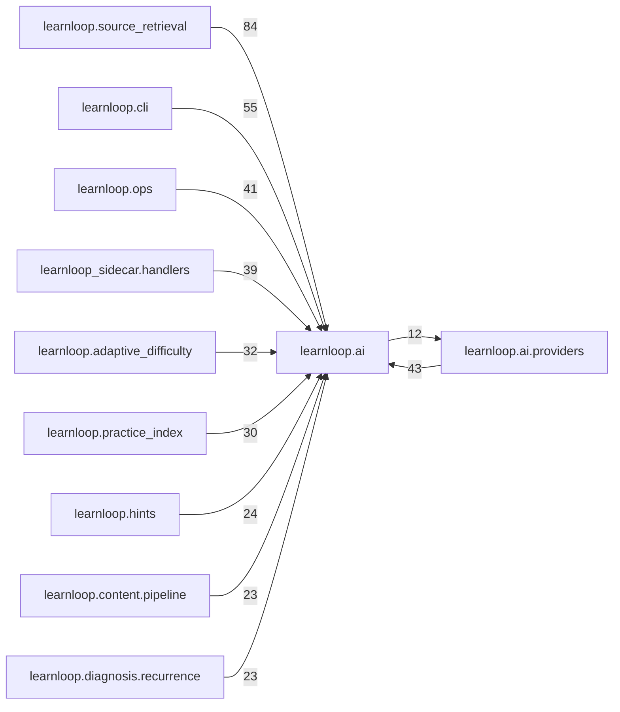

# `learnloop.ai` package map

> [!info] Generated package map
> This map is generated from live modules and their static imports. Follow module links for source-level facts and canonical concept/workflow links for system behavior.

Up: [[Module Catalog]]

## Responsibility

Provider-neutral structured transport, routing, provider composition, capability checks, and usage accounting.

For system intent, use [[AI Architecture]], [[Architecture Overview]].

^package-purpose

## Module index

| Module | Purpose | Status | Direct importers | Direct test files |
|---|---|---:|---:|---:|
| [[Reference/Modules/learnloop/ai/__init__|learnloop.ai]] | [[Reference/Modules/learnloop/ai/__init__#^module-purpose|purpose]] | `ACTIVE` | 0 | 0 |
| [[Reference/Modules/learnloop/ai/agent_harness|learnloop.ai.agent_harness]] | [[Reference/Modules/learnloop/ai/agent_harness#^module-purpose|purpose]] | `ACTIVE` | 5 | 2 |
| [[Reference/Modules/learnloop/ai/agreement|learnloop.ai.agreement]] | [[Reference/Modules/learnloop/ai/agreement#^module-purpose|purpose]] | `ACTIVE` | 1 | 3 |
| [[Reference/Modules/learnloop/ai/client|learnloop.ai.client]] | [[Reference/Modules/learnloop/ai/client#^module-purpose|purpose]] | `ACTIVE` | 8 | 17 |
| [[Reference/Modules/learnloop/ai/decisions|learnloop.ai.decisions]] | [[Reference/Modules/learnloop/ai/decisions#^module-purpose|purpose]] | `ACTIVE` | 22 | 17 |
| [[Reference/Modules/learnloop/ai/disclosures|learnloop.ai.disclosures]] | [[Reference/Modules/learnloop/ai/disclosures#^module-purpose|purpose]] | `ACTIVE` | 3 | 7 |
| [[Reference/Modules/learnloop/ai/embedding|learnloop.ai.embedding]] | [[Reference/Modules/learnloop/ai/embedding#^module-purpose|purpose]] | `ACTIVE` | 10 | 3 |
| [[Reference/Modules/learnloop/ai/errors|learnloop.ai.errors]] | [[Reference/Modules/learnloop/ai/errors#^module-purpose|purpose]] | `ACTIVE` | 111 | 94 |
| [[Reference/Modules/learnloop/ai/execution|learnloop.ai.execution]] | [[Reference/Modules/learnloop/ai/execution#^module-purpose|purpose]] | `ACTIVE` | 131 | 100 |
| [[Reference/Modules/learnloop/ai/isolation|learnloop.ai.isolation]] | [[Reference/Modules/learnloop/ai/isolation#^module-purpose|purpose]] | `ACTIVE` | 4 | 21 |
| [[Reference/Modules/learnloop/ai/multimodal|learnloop.ai.multimodal]] | [[Reference/Modules/learnloop/ai/multimodal#^module-purpose|purpose]] | `ACTIVE` | 2 | 1 |
| [[Reference/Modules/learnloop/ai/native_media|learnloop.ai.native_media]] | [[Reference/Modules/learnloop/ai/native_media#^module-purpose|purpose]] | `ACTIVE` | 4 | 1 |
| [[Reference/Modules/learnloop/ai/output_budget|learnloop.ai.output_budget]] | [[Reference/Modules/learnloop/ai/output_budget#^module-purpose|purpose]] | `ACTIVE` | 26 | 5 |
| [[Reference/Modules/learnloop/ai/plan_fallback|learnloop.ai.plan_fallback]] | [[Reference/Modules/learnloop/ai/plan_fallback#^module-purpose|purpose]] | `ACTIVE` | 34 | 20 |
| [[Reference/Modules/learnloop/ai/review_spend|learnloop.ai.review_spend]] | [[Reference/Modules/learnloop/ai/review_spend#^module-purpose|purpose]] | `ACTIVE` | 5 | 2 |
| [[Reference/Modules/learnloop/ai/routing|learnloop.ai.routing]] | [[Reference/Modules/learnloop/ai/routing#^module-purpose|purpose]] | `ACTIVE` | 60 | 37 |
| [[Reference/Modules/learnloop/ai/runs|learnloop.ai.runs]] | [[Reference/Modules/learnloop/ai/runs#^module-purpose|purpose]] | `ACTIVE` | 10 | 1 |
| [[Reference/Modules/learnloop/ai/runtime|learnloop.ai.runtime]] | [[Reference/Modules/learnloop/ai/runtime#^module-purpose|purpose]] | `ACTIVE` | 9 | 15 |
| [[Reference/Modules/learnloop/ai/schemas|learnloop.ai.schemas]] | [[Reference/Modules/learnloop/ai/schemas#^module-purpose|purpose]] | `ACTIVE` | 72 | 14 |
| [[Reference/Modules/learnloop/ai/spend|learnloop.ai.spend]] | [[Reference/Modules/learnloop/ai/spend#^module-purpose|purpose]] | `ACTIVE` | 122 | 94 |
| [[Reference/Modules/learnloop/ai/strict_schema|learnloop.ai.strict_schema]] | [[Reference/Modules/learnloop/ai/strict_schema#^module-purpose|purpose]] | `ACTIVE` | 5 | 11 |
| [[Reference/Modules/learnloop/ai/tool_requests|learnloop.ai.tool_requests]] | [[Reference/Modules/learnloop/ai/tool_requests#^module-purpose|purpose]] | `ACTIVE` | 1 | 0 |
| [[Reference/Modules/learnloop/ai/transport|learnloop.ai.transport]] | [[Reference/Modules/learnloop/ai/transport#^module-purpose|purpose]] | `ACTIVE` | 114 | 69 |
| [[Reference/Modules/learnloop/ai/usage|learnloop.ai.usage]] | [[Reference/Modules/learnloop/ai/usage#^module-purpose|purpose]] | `ACTIVE` | 13 | 7 |

## Child package maps

- [[Reference/Modules/learnloop/ai/chatgpt_plan/_package|learnloop.ai.chatgpt_plan]] — Sign in with ChatGPT for the chatgpt_plan provider: the machine-local sign-in store, the PKCE flow, access tokens and plan-usage state, and its requests.
- [[Reference/Modules/learnloop/ai/providers/_package|learnloop.ai.providers]] — Concrete AI transport adapters behind the provider-neutral contract.

## Cross-package dependencies

### This package imports

- [[Reference/Modules/learnloop/ai/providers/_package|learnloop.ai.providers]] — 12 static module edges
- [[Reference/Modules/learnloop/config/_package|learnloop.config]] — 11 static module edges
- [[Reference/Modules/learnloop/_package|learnloop]] — 2 static module edges
- [[Reference/Modules/learnloop/ai/chatgpt_plan/_package|learnloop.ai.chatgpt_plan]] — 1 static module edge
- [[Reference/Modules/learnloop/db/_package|learnloop.db]] — 1 static module edge

### Packages that import this package

- [[Reference/Modules/learnloop/source_retrieval/_package|learnloop.source_retrieval]] — 84 static module edges
- [[Reference/Modules/learnloop/cli/_package|learnloop.cli]] — 55 static module edges
- [[Reference/Modules/learnloop/ai/providers/_package|learnloop.ai.providers]] — 43 static module edges
- [[Reference/Modules/learnloop/ops/_package|learnloop.ops]] — 41 static module edges
- [[Reference/Modules/learnloop_sidecar/handlers/_package|learnloop_sidecar.handlers]] — 39 static module edges
- [[Reference/Modules/learnloop/adaptive_difficulty/_package|learnloop.adaptive_difficulty]] — 32 static module edges
- [[Reference/Modules/learnloop/practice_index/_package|learnloop.practice_index]] — 30 static module edges
- [[Reference/Modules/learnloop/hints/_package|learnloop.hints]] — 24 static module edges
- [[Reference/Modules/learnloop/content/pipeline/_package|learnloop.content.pipeline]] — 23 static module edges
- [[Reference/Modules/learnloop/diagnosis/recurrence/_package|learnloop.diagnosis.recurrence]] — 23 static module edges
- [[Reference/Modules/learnloop/instructional/_package|learnloop.instructional]] — 21 static module edges
- [[Reference/Modules/learnloop/content/authoring/_package|learnloop.content.authoring]] — 19 static module edges
- [[Reference/Modules/learnloop/content/proposals/_package|learnloop.content.proposals]] — 19 static module edges
- [[Reference/Modules/learnloop/experiments/contextual_embeddings/_package|learnloop.experiments.contextual_embeddings]] — 19 static module edges
- [[Reference/Modules/learnloop/attempts/_package|learnloop.attempts]] — 17 static module edges
- [[Reference/Modules/learnloop/content/synthesis/_package|learnloop.content.synthesis]] — 17 static module edges
- [[Reference/Modules/learnloop/diagnosis/_package|learnloop.diagnosis]] — 17 static module edges
- [[Reference/Modules/learnloop/diagnosis/split/_package|learnloop.diagnosis.split]] — 17 static module edges
- [[Reference/Modules/learnloop/diagnosis/text_gaps/_package|learnloop.diagnosis.text_gaps]] — 17 static module edges
- [[Reference/Modules/learnloop/figures/_package|learnloop.figures]] — 16 static module edges
- [[Reference/Modules/learnloop/reader/_package|learnloop.reader]] — 16 static module edges
- [[Reference/Modules/learnloop/content/facet_identity/_package|learnloop.content.facet_identity]] — 14 static module edges
- [[Reference/Modules/learnloop/diagnosis/offline_review/_package|learnloop.diagnosis.offline_review]] — 14 static module edges
- [[Reference/Modules/learnloop/ops/contamination/_package|learnloop.ops.contamination]] — 14 static module edges
- [[Reference/Modules/learnloop/field/_package|learnloop.field]] — 12 static module edges
- [[Reference/Modules/learnloop/projects/_package|learnloop.projects]] — 12 static module edges
- [[Reference/Modules/learnloop/workbench/_package|learnloop.workbench]] — 12 static module edges
- [[Reference/Modules/learnloop/daily_plan/_package|learnloop.daily_plan]] — 11 static module edges
- [[Reference/Modules/learnloop/tutor/_package|learnloop.tutor]] — 11 static module edges
- [[Reference/Modules/learnloop/teacher/_package|learnloop.teacher]] — 9 static module edges
- [[Reference/Modules/learnloop/_package|learnloop]] — 8 static module edges
- [[Reference/Modules/learnloop_sidecar/_package|learnloop_sidecar]] — 7 static module edges
- [[Reference/Modules/learnloop/curriculum/_package|learnloop.curriculum]] — 5 static module edges
- [[Reference/Modules/learnloop/matching/_package|learnloop.matching]] — 5 static module edges
- [[Reference/Modules/learnloop/followup_run/_package|learnloop.followup_run]] — 4 static module edges
- [[Reference/Modules/learnloop/ingest/extractors/_package|learnloop.ingest.extractors]] — 3 static module edges
- [[Reference/Modules/learnloop/ai/chatgpt_plan/_package|learnloop.ai.chatgpt_plan]] — 2 static module edges
- [[Reference/Modules/learnloop/experiments/contextual_embeddings/e1/_package|learnloop.experiments.contextual_embeddings.e1]] — 2 static module edges
- [[Reference/Modules/learnloop/remote/_package|learnloop.remote]] — 2 static module edges
- [[Reference/Modules/learnloop/router/_package|learnloop.router]] — 2 static module edges
- [[Reference/Modules/learnloop/tui/screens/_package|learnloop.tui.screens]] — 2 static module edges
- [[Reference/Modules/learnloop/db/_package|learnloop.db]] — 1 static module edge
- [[Reference/Modules/learnloop/sim/_package|learnloop.sim]] — 1 static module edge
- [[Reference/Modules/learnloop/substrate/_package|learnloop.substrate]] — 1 static module edge
- [[Reference/Modules/learnloop/tui/_package|learnloop.tui]] — 1 static module edge
- [[Reference/Modules/learnloop/why/_package|learnloop.why]] — 1 static module edge

### Dependency neighborhood

This diagram compresses package-level static imports; edge labels are distinct module-to-module import counts.



Interpretation: arrow direction is static import direction and the label is the number of distinct module-to-module edges. It shows coupling pressure, not runtime call frequency or ownership permission.

## Workflow entry points

- [[Process Model Output]]

## Find and filter

Use Obsidian's native search:

```query
path:"Reference/Modules/learnloop/ai" tag:#docs/module
```

To change this package, start with a module's [[#Module index|purpose link]], then follow its callers, tests, and modification guidance. Re-run the generator after source changes.
