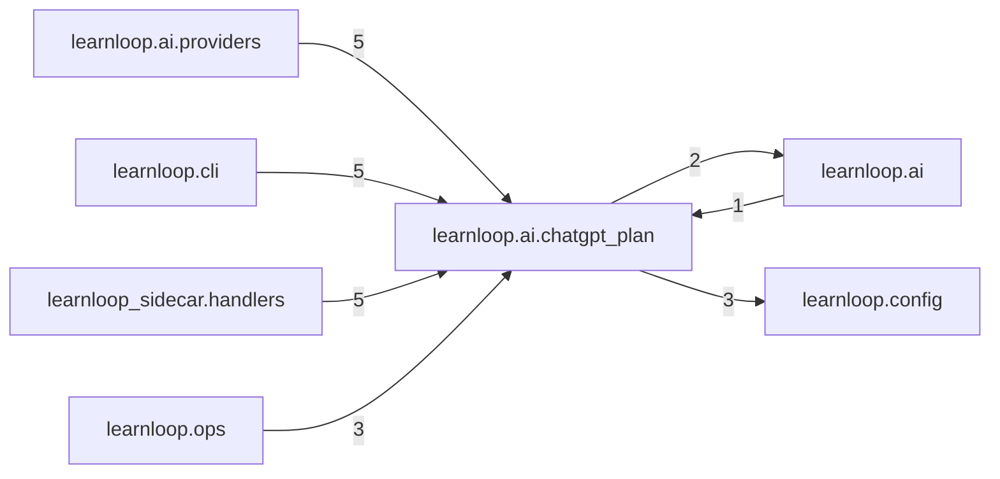

# `learnloop.ai.chatgpt_plan` package map

> [!info] Generated package map
> This map is generated from live modules and their static imports. Follow module links for source-level facts and canonical concept/workflow links for system behavior.

Up: [[Module Catalog]]

## Responsibility

Sign in with ChatGPT for the chatgpt_plan provider: the machine-local sign-in store, the PKCE flow, access tokens and plan-usage state, and its requests.

For system intent, use [[AI Architecture]], [[Architecture Overview]].

^package-purpose

## Module index

| Module | Purpose | Status | Direct importers | Direct test files |
|---|---|---:|---:|---:|
| [[Reference/Modules/learnloop/ai/chatgpt_plan/__init__|learnloop.ai.chatgpt_plan]] | [[Reference/Modules/learnloop/ai/chatgpt_plan/__init__#^module-purpose|purpose]] | `ACTIVE` | 0 | 0 |
| [[Reference/Modules/learnloop/ai/chatgpt_plan/oauth|learnloop.ai.chatgpt_plan.oauth]] | [[Reference/Modules/learnloop/ai/chatgpt_plan/oauth#^module-purpose|purpose]] | `ACTIVE` | 4 | 2 |
| [[Reference/Modules/learnloop/ai/chatgpt_plan/responses|learnloop.ai.chatgpt_plan.responses]] | [[Reference/Modules/learnloop/ai/chatgpt_plan/responses#^module-purpose|purpose]] | `ACTIVE` | 1 | 2 |
| [[Reference/Modules/learnloop/ai/chatgpt_plan/routes|learnloop.ai.chatgpt_plan.routes]] | [[Reference/Modules/learnloop/ai/chatgpt_plan/routes#^module-purpose|purpose]] | `ACTIVE` | 4 | 0 |
| [[Reference/Modules/learnloop/ai/chatgpt_plan/session|learnloop.ai.chatgpt_plan.session]] | [[Reference/Modules/learnloop/ai/chatgpt_plan/session#^module-purpose|purpose]] | `ACTIVE` | 7 | 12 |
| [[Reference/Modules/learnloop/ai/chatgpt_plan/store|learnloop.ai.chatgpt_plan.store]] | [[Reference/Modules/learnloop/ai/chatgpt_plan/store#^module-purpose|purpose]] | `ACTIVE` | 3 | 1 |
| [[Reference/Modules/learnloop/ai/chatgpt_plan/workspace|learnloop.ai.chatgpt_plan.workspace]] | [[Reference/Modules/learnloop/ai/chatgpt_plan/workspace#^module-purpose|purpose]] | `ACTIVE` | 2 | 3 |

## Cross-package dependencies

### This package imports

- [[Reference/Modules/learnloop/config/_package|learnloop.config]] — 3 static module edges
- [[Reference/Modules/learnloop/ai/_package|learnloop.ai]] — 2 static module edges

### Packages that import this package

- [[Reference/Modules/learnloop/ai/providers/_package|learnloop.ai.providers]] — 5 static module edges
- [[Reference/Modules/learnloop/cli/_package|learnloop.cli]] — 5 static module edges
- [[Reference/Modules/learnloop_sidecar/handlers/_package|learnloop_sidecar.handlers]] — 5 static module edges
- [[Reference/Modules/learnloop/ops/_package|learnloop.ops]] — 3 static module edges
- [[Reference/Modules/learnloop/ai/_package|learnloop.ai]] — 1 static module edge

### Dependency neighborhood

This diagram compresses package-level static imports; edge labels are distinct module-to-module import counts.



Interpretation: arrow direction is static import direction and the label is the number of distinct module-to-module edges. It shows coupling pressure, not runtime call frequency or ownership permission.

## Workflow entry points

- [[Process Model Output]]

## Find and filter

Use Obsidian's native search:

```query
path:"Reference/Modules/learnloop/ai/chatgpt_plan" tag:#docs/module
```

To change this package, start with a module's [[#Module index|purpose link]], then follow its callers, tests, and modification guidance. Re-run the generator after source changes.
