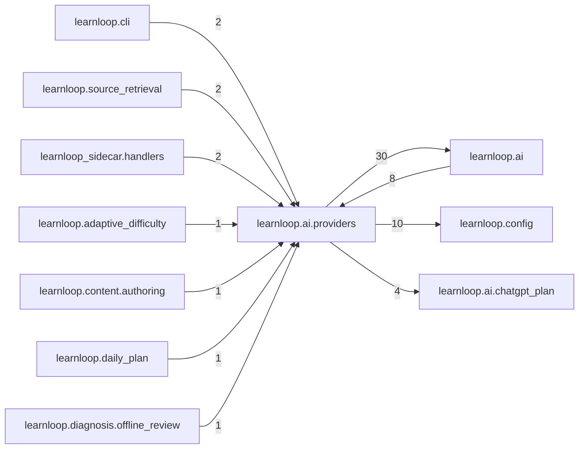

# `learnloop.ai.providers` package map

> [!info] Generated package map
> This map is generated from live modules and their static imports. Follow module links for source-level facts and canonical concept/workflow links for system behavior.

Up: [[Module Catalog]]

## Responsibility

Concrete AI transport adapters behind the provider-neutral contract.

For system intent, use [[AI Architecture]], [[Architecture Overview]].

^package-purpose

## Module index

| Module | Purpose | Status | Direct importers | Direct test files |
|---|---|---:|---:|---:|
| [[Reference/Modules/learnloop/ai/providers/__init__|learnloop.ai.providers]] | [[Reference/Modules/learnloop/ai/providers/__init__#^module-purpose|purpose]] | `ACTIVE` | 0 | 0 |
| [[Reference/Modules/learnloop/ai/providers/chatgpt_plan|learnloop.ai.providers.chatgpt_plan]] | [[Reference/Modules/learnloop/ai/providers/chatgpt_plan#^module-purpose|purpose]] | `ACTIVE` | 3 | 8 |
| [[Reference/Modules/learnloop/ai/providers/decider|learnloop.ai.providers.decider]] | [[Reference/Modules/learnloop/ai/providers/decider#^module-purpose|purpose]] | `ACTIVE` | 6 | 5 |
| [[Reference/Modules/learnloop/ai/providers/openai_chat|learnloop.ai.providers.openai_chat]] | [[Reference/Modules/learnloop/ai/providers/openai_chat#^module-purpose|purpose]] | `ACTIVE` | 3 | 15 |
| [[Reference/Modules/learnloop/ai/providers/openai_embedding|learnloop.ai.providers.openai_embedding]] | [[Reference/Modules/learnloop/ai/providers/openai_embedding#^module-purpose|purpose]] | `ACTIVE` | 6 | 11 |
| [[Reference/Modules/learnloop/ai/providers/openrouter|learnloop.ai.providers.openrouter]] | [[Reference/Modules/learnloop/ai/providers/openrouter#^module-purpose|purpose]] | `ACTIVE` | 2 | 7 |
| [[Reference/Modules/learnloop/ai/providers/openrouter_catalog|learnloop.ai.providers.openrouter_catalog]] | [[Reference/Modules/learnloop/ai/providers/openrouter_catalog#^module-purpose|purpose]] | `ACTIVE` | 1 | 2 |
| [[Reference/Modules/learnloop/ai/providers/openrouter_video|learnloop.ai.providers.openrouter_video]] | [[Reference/Modules/learnloop/ai/providers/openrouter_video#^module-purpose|purpose]] | `ACTIVE` | 2 | 3 |
| [[Reference/Modules/learnloop/ai/providers/structured_output|learnloop.ai.providers.structured_output]] | [[Reference/Modules/learnloop/ai/providers/structured_output#^module-purpose|purpose]] | `ACTIVE` | 0 | 0 |
| [[Reference/Modules/learnloop/ai/providers/voyage_contextual|learnloop.ai.providers.voyage_contextual]] | [[Reference/Modules/learnloop/ai/providers/voyage_contextual#^module-purpose|purpose]] | `ACTIVE` | 2 | 1 |

## Cross-package dependencies

### This package imports

- [[Reference/Modules/learnloop/ai/_package|learnloop.ai]] — 30 static module edges
- [[Reference/Modules/learnloop/config/_package|learnloop.config]] — 10 static module edges
- [[Reference/Modules/learnloop/ai/chatgpt_plan/_package|learnloop.ai.chatgpt_plan]] — 4 static module edges

### Packages that import this package

- [[Reference/Modules/learnloop/ai/_package|learnloop.ai]] — 8 static module edges
- [[Reference/Modules/learnloop/cli/_package|learnloop.cli]] — 2 static module edges
- [[Reference/Modules/learnloop/source_retrieval/_package|learnloop.source_retrieval]] — 2 static module edges
- [[Reference/Modules/learnloop_sidecar/handlers/_package|learnloop_sidecar.handlers]] — 2 static module edges
- [[Reference/Modules/learnloop/adaptive_difficulty/_package|learnloop.adaptive_difficulty]] — 1 static module edge
- [[Reference/Modules/learnloop/content/authoring/_package|learnloop.content.authoring]] — 1 static module edge
- [[Reference/Modules/learnloop/daily_plan/_package|learnloop.daily_plan]] — 1 static module edge
- [[Reference/Modules/learnloop/diagnosis/offline_review/_package|learnloop.diagnosis.offline_review]] — 1 static module edge
- [[Reference/Modules/learnloop/diagnosis/recurrence/_package|learnloop.diagnosis.recurrence]] — 1 static module edge
- [[Reference/Modules/learnloop/experiments/contextual_embeddings/_package|learnloop.experiments.contextual_embeddings]] — 1 static module edge
- [[Reference/Modules/learnloop/experiments/contextual_embeddings/e1/_package|learnloop.experiments.contextual_embeddings.e1]] — 1 static module edge
- [[Reference/Modules/learnloop/instructional/_package|learnloop.instructional]] — 1 static module edge
- [[Reference/Modules/learnloop/ops/_package|learnloop.ops]] — 1 static module edge

### Dependency neighborhood

This diagram compresses package-level static imports; edge labels are distinct module-to-module import counts.



Interpretation: arrow direction is static import direction and the label is the number of distinct module-to-module edges. It shows coupling pressure, not runtime call frequency or ownership permission.

## Workflow entry points

- [[Process Model Output]]

## Find and filter

Use Obsidian's native search:

```query
path:"Reference/Modules/learnloop/ai/providers" tag:#docs/module
```

To change this package, start with a module's [[#Module index|purpose link]], then follow its callers, tests, and modification guidance. Re-run the generator after source changes.
