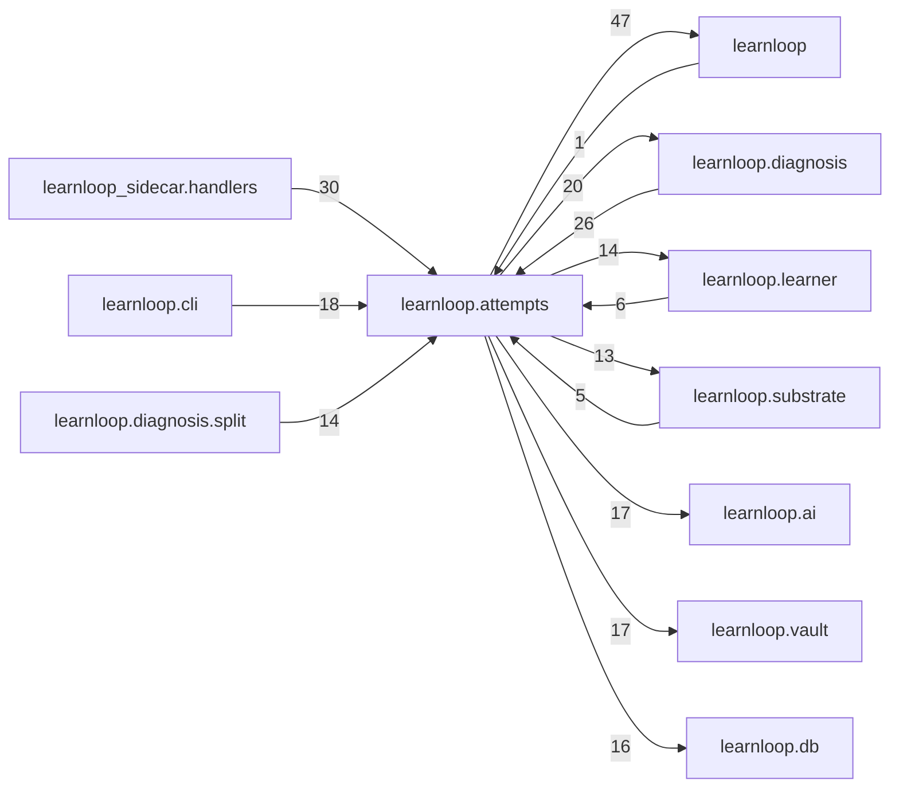

# `learnloop.attempts` package map

> [!info] Generated package map
> This map is generated from live modules and their static imports. Follow module links for source-level facts and canonical concept/workflow links for system behavior.

Up: [[Module Catalog]]

## Responsibility

Attempt acceptance, grading, interaction evidence, feedback, and post-attempt processing.

For system intent, use [[Learning System]].

^package-purpose

## Module index

| Module | Purpose | Status | Direct importers | Direct test files |
|---|---|---:|---:|---:|
| [[Reference/Modules/learnloop/attempts/__init__|learnloop.attempts]] | [[Reference/Modules/learnloop/attempts/__init__#^module-purpose|purpose]] | `ACTIVE` | 0 | 0 |
| [[Reference/Modules/learnloop/attempts/ability_transition|learnloop.attempts.ability_transition]] | [[Reference/Modules/learnloop/attempts/ability_transition#^module-purpose|purpose]] | `ACTIVE` | 2 | 0 |
| [[Reference/Modules/learnloop/attempts/ai_contracts|learnloop.attempts.ai_contracts]] | [[Reference/Modules/learnloop/attempts/ai_contracts#^module-purpose|purpose]] | `ACTIVE` | 13 | 30 |
| [[Reference/Modules/learnloop/attempts/answer_check|learnloop.attempts.answer_check]] | [[Reference/Modules/learnloop/attempts/answer_check#^module-purpose|purpose]] | `ACTIVE` | 6 | 1 |
| [[Reference/Modules/learnloop/attempts/attempt_trace|learnloop.attempts.attempt_trace]] | [[Reference/Modules/learnloop/attempts/attempt_trace#^module-purpose|purpose]] | `ACTIVE` | 1 | 0 |
| [[Reference/Modules/learnloop/attempts/attempts|learnloop.attempts.attempts]] | [[Reference/Modules/learnloop/attempts/attempts#^module-purpose|purpose]] | `ACTIVE` | 37 | 225 |
| [[Reference/Modules/learnloop/attempts/blind_grading|learnloop.attempts.blind_grading]] | [[Reference/Modules/learnloop/attempts/blind_grading#^module-purpose|purpose]] | `ACTIVE` | 13 | 36 |
| [[Reference/Modules/learnloop/attempts/calibration_streams|learnloop.attempts.calibration_streams]] | [[Reference/Modules/learnloop/attempts/calibration_streams#^module-purpose|purpose]] | `ACTIVE` | 2 | 1 |
| [[Reference/Modules/learnloop/attempts/clarification|learnloop.attempts.clarification]] | [[Reference/Modules/learnloop/attempts/clarification#^module-purpose|purpose]] | `ACTIVE` | 6 | 3 |
| [[Reference/Modules/learnloop/attempts/coldness_receipt|learnloop.attempts.coldness_receipt]] | [[Reference/Modules/learnloop/attempts/coldness_receipt#^module-purpose|purpose]] | `ACTIVE` | 4 | 5 |
| [[Reference/Modules/learnloop/attempts/completion_lock|learnloop.attempts.completion_lock]] | [[Reference/Modules/learnloop/attempts/completion_lock#^module-purpose|purpose]] | `ACTIVE` | 2 | 1 |
| [[Reference/Modules/learnloop/attempts/effective_observation|learnloop.attempts.effective_observation]] | [[Reference/Modules/learnloop/attempts/effective_observation#^module-purpose|purpose]] | `ACTIVE` | 4 | 4 |
| [[Reference/Modules/learnloop/attempts/evidence|learnloop.attempts.evidence]] | [[Reference/Modules/learnloop/attempts/evidence#^module-purpose|purpose]] | `ACTIVE` | 9 | 3 |
| [[Reference/Modules/learnloop/attempts/grade_classifier|learnloop.attempts.grade_classifier]] | [[Reference/Modules/learnloop/attempts/grade_classifier#^module-purpose|purpose]] | `ACTIVE` | 3 | 1 |
| [[Reference/Modules/learnloop/attempts/grade_resolution|learnloop.attempts.grade_resolution]] | [[Reference/Modules/learnloop/attempts/grade_resolution#^module-purpose|purpose]] | `ACTIVE` | 6 | 12 |
| [[Reference/Modules/learnloop/attempts/grader_calibration|learnloop.attempts.grader_calibration]] | [[Reference/Modules/learnloop/attempts/grader_calibration#^module-purpose|purpose]] | `ACTIVE` | 4 | 6 |
| [[Reference/Modules/learnloop/attempts/grading|learnloop.attempts.grading]] | [[Reference/Modules/learnloop/attempts/grading#^module-purpose|purpose]] | `ACTIVE` | 35 | 40 |
| [[Reference/Modules/learnloop/attempts/grading_admission|learnloop.attempts.grading_admission]] | [[Reference/Modules/learnloop/attempts/grading_admission#^module-purpose|purpose]] | `ACTIVE` | 5 | 1 |
| [[Reference/Modules/learnloop/attempts/grading_support|learnloop.attempts.grading_support]] | [[Reference/Modules/learnloop/attempts/grading_support#^module-purpose|purpose]] | `ACTIVE` | 7 | 16 |
| [[Reference/Modules/learnloop/attempts/hint_fold|learnloop.attempts.hint_fold]] | [[Reference/Modules/learnloop/attempts/hint_fold#^module-purpose|purpose]] | `ACTIVE` | 2 | 5 |
| [[Reference/Modules/learnloop/attempts/measurement_corrections|learnloop.attempts.measurement_corrections]] | [[Reference/Modules/learnloop/attempts/measurement_corrections#^module-purpose|purpose]] | `ACTIVE` | 1 | 2 |
| [[Reference/Modules/learnloop/attempts/observations|learnloop.attempts.observations]] | [[Reference/Modules/learnloop/attempts/observations#^module-purpose|purpose]] | `ACTIVE` | 1 | 2 |
| [[Reference/Modules/learnloop/attempts/outcome_schemas|learnloop.attempts.outcome_schemas]] | [[Reference/Modules/learnloop/attempts/outcome_schemas#^module-purpose|purpose]] | `ACTIVE` | 6 | 7 |
| [[Reference/Modules/learnloop/attempts/post_attempt|learnloop.attempts.post_attempt]] | [[Reference/Modules/learnloop/attempts/post_attempt#^module-purpose|purpose]] | `ACTIVE` | 6 | 22 |
| [[Reference/Modules/learnloop/attempts/regrade|learnloop.attempts.regrade]] | [[Reference/Modules/learnloop/attempts/regrade#^module-purpose|purpose]] | `ACTIVE` | 3 | 26 |
| [[Reference/Modules/learnloop/attempts/reveal_ledger|learnloop.attempts.reveal_ledger]] | [[Reference/Modules/learnloop/attempts/reveal_ledger#^module-purpose|purpose]] | `ACTIVE` | 19 | 14 |
| [[Reference/Modules/learnloop/attempts/salience_firewall|learnloop.attempts.salience_firewall]] | [[Reference/Modules/learnloop/attempts/salience_firewall#^module-purpose|purpose]] | `ACTIVE` | 17 | 28 |
| [[Reference/Modules/learnloop/attempts/stuck|learnloop.attempts.stuck]] | [[Reference/Modules/learnloop/attempts/stuck#^module-purpose|purpose]] | `ACTIVE` | 14 | 14 |
| [[Reference/Modules/learnloop/attempts/surprise|learnloop.attempts.surprise]] | [[Reference/Modules/learnloop/attempts/surprise#^module-purpose|purpose]] | `ACTIVE` | 1 | 1 |
| [[Reference/Modules/learnloop/attempts/trace_evidence|learnloop.attempts.trace_evidence]] | [[Reference/Modules/learnloop/attempts/trace_evidence#^module-purpose|purpose]] | `ACTIVE` | 6 | 4 |

## Cross-package dependencies

### This package imports

- [[Reference/Modules/learnloop/_package|learnloop]] — 47 static module edges
- [[Reference/Modules/learnloop/diagnosis/_package|learnloop.diagnosis]] — 20 static module edges
- [[Reference/Modules/learnloop/ai/_package|learnloop.ai]] — 17 static module edges
- [[Reference/Modules/learnloop/vault/_package|learnloop.vault]] — 17 static module edges
- [[Reference/Modules/learnloop/db/_package|learnloop.db]] — 16 static module edges
- [[Reference/Modules/learnloop/learner/_package|learnloop.learner]] — 14 static module edges
- [[Reference/Modules/learnloop/substrate/_package|learnloop.substrate]] — 13 static module edges
- [[Reference/Modules/learnloop/db/stores/_package|learnloop.db.stores]] — 8 static module edges
- [[Reference/Modules/learnloop/params/_package|learnloop.params]] — 4 static module edges
- [[Reference/Modules/learnloop/config/_package|learnloop.config]] — 3 static module edges
- [[Reference/Modules/learnloop/followup_serve/_package|learnloop.followup_serve]] — 3 static module edges
- [[Reference/Modules/learnloop/ai/providers/_package|learnloop.ai.providers]] — 2 static module edges
- [[Reference/Modules/learnloop/goals/_package|learnloop.goals]] — 2 static module edges
- [[Reference/Modules/learnloop/placement/_package|learnloop.placement]] — 2 static module edges
- [[Reference/Modules/learnloop/content/authoring/_package|learnloop.content.authoring]] — 1 static module edge
- [[Reference/Modules/learnloop/content/proposals/_package|learnloop.content.proposals]] — 1 static module edge
- [[Reference/Modules/learnloop/scheduling/_package|learnloop.scheduling]] — 1 static module edge
- [[Reference/Modules/learnloop/tutor/_package|learnloop.tutor]] — 1 static module edge

### Packages that import this package

- [[Reference/Modules/learnloop_sidecar/handlers/_package|learnloop_sidecar.handlers]] — 30 static module edges
- [[Reference/Modules/learnloop/diagnosis/_package|learnloop.diagnosis]] — 26 static module edges
- [[Reference/Modules/learnloop/cli/_package|learnloop.cli]] — 18 static module edges
- [[Reference/Modules/learnloop/diagnosis/split/_package|learnloop.diagnosis.split]] — 14 static module edges
- [[Reference/Modules/learnloop/teacher/_package|learnloop.teacher]] — 9 static module edges
- [[Reference/Modules/learnloop/reader/_package|learnloop.reader]] — 8 static module edges
- [[Reference/Modules/learnloop/diagnosis/offline_review/_package|learnloop.diagnosis.offline_review]] — 7 static module edges
- [[Reference/Modules/learnloop/tui/screens/_package|learnloop.tui.screens]] — 7 static module edges
- [[Reference/Modules/learnloop/field/_package|learnloop.field]] — 6 static module edges
- [[Reference/Modules/learnloop/goals/_package|learnloop.goals]] — 6 static module edges
- [[Reference/Modules/learnloop/learner/_package|learnloop.learner]] — 6 static module edges
- [[Reference/Modules/learnloop/scheduling/_package|learnloop.scheduling]] — 6 static module edges
- [[Reference/Modules/learnloop/sim/_package|learnloop.sim]] — 5 static module edges
- [[Reference/Modules/learnloop/substrate/_package|learnloop.substrate]] — 5 static module edges
- [[Reference/Modules/learnloop/daily_plan/_package|learnloop.daily_plan]] — 4 static module edges
- [[Reference/Modules/learnloop/source_retrieval/_package|learnloop.source_retrieval]] — 4 static module edges
- [[Reference/Modules/learnloop/ops/_package|learnloop.ops]] — 3 static module edges
- [[Reference/Modules/learnloop/tutor/_package|learnloop.tutor]] — 3 static module edges
- [[Reference/Modules/learnloop/adaptive_difficulty/_package|learnloop.adaptive_difficulty]] — 2 static module edges
- [[Reference/Modules/learnloop/content/authoring/_package|learnloop.content.authoring]] — 2 static module edges
- [[Reference/Modules/learnloop/instructional/_package|learnloop.instructional]] — 2 static module edges
- [[Reference/Modules/learnloop/ops/contamination/_package|learnloop.ops.contamination]] — 2 static module edges
- [[Reference/Modules/learnloop_sidecar/_package|learnloop_sidecar]] — 2 static module edges
- [[Reference/Modules/learnloop/_package|learnloop]] — 1 static module edge
- [[Reference/Modules/learnloop/curriculum/_package|learnloop.curriculum]] — 1 static module edge
- [[Reference/Modules/learnloop/diagnosis/text_gaps/_package|learnloop.diagnosis.text_gaps]] — 1 static module edge
- [[Reference/Modules/learnloop/followup_run/_package|learnloop.followup_run]] — 1 static module edge
- [[Reference/Modules/learnloop/hints/_package|learnloop.hints]] — 1 static module edge
- [[Reference/Modules/learnloop/placement/_package|learnloop.placement]] — 1 static module edge
- [[Reference/Modules/learnloop/practice_index/_package|learnloop.practice_index]] — 1 static module edge
- [[Reference/Modules/learnloop/remote/_package|learnloop.remote]] — 1 static module edge
- [[Reference/Modules/learnloop/workbench/_package|learnloop.workbench]] — 1 static module edge

### Dependency neighborhood

This diagram compresses package-level static imports; edge labels are distinct module-to-module import counts.



Interpretation: arrow direction is static import direction and the label is the number of distinct module-to-module edges. It shows coupling pressure, not runtime call frequency or ownership permission.

## Workflow entry points

- [[Start a Learning Cycle]]
- [[Inspect Persistent State]]

## Find and filter

Use Obsidian's native search:

```query
path:"Reference/Modules/learnloop/attempts" tag:#docs/module
```

To change this package, start with a module's [[#Module index|purpose link]], then follow its callers, tests, and modification guidance. Re-run the generator after source changes.
