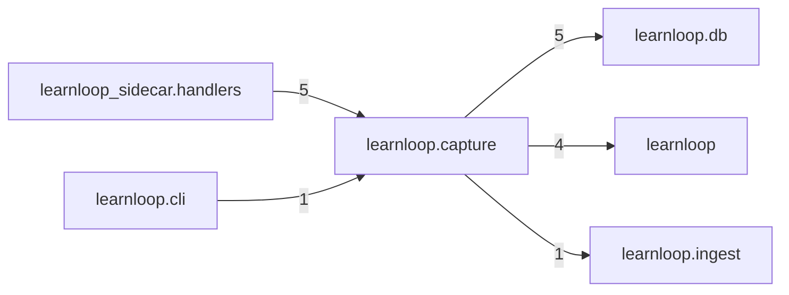

# `learnloop.capture` package map

> [!info] Generated package map
> This map is generated from live modules and their static imports. Follow module links for source-level facts and canonical concept/workflow links for system behavior.

Up: [[Module Catalog]]

## Responsibility

The shared capture domain (the capture inbox); importing it never attaches or migrates.

For system intent, use [[Architecture Overview]].

^package-purpose

## Module index

| Module | Purpose | Status | Direct importers | Direct test files |
|---|---|---:|---:|---:|
| [[Reference/Modules/learnloop/capture/__init__|learnloop.capture]] | [[Reference/Modules/learnloop/capture/__init__#^module-purpose|purpose]] | `ACTIVE` | 4 | 12 |
| [[Reference/Modules/learnloop/capture/devices|learnloop.capture.devices]] | [[Reference/Modules/learnloop/capture/devices#^module-purpose|purpose]] | `ACTIVE` | 4 | 0 |
| [[Reference/Modules/learnloop/capture/errors|learnloop.capture.errors]] | [[Reference/Modules/learnloop/capture/errors#^module-purpose|purpose]] | `ACTIVE` | 6 | 0 |
| [[Reference/Modules/learnloop/capture/inbox|learnloop.capture.inbox]] | [[Reference/Modules/learnloop/capture/inbox#^module-purpose|purpose]] | `ACTIVE` | 2 | 1 |
| [[Reference/Modules/learnloop/capture/jobs|learnloop.capture.jobs]] | [[Reference/Modules/learnloop/capture/jobs#^module-purpose|purpose]] | `ACTIVE` | 1 | 0 |
| [[Reference/Modules/learnloop/capture/maintenance|learnloop.capture.maintenance]] | [[Reference/Modules/learnloop/capture/maintenance#^module-purpose|purpose]] | `ACTIVE` | 1 | 0 |
| [[Reference/Modules/learnloop/capture/report|learnloop.capture.report]] | [[Reference/Modules/learnloop/capture/report#^module-purpose|purpose]] | `ACTIVE` | 1 | 0 |
| [[Reference/Modules/learnloop/capture/routing|learnloop.capture.routing]] | [[Reference/Modules/learnloop/capture/routing#^module-purpose|purpose]] | `ACTIVE` | 2 | 0 |

## Cross-package dependencies

### This package imports

- [[Reference/Modules/learnloop/db/_package|learnloop.db]] — 5 static module edges
- [[Reference/Modules/learnloop/_package|learnloop]] — 4 static module edges
- [[Reference/Modules/learnloop/ingest/_package|learnloop.ingest]] — 1 static module edge

### Packages that import this package

- [[Reference/Modules/learnloop_sidecar/handlers/_package|learnloop_sidecar.handlers]] — 5 static module edges
- [[Reference/Modules/learnloop/cli/_package|learnloop.cli]] — 1 static module edge

### Dependency neighborhood

This diagram compresses package-level static imports; edge labels are distinct module-to-module import counts.



Interpretation: arrow direction is static import direction and the label is the number of distinct module-to-module edges. It shows coupling pressure, not runtime call frequency or ownership permission.

## Workflow entry points

- [[Initialize a Vault]]
- [[Start a Learning Cycle]]

## Find and filter

Use Obsidian's native search:

```query
path:"Reference/Modules/learnloop/capture" tag:#docs/module
```

To change this package, start with a module's [[#Module index|purpose link]], then follow its callers, tests, and modification guidance. Re-run the generator after source changes.
