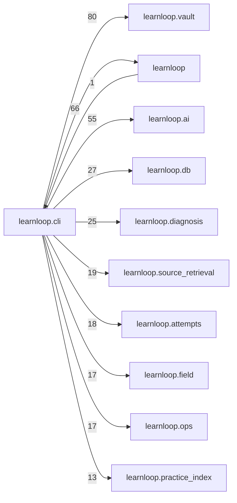

# `learnloop.cli` package map

> [!info] Generated package map
> This map is generated from live modules and their static imports. Follow module links for source-level facts and canonical concept/workflow links for system behavior.

Up: [[Module Catalog]]

## Responsibility

Typer command adapters, rendering, argument contracts, and command registration.

For system intent, use [[Architecture Overview]].

^package-purpose

## Module index

| Module | Purpose | Status | Direct importers | Direct test files |
|---|---|---:|---:|---:|
| [[Reference/Modules/learnloop/cli/__init__|learnloop.cli]] | [[Reference/Modules/learnloop/cli/__init__#^module-purpose|purpose]] | `ACTIVE` | 0 | 8 |
| [[Reference/Modules/learnloop/cli/ad|learnloop.cli.ad]] | [[Reference/Modules/learnloop/cli/ad#^module-purpose|purpose]] | `ACTIVE` | 1 | 0 |
| [[Reference/Modules/learnloop/cli/ai|learnloop.cli.ai]] | [[Reference/Modules/learnloop/cli/ai#^module-purpose|purpose]] | `ACTIVE` | 1 | 0 |
| [[Reference/Modules/learnloop/cli/ai_compare|learnloop.cli.ai_compare]] | [[Reference/Modules/learnloop/cli/ai_compare#^module-purpose|purpose]] | `ACTIVE` | 1 | 1 |
| [[Reference/Modules/learnloop/cli/app|learnloop.cli.app]] | [[Reference/Modules/learnloop/cli/app#^module-purpose|purpose]] | `ACTIVE` | 3 | 181 |
| [[Reference/Modules/learnloop/cli/calibration|learnloop.cli.calibration]] | [[Reference/Modules/learnloop/cli/calibration#^module-purpose|purpose]] | `ACTIVE` | 1 | 0 |
| [[Reference/Modules/learnloop/cli/card|learnloop.cli.card]] | [[Reference/Modules/learnloop/cli/card#^module-purpose|purpose]] | `ACTIVE` | 1 | 0 |
| [[Reference/Modules/learnloop/cli/claims|learnloop.cli.claims]] | [[Reference/Modules/learnloop/cli/claims#^module-purpose|purpose]] | `ACTIVE` | 1 | 0 |
| [[Reference/Modules/learnloop/cli/clarification|learnloop.cli.clarification]] | [[Reference/Modules/learnloop/cli/clarification#^module-purpose|purpose]] | `ACTIVE` | 1 | 0 |
| [[Reference/Modules/learnloop/cli/config|learnloop.cli.config]] | [[Reference/Modules/learnloop/cli/config#^module-purpose|purpose]] | `ACTIVE` | 1 | 0 |
| [[Reference/Modules/learnloop/cli/contamination|learnloop.cli.contamination]] | [[Reference/Modules/learnloop/cli/contamination#^module-purpose|purpose]] | `ACTIVE` | 1 | 0 |
| [[Reference/Modules/learnloop/cli/contracts|learnloop.cli.contracts]] | [[Reference/Modules/learnloop/cli/contracts#^module-purpose|purpose]] | `ACTIVE` | 1 | 0 |
| [[Reference/Modules/learnloop/cli/controller|learnloop.cli.controller]] | [[Reference/Modules/learnloop/cli/controller#^module-purpose|purpose]] | `ACTIVE` | 1 | 0 |
| [[Reference/Modules/learnloop/cli/curriculum|learnloop.cli.curriculum]] | [[Reference/Modules/learnloop/cli/curriculum#^module-purpose|purpose]] | `ACTIVE` | 1 | 0 |
| [[Reference/Modules/learnloop/cli/data|learnloop.cli.data]] | [[Reference/Modules/learnloop/cli/data#^module-purpose|purpose]] | `ACTIVE` | 1 | 0 |
| [[Reference/Modules/learnloop/cli/data_capture|learnloop.cli.data_capture]] | [[Reference/Modules/learnloop/cli/data_capture#^module-purpose|purpose]] | `ACTIVE` | 1 | 0 |
| [[Reference/Modules/learnloop/cli/decider|learnloop.cli.decider]] | [[Reference/Modules/learnloop/cli/decider#^module-purpose|purpose]] | `ACTIVE` | 1 | 0 |
| [[Reference/Modules/learnloop/cli/depth|learnloop.cli.depth]] | [[Reference/Modules/learnloop/cli/depth#^module-purpose|purpose]] | `ACTIVE` | 1 | 0 |
| [[Reference/Modules/learnloop/cli/diagnose|learnloop.cli.diagnose]] | [[Reference/Modules/learnloop/cli/diagnose#^module-purpose|purpose]] | `ACTIVE` | 1 | 0 |
| [[Reference/Modules/learnloop/cli/diagnosis|learnloop.cli.diagnosis]] | [[Reference/Modules/learnloop/cli/diagnosis#^module-purpose|purpose]] | `ACTIVE` | 1 | 0 |
| [[Reference/Modules/learnloop/cli/embeddings|learnloop.cli.embeddings]] | [[Reference/Modules/learnloop/cli/embeddings#^module-purpose|purpose]] | `ACTIVE` | 13 | 0 |
| [[Reference/Modules/learnloop/cli/evaluation|learnloop.cli.evaluation]] | [[Reference/Modules/learnloop/cli/evaluation#^module-purpose|purpose]] | `ACTIVE` | 1 | 0 |
| [[Reference/Modules/learnloop/cli/evsi|learnloop.cli.evsi]] | [[Reference/Modules/learnloop/cli/evsi#^module-purpose|purpose]] | `ACTIVE` | 1 | 1 |
| [[Reference/Modules/learnloop/cli/exam|learnloop.cli.exam]] | [[Reference/Modules/learnloop/cli/exam#^module-purpose|purpose]] | `ACTIVE` | 1 | 0 |
| [[Reference/Modules/learnloop/cli/experiments|learnloop.cli.experiments]] | [[Reference/Modules/learnloop/cli/experiments#^module-purpose|purpose]] | `ACTIVE` | 1 | 0 |
| [[Reference/Modules/learnloop/cli/facets|learnloop.cli.facets]] | [[Reference/Modules/learnloop/cli/facets#^module-purpose|purpose]] | `ACTIVE` | 1 | 0 |
| [[Reference/Modules/learnloop/cli/families|learnloop.cli.families]] | [[Reference/Modules/learnloop/cli/families#^module-purpose|purpose]] | `ACTIVE` | 1 | 0 |
| [[Reference/Modules/learnloop/cli/field|learnloop.cli.field]] | [[Reference/Modules/learnloop/cli/field#^module-purpose|purpose]] | `ACTIVE` | 4 | 3 |
| [[Reference/Modules/learnloop/cli/field_classification|learnloop.cli.field_classification]] | [[Reference/Modules/learnloop/cli/field_classification#^module-purpose|purpose]] | `ACTIVE` | 1 | 1 |
| [[Reference/Modules/learnloop/cli/fit|learnloop.cli.fit]] | [[Reference/Modules/learnloop/cli/fit#^module-purpose|purpose]] | `ACTIVE` | 1 | 0 |
| [[Reference/Modules/learnloop/cli/gaps|learnloop.cli.gaps]] | [[Reference/Modules/learnloop/cli/gaps#^module-purpose|purpose]] | `ACTIVE` | 1 | 0 |
| [[Reference/Modules/learnloop/cli/goldenpath|learnloop.cli.goldenpath]] | [[Reference/Modules/learnloop/cli/goldenpath#^module-purpose|purpose]] | `ACTIVE` | 1 | 0 |
| [[Reference/Modules/learnloop/cli/grading|learnloop.cli.grading]] | [[Reference/Modules/learnloop/cli/grading#^module-purpose|purpose]] | `ACTIVE` | 1 | 0 |
| [[Reference/Modules/learnloop/cli/hints|learnloop.cli.hints]] | [[Reference/Modules/learnloop/cli/hints#^module-purpose|purpose]] | `ACTIVE` | 1 | 0 |
| [[Reference/Modules/learnloop/cli/inbox|learnloop.cli.inbox]] | [[Reference/Modules/learnloop/cli/inbox#^module-purpose|purpose]] | `ACTIVE` | 1 | 0 |
| [[Reference/Modules/learnloop/cli/ingest_batches|learnloop.cli.ingest_batches]] | [[Reference/Modules/learnloop/cli/ingest_batches#^module-purpose|purpose]] | `ACTIVE` | 1 | 0 |
| [[Reference/Modules/learnloop/cli/mcp|learnloop.cli.mcp]] | [[Reference/Modules/learnloop/cli/mcp#^module-purpose|purpose]] | `ACTIVE` | 1 | 0 |
| [[Reference/Modules/learnloop/cli/pf|learnloop.cli.pf]] | [[Reference/Modules/learnloop/cli/pf#^module-purpose|purpose]] | `ACTIVE` | 1 | 0 |
| [[Reference/Modules/learnloop/cli/placement|learnloop.cli.placement]] | [[Reference/Modules/learnloop/cli/placement#^module-purpose|purpose]] | `ACTIVE` | 2 | 0 |
| [[Reference/Modules/learnloop/cli/plan|learnloop.cli.plan]] | [[Reference/Modules/learnloop/cli/plan#^module-purpose|purpose]] | `ACTIVE` | 1 | 0 |
| [[Reference/Modules/learnloop/cli/practice_index|learnloop.cli.practice_index]] | [[Reference/Modules/learnloop/cli/practice_index#^module-purpose|purpose]] | `ACTIVE` | 2 | 0 |
| [[Reference/Modules/learnloop/cli/probability_arms|learnloop.cli.probability_arms]] | [[Reference/Modules/learnloop/cli/probability_arms#^module-purpose|purpose]] | `ACTIVE` | 3 | 2 |
| [[Reference/Modules/learnloop/cli/project|learnloop.cli.project]] | [[Reference/Modules/learnloop/cli/project#^module-purpose|purpose]] | `ACTIVE` | 1 | 2 |
| [[Reference/Modules/learnloop/cli/questions|learnloop.cli.questions]] | [[Reference/Modules/learnloop/cli/questions#^module-purpose|purpose]] | `ACTIVE` | 1 | 0 |
| [[Reference/Modules/learnloop/cli/reader|learnloop.cli.reader]] | [[Reference/Modules/learnloop/cli/reader#^module-purpose|purpose]] | `ACTIVE` | 1 | 0 |
| [[Reference/Modules/learnloop/cli/receipts|learnloop.cli.receipts]] | [[Reference/Modules/learnloop/cli/receipts#^module-purpose|purpose]] | `ACTIVE` | 9 | 0 |
| [[Reference/Modules/learnloop/cli/recurrence|learnloop.cli.recurrence]] | [[Reference/Modules/learnloop/cli/recurrence#^module-purpose|purpose]] | `ACTIVE` | 1 | 0 |
| [[Reference/Modules/learnloop/cli/registry|learnloop.cli.registry]] | [[Reference/Modules/learnloop/cli/registry#^module-purpose|purpose]] | `ACTIVE` | 1 | 0 |
| [[Reference/Modules/learnloop/cli/render|learnloop.cli.render]] | [[Reference/Modules/learnloop/cli/render#^module-purpose|purpose]] | `ACTIVE` | 2 | 1 |
| [[Reference/Modules/learnloop/cli/router|learnloop.cli.router]] | [[Reference/Modules/learnloop/cli/router#^module-purpose|purpose]] | `ACTIVE` | 1 | 0 |
| [[Reference/Modules/learnloop/cli/runtime|learnloop.cli.runtime]] | [[Reference/Modules/learnloop/cli/runtime#^module-purpose|purpose]] | `ACTIVE` | 25 | 25 |
| [[Reference/Modules/learnloop/cli/sim|learnloop.cli.sim]] | [[Reference/Modules/learnloop/cli/sim#^module-purpose|purpose]] | `ACTIVE` | 1 | 0 |
| [[Reference/Modules/learnloop/cli/source_set|learnloop.cli.source_set]] | [[Reference/Modules/learnloop/cli/source_set#^module-purpose|purpose]] | `ACTIVE` | 1 | 0 |
| [[Reference/Modules/learnloop/cli/sources|learnloop.cli.sources]] | [[Reference/Modules/learnloop/cli/sources#^module-purpose|purpose]] | `ACTIVE` | 1 | 0 |
| [[Reference/Modules/learnloop/cli/success_head|learnloop.cli.success_head]] | [[Reference/Modules/learnloop/cli/success_head#^module-purpose|purpose]] | `ACTIVE` | 1 | 0 |
| [[Reference/Modules/learnloop/cli/surfaces|learnloop.cli.surfaces]] | [[Reference/Modules/learnloop/cli/surfaces#^module-purpose|purpose]] | `ACTIVE` | 1 | 0 |
| [[Reference/Modules/learnloop/cli/teacher|learnloop.cli.teacher]] | [[Reference/Modules/learnloop/cli/teacher#^module-purpose|purpose]] | `ACTIVE` | 1 | 1 |

## Cross-package dependencies

### This package imports

- [[Reference/Modules/learnloop/vault/_package|learnloop.vault]] — 80 static module edges
- [[Reference/Modules/learnloop/_package|learnloop]] — 66 static module edges
- [[Reference/Modules/learnloop/ai/_package|learnloop.ai]] — 55 static module edges
- [[Reference/Modules/learnloop/db/_package|learnloop.db]] — 27 static module edges
- [[Reference/Modules/learnloop/diagnosis/_package|learnloop.diagnosis]] — 25 static module edges
- [[Reference/Modules/learnloop/source_retrieval/_package|learnloop.source_retrieval]] — 19 static module edges
- [[Reference/Modules/learnloop/attempts/_package|learnloop.attempts]] — 18 static module edges
- [[Reference/Modules/learnloop/field/_package|learnloop.field]] — 17 static module edges
- [[Reference/Modules/learnloop/ops/_package|learnloop.ops]] — 17 static module edges
- [[Reference/Modules/learnloop/practice_index/_package|learnloop.practice_index]] — 13 static module edges
- [[Reference/Modules/learnloop/content/synthesis/_package|learnloop.content.synthesis]] — 12 static module edges
- [[Reference/Modules/learnloop/diagnosis/split/_package|learnloop.diagnosis.split]] — 12 static module edges
- [[Reference/Modules/learnloop/substrate/_package|learnloop.substrate]] — 11 static module edges
- [[Reference/Modules/learnloop/adaptive_difficulty/_package|learnloop.adaptive_difficulty]] — 10 static module edges
- [[Reference/Modules/learnloop/evsi_calibration/_package|learnloop.evsi_calibration]] — 10 static module edges
- [[Reference/Modules/learnloop/scheduling/_package|learnloop.scheduling]] — 9 static module edges
- [[Reference/Modules/learnloop/content/pipeline/_package|learnloop.content.pipeline]] — 8 static module edges
- [[Reference/Modules/learnloop/goals/_package|learnloop.goals]] — 8 static module edges
- [[Reference/Modules/learnloop/learner/_package|learnloop.learner]] — 8 static module edges
- [[Reference/Modules/learnloop/config/_package|learnloop.config]] — 7 static module edges
- [[Reference/Modules/learnloop/content/authoring/_package|learnloop.content.authoring]] — 7 static module edges
- [[Reference/Modules/learnloop/daily_plan/_package|learnloop.daily_plan]] — 7 static module edges
- [[Reference/Modules/learnloop/db/stores/_package|learnloop.db.stores]] — 7 static module edges
- [[Reference/Modules/learnloop/diagnosis/offline_review/_package|learnloop.diagnosis.offline_review]] — 7 static module edges
- [[Reference/Modules/learnloop/projects/_package|learnloop.projects]] — 7 static module edges
- [[Reference/Modules/learnloop/sim/_package|learnloop.sim]] — 7 static module edges
- [[Reference/Modules/learnloop/content/proposals/_package|learnloop.content.proposals]] — 6 static module edges
- [[Reference/Modules/learnloop/instructional/_package|learnloop.instructional]] — 6 static module edges
- [[Reference/Modules/learnloop/router_objective/_package|learnloop.router_objective]] — 6 static module edges
- [[Reference/Modules/learnloop/ai/chatgpt_plan/_package|learnloop.ai.chatgpt_plan]] — 5 static module edges
- [[Reference/Modules/learnloop/content/sources/_package|learnloop.content.sources]] — 5 static module edges
- [[Reference/Modules/learnloop/curriculum/_package|learnloop.curriculum]] — 5 static module edges
- [[Reference/Modules/learnloop/diagnosis/recurrence/_package|learnloop.diagnosis.recurrence]] — 5 static module edges
- [[Reference/Modules/learnloop/experiments/contextual_embeddings/_package|learnloop.experiments.contextual_embeddings]] — 5 static module edges
- [[Reference/Modules/learnloop/experiments/contextual_embeddings/e1/_package|learnloop.experiments.contextual_embeddings.e1]] — 5 static module edges
- [[Reference/Modules/learnloop/diagnosis/text_gaps/_package|learnloop.diagnosis.text_gaps]] — 4 static module edges
- [[Reference/Modules/learnloop/hints/_package|learnloop.hints]] — 4 static module edges
- [[Reference/Modules/learnloop/params/_package|learnloop.params]] — 4 static module edges
- [[Reference/Modules/learnloop/tutor/_package|learnloop.tutor]] — 4 static module edges
- [[Reference/Modules/learnloop/figures/_package|learnloop.figures]] — 3 static module edges
- [[Reference/Modules/learnloop/ops/contamination/_package|learnloop.ops.contamination]] — 3 static module edges
- [[Reference/Modules/learnloop/placement/_package|learnloop.placement]] — 3 static module edges
- [[Reference/Modules/learnloop/remote/_package|learnloop.remote]] — 3 static module edges
- [[Reference/Modules/learnloop/router/_package|learnloop.router]] — 3 static module edges
- [[Reference/Modules/learnloop/ai/providers/_package|learnloop.ai.providers]] — 2 static module edges
- [[Reference/Modules/learnloop/content/facet_identity/_package|learnloop.content.facet_identity]] — 2 static module edges
- [[Reference/Modules/learnloop/local_embeddings/_package|learnloop.local_embeddings]] — 2 static module edges
- [[Reference/Modules/learnloop/capture/_package|learnloop.capture]] — 1 static module edge
- [[Reference/Modules/learnloop/data_capture/_package|learnloop.data_capture]] — 1 static module edge
- [[Reference/Modules/learnloop/ingest/_package|learnloop.ingest]] — 1 static module edge
- [[Reference/Modules/learnloop/intent/_package|learnloop.intent]] — 1 static module edge
- [[Reference/Modules/learnloop/reader/_package|learnloop.reader]] — 1 static module edge
- [[Reference/Modules/learnloop/teacher/_package|learnloop.teacher]] — 1 static module edge

### Packages that import this package

- [[Reference/Modules/learnloop/_package|learnloop]] — 1 static module edge

### Dependency neighborhood

This diagram compresses package-level static imports; edge labels are distinct module-to-module import counts.



Interpretation: arrow direction is static import direction and the label is the number of distinct module-to-module edges. It shows coupling pressure, not runtime call frequency or ownership permission.

## Workflow entry points

- [[Initialize a Vault]]
- [[Start a Learning Cycle]]
- [[Import Canonical Sources]]
- [[Inspect Persistent State]]

## Find and filter

Use Obsidian's native search:

```query
path:"Reference/Modules/learnloop/cli" tag:#docs/module
```

To change this package, start with a module's [[#Module index|purpose link]], then follow its callers, tests, and modification guidance. Re-run the generator after source changes.
