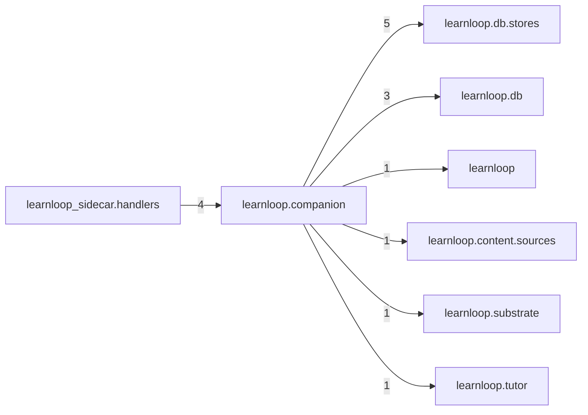

# `learnloop.companion` package map

> [!info] Generated package map
> This map is generated from live modules and their static imports. Follow module links for source-level facts and canonical concept/workflow links for system behavior.

Up: [[Module Catalog]]

## Responsibility

The Reader workbench's companion: the tutor's history by day and desk, and the context each exchange was asked in. Read-only over exchanges.

For system intent, use [[Architecture Overview]].

^package-purpose

## Module index

| Module | Purpose | Status | Direct importers | Direct test files |
|---|---|---:|---:|---:|
| [[Reference/Modules/learnloop/companion/__init__|learnloop.companion]] | [[Reference/Modules/learnloop/companion/__init__#^module-purpose|purpose]] | `ACTIVE` | 0 | 0 |
| [[Reference/Modules/learnloop/companion/asks|learnloop.companion.asks]] | [[Reference/Modules/learnloop/companion/asks#^module-purpose|purpose]] | `ACTIVE` | 1 | 1 |
| [[Reference/Modules/learnloop/companion/history|learnloop.companion.history]] | [[Reference/Modules/learnloop/companion/history#^module-purpose|purpose]] | `ACTIVE` | 3 | 1 |
| [[Reference/Modules/learnloop/companion/search|learnloop.companion.search]] | [[Reference/Modules/learnloop/companion/search#^module-purpose|purpose]] | `ACTIVE` | 1 | 0 |

## Cross-package dependencies

### This package imports

- [[Reference/Modules/learnloop/db/stores/_package|learnloop.db.stores]] — 5 static module edges
- [[Reference/Modules/learnloop/db/_package|learnloop.db]] — 3 static module edges
- [[Reference/Modules/learnloop/_package|learnloop]] — 1 static module edge
- [[Reference/Modules/learnloop/content/sources/_package|learnloop.content.sources]] — 1 static module edge
- [[Reference/Modules/learnloop/substrate/_package|learnloop.substrate]] — 1 static module edge
- [[Reference/Modules/learnloop/tutor/_package|learnloop.tutor]] — 1 static module edge

### Packages that import this package

- [[Reference/Modules/learnloop_sidecar/handlers/_package|learnloop_sidecar.handlers]] — 4 static module edges

### Dependency neighborhood

This diagram compresses package-level static imports; edge labels are distinct module-to-module import counts.



Interpretation: arrow direction is static import direction and the label is the number of distinct module-to-module edges. It shows coupling pressure, not runtime call frequency or ownership permission.

## Workflow entry points

- [[Initialize a Vault]]
- [[Start a Learning Cycle]]

## Find and filter

Use Obsidian's native search:

```query
path:"Reference/Modules/learnloop/companion" tag:#docs/module
```

To change this package, start with a module's [[#Module index|purpose link]], then follow its callers, tests, and modification guidance. Re-run the generator after source changes.
