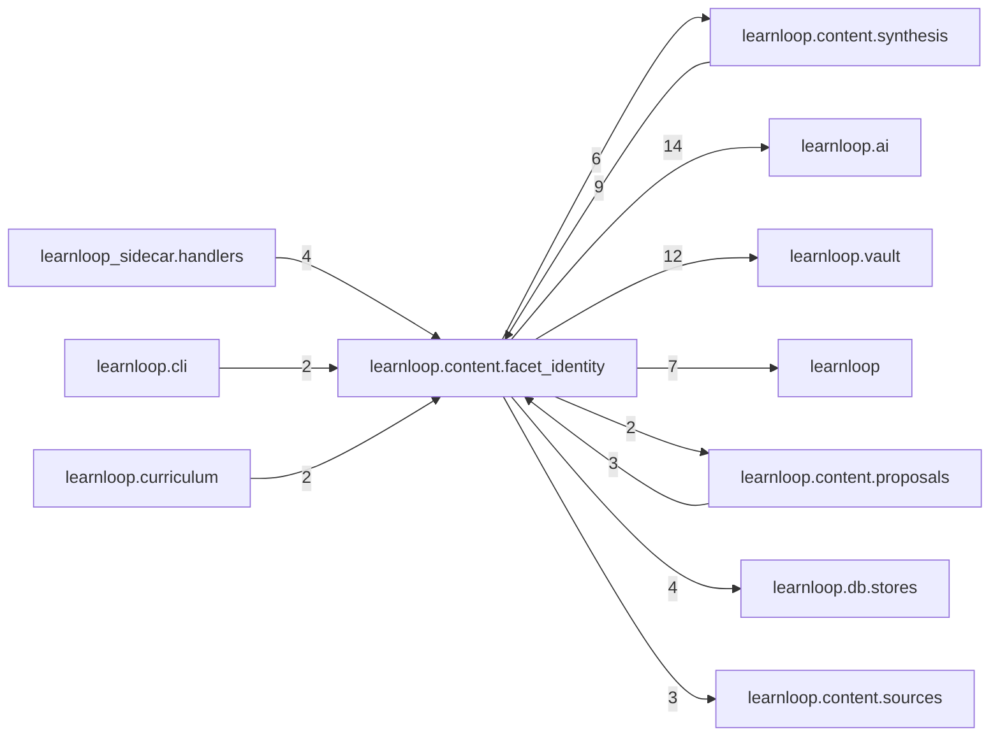

# `learnloop.content.facet_identity` package map

> [!info] Generated package map
> This map is generated from live modules and their static imports. Follow module links for source-level facts and canonical concept/workflow links for system behavior.

Up: [[Module Catalog]]

## Responsibility

Facet identity at mint time and the dedupe command: embedding shortlists, a judge over each neighbourhood, live merges with exact undo.

For system intent, use [[Learning System]], [[AI Architecture]].

^package-purpose

## Module index

| Module | Purpose | Status | Direct importers | Direct test files |
|---|---|---:|---:|---:|
| [[Reference/Modules/learnloop/content/facet_identity/__init__|learnloop.content.facet_identity]] | [[Reference/Modules/learnloop/content/facet_identity/__init__#^module-purpose|purpose]] | `ACTIVE` | 0 | 0 |
| [[Reference/Modules/learnloop/content/facet_identity/actions|learnloop.content.facet_identity.actions]] | [[Reference/Modules/learnloop/content/facet_identity/actions#^module-purpose|purpose]] | `ACTIVE` | 13 | 14 |
| [[Reference/Modules/learnloop/content/facet_identity/authority|learnloop.content.facet_identity.authority]] | [[Reference/Modules/learnloop/content/facet_identity/authority#^module-purpose|purpose]] | `ACTIVE` | 5 | 8 |
| [[Reference/Modules/learnloop/content/facet_identity/dedupe|learnloop.content.facet_identity.dedupe]] | [[Reference/Modules/learnloop/content/facet_identity/dedupe#^module-purpose|purpose]] | `ACTIVE` | 1 | 5 |
| [[Reference/Modules/learnloop/content/facet_identity/grouping|learnloop.content.facet_identity.grouping]] | [[Reference/Modules/learnloop/content/facet_identity/grouping#^module-purpose|purpose]] | `ACTIVE` | 2 | 2 |
| [[Reference/Modules/learnloop/content/facet_identity/judge|learnloop.content.facet_identity.judge]] | [[Reference/Modules/learnloop/content/facet_identity/judge#^module-purpose|purpose]] | `ACTIVE` | 6 | 5 |
| [[Reference/Modules/learnloop/content/facet_identity/plan|learnloop.content.facet_identity.plan]] | [[Reference/Modules/learnloop/content/facet_identity/plan#^module-purpose|purpose]] | `ACTIVE` | 2 | 4 |
| [[Reference/Modules/learnloop/content/facet_identity/span_support|learnloop.content.facet_identity.span_support]] | [[Reference/Modules/learnloop/content/facet_identity/span_support#^module-purpose|purpose]] | `ACTIVE` | 2 | 1 |
| [[Reference/Modules/learnloop/content/facet_identity/views|learnloop.content.facet_identity.views]] | [[Reference/Modules/learnloop/content/facet_identity/views#^module-purpose|purpose]] | `ACTIVE` | 4 | 2 |

## Cross-package dependencies

### This package imports

- [[Reference/Modules/learnloop/ai/_package|learnloop.ai]] — 14 static module edges
- [[Reference/Modules/learnloop/vault/_package|learnloop.vault]] — 12 static module edges
- [[Reference/Modules/learnloop/_package|learnloop]] — 7 static module edges
- [[Reference/Modules/learnloop/content/synthesis/_package|learnloop.content.synthesis]] — 6 static module edges
- [[Reference/Modules/learnloop/db/stores/_package|learnloop.db.stores]] — 4 static module edges
- [[Reference/Modules/learnloop/content/sources/_package|learnloop.content.sources]] — 3 static module edges
- [[Reference/Modules/learnloop/content/proposals/_package|learnloop.content.proposals]] — 2 static module edges
- [[Reference/Modules/learnloop/db/_package|learnloop.db]] — 2 static module edges
- [[Reference/Modules/learnloop/matching/_package|learnloop.matching]] — 2 static module edges
- [[Reference/Modules/learnloop/substrate/_package|learnloop.substrate]] — 2 static module edges
- [[Reference/Modules/learnloop/config/_package|learnloop.config]] — 1 static module edge
- [[Reference/Modules/learnloop/ingest/_package|learnloop.ingest]] — 1 static module edge

### Packages that import this package

- [[Reference/Modules/learnloop/content/synthesis/_package|learnloop.content.synthesis]] — 9 static module edges
- [[Reference/Modules/learnloop_sidecar/handlers/_package|learnloop_sidecar.handlers]] — 4 static module edges
- [[Reference/Modules/learnloop/content/proposals/_package|learnloop.content.proposals]] — 3 static module edges
- [[Reference/Modules/learnloop/cli/_package|learnloop.cli]] — 2 static module edges
- [[Reference/Modules/learnloop/curriculum/_package|learnloop.curriculum]] — 2 static module edges
- [[Reference/Modules/learnloop/ops/_package|learnloop.ops]] — 1 static module edge
- [[Reference/Modules/learnloop_sidecar/_package|learnloop_sidecar]] — 1 static module edge

### Dependency neighborhood

This diagram compresses package-level static imports; edge labels are distinct module-to-module import counts.



Interpretation: arrow direction is static import direction and the label is the number of distinct module-to-module edges. It shows coupling pressure, not runtime call frequency or ownership permission.

## Workflow entry points

- [[Import Canonical Sources]]
- [[Process Model Output]]

## Find and filter

Use Obsidian's native search:

```query
path:"Reference/Modules/learnloop/content/facet_identity" tag:#docs/module
```

To change this package, start with a module's [[#Module index|purpose link]], then follow its callers, tests, and modification guidance. Re-run the generator after source changes.
