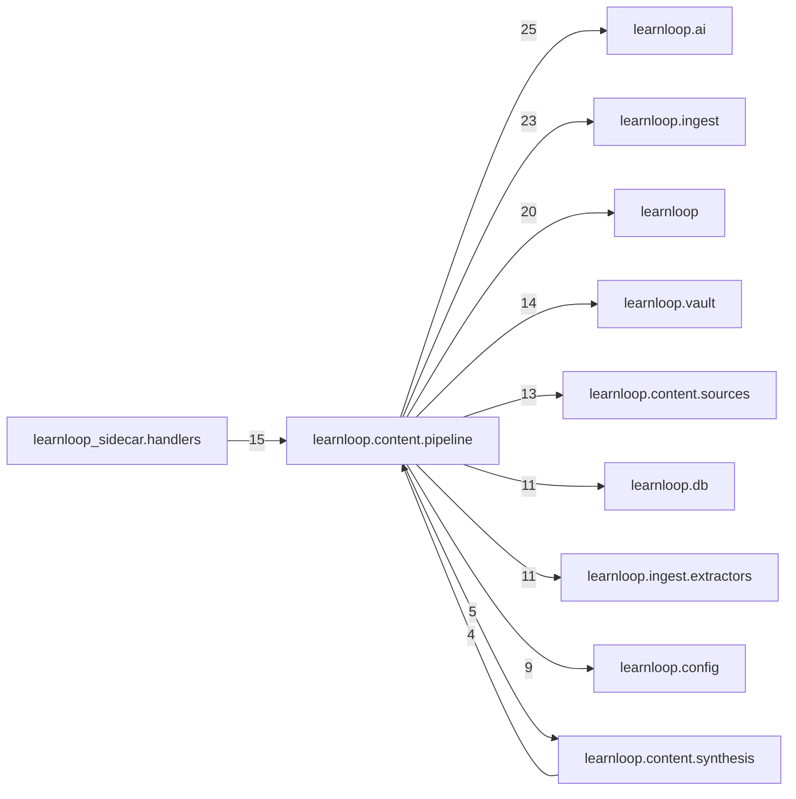

# `learnloop.content.pipeline` package map

> [!info] Generated package map
> This map is generated from live modules and their static imports. Follow module links for source-level facts and canonical concept/workflow links for system behavior.

Up: [[Module Catalog]]

## Responsibility

Canonical content extraction and transformation stages.

For system intent, use [[Learning System]], [[AI Architecture]].

^package-purpose

## Module index

| Module | Purpose | Status | Direct importers | Direct test files |
|---|---|---:|---:|---:|
| [[Reference/Modules/learnloop/content/pipeline/__init__|learnloop.content.pipeline]] | [[Reference/Modules/learnloop/content/pipeline/__init__#^module-purpose|purpose]] | `ACTIVE` | 0 | 0 |
| [[Reference/Modules/learnloop/content/pipeline/acquisition_preview|learnloop.content.pipeline.acquisition_preview]] | [[Reference/Modules/learnloop/content/pipeline/acquisition_preview#^module-purpose|purpose]] | `ACTIVE` | 2 | 2 |
| [[Reference/Modules/learnloop/content/pipeline/add_source|learnloop.content.pipeline.add_source]] | [[Reference/Modules/learnloop/content/pipeline/add_source#^module-purpose|purpose]] | `ACTIVE` | 18 | 40 |
| [[Reference/Modules/learnloop/content/pipeline/ai_contracts|learnloop.content.pipeline.ai_contracts]] | [[Reference/Modules/learnloop/content/pipeline/ai_contracts#^module-purpose|purpose]] | `ACTIVE` | 1 | 13 |
| [[Reference/Modules/learnloop/content/pipeline/build_plan|learnloop.content.pipeline.build_plan]] | [[Reference/Modules/learnloop/content/pipeline/build_plan#^module-purpose|purpose]] | `ACTIVE` | 4 | 2 |
| [[Reference/Modules/learnloop/content/pipeline/exam_marking|learnloop.content.pipeline.exam_marking]] | [[Reference/Modules/learnloop/content/pipeline/exam_marking#^module-purpose|purpose]] | `ACTIVE` | 3 | 3 |
| [[Reference/Modules/learnloop/content/pipeline/import_jobs|learnloop.content.pipeline.import_jobs]] | [[Reference/Modules/learnloop/content/pipeline/import_jobs#^module-purpose|purpose]] | `ACTIVE` | 1 | 8 |
| [[Reference/Modules/learnloop/content/pipeline/job_contracts|learnloop.content.pipeline.job_contracts]] | [[Reference/Modules/learnloop/content/pipeline/job_contracts#^module-purpose|purpose]] | `ACTIVE` | 7 | 1 |
| [[Reference/Modules/learnloop/content/pipeline/job_types|learnloop.content.pipeline.job_types]] | [[Reference/Modules/learnloop/content/pipeline/job_types#^module-purpose|purpose]] | `ACTIVE` | 4 | 2 |
| [[Reference/Modules/learnloop/content/pipeline/jobs|learnloop.content.pipeline.jobs]] | [[Reference/Modules/learnloop/content/pipeline/jobs#^module-purpose|purpose]] | `ACTIVE` | 3 | 38 |
| [[Reference/Modules/learnloop/content/pipeline/quick_add|learnloop.content.pipeline.quick_add]] | [[Reference/Modules/learnloop/content/pipeline/quick_add#^module-purpose|purpose]] | `ACTIVE` | 3 | 4 |
| [[Reference/Modules/learnloop/content/pipeline/reread|learnloop.content.pipeline.reread]] | [[Reference/Modules/learnloop/content/pipeline/reread#^module-purpose|purpose]] | `ACTIVE` | 5 | 3 |
| [[Reference/Modules/learnloop/content/pipeline/revision_refresh|learnloop.content.pipeline.revision_refresh]] | [[Reference/Modules/learnloop/content/pipeline/revision_refresh#^module-purpose|purpose]] | `ACTIVE` | 1 | 3 |
| [[Reference/Modules/learnloop/content/pipeline/runner|learnloop.content.pipeline.runner]] | [[Reference/Modules/learnloop/content/pipeline/runner#^module-purpose|purpose]] | `ACTIVE` | 12 | 82 |
| [[Reference/Modules/learnloop/content/pipeline/source_ingestion|learnloop.content.pipeline.source_ingestion]] | [[Reference/Modules/learnloop/content/pipeline/source_ingestion#^module-purpose|purpose]] | `ACTIVE` | 3 | 15 |
| [[Reference/Modules/learnloop/content/pipeline/wait_detail|learnloop.content.pipeline.wait_detail]] | [[Reference/Modules/learnloop/content/pipeline/wait_detail#^module-purpose|purpose]] | `ACTIVE` | 1 | 1 |

## Cross-package dependencies

### This package imports

- [[Reference/Modules/learnloop/ai/_package|learnloop.ai]] — 25 static module edges
- [[Reference/Modules/learnloop/ingest/_package|learnloop.ingest]] — 23 static module edges
- [[Reference/Modules/learnloop/_package|learnloop]] — 20 static module edges
- [[Reference/Modules/learnloop/vault/_package|learnloop.vault]] — 14 static module edges
- [[Reference/Modules/learnloop/content/sources/_package|learnloop.content.sources]] — 13 static module edges
- [[Reference/Modules/learnloop/db/_package|learnloop.db]] — 11 static module edges
- [[Reference/Modules/learnloop/ingest/extractors/_package|learnloop.ingest.extractors]] — 11 static module edges
- [[Reference/Modules/learnloop/config/_package|learnloop.config]] — 9 static module edges
- [[Reference/Modules/learnloop/db/stores/_package|learnloop.db.stores]] — 8 static module edges
- [[Reference/Modules/learnloop/reader/_package|learnloop.reader]] — 7 static module edges
- [[Reference/Modules/learnloop/content/proposals/_package|learnloop.content.proposals]] — 6 static module edges
- [[Reference/Modules/learnloop/source_retrieval/_package|learnloop.source_retrieval]] — 6 static module edges
- [[Reference/Modules/learnloop/content/synthesis/_package|learnloop.content.synthesis]] — 5 static module edges
- [[Reference/Modules/learnloop/content/authoring/_package|learnloop.content.authoring]] — 2 static module edges
- [[Reference/Modules/learnloop/learner/_package|learnloop.learner]] — 2 static module edges
- [[Reference/Modules/learnloop/local_embeddings/_package|learnloop.local_embeddings]] — 2 static module edges
- [[Reference/Modules/learnloop/adaptive_difficulty/_package|learnloop.adaptive_difficulty]] — 1 static module edge
- [[Reference/Modules/learnloop/goals/_package|learnloop.goals]] — 1 static module edge
- [[Reference/Modules/learnloop/practice_index/_package|learnloop.practice_index]] — 1 static module edge

### Packages that import this package

- [[Reference/Modules/learnloop_sidecar/handlers/_package|learnloop_sidecar.handlers]] — 15 static module edges
- [[Reference/Modules/learnloop/cli/_package|learnloop.cli]] — 8 static module edges
- [[Reference/Modules/learnloop/content/synthesis/_package|learnloop.content.synthesis]] — 4 static module edges
- [[Reference/Modules/learnloop_sidecar/_package|learnloop_sidecar]] — 3 static module edges
- [[Reference/Modules/learnloop/content/authoring/_package|learnloop.content.authoring]] — 2 static module edges
- [[Reference/Modules/learnloop/figures/_package|learnloop.figures]] — 2 static module edges
- [[Reference/Modules/learnloop/ops/_package|learnloop.ops]] — 2 static module edges
- [[Reference/Modules/learnloop/remote/_package|learnloop.remote]] — 2 static module edges
- [[Reference/Modules/learnloop/source_retrieval/_package|learnloop.source_retrieval]] — 2 static module edges
- [[Reference/Modules/learnloop/reader/_package|learnloop.reader]] — 1 static module edge

### Dependency neighborhood

This diagram compresses package-level static imports; edge labels are distinct module-to-module import counts.



Interpretation: arrow direction is static import direction and the label is the number of distinct module-to-module edges. It shows coupling pressure, not runtime call frequency or ownership permission.

## Workflow entry points

- [[Import Canonical Sources]]
- [[Process Model Output]]

## Find and filter

Use Obsidian's native search:

```query
path:"Reference/Modules/learnloop/content/pipeline" tag:#docs/module
```

To change this package, start with a module's [[#Module index|purpose link]], then follow its callers, tests, and modification guidance. Re-run the generator after source changes.
