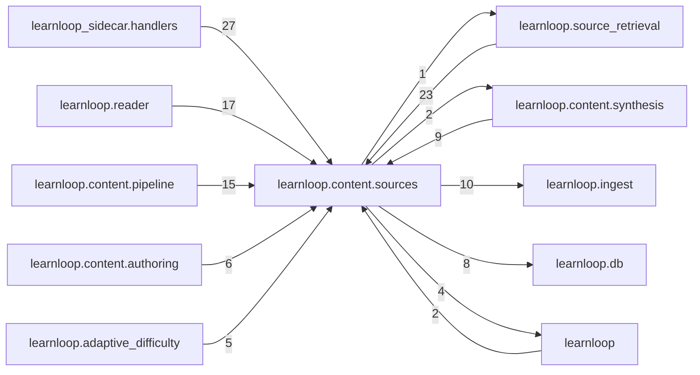

# `learnloop.content.sources` package map

> [!info] Generated package map
> This map is generated from live modules and their static imports. Follow module links for source-level facts and canonical concept/workflow links for system behavior.

Up: [[Module Catalog]]

## Responsibility

Canonical source-library identity, manifests, and source-set behavior.

For system intent, use [[Learning System]], [[AI Architecture]].

^package-purpose

## Module index

| Module | Purpose | Status | Direct importers | Direct test files |
|---|---|---:|---:|---:|
| [[Reference/Modules/learnloop/content/sources/__init__|learnloop.content.sources]] | [[Reference/Modules/learnloop/content/sources/__init__#^module-purpose|purpose]] | `ACTIVE` | 0 | 0 |
| [[Reference/Modules/learnloop/content/sources/block_health|learnloop.content.sources.block_health]] | [[Reference/Modules/learnloop/content/sources/block_health#^module-purpose|purpose]] | `ACTIVE` | 2 | 1 |
| [[Reference/Modules/learnloop/content/sources/exam_material|learnloop.content.sources.exam_material]] | [[Reference/Modules/learnloop/content/sources/exam_material#^module-purpose|purpose]] | `ACTIVE` | 60 | 41 |
| [[Reference/Modules/learnloop/content/sources/exercise_statements|learnloop.content.sources.exercise_statements]] | [[Reference/Modules/learnloop/content/sources/exercise_statements#^module-purpose|purpose]] | `ACTIVE` | 6 | 1 |
| [[Reference/Modules/learnloop/content/sources/extraction_health|learnloop.content.sources.extraction_health]] | [[Reference/Modules/learnloop/content/sources/extraction_health#^module-purpose|purpose]] | `ACTIVE` | 1 | 1 |
| [[Reference/Modules/learnloop/content/sources/front_matter|learnloop.content.sources.front_matter]] | [[Reference/Modules/learnloop/content/sources/front_matter#^module-purpose|purpose]] | `ACTIVE` | 2 | 0 |
| [[Reference/Modules/learnloop/content/sources/math_text|learnloop.content.sources.math_text]] | [[Reference/Modules/learnloop/content/sources/math_text#^module-purpose|purpose]] | `ACTIVE` | 3 | 3 |
| [[Reference/Modules/learnloop/content/sources/pdf_extraction|learnloop.content.sources.pdf_extraction]] | [[Reference/Modules/learnloop/content/sources/pdf_extraction#^module-purpose|purpose]] | `ACTIVE` | 1 | 4 |
| [[Reference/Modules/learnloop/content/sources/provenance|learnloop.content.sources.provenance]] | [[Reference/Modules/learnloop/content/sources/provenance#^module-purpose|purpose]] | `ACTIVE` | 3 | 3 |
| [[Reference/Modules/learnloop/content/sources/role_authority|learnloop.content.sources.role_authority]] | [[Reference/Modules/learnloop/content/sources/role_authority#^module-purpose|purpose]] | `ACTIVE` | 12 | 4 |
| [[Reference/Modules/learnloop/content/sources/source_deletion|learnloop.content.sources.source_deletion]] | [[Reference/Modules/learnloop/content/sources/source_deletion#^module-purpose|purpose]] | `ACTIVE` | 1 | 1 |
| [[Reference/Modules/learnloop/content/sources/source_library|learnloop.content.sources.source_library]] | [[Reference/Modules/learnloop/content/sources/source_library#^module-purpose|purpose]] | `ACTIVE` | 2 | 16 |
| [[Reference/Modules/learnloop/content/sources/source_outcome_analytics|learnloop.content.sources.source_outcome_analytics]] | [[Reference/Modules/learnloop/content/sources/source_outcome_analytics#^module-purpose|purpose]] | `ACTIVE` | 3 | 1 |
| [[Reference/Modules/learnloop/content/sources/source_outline|learnloop.content.sources.source_outline]] | [[Reference/Modules/learnloop/content/sources/source_outline#^module-purpose|purpose]] | `ACTIVE` | 34 | 17 |
| [[Reference/Modules/learnloop/content/sources/source_refs|learnloop.content.sources.source_refs]] | [[Reference/Modules/learnloop/content/sources/source_refs#^module-purpose|purpose]] | `ACTIVE` | 3 | 1 |
| [[Reference/Modules/learnloop/content/sources/span_aliases|learnloop.content.sources.span_aliases]] | [[Reference/Modules/learnloop/content/sources/span_aliases#^module-purpose|purpose]] | `ACTIVE` | 14 | 5 |

## Cross-package dependencies

### This package imports

- [[Reference/Modules/learnloop/ingest/_package|learnloop.ingest]] — 10 static module edges
- [[Reference/Modules/learnloop/db/_package|learnloop.db]] — 8 static module edges
- [[Reference/Modules/learnloop/vault/_package|learnloop.vault]] — 5 static module edges
- [[Reference/Modules/learnloop/_package|learnloop]] — 4 static module edges
- [[Reference/Modules/learnloop/db/stores/_package|learnloop.db.stores]] — 3 static module edges
- [[Reference/Modules/learnloop/ingest/extractors/_package|learnloop.ingest.extractors]] — 3 static module edges
- [[Reference/Modules/learnloop/content/synthesis/_package|learnloop.content.synthesis]] — 2 static module edges
- [[Reference/Modules/learnloop/config/_package|learnloop.config]] — 1 static module edge
- [[Reference/Modules/learnloop/source_retrieval/_package|learnloop.source_retrieval]] — 1 static module edge

### Packages that import this package

- [[Reference/Modules/learnloop_sidecar/handlers/_package|learnloop_sidecar.handlers]] — 27 static module edges
- [[Reference/Modules/learnloop/source_retrieval/_package|learnloop.source_retrieval]] — 23 static module edges
- [[Reference/Modules/learnloop/reader/_package|learnloop.reader]] — 17 static module edges
- [[Reference/Modules/learnloop/content/pipeline/_package|learnloop.content.pipeline]] — 15 static module edges
- [[Reference/Modules/learnloop/content/synthesis/_package|learnloop.content.synthesis]] — 9 static module edges
- [[Reference/Modules/learnloop/content/authoring/_package|learnloop.content.authoring]] — 6 static module edges
- [[Reference/Modules/learnloop/adaptive_difficulty/_package|learnloop.adaptive_difficulty]] — 5 static module edges
- [[Reference/Modules/learnloop/cli/_package|learnloop.cli]] — 5 static module edges
- [[Reference/Modules/learnloop/instructional/_package|learnloop.instructional]] — 4 static module edges
- [[Reference/Modules/learnloop/ops/_package|learnloop.ops]] — 4 static module edges
- [[Reference/Modules/learnloop/content/facet_identity/_package|learnloop.content.facet_identity]] — 3 static module edges
- [[Reference/Modules/learnloop/daily_plan/_package|learnloop.daily_plan]] — 3 static module edges
- [[Reference/Modules/learnloop/figures/_package|learnloop.figures]] — 3 static module edges
- [[Reference/Modules/learnloop/goals/_package|learnloop.goals]] — 3 static module edges
- [[Reference/Modules/learnloop/_package|learnloop]] — 2 static module edges
- [[Reference/Modules/learnloop/diagnosis/_package|learnloop.diagnosis]] — 2 static module edges
- [[Reference/Modules/learnloop/diagnosis/text_gaps/_package|learnloop.diagnosis.text_gaps]] — 2 static module edges
- [[Reference/Modules/learnloop/remote/_package|learnloop.remote]] — 2 static module edges
- [[Reference/Modules/learnloop_sidecar/_package|learnloop_sidecar]] — 2 static module edges
- [[Reference/Modules/learnloop/experiments/contextual_embeddings/_package|learnloop.experiments.contextual_embeddings]] — 1 static module edge
- [[Reference/Modules/learnloop/scheduling/_package|learnloop.scheduling]] — 1 static module edge
- [[Reference/Modules/learnloop/scheduling/intent/_package|learnloop.scheduling.intent]] — 1 static module edge
- [[Reference/Modules/learnloop/teacher/_package|learnloop.teacher]] — 1 static module edge
- [[Reference/Modules/learnloop/tutor/_package|learnloop.tutor]] — 1 static module edge
- [[Reference/Modules/learnloop/workbench/_package|learnloop.workbench]] — 1 static module edge

### Dependency neighborhood

This diagram compresses package-level static imports; edge labels are distinct module-to-module import counts.



Interpretation: arrow direction is static import direction and the label is the number of distinct module-to-module edges. It shows coupling pressure, not runtime call frequency or ownership permission.

## Workflow entry points

- [[Import Canonical Sources]]
- [[Process Model Output]]

## Find and filter

Use Obsidian's native search:

```query
path:"Reference/Modules/learnloop/content/sources" tag:#docs/module
```

To change this package, start with a module's [[#Module index|purpose link]], then follow its callers, tests, and modification guidance. Re-run the generator after source changes.
