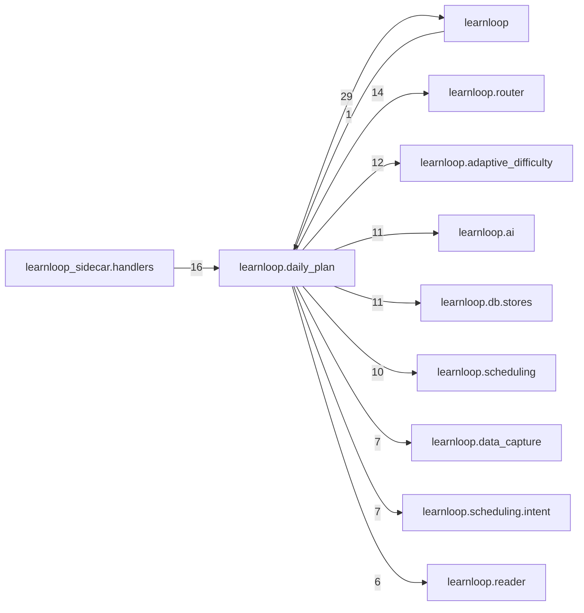

# `learnloop.daily_plan` package map

> [!info] Generated package map
> This map is generated from live modules and their static imports. Follow module links for source-level facts and canonical concept/workflow links for system behavior.

Up: [[Module Catalog]]

## Responsibility

The finite daily plan: remembered minutes split across repair, maintain, new and push, chosen block by block, and the router card.

For system intent, use [[Architecture Overview]].

^package-purpose

## Module index

| Module | Purpose | Status | Direct importers | Direct test files |
|---|---|---:|---:|---:|
| [[Reference/Modules/learnloop/daily_plan/__init__|learnloop.daily_plan]] | [[Reference/Modules/learnloop/daily_plan/__init__#^module-purpose|purpose]] | `ACTIVE` | 0 | 0 |
| [[Reference/Modules/learnloop/daily_plan/ad_slot|learnloop.daily_plan.ad_slot]] | [[Reference/Modules/learnloop/daily_plan/ad_slot#^module-purpose|purpose]] | `ACTIVE` | 1 | 6 |
| [[Reference/Modules/learnloop/daily_plan/admission|learnloop.daily_plan.admission]] | [[Reference/Modules/learnloop/daily_plan/admission#^module-purpose|purpose]] | `ACTIVE` | 3 | 2 |
| [[Reference/Modules/learnloop/daily_plan/chooser|learnloop.daily_plan.chooser]] | [[Reference/Modules/learnloop/daily_plan/chooser#^module-purpose|purpose]] | `ACTIVE` | 4 | 4 |
| [[Reference/Modules/learnloop/daily_plan/engine|learnloop.daily_plan.engine]] | [[Reference/Modules/learnloop/daily_plan/engine#^module-purpose|purpose]] | `ACTIVE` | 14 | 102 |
| [[Reference/Modules/learnloop/daily_plan/estimates|learnloop.daily_plan.estimates]] | [[Reference/Modules/learnloop/daily_plan/estimates#^module-purpose|purpose]] | `ACTIVE` | 6 | 4 |
| [[Reference/Modules/learnloop/daily_plan/headline|learnloop.daily_plan.headline]] | [[Reference/Modules/learnloop/daily_plan/headline#^module-purpose|purpose]] | `ACTIVE` | 4 | 5 |
| [[Reference/Modules/learnloop/daily_plan/intent_cost|learnloop.daily_plan.intent_cost]] | [[Reference/Modules/learnloop/daily_plan/intent_cost#^module-purpose|purpose]] | `ACTIVE` | 1 | 2 |
| [[Reference/Modules/learnloop/daily_plan/lanes|learnloop.daily_plan.lanes]] | [[Reference/Modules/learnloop/daily_plan/lanes#^module-purpose|purpose]] | `ACTIVE` | 3 | 11 |
| [[Reference/Modules/learnloop/daily_plan/lesson_suggestion|learnloop.daily_plan.lesson_suggestion]] | [[Reference/Modules/learnloop/daily_plan/lesson_suggestion#^module-purpose|purpose]] | `ACTIVE` | 3 | 7 |
| [[Reference/Modules/learnloop/daily_plan/measurement|learnloop.daily_plan.measurement]] | [[Reference/Modules/learnloop/daily_plan/measurement#^module-purpose|purpose]] | `ACTIVE` | 4 | 5 |
| [[Reference/Modules/learnloop/daily_plan/policy|learnloop.daily_plan.policy]] | [[Reference/Modules/learnloop/daily_plan/policy#^module-purpose|purpose]] | `ACTIVE` | 7 | 20 |
| [[Reference/Modules/learnloop/daily_plan/reading|learnloop.daily_plan.reading]] | [[Reference/Modules/learnloop/daily_plan/reading#^module-purpose|purpose]] | `ACTIVE` | 1 | 7 |
| [[Reference/Modules/learnloop/daily_plan/reading_choice|learnloop.daily_plan.reading_choice]] | [[Reference/Modules/learnloop/daily_plan/reading_choice#^module-purpose|purpose]] | `ACTIVE` | 2 | 3 |
| [[Reference/Modules/learnloop/daily_plan/records|learnloop.daily_plan.records]] | [[Reference/Modules/learnloop/daily_plan/records#^module-purpose|purpose]] | `ACTIVE` | 4 | 3 |
| [[Reference/Modules/learnloop/daily_plan/reentry|learnloop.daily_plan.reentry]] | [[Reference/Modules/learnloop/daily_plan/reentry#^module-purpose|purpose]] | `ACTIVE` | 3 | 3 |
| [[Reference/Modules/learnloop/daily_plan/report|learnloop.daily_plan.report]] | [[Reference/Modules/learnloop/daily_plan/report#^module-purpose|purpose]] | `ACTIVE` | 1 | 0 |
| [[Reference/Modules/learnloop/daily_plan/router_card|learnloop.daily_plan.router_card]] | [[Reference/Modules/learnloop/daily_plan/router_card#^module-purpose|purpose]] | `ACTIVE` | 1 | 5 |
| [[Reference/Modules/learnloop/daily_plan/router_chooser|learnloop.daily_plan.router_chooser]] | [[Reference/Modules/learnloop/daily_plan/router_chooser#^module-purpose|purpose]] | `ACTIVE` | 2 | 3 |
| [[Reference/Modules/learnloop/daily_plan/router_reader|learnloop.daily_plan.router_reader]] | [[Reference/Modules/learnloop/daily_plan/router_reader#^module-purpose|purpose]] | `ACTIVE` | 1 | 1 |
| [[Reference/Modules/learnloop/daily_plan/router_retrieval|learnloop.daily_plan.router_retrieval]] | [[Reference/Modules/learnloop/daily_plan/router_retrieval#^module-purpose|purpose]] | `ACTIVE` | 2 | 1 |
| [[Reference/Modules/learnloop/daily_plan/router_runtime|learnloop.daily_plan.router_runtime]] | [[Reference/Modules/learnloop/daily_plan/router_runtime#^module-purpose|purpose]] | `ACTIVE` | 6 | 7 |
| [[Reference/Modules/learnloop/daily_plan/router_teach_back|learnloop.daily_plan.router_teach_back]] | [[Reference/Modules/learnloop/daily_plan/router_teach_back#^module-purpose|purpose]] | `ACTIVE` | 2 | 4 |
| [[Reference/Modules/learnloop/daily_plan/slot_facts|learnloop.daily_plan.slot_facts]] | [[Reference/Modules/learnloop/daily_plan/slot_facts#^module-purpose|purpose]] | `ACTIVE` | 1 | 3 |
| [[Reference/Modules/learnloop/daily_plan/slot_facts_schema|learnloop.daily_plan.slot_facts_schema]] | [[Reference/Modules/learnloop/daily_plan/slot_facts_schema#^module-purpose|purpose]] | `ACTIVE` | 3 | 2 |
| [[Reference/Modules/learnloop/daily_plan/split|learnloop.daily_plan.split]] | [[Reference/Modules/learnloop/daily_plan/split#^module-purpose|purpose]] | `ACTIVE` | 2 | 2 |
| [[Reference/Modules/learnloop/daily_plan/staged_frame|learnloop.daily_plan.staged_frame]] | [[Reference/Modules/learnloop/daily_plan/staged_frame#^module-purpose|purpose]] | `ACTIVE` | 3 | 5 |
| [[Reference/Modules/learnloop/daily_plan/types|learnloop.daily_plan.types]] | [[Reference/Modules/learnloop/daily_plan/types#^module-purpose|purpose]] | `ACTIVE` | 12 | 17 |
| [[Reference/Modules/learnloop/daily_plan/view|learnloop.daily_plan.view]] | [[Reference/Modules/learnloop/daily_plan/view#^module-purpose|purpose]] | `ACTIVE` | 2 | 7 |

## Cross-package dependencies

### This package imports

- [[Reference/Modules/learnloop/_package|learnloop]] — 29 static module edges
- [[Reference/Modules/learnloop/router/_package|learnloop.router]] — 14 static module edges
- [[Reference/Modules/learnloop/adaptive_difficulty/_package|learnloop.adaptive_difficulty]] — 12 static module edges
- [[Reference/Modules/learnloop/ai/_package|learnloop.ai]] — 11 static module edges
- [[Reference/Modules/learnloop/db/stores/_package|learnloop.db.stores]] — 11 static module edges
- [[Reference/Modules/learnloop/scheduling/_package|learnloop.scheduling]] — 10 static module edges
- [[Reference/Modules/learnloop/data_capture/_package|learnloop.data_capture]] — 7 static module edges
- [[Reference/Modules/learnloop/scheduling/intent/_package|learnloop.scheduling.intent]] — 7 static module edges
- [[Reference/Modules/learnloop/reader/_package|learnloop.reader]] — 6 static module edges
- [[Reference/Modules/learnloop/vault/_package|learnloop.vault]] — 6 static module edges
- [[Reference/Modules/learnloop/learner/_package|learnloop.learner]] — 5 static module edges
- [[Reference/Modules/learnloop/source_retrieval/_package|learnloop.source_retrieval]] — 5 static module edges
- [[Reference/Modules/learnloop/attempts/_package|learnloop.attempts]] — 4 static module edges
- [[Reference/Modules/learnloop/placement/_package|learnloop.placement]] — 4 static module edges
- [[Reference/Modules/learnloop/content/sources/_package|learnloop.content.sources]] — 3 static module edges
- [[Reference/Modules/learnloop/db/_package|learnloop.db]] — 3 static module edges
- [[Reference/Modules/learnloop/followup_serve/_package|learnloop.followup_serve]] — 3 static module edges
- [[Reference/Modules/learnloop/goals/_package|learnloop.goals]] — 3 static module edges
- [[Reference/Modules/learnloop/params/_package|learnloop.params]] — 3 static module edges
- [[Reference/Modules/learnloop/curriculum/_package|learnloop.curriculum]] — 2 static module edges
- [[Reference/Modules/learnloop/diagnosis/_package|learnloop.diagnosis]] — 2 static module edges
- [[Reference/Modules/learnloop/substrate/_package|learnloop.substrate]] — 2 static module edges
- [[Reference/Modules/learnloop/ai/providers/_package|learnloop.ai.providers]] — 1 static module edge
- [[Reference/Modules/learnloop/intent/_package|learnloop.intent]] — 1 static module edge
- [[Reference/Modules/learnloop/ops/_package|learnloop.ops]] — 1 static module edge

### Packages that import this package

- [[Reference/Modules/learnloop_sidecar/handlers/_package|learnloop_sidecar.handlers]] — 16 static module edges
- [[Reference/Modules/learnloop/cli/_package|learnloop.cli]] — 5 static module edges
- [[Reference/Modules/learnloop/followup_run/_package|learnloop.followup_run]] — 5 static module edges
- [[Reference/Modules/learnloop_sidecar/_package|learnloop_sidecar]] — 4 static module edges
- [[Reference/Modules/learnloop/remote/_package|learnloop.remote]] — 3 static module edges
- [[Reference/Modules/learnloop/figures/_package|learnloop.figures]] — 2 static module edges
- [[Reference/Modules/learnloop/_package|learnloop]] — 1 static module edge

### Dependency neighborhood

This diagram compresses package-level static imports; edge labels are distinct module-to-module import counts.



Interpretation: arrow direction is static import direction and the label is the number of distinct module-to-module edges. It shows coupling pressure, not runtime call frequency or ownership permission.

## Workflow entry points

- [[Initialize a Vault]]
- [[Start a Learning Cycle]]

## Find and filter

Use Obsidian's native search:

```query
path:"Reference/Modules/learnloop/daily_plan" tag:#docs/module
```

To change this package, start with a module's [[#Module index|purpose link]], then follow its callers, tests, and modification guidance. Re-run the generator after source changes.
