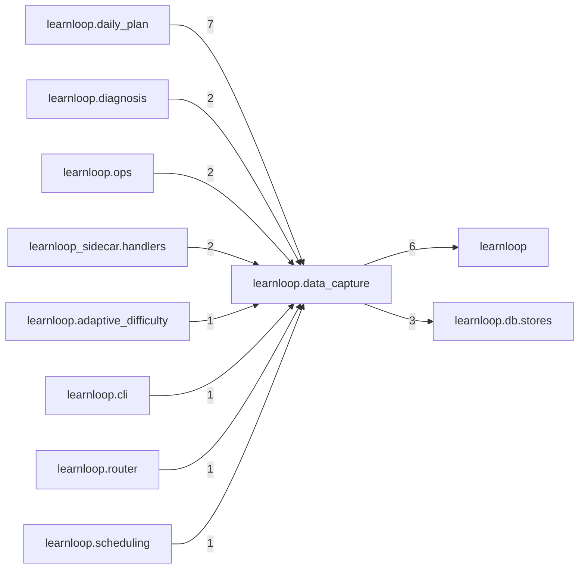

# `learnloop.data_capture` package map

> [!info] Generated package map
> This map is generated from live modules and their static imports. Follow module links for source-level facts and canonical concept/workflow links for system behavior.

Up: [[Module Catalog]]

## Responsibility

What later evaluation needs, recorded now: its switches, prefilter receipts, and the one read of Reader exposures with the sweep that freezes them.

For system intent, use [[Architecture Overview]].

^package-purpose

## Module index

| Module | Purpose | Status | Direct importers | Direct test files |
|---|---|---:|---:|---:|
| [[Reference/Modules/learnloop/data_capture/__init__|learnloop.data_capture]] | [[Reference/Modules/learnloop/data_capture/__init__#^module-purpose|purpose]] | `ACTIVE` | 0 | 0 |
| [[Reference/Modules/learnloop/data_capture/gates|learnloop.data_capture.gates]] | [[Reference/Modules/learnloop/data_capture/gates#^module-purpose|purpose]] | `ACTIVE` | 11 | 2 |
| [[Reference/Modules/learnloop/data_capture/prefilter|learnloop.data_capture.prefilter]] | [[Reference/Modules/learnloop/data_capture/prefilter#^module-purpose|purpose]] | `ACTIVE` | 4 | 3 |
| [[Reference/Modules/learnloop/data_capture/reading_exposures|learnloop.data_capture.reading_exposures]] | [[Reference/Modules/learnloop/data_capture/reading_exposures#^module-purpose|purpose]] | `ACTIVE` | 6 | 5 |

## Cross-package dependencies

### This package imports

- [[Reference/Modules/learnloop/_package|learnloop]] — 6 static module edges
- [[Reference/Modules/learnloop/db/stores/_package|learnloop.db.stores]] — 3 static module edges
- [[Reference/Modules/learnloop/vault/_package|learnloop.vault]] — 1 static module edge

### Packages that import this package

- [[Reference/Modules/learnloop/daily_plan/_package|learnloop.daily_plan]] — 7 static module edges
- [[Reference/Modules/learnloop/diagnosis/_package|learnloop.diagnosis]] — 2 static module edges
- [[Reference/Modules/learnloop/ops/_package|learnloop.ops]] — 2 static module edges
- [[Reference/Modules/learnloop_sidecar/handlers/_package|learnloop_sidecar.handlers]] — 2 static module edges
- [[Reference/Modules/learnloop/adaptive_difficulty/_package|learnloop.adaptive_difficulty]] — 1 static module edge
- [[Reference/Modules/learnloop/cli/_package|learnloop.cli]] — 1 static module edge
- [[Reference/Modules/learnloop/router/_package|learnloop.router]] — 1 static module edge
- [[Reference/Modules/learnloop/scheduling/_package|learnloop.scheduling]] — 1 static module edge
- [[Reference/Modules/learnloop/substrate/_package|learnloop.substrate]] — 1 static module edge
- [[Reference/Modules/learnloop/teacher/_package|learnloop.teacher]] — 1 static module edge

### Dependency neighborhood

This diagram compresses package-level static imports; edge labels are distinct module-to-module import counts.



Interpretation: arrow direction is static import direction and the label is the number of distinct module-to-module edges. It shows coupling pressure, not runtime call frequency or ownership permission.

## Workflow entry points

- [[Initialize a Vault]]
- [[Start a Learning Cycle]]

## Find and filter

Use Obsidian's native search:

```query
path:"Reference/Modules/learnloop/data_capture" tag:#docs/module
```

To change this package, start with a module's [[#Module index|purpose link]], then follow its callers, tests, and modification guidance. Re-run the generator after source changes.
