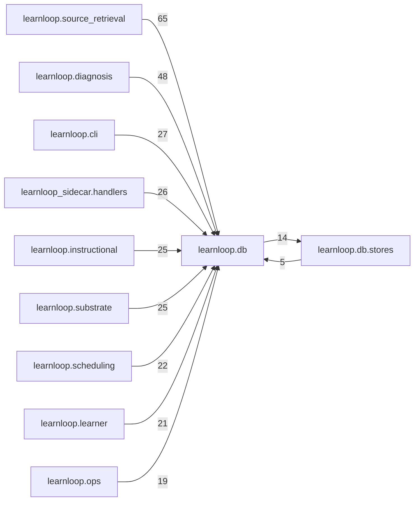

# `learnloop.db` package map

> [!info] Generated package map
> This map is generated from live modules and their static imports. Follow module links for source-level facts and canonical concept/workflow links for system behavior.

Up: [[Module Catalog]]

## Responsibility

SQLite connections, migrations, repository compatibility, table roles, rebuilds, and persistence infrastructure.

For system intent, use [[State and Persistence]], [[Architecture Overview]].

^package-purpose

## Module index

| Module | Purpose | Status | Direct importers | Direct test files |
|---|---|---:|---:|---:|
| [[Reference/Modules/learnloop/db/__init__|learnloop.db]] | [[Reference/Modules/learnloop/db/__init__#^module-purpose|purpose]] | `ACTIVE` | 0 | 0 |
| [[Reference/Modules/learnloop/db/checkpoint|learnloop.db.checkpoint]] | [[Reference/Modules/learnloop/db/checkpoint#^module-purpose|purpose]] | `ACTIVE` | 3 | 2 |
| [[Reference/Modules/learnloop/db/connection|learnloop.db.connection]] | [[Reference/Modules/learnloop/db/connection#^module-purpose|purpose]] | `ACTIVE` | 181 | 252 |
| [[Reference/Modules/learnloop/db/copies|learnloop.db.copies]] | [[Reference/Modules/learnloop/db/copies#^module-purpose|purpose]] | `ACTIVE` | 10 | 67 |
| [[Reference/Modules/learnloop/db/migrate|learnloop.db.migrate]] | [[Reference/Modules/learnloop/db/migrate#^module-purpose|purpose]] | `ACTIVE` | 10 | 91 |
| [[Reference/Modules/learnloop/db/repositories|learnloop.db.repositories]] | [[Reference/Modules/learnloop/db/repositories#^module-purpose|purpose]] | `ACTIVE` | 392 | 723 |
| [[Reference/Modules/learnloop/db/scopes|learnloop.db.scopes]] | [[Reference/Modules/learnloop/db/scopes#^module-purpose|purpose]] | `ACTIVE` | 16 | 5 |
| [[Reference/Modules/learnloop/db/storage|learnloop.db.storage]] | [[Reference/Modules/learnloop/db/storage#^module-purpose|purpose]] | `ACTIVE` | 1 | 6 |
| [[Reference/Modules/learnloop/db/table_roles|learnloop.db.table_roles]] | [[Reference/Modules/learnloop/db/table_roles#^module-purpose|purpose]] | `ACTIVE` | 6 | 86 |

## Child package maps

- [[Reference/Modules/learnloop/db/stores/_package|learnloop.db.stores]] — Table-family persistence owners extracted from the repository facade.

## Cross-package dependencies

### This package imports

- [[Reference/Modules/learnloop/db/stores/_package|learnloop.db.stores]] — 14 static module edges
- [[Reference/Modules/learnloop/_package|learnloop]] — 12 static module edges
- [[Reference/Modules/learnloop/ingest/_package|learnloop.ingest]] — 2 static module edges
- [[Reference/Modules/learnloop/ai/_package|learnloop.ai]] — 1 static module edge

### Packages that import this package

- [[Reference/Modules/learnloop/source_retrieval/_package|learnloop.source_retrieval]] — 65 static module edges
- [[Reference/Modules/learnloop/diagnosis/_package|learnloop.diagnosis]] — 48 static module edges
- [[Reference/Modules/learnloop/cli/_package|learnloop.cli]] — 27 static module edges
- [[Reference/Modules/learnloop_sidecar/handlers/_package|learnloop_sidecar.handlers]] — 26 static module edges
- [[Reference/Modules/learnloop/instructional/_package|learnloop.instructional]] — 25 static module edges
- [[Reference/Modules/learnloop/substrate/_package|learnloop.substrate]] — 25 static module edges
- [[Reference/Modules/learnloop/scheduling/_package|learnloop.scheduling]] — 22 static module edges
- [[Reference/Modules/learnloop/learner/_package|learnloop.learner]] — 21 static module edges
- [[Reference/Modules/learnloop/ops/_package|learnloop.ops]] — 19 static module edges
- [[Reference/Modules/learnloop/reader/_package|learnloop.reader]] — 19 static module edges
- [[Reference/Modules/learnloop/adaptive_difficulty/_package|learnloop.adaptive_difficulty]] — 18 static module edges
- [[Reference/Modules/learnloop/curriculum/_package|learnloop.curriculum]] — 17 static module edges
- [[Reference/Modules/learnloop/practice_index/_package|learnloop.practice_index]] — 17 static module edges
- [[Reference/Modules/learnloop/attempts/_package|learnloop.attempts]] — 16 static module edges
- [[Reference/Modules/learnloop/diagnosis/text_gaps/_package|learnloop.diagnosis.text_gaps]] — 16 static module edges
- [[Reference/Modules/learnloop/goals/_package|learnloop.goals]] — 16 static module edges
- [[Reference/Modules/learnloop/diagnosis/split/_package|learnloop.diagnosis.split]] — 13 static module edges
- [[Reference/Modules/learnloop/hints/_package|learnloop.hints]] — 13 static module edges
- [[Reference/Modules/learnloop/diagnosis/recurrence/_package|learnloop.diagnosis.recurrence]] — 12 static module edges
- [[Reference/Modules/learnloop/figures/_package|learnloop.figures]] — 12 static module edges
- [[Reference/Modules/learnloop/content/authoring/_package|learnloop.content.authoring]] — 11 static module edges
- [[Reference/Modules/learnloop/content/synthesis/_package|learnloop.content.synthesis]] — 11 static module edges
- [[Reference/Modules/learnloop/workbench/_package|learnloop.workbench]] — 11 static module edges
- [[Reference/Modules/learnloop/content/pipeline/_package|learnloop.content.pipeline]] — 10 static module edges
- [[Reference/Modules/learnloop/content/proposals/_package|learnloop.content.proposals]] — 10 static module edges
- [[Reference/Modules/learnloop/diagnosis/offline_review/_package|learnloop.diagnosis.offline_review]] — 9 static module edges
- [[Reference/Modules/learnloop/followup_run/_package|learnloop.followup_run]] — 9 static module edges
- [[Reference/Modules/learnloop/content/sources/_package|learnloop.content.sources]] — 8 static module edges
- [[Reference/Modules/learnloop/experiments/contextual_embeddings/_package|learnloop.experiments.contextual_embeddings]] — 7 static module edges
- [[Reference/Modules/learnloop/tutor/_package|learnloop.tutor]] — 7 static module edges
- [[Reference/Modules/learnloop/daily_plan/_package|learnloop.daily_plan]] — 6 static module edges
- [[Reference/Modules/learnloop/ops/contamination/_package|learnloop.ops.contamination]] — 6 static module edges
- [[Reference/Modules/learnloop/_package|learnloop]] — 5 static module edges
- [[Reference/Modules/learnloop/capture/_package|learnloop.capture]] — 5 static module edges
- [[Reference/Modules/learnloop/db/stores/_package|learnloop.db.stores]] — 5 static module edges
- [[Reference/Modules/learnloop/remote/_package|learnloop.remote]] — 5 static module edges
- [[Reference/Modules/learnloop/sim/_package|learnloop.sim]] — 5 static module edges
- [[Reference/Modules/learnloop/placement/_package|learnloop.placement]] — 4 static module edges
- [[Reference/Modules/learnloop/vault/_package|learnloop.vault]] — 4 static module edges
- [[Reference/Modules/learnloop/evsi_calibration/_package|learnloop.evsi_calibration]] — 3 static module edges
- [[Reference/Modules/learnloop/followup_serve/_package|learnloop.followup_serve]] — 3 static module edges
- [[Reference/Modules/learnloop/params/_package|learnloop.params]] — 3 static module edges
- [[Reference/Modules/learnloop_sidecar/_package|learnloop_sidecar]] — 3 static module edges
- [[Reference/Modules/learnloop/content/facet_identity/_package|learnloop.content.facet_identity]] — 2 static module edges
- [[Reference/Modules/learnloop/projects/_package|learnloop.projects]] — 2 static module edges
- [[Reference/Modules/learnloop/ai/_package|learnloop.ai]] — 1 static module edge
- [[Reference/Modules/learnloop/experiments/contextual_embeddings/e1/_package|learnloop.experiments.contextual_embeddings.e1]] — 1 static module edge
- [[Reference/Modules/learnloop/field/_package|learnloop.field]] — 1 static module edge
- [[Reference/Modules/learnloop/local_embeddings/_package|learnloop.local_embeddings]] — 1 static module edge
- [[Reference/Modules/learnloop/scheduling/intent/_package|learnloop.scheduling.intent]] — 1 static module edge
- [[Reference/Modules/learnloop/substrate/compat/_package|learnloop.substrate.compat]] — 1 static module edge
- [[Reference/Modules/learnloop/teacher/_package|learnloop.teacher]] — 1 static module edge
- [[Reference/Modules/learnloop/tui/_package|learnloop.tui]] — 1 static module edge
- [[Reference/Modules/learnloop/why/_package|learnloop.why]] — 1 static module edge

### Dependency neighborhood

This diagram compresses package-level static imports; edge labels are distinct module-to-module import counts.



Interpretation: arrow direction is static import direction and the label is the number of distinct module-to-module edges. It shows coupling pressure, not runtime call frequency or ownership permission.

## Workflow entry points

- [[Initialize a Vault]]
- [[Inspect Persistent State]]

## Find and filter

Use Obsidian's native search:

```query
path:"Reference/Modules/learnloop/db" tag:#docs/module
```

To change this package, start with a module's [[#Module index|purpose link]], then follow its callers, tests, and modification guidance. Re-run the generator after source changes.
