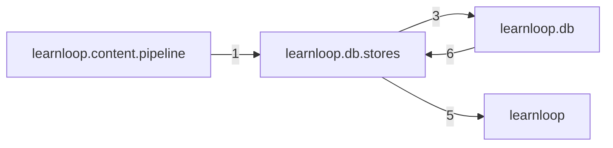

# `learnloop.db.stores` package map

> [!info] Generated package map
> This map is generated from live modules and their static imports. Follow module links for source-level facts and canonical concept/workflow links for system behavior.

Up: [[Module Catalog]]

## Responsibility

Table-family persistence owners extracted from the repository facade.

For system intent, use [[State and Persistence]], [[Architecture Overview]].

^package-purpose

## Module index

| Module | Purpose | Status | Direct importers | Direct test files |
|---|---|---:|---:|---:|
| [[Reference/Modules/learnloop/db/stores/__init__|learnloop.db.stores]] | [[Reference/Modules/learnloop/db/stores/__init__#^module-purpose|purpose]] | `ACTIVE` | 0 | 0 |
| [[Reference/Modules/learnloop/db/stores/collection|learnloop.db.stores.collection]] | [[Reference/Modules/learnloop/db/stores/collection#^module-purpose|purpose]] | `ACTIVE` | 1 | 1 |
| [[Reference/Modules/learnloop/db/stores/completion|learnloop.db.stores.completion]] | [[Reference/Modules/learnloop/db/stores/completion#^module-purpose|purpose]] | `ACTIVE` | 1 | 0 |
| [[Reference/Modules/learnloop/db/stores/ingest_queue|learnloop.db.stores.ingest_queue]] | [[Reference/Modules/learnloop/db/stores/ingest_queue#^module-purpose|purpose]] | `ACTIVE` | 3 | 2 |
| [[Reference/Modules/learnloop/db/stores/model_calls|learnloop.db.stores.model_calls]] | [[Reference/Modules/learnloop/db/stores/model_calls#^module-purpose|purpose]] | `ACTIVE` | 1 | 0 |
| [[Reference/Modules/learnloop/db/stores/observation_ledger|learnloop.db.stores.observation_ledger]] | [[Reference/Modules/learnloop/db/stores/observation_ledger#^module-purpose|purpose]] | `ACTIVE` | 1 | 1 |

## Cross-package dependencies

### This package imports

- [[Reference/Modules/learnloop/_package|learnloop]] — 5 static module edges
- [[Reference/Modules/learnloop/db/_package|learnloop.db]] — 3 static module edges

### Packages that import this package

- [[Reference/Modules/learnloop/db/_package|learnloop.db]] — 6 static module edges
- [[Reference/Modules/learnloop/content/pipeline/_package|learnloop.content.pipeline]] — 1 static module edge

### Dependency neighborhood

This diagram compresses package-level static imports; edge labels are distinct module-to-module import counts.



Interpretation: arrow direction is static import direction and the label is the number of distinct module-to-module edges. It shows coupling pressure, not runtime call frequency or ownership permission.

## Workflow entry points

- [[Initialize a Vault]]
- [[Inspect Persistent State]]

## Find and filter

Use Obsidian's native search:

```query
path:"Reference/Modules/learnloop/db/stores" tag:#docs/module
```

To change this package, start with a module's [[#Module index|purpose link]], then follow its callers, tests, and modification guidance. Re-run the generator after source changes.
