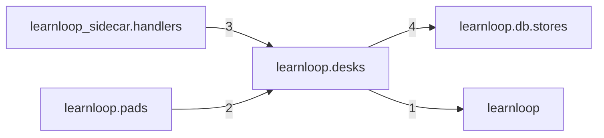

# `learnloop.desks` package map

> [!info] Generated package map
> This map is generated from live modules and their static imports. Follow module links for source-level facts and canonical concept/workflow links for system behavior.

Up: [[Module Catalog]]

## Responsibility

The Reader workbench's desks: workspace persistence, the write protocol desks and scratchpads share (client sequence, expected heads, stored receipts) and the one content reference. Workflow data, never evidence.

For system intent, use [[Architecture Overview]].

^package-purpose

## Module index

| Module | Purpose | Status | Direct importers | Direct test files |
|---|---|---:|---:|---:|
| [[Reference/Modules/learnloop/desks/__init__|learnloop.desks]] | [[Reference/Modules/learnloop/desks/__init__#^module-purpose|purpose]] | `ACTIVE` | 0 | 0 |
| [[Reference/Modules/learnloop/desks/content_ref|learnloop.desks.content_ref]] | [[Reference/Modules/learnloop/desks/content_ref#^module-purpose|purpose]] | `ACTIVE` | 2 | 0 |
| [[Reference/Modules/learnloop/desks/protocol|learnloop.desks.protocol]] | [[Reference/Modules/learnloop/desks/protocol#^module-purpose|purpose]] | `ACTIVE` | 4 | 1 |
| [[Reference/Modules/learnloop/desks/workspace|learnloop.desks.workspace]] | [[Reference/Modules/learnloop/desks/workspace#^module-purpose|purpose]] | `ACTIVE` | 1 | 2 |

## Cross-package dependencies

### This package imports

- [[Reference/Modules/learnloop/db/stores/_package|learnloop.db.stores]] — 4 static module edges
- [[Reference/Modules/learnloop/_package|learnloop]] — 1 static module edge

### Packages that import this package

- [[Reference/Modules/learnloop_sidecar/handlers/_package|learnloop_sidecar.handlers]] — 3 static module edges
- [[Reference/Modules/learnloop/pads/_package|learnloop.pads]] — 2 static module edges

### Dependency neighborhood

This diagram compresses package-level static imports; edge labels are distinct module-to-module import counts.



Interpretation: arrow direction is static import direction and the label is the number of distinct module-to-module edges. It shows coupling pressure, not runtime call frequency or ownership permission.

## Workflow entry points

- [[Initialize a Vault]]
- [[Start a Learning Cycle]]

## Find and filter

Use Obsidian's native search:

```query
path:"Reference/Modules/learnloop/desks" tag:#docs/module
```

To change this package, start with a module's [[#Module index|purpose link]], then follow its callers, tests, and modification guidance. Re-run the generator after source changes.
