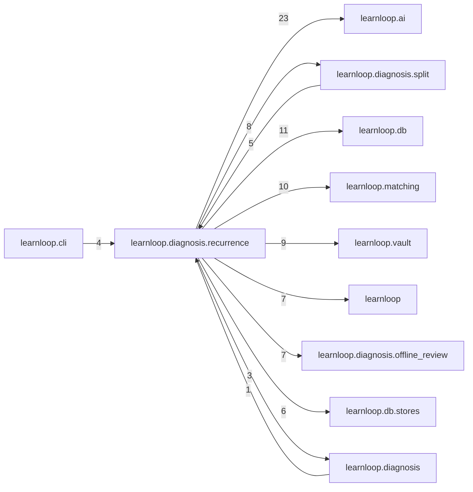

# `learnloop.diagnosis.recurrence` package map

> [!info] Generated package map
> This map is generated from live modules and their static imports. Follow module links for source-level facts and canonical concept/workflow links for system behavior.

Up: [[Module Catalog]]

## Responsibility

Recurrence with authority: the same_cause match kind over causal hypotheses, its shortlist and judge, the live step and the backlog.

For system intent, use [[Learning System]].

^package-purpose

## Module index

| Module | Purpose | Status | Direct importers | Direct test files |
|---|---|---:|---:|---:|
| [[Reference/Modules/learnloop/diagnosis/recurrence/__init__|learnloop.diagnosis.recurrence]] | [[Reference/Modules/learnloop/diagnosis/recurrence/__init__#^module-purpose|purpose]] | `ACTIVE` | 0 | 0 |
| [[Reference/Modules/learnloop/diagnosis/recurrence/backlog|learnloop.diagnosis.recurrence.backlog]] | [[Reference/Modules/learnloop/diagnosis/recurrence/backlog#^module-purpose|purpose]] | `ACTIVE` | 4 | 4 |
| [[Reference/Modules/learnloop/diagnosis/recurrence/benchmarks|learnloop.diagnosis.recurrence.benchmarks]] | [[Reference/Modules/learnloop/diagnosis/recurrence/benchmarks#^module-purpose|purpose]] | `ACTIVE` | 1 | 3 |
| [[Reference/Modules/learnloop/diagnosis/recurrence/display|learnloop.diagnosis.recurrence.display]] | [[Reference/Modules/learnloop/diagnosis/recurrence/display#^module-purpose|purpose]] | `ACTIVE` | 5 | 0 |
| [[Reference/Modules/learnloop/diagnosis/recurrence/escalation|learnloop.diagnosis.recurrence.escalation]] | [[Reference/Modules/learnloop/diagnosis/recurrence/escalation#^module-purpose|purpose]] | `ACTIVE` | 2 | 2 |
| [[Reference/Modules/learnloop/diagnosis/recurrence/guard|learnloop.diagnosis.recurrence.guard]] | [[Reference/Modules/learnloop/diagnosis/recurrence/guard#^module-purpose|purpose]] | `ACTIVE` | 2 | 2 |
| [[Reference/Modules/learnloop/diagnosis/recurrence/judging|learnloop.diagnosis.recurrence.judging]] | [[Reference/Modules/learnloop/diagnosis/recurrence/judging#^module-purpose|purpose]] | `ACTIVE` | 9 | 2 |
| [[Reference/Modules/learnloop/diagnosis/recurrence/kind|learnloop.diagnosis.recurrence.kind]] | [[Reference/Modules/learnloop/diagnosis/recurrence/kind#^module-purpose|purpose]] | `ACTIVE` | 6 | 1 |
| [[Reference/Modules/learnloop/diagnosis/recurrence/live|learnloop.diagnosis.recurrence.live]] | [[Reference/Modules/learnloop/diagnosis/recurrence/live#^module-purpose|purpose]] | `ACTIVE` | 1 | 1 |
| [[Reference/Modules/learnloop/diagnosis/recurrence/report|learnloop.diagnosis.recurrence.report]] | [[Reference/Modules/learnloop/diagnosis/recurrence/report#^module-purpose|purpose]] | `ACTIVE` | 1 | 1 |

## Cross-package dependencies

### This package imports

- [[Reference/Modules/learnloop/ai/_package|learnloop.ai]] — 23 static module edges
- [[Reference/Modules/learnloop/db/_package|learnloop.db]] — 11 static module edges
- [[Reference/Modules/learnloop/matching/_package|learnloop.matching]] — 10 static module edges
- [[Reference/Modules/learnloop/vault/_package|learnloop.vault]] — 9 static module edges
- [[Reference/Modules/learnloop/diagnosis/split/_package|learnloop.diagnosis.split]] — 8 static module edges
- [[Reference/Modules/learnloop/_package|learnloop]] — 7 static module edges
- [[Reference/Modules/learnloop/diagnosis/offline_review/_package|learnloop.diagnosis.offline_review]] — 7 static module edges
- [[Reference/Modules/learnloop/db/stores/_package|learnloop.db.stores]] — 6 static module edges
- [[Reference/Modules/learnloop/substrate/_package|learnloop.substrate]] — 4 static module edges
- [[Reference/Modules/learnloop/diagnosis/_package|learnloop.diagnosis]] — 3 static module edges
- [[Reference/Modules/learnloop/ai/providers/_package|learnloop.ai.providers]] — 1 static module edge

### Packages that import this package

- [[Reference/Modules/learnloop/diagnosis/split/_package|learnloop.diagnosis.split]] — 5 static module edges
- [[Reference/Modules/learnloop/cli/_package|learnloop.cli]] — 4 static module edges
- [[Reference/Modules/learnloop/content/proposals/_package|learnloop.content.proposals]] — 2 static module edges
- [[Reference/Modules/learnloop/diagnosis/text_gaps/_package|learnloop.diagnosis.text_gaps]] — 2 static module edges
- [[Reference/Modules/learnloop_sidecar/handlers/_package|learnloop_sidecar.handlers]] — 2 static module edges
- [[Reference/Modules/learnloop/diagnosis/_package|learnloop.diagnosis]] — 1 static module edge

### Dependency neighborhood

This diagram compresses package-level static imports; edge labels are distinct module-to-module import counts.



Interpretation: arrow direction is static import direction and the label is the number of distinct module-to-module edges. It shows coupling pressure, not runtime call frequency or ownership permission.

## Workflow entry points

- [[Start a Learning Cycle]]
- [[Process Model Output]]

## Find and filter

Use Obsidian's native search:

```query
path:"Reference/Modules/learnloop/diagnosis/recurrence" tag:#docs/module
```

To change this package, start with a module's [[#Module index|purpose link]], then follow its callers, tests, and modification guidance. Re-run the generator after source changes.
