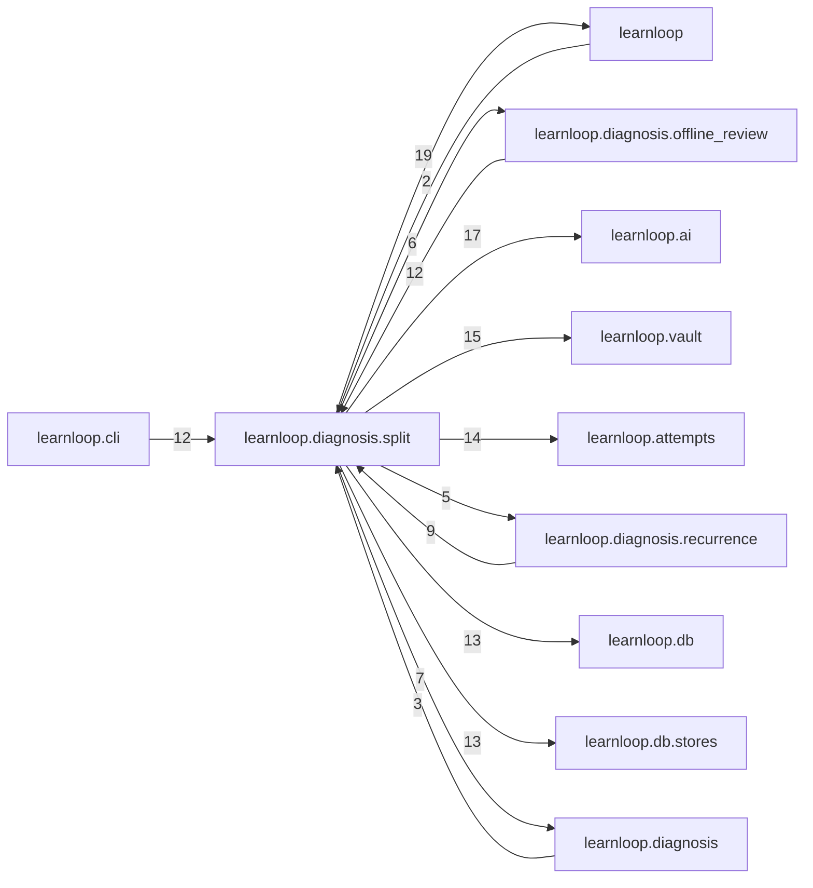

# `learnloop.diagnosis.split` package map

> [!info] Generated package map
> This map is generated from live modules and their static imports. Follow module links for source-level facts and canonical concept/workflow links for system behavior.

Up: [[Module Catalog]]

## Responsibility

History-aware diagnosis split from the learner-blind grader: history modes, the diagnoser's inputs, jobs and traces.

For system intent, use [[Learning System]].

^package-purpose

## Module index

| Module | Purpose | Status | Direct importers | Direct test files |
|---|---|---:|---:|---:|
| [[Reference/Modules/learnloop/diagnosis/split/__init__|learnloop.diagnosis.split]] | [[Reference/Modules/learnloop/diagnosis/split/__init__#^module-purpose|purpose]] | `ACTIVE` | 0 | 0 |
| [[Reference/Modules/learnloop/diagnosis/split/card|learnloop.diagnosis.split.card]] | [[Reference/Modules/learnloop/diagnosis/split/card#^module-purpose|purpose]] | `ACTIVE` | 3 | 3 |
| [[Reference/Modules/learnloop/diagnosis/split/context|learnloop.diagnosis.split.context]] | [[Reference/Modules/learnloop/diagnosis/split/context#^module-purpose|purpose]] | `ACTIVE` | 9 | 12 |
| [[Reference/Modules/learnloop/diagnosis/split/contract|learnloop.diagnosis.split.contract]] | [[Reference/Modules/learnloop/diagnosis/split/contract#^module-purpose|purpose]] | `ACTIVE` | 5 | 10 |
| [[Reference/Modules/learnloop/diagnosis/split/diagnoser|learnloop.diagnosis.split.diagnoser]] | [[Reference/Modules/learnloop/diagnosis/split/diagnoser#^module-purpose|purpose]] | `ACTIVE` | 3 | 3 |
| [[Reference/Modules/learnloop/diagnosis/split/embeddings|learnloop.diagnosis.split.embeddings]] | [[Reference/Modules/learnloop/diagnosis/split/embeddings#^module-purpose|purpose]] | `ACTIVE` | 8 | 3 |
| [[Reference/Modules/learnloop/diagnosis/split/figure_trace|learnloop.diagnosis.split.figure_trace]] | [[Reference/Modules/learnloop/diagnosis/split/figure_trace#^module-purpose|purpose]] | `ACTIVE` | 3 | 2 |
| [[Reference/Modules/learnloop/diagnosis/split/history|learnloop.diagnosis.split.history]] | [[Reference/Modules/learnloop/diagnosis/split/history#^module-purpose|purpose]] | `ACTIVE` | 10 | 17 |
| [[Reference/Modules/learnloop/diagnosis/split/jobs|learnloop.diagnosis.split.jobs]] | [[Reference/Modules/learnloop/diagnosis/split/jobs#^module-purpose|purpose]] | `ACTIVE` | 19 | 25 |
| [[Reference/Modules/learnloop/diagnosis/split/legacy_view|learnloop.diagnosis.split.legacy_view]] | [[Reference/Modules/learnloop/diagnosis/split/legacy_view#^module-purpose|purpose]] | `ACTIVE` | 3 | 0 |
| [[Reference/Modules/learnloop/diagnosis/split/live|learnloop.diagnosis.split.live]] | [[Reference/Modules/learnloop/diagnosis/split/live#^module-purpose|purpose]] | `ACTIVE` | 8 | 16 |
| [[Reference/Modules/learnloop/diagnosis/split/pfc_report|learnloop.diagnosis.split.pfc_report]] | [[Reference/Modules/learnloop/diagnosis/split/pfc_report#^module-purpose|purpose]] | `ACTIVE` | 1 | 1 |
| [[Reference/Modules/learnloop/diagnosis/split/prior_analysis|learnloop.diagnosis.split.prior_analysis]] | [[Reference/Modules/learnloop/diagnosis/split/prior_analysis#^module-purpose|purpose]] | `ACTIVE` | 3 | 2 |
| [[Reference/Modules/learnloop/diagnosis/split/provenance|learnloop.diagnosis.split.provenance]] | [[Reference/Modules/learnloop/diagnosis/split/provenance#^module-purpose|purpose]] | `ACTIVE` | 4 | 5 |
| [[Reference/Modules/learnloop/diagnosis/split/reports|learnloop.diagnosis.split.reports]] | [[Reference/Modules/learnloop/diagnosis/split/reports#^module-purpose|purpose]] | `ACTIVE` | 1 | 3 |
| [[Reference/Modules/learnloop/diagnosis/split/retrieval|learnloop.diagnosis.split.retrieval]] | [[Reference/Modules/learnloop/diagnosis/split/retrieval#^module-purpose|purpose]] | `ACTIVE` | 5 | 2 |
| [[Reference/Modules/learnloop/diagnosis/split/settings|learnloop.diagnosis.split.settings]] | [[Reference/Modules/learnloop/diagnosis/split/settings#^module-purpose|purpose]] | `ACTIVE` | 9 | 12 |
| [[Reference/Modules/learnloop/diagnosis/split/snapshot|learnloop.diagnosis.split.snapshot]] | [[Reference/Modules/learnloop/diagnosis/split/snapshot#^module-purpose|purpose]] | `ACTIVE` | 2 | 3 |
| [[Reference/Modules/learnloop/diagnosis/split/validation|learnloop.diagnosis.split.validation]] | [[Reference/Modules/learnloop/diagnosis/split/validation#^module-purpose|purpose]] | `ACTIVE` | 3 | 2 |
| [[Reference/Modules/learnloop/diagnosis/split/workbench_trace|learnloop.diagnosis.split.workbench_trace]] | [[Reference/Modules/learnloop/diagnosis/split/workbench_trace#^module-purpose|purpose]] | `ACTIVE` | 4 | 1 |

## Cross-package dependencies

### This package imports

- [[Reference/Modules/learnloop/_package|learnloop]] — 19 static module edges
- [[Reference/Modules/learnloop/ai/_package|learnloop.ai]] — 17 static module edges
- [[Reference/Modules/learnloop/vault/_package|learnloop.vault]] — 15 static module edges
- [[Reference/Modules/learnloop/attempts/_package|learnloop.attempts]] — 14 static module edges
- [[Reference/Modules/learnloop/db/_package|learnloop.db]] — 13 static module edges
- [[Reference/Modules/learnloop/db/stores/_package|learnloop.db.stores]] — 13 static module edges
- [[Reference/Modules/learnloop/diagnosis/_package|learnloop.diagnosis]] — 7 static module edges
- [[Reference/Modules/learnloop/followup_serve/_package|learnloop.followup_serve]] — 7 static module edges
- [[Reference/Modules/learnloop/diagnosis/offline_review/_package|learnloop.diagnosis.offline_review]] — 6 static module edges
- [[Reference/Modules/learnloop/diagnosis/recurrence/_package|learnloop.diagnosis.recurrence]] — 5 static module edges
- [[Reference/Modules/learnloop/substrate/_package|learnloop.substrate]] — 5 static module edges
- [[Reference/Modules/learnloop/diagnosis/text_gaps/_package|learnloop.diagnosis.text_gaps]] — 2 static module edges
- [[Reference/Modules/learnloop/ops/_package|learnloop.ops]] — 1 static module edge

### Packages that import this package

- [[Reference/Modules/learnloop/cli/_package|learnloop.cli]] — 12 static module edges
- [[Reference/Modules/learnloop/diagnosis/offline_review/_package|learnloop.diagnosis.offline_review]] — 12 static module edges
- [[Reference/Modules/learnloop/diagnosis/recurrence/_package|learnloop.diagnosis.recurrence]] — 9 static module edges
- [[Reference/Modules/learnloop_sidecar/handlers/_package|learnloop_sidecar.handlers]] — 6 static module edges
- [[Reference/Modules/learnloop/diagnosis/text_gaps/_package|learnloop.diagnosis.text_gaps]] — 5 static module edges
- [[Reference/Modules/learnloop/diagnosis/_package|learnloop.diagnosis]] — 3 static module edges
- [[Reference/Modules/learnloop/followup_run/_package|learnloop.followup_run]] — 3 static module edges
- [[Reference/Modules/learnloop/_package|learnloop]] — 2 static module edges
- [[Reference/Modules/learnloop/field/_package|learnloop.field]] — 1 static module edge
- [[Reference/Modules/learnloop/tui/screens/_package|learnloop.tui.screens]] — 1 static module edge
- [[Reference/Modules/learnloop_sidecar/_package|learnloop_sidecar]] — 1 static module edge

### Dependency neighborhood

This diagram compresses package-level static imports; edge labels are distinct module-to-module import counts.



Interpretation: arrow direction is static import direction and the label is the number of distinct module-to-module edges. It shows coupling pressure, not runtime call frequency or ownership permission.

## Workflow entry points

- [[Start a Learning Cycle]]
- [[Process Model Output]]

## Find and filter

Use Obsidian's native search:

```query
path:"Reference/Modules/learnloop/diagnosis/split" tag:#docs/module
```

To change this package, start with a module's [[#Module index|purpose link]], then follow its callers, tests, and modification guidance. Re-run the generator after source changes.
