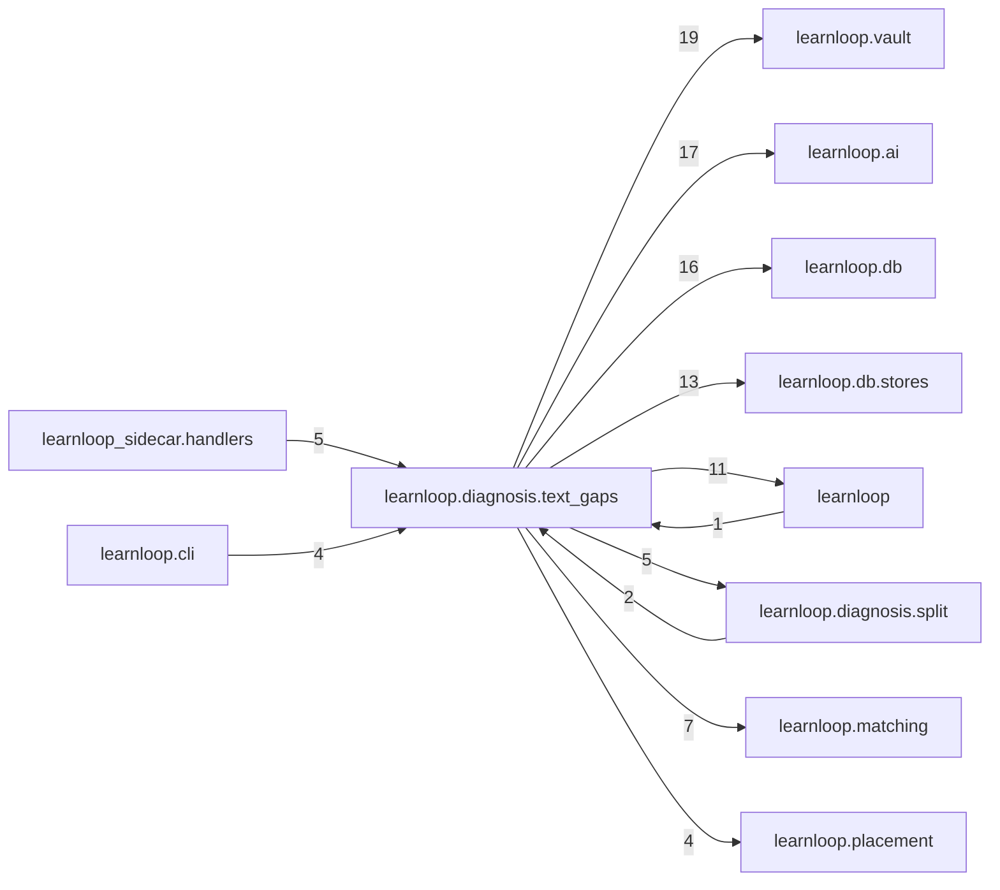

# `learnloop.diagnosis.text_gaps` package map

> [!info] Generated package map
> This map is generated from live modules and their static imports. Follow module links for source-level facts and canonical concept/workflow links for system behavior.

Up: [[Module Catalog]]

## Responsibility

Learner-text gaps: what a learner's own words show they lack or hold, read in tiers, judged in pairs, acted on with undo, and reported.

For system intent, use [[Learning System]].

^package-purpose

## Module index

| Module | Purpose | Status | Direct importers | Direct test files |
|---|---|---:|---:|---:|
| [[Reference/Modules/learnloop/diagnosis/text_gaps/__init__|learnloop.diagnosis.text_gaps]] | [[Reference/Modules/learnloop/diagnosis/text_gaps/__init__#^module-purpose|purpose]] | `ACTIVE` | 0 | 0 |
| [[Reference/Modules/learnloop/diagnosis/text_gaps/actions|learnloop.diagnosis.text_gaps.actions]] | [[Reference/Modules/learnloop/diagnosis/text_gaps/actions#^module-purpose|purpose]] | `ACTIVE` | 4 | 8 |
| [[Reference/Modules/learnloop/diagnosis/text_gaps/candidates|learnloop.diagnosis.text_gaps.candidates]] | [[Reference/Modules/learnloop/diagnosis/text_gaps/candidates#^module-purpose|purpose]] | `ACTIVE` | 2 | 0 |
| [[Reference/Modules/learnloop/diagnosis/text_gaps/contract|learnloop.diagnosis.text_gaps.contract]] | [[Reference/Modules/learnloop/diagnosis/text_gaps/contract#^module-purpose|purpose]] | `ACTIVE` | 10 | 13 |
| [[Reference/Modules/learnloop/diagnosis/text_gaps/jobs|learnloop.diagnosis.text_gaps.jobs]] | [[Reference/Modules/learnloop/diagnosis/text_gaps/jobs#^module-purpose|purpose]] | `ACTIVE` | 14 | 29 |
| [[Reference/Modules/learnloop/diagnosis/text_gaps/judges|learnloop.diagnosis.text_gaps.judges]] | [[Reference/Modules/learnloop/diagnosis/text_gaps/judges#^module-purpose|purpose]] | `ACTIVE` | 4 | 6 |
| [[Reference/Modules/learnloop/diagnosis/text_gaps/kinds|learnloop.diagnosis.text_gaps.kinds]] | [[Reference/Modules/learnloop/diagnosis/text_gaps/kinds#^module-purpose|purpose]] | `ACTIVE` | 2 | 2 |
| [[Reference/Modules/learnloop/diagnosis/text_gaps/pipeline|learnloop.diagnosis.text_gaps.pipeline]] | [[Reference/Modules/learnloop/diagnosis/text_gaps/pipeline#^module-purpose|purpose]] | `ACTIVE` | 2 | 22 |
| [[Reference/Modules/learnloop/diagnosis/text_gaps/provenance|learnloop.diagnosis.text_gaps.provenance]] | [[Reference/Modules/learnloop/diagnosis/text_gaps/provenance#^module-purpose|purpose]] | `ACTIVE` | 3 | 7 |
| [[Reference/Modules/learnloop/diagnosis/text_gaps/report|learnloop.diagnosis.text_gaps.report]] | [[Reference/Modules/learnloop/diagnosis/text_gaps/report#^module-purpose|purpose]] | `ACTIVE` | 1 | 6 |
| [[Reference/Modules/learnloop/diagnosis/text_gaps/sources|learnloop.diagnosis.text_gaps.sources]] | [[Reference/Modules/learnloop/diagnosis/text_gaps/sources#^module-purpose|purpose]] | `ACTIVE` | 4 | 27 |
| [[Reference/Modules/learnloop/diagnosis/text_gaps/tier1|learnloop.diagnosis.text_gaps.tier1]] | [[Reference/Modules/learnloop/diagnosis/text_gaps/tier1#^module-purpose|purpose]] | `ACTIVE` | 1 | 2 |

## Cross-package dependencies

### This package imports

- [[Reference/Modules/learnloop/vault/_package|learnloop.vault]] — 19 static module edges
- [[Reference/Modules/learnloop/ai/_package|learnloop.ai]] — 17 static module edges
- [[Reference/Modules/learnloop/db/_package|learnloop.db]] — 16 static module edges
- [[Reference/Modules/learnloop/db/stores/_package|learnloop.db.stores]] — 13 static module edges
- [[Reference/Modules/learnloop/_package|learnloop]] — 11 static module edges
- [[Reference/Modules/learnloop/matching/_package|learnloop.matching]] — 7 static module edges
- [[Reference/Modules/learnloop/diagnosis/split/_package|learnloop.diagnosis.split]] — 5 static module edges
- [[Reference/Modules/learnloop/placement/_package|learnloop.placement]] — 4 static module edges
- [[Reference/Modules/learnloop/substrate/_package|learnloop.substrate]] — 3 static module edges
- [[Reference/Modules/learnloop/tutor/_package|learnloop.tutor]] — 3 static module edges
- [[Reference/Modules/learnloop/content/sources/_package|learnloop.content.sources]] — 2 static module edges
- [[Reference/Modules/learnloop/diagnosis/_package|learnloop.diagnosis]] — 2 static module edges
- [[Reference/Modules/learnloop/diagnosis/recurrence/_package|learnloop.diagnosis.recurrence]] — 2 static module edges
- [[Reference/Modules/learnloop/attempts/_package|learnloop.attempts]] — 1 static module edge
- [[Reference/Modules/learnloop/diagnosis/offline_review/_package|learnloop.diagnosis.offline_review]] — 1 static module edge
- [[Reference/Modules/learnloop/ingest/_package|learnloop.ingest]] — 1 static module edge
- [[Reference/Modules/learnloop/reader/_package|learnloop.reader]] — 1 static module edge
- [[Reference/Modules/learnloop/source_retrieval/_package|learnloop.source_retrieval]] — 1 static module edge

### Packages that import this package

- [[Reference/Modules/learnloop_sidecar/handlers/_package|learnloop_sidecar.handlers]] — 5 static module edges
- [[Reference/Modules/learnloop/cli/_package|learnloop.cli]] — 4 static module edges
- [[Reference/Modules/learnloop/diagnosis/split/_package|learnloop.diagnosis.split]] — 2 static module edges
- [[Reference/Modules/learnloop_sidecar/_package|learnloop_sidecar]] — 2 static module edges
- [[Reference/Modules/learnloop/_package|learnloop]] — 1 static module edge
- [[Reference/Modules/learnloop/diagnosis/_package|learnloop.diagnosis]] — 1 static module edge
- [[Reference/Modules/learnloop/field/_package|learnloop.field]] — 1 static module edge
- [[Reference/Modules/learnloop/figures/_package|learnloop.figures]] — 1 static module edge
- [[Reference/Modules/learnloop/goals/_package|learnloop.goals]] — 1 static module edge
- [[Reference/Modules/learnloop/reader/_package|learnloop.reader]] — 1 static module edge
- [[Reference/Modules/learnloop/source_retrieval/_package|learnloop.source_retrieval]] — 1 static module edge
- [[Reference/Modules/learnloop/teacher/_package|learnloop.teacher]] — 1 static module edge
- [[Reference/Modules/learnloop/workbench/_package|learnloop.workbench]] — 1 static module edge

### Dependency neighborhood

This diagram compresses package-level static imports; edge labels are distinct module-to-module import counts.



Interpretation: arrow direction is static import direction and the label is the number of distinct module-to-module edges. It shows coupling pressure, not runtime call frequency or ownership permission.

## Workflow entry points

- [[Start a Learning Cycle]]
- [[Process Model Output]]

## Find and filter

Use Obsidian's native search:

```query
path:"Reference/Modules/learnloop/diagnosis/text_gaps" tag:#docs/module
```

To change this package, start with a module's [[#Module index|purpose link]], then follow its callers, tests, and modification guidance. Re-run the generator after source changes.
