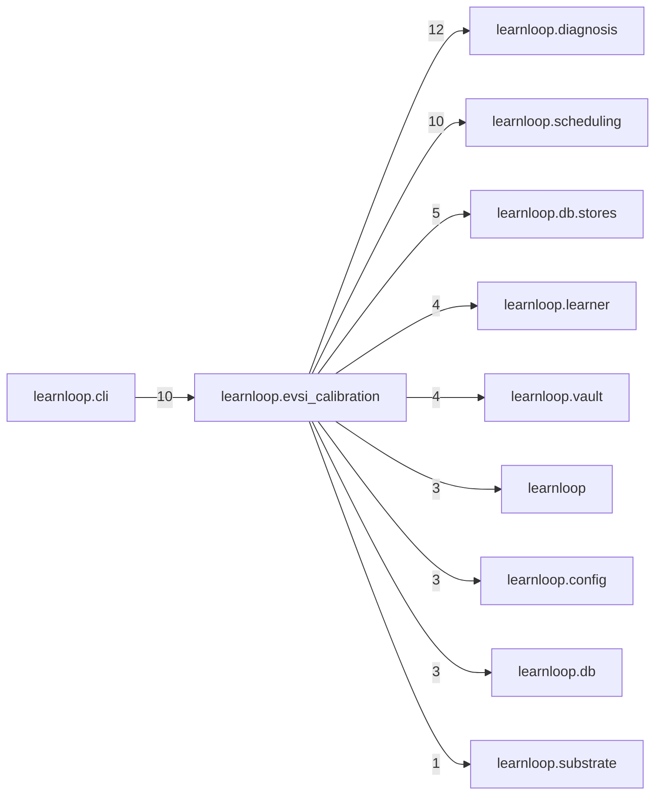

# `learnloop.evsi_calibration` package map

> [!info] Generated package map
> This map is generated from live modules and their static imports. Follow module links for source-level facts and canonical concept/workflow links for system behavior.

Up: [[Module Catalog]]

## Responsibility

EVSI/EIG calibration: read-only measurement of the numbers value-of-information runs on, labelled honestly where they cannot be measured.

For system intent, use [[Architecture Overview]].

^package-purpose

## Module index

| Module | Purpose | Status | Direct importers | Direct test files |
|---|---|---:|---:|---:|
| [[Reference/Modules/learnloop/evsi_calibration/__init__|learnloop.evsi_calibration]] | [[Reference/Modules/learnloop/evsi_calibration/__init__#^module-purpose|purpose]] | `ACTIVE` | 0 | 0 |
| [[Reference/Modules/learnloop/evsi_calibration/artifacts|learnloop.evsi_calibration.artifacts]] | [[Reference/Modules/learnloop/evsi_calibration/artifacts#^module-purpose|purpose]] | `ACTIVE` | 1 | 1 |
| [[Reference/Modules/learnloop/evsi_calibration/compare|learnloop.evsi_calibration.compare]] | [[Reference/Modules/learnloop/evsi_calibration/compare#^module-purpose|purpose]] | `ACTIVE` | 1 | 1 |
| [[Reference/Modules/learnloop/evsi_calibration/eedi|learnloop.evsi_calibration.eedi]] | [[Reference/Modules/learnloop/evsi_calibration/eedi#^module-purpose|purpose]] | `ACTIVE` | 9 | 3 |
| [[Reference/Modules/learnloop/evsi_calibration/experiments|learnloop.evsi_calibration.experiments]] | [[Reference/Modules/learnloop/evsi_calibration/experiments#^module-purpose|purpose]] | `ACTIVE` | 3 | 2 |
| [[Reference/Modules/learnloop/evsi_calibration/families|learnloop.evsi_calibration.families]] | [[Reference/Modules/learnloop/evsi_calibration/families#^module-purpose|purpose]] | `ACTIVE` | 2 | 1 |
| [[Reference/Modules/learnloop/evsi_calibration/family_data|learnloop.evsi_calibration.family_data]] | [[Reference/Modules/learnloop/evsi_calibration/family_data#^module-purpose|purpose]] | `ACTIVE` | 2 | 1 |
| [[Reference/Modules/learnloop/evsi_calibration/family_fit|learnloop.evsi_calibration.family_fit]] | [[Reference/Modules/learnloop/evsi_calibration/family_fit#^module-purpose|purpose]] | `ACTIVE` | 3 | 1 |
| [[Reference/Modules/learnloop/evsi_calibration/forecast_report|learnloop.evsi_calibration.forecast_report]] | [[Reference/Modules/learnloop/evsi_calibration/forecast_report#^module-purpose|purpose]] | `ACTIVE` | 1 | 4 |
| [[Reference/Modules/learnloop/evsi_calibration/live_report|learnloop.evsi_calibration.live_report]] | [[Reference/Modules/learnloop/evsi_calibration/live_report#^module-purpose|purpose]] | `ACTIVE` | 2 | 5 |
| [[Reference/Modules/learnloop/evsi_calibration/metrics|learnloop.evsi_calibration.metrics]] | [[Reference/Modules/learnloop/evsi_calibration/metrics#^module-purpose|purpose]] | `ACTIVE` | 4 | 1 |
| [[Reference/Modules/learnloop/evsi_calibration/multifamily|learnloop.evsi_calibration.multifamily]] | [[Reference/Modules/learnloop/evsi_calibration/multifamily#^module-purpose|purpose]] | `ACTIVE` | 1 | 1 |
| [[Reference/Modules/learnloop/evsi_calibration/multisim|learnloop.evsi_calibration.multisim]] | [[Reference/Modules/learnloop/evsi_calibration/multisim#^module-purpose|purpose]] | `ACTIVE` | 1 | 1 |
| [[Reference/Modules/learnloop/evsi_calibration/policies|learnloop.evsi_calibration.policies]] | [[Reference/Modules/learnloop/evsi_calibration/policies#^module-purpose|purpose]] | `ACTIVE` | 5 | 3 |
| [[Reference/Modules/learnloop/evsi_calibration/response_fit|learnloop.evsi_calibration.response_fit]] | [[Reference/Modules/learnloop/evsi_calibration/response_fit#^module-purpose|purpose]] | `ACTIVE` | 6 | 3 |
| [[Reference/Modules/learnloop/evsi_calibration/simulate|learnloop.evsi_calibration.simulate]] | [[Reference/Modules/learnloop/evsi_calibration/simulate#^module-purpose|purpose]] | `ACTIVE` | 4 | 3 |
| [[Reference/Modules/learnloop/evsi_calibration/world|learnloop.evsi_calibration.world]] | [[Reference/Modules/learnloop/evsi_calibration/world#^module-purpose|purpose]] | `ACTIVE` | 5 | 3 |

## Cross-package dependencies

### This package imports

- [[Reference/Modules/learnloop/diagnosis/_package|learnloop.diagnosis]] — 12 static module edges
- [[Reference/Modules/learnloop/scheduling/_package|learnloop.scheduling]] — 10 static module edges
- [[Reference/Modules/learnloop/db/stores/_package|learnloop.db.stores]] — 5 static module edges
- [[Reference/Modules/learnloop/learner/_package|learnloop.learner]] — 4 static module edges
- [[Reference/Modules/learnloop/vault/_package|learnloop.vault]] — 4 static module edges
- [[Reference/Modules/learnloop/_package|learnloop]] — 3 static module edges
- [[Reference/Modules/learnloop/config/_package|learnloop.config]] — 3 static module edges
- [[Reference/Modules/learnloop/db/_package|learnloop.db]] — 3 static module edges
- [[Reference/Modules/learnloop/substrate/_package|learnloop.substrate]] — 1 static module edge

### Packages that import this package

- [[Reference/Modules/learnloop/cli/_package|learnloop.cli]] — 10 static module edges

### Dependency neighborhood

This diagram compresses package-level static imports; edge labels are distinct module-to-module import counts.



Interpretation: arrow direction is static import direction and the label is the number of distinct module-to-module edges. It shows coupling pressure, not runtime call frequency or ownership permission.

## Workflow entry points

- [[Initialize a Vault]]
- [[Start a Learning Cycle]]

## Find and filter

Use Obsidian's native search:

```query
path:"Reference/Modules/learnloop/evsi_calibration" tag:#docs/module
```

To change this package, start with a module's [[#Module index|purpose link]], then follow its callers, tests, and modification guidance. Re-run the generator after source changes.
