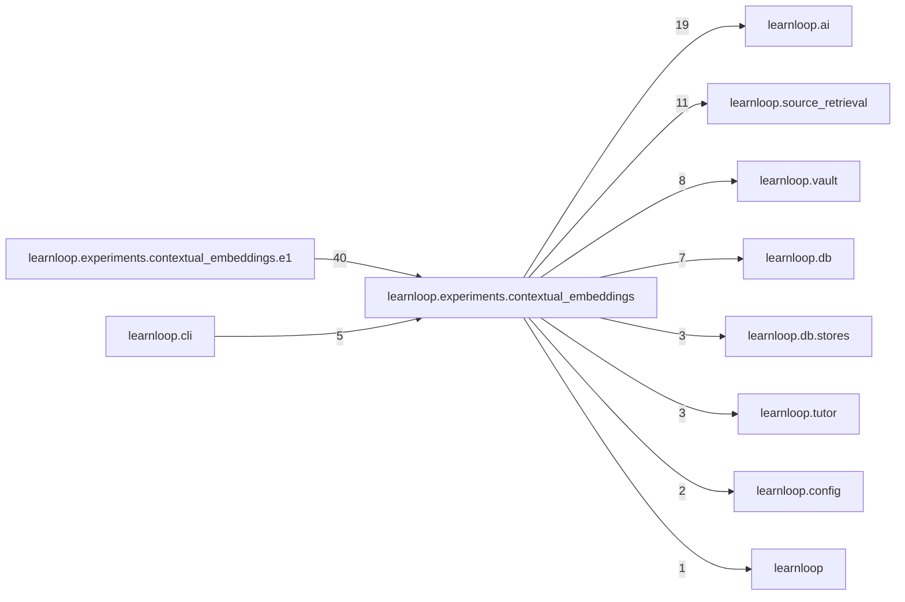

# `learnloop.experiments.contextual_embeddings` package map

> [!info] Generated package map
> This map is generated from live modules and their static imports. Follow module links for source-level facts and canonical concept/workflow links for system behavior.

Up: [[Module Catalog]]

## Responsibility

Experiment E0: hosted contextual source embeddings, its bank, labels, arms and report.

For system intent, use [[Architecture Overview]].

^package-purpose

## Module index

| Module | Purpose | Status | Direct importers | Direct test files |
|---|---|---:|---:|---:|
| [[Reference/Modules/learnloop/experiments/contextual_embeddings/__init__|learnloop.experiments.contextual_embeddings]] | [[Reference/Modules/learnloop/experiments/contextual_embeddings/__init__#^module-purpose|purpose]] | `ACTIVE` | 0 | 0 |
| [[Reference/Modules/learnloop/experiments/contextual_embeddings/adapters|learnloop.experiments.contextual_embeddings.adapters]] | [[Reference/Modules/learnloop/experiments/contextual_embeddings/adapters#^module-purpose|purpose]] | `ACTIVE` | 7 | 12 |
| [[Reference/Modules/learnloop/experiments/contextual_embeddings/answers|learnloop.experiments.contextual_embeddings.answers]] | [[Reference/Modules/learnloop/experiments/contextual_embeddings/answers#^module-purpose|purpose]] | `ACTIVE` | 1 | 2 |
| [[Reference/Modules/learnloop/experiments/contextual_embeddings/anthropic_api|learnloop.experiments.contextual_embeddings.anthropic_api]] | [[Reference/Modules/learnloop/experiments/contextual_embeddings/anthropic_api#^module-purpose|purpose]] | `ACTIVE` | 1 | 3 |
| [[Reference/Modules/learnloop/experiments/contextual_embeddings/bank|learnloop.experiments.contextual_embeddings.bank]] | [[Reference/Modules/learnloop/experiments/contextual_embeddings/bank#^module-purpose|purpose]] | `ACTIVE` | 10 | 12 |
| [[Reference/Modules/learnloop/experiments/contextual_embeddings/boundary|learnloop.experiments.contextual_embeddings.boundary]] | [[Reference/Modules/learnloop/experiments/contextual_embeddings/boundary#^module-purpose|purpose]] | `ACTIVE` | 5 | 1 |
| [[Reference/Modules/learnloop/experiments/contextual_embeddings/budget|learnloop.experiments.contextual_embeddings.budget]] | [[Reference/Modules/learnloop/experiments/contextual_embeddings/budget#^module-purpose|purpose]] | `ACTIVE` | 14 | 15 |
| [[Reference/Modules/learnloop/experiments/contextual_embeddings/callers|learnloop.experiments.contextual_embeddings.callers]] | [[Reference/Modules/learnloop/experiments/contextual_embeddings/callers#^module-purpose|purpose]] | `ACTIVE` | 6 | 14 |
| [[Reference/Modules/learnloop/experiments/contextual_embeddings/corpus|learnloop.experiments.contextual_embeddings.corpus]] | [[Reference/Modules/learnloop/experiments/contextual_embeddings/corpus#^module-purpose|purpose]] | `ACTIVE` | 15 | 17 |
| [[Reference/Modules/learnloop/experiments/contextual_embeddings/credentials|learnloop.experiments.contextual_embeddings.credentials]] | [[Reference/Modules/learnloop/experiments/contextual_embeddings/credentials#^module-purpose|purpose]] | `ACTIVE` | 4 | 2 |
| [[Reference/Modules/learnloop/experiments/contextual_embeddings/delivery|learnloop.experiments.contextual_embeddings.delivery]] | [[Reference/Modules/learnloop/experiments/contextual_embeddings/delivery#^module-purpose|purpose]] | `ACTIVE` | 3 | 4 |
| [[Reference/Modules/learnloop/experiments/contextual_embeddings/evaluate|learnloop.experiments.contextual_embeddings.evaluate]] | [[Reference/Modules/learnloop/experiments/contextual_embeddings/evaluate#^module-purpose|purpose]] | `ACTIVE` | 4 | 1 |
| [[Reference/Modules/learnloop/experiments/contextual_embeddings/live|learnloop.experiments.contextual_embeddings.live]] | [[Reference/Modules/learnloop/experiments/contextual_embeddings/live#^module-purpose|purpose]] | `ACTIVE` | 3 | 5 |
| [[Reference/Modules/learnloop/experiments/contextual_embeddings/metrics|learnloop.experiments.contextual_embeddings.metrics]] | [[Reference/Modules/learnloop/experiments/contextual_embeddings/metrics#^module-purpose|purpose]] | `ACTIVE` | 5 | 2 |
| [[Reference/Modules/learnloop/experiments/contextual_embeddings/paid|learnloop.experiments.contextual_embeddings.paid]] | [[Reference/Modules/learnloop/experiments/contextual_embeddings/paid#^module-purpose|purpose]] | `ACTIVE` | 4 | 6 |
| [[Reference/Modules/learnloop/experiments/contextual_embeddings/pins|learnloop.experiments.contextual_embeddings.pins]] | [[Reference/Modules/learnloop/experiments/contextual_embeddings/pins#^module-purpose|purpose]] | `ACTIVE` | 25 | 19 |
| [[Reference/Modules/learnloop/experiments/contextual_embeddings/plan|learnloop.experiments.contextual_embeddings.plan]] | [[Reference/Modules/learnloop/experiments/contextual_embeddings/plan#^module-purpose|purpose]] | `ACTIVE` | 1 | 1 |
| [[Reference/Modules/learnloop/experiments/contextual_embeddings/records|learnloop.experiments.contextual_embeddings.records]] | [[Reference/Modules/learnloop/experiments/contextual_embeddings/records#^module-purpose|purpose]] | `ACTIVE` | 3 | 2 |
| [[Reference/Modules/learnloop/experiments/contextual_embeddings/report|learnloop.experiments.contextual_embeddings.report]] | [[Reference/Modules/learnloop/experiments/contextual_embeddings/report#^module-purpose|purpose]] | `ACTIVE` | 4 | 3 |
| [[Reference/Modules/learnloop/experiments/contextual_embeddings/retrieval|learnloop.experiments.contextual_embeddings.retrieval]] | [[Reference/Modules/learnloop/experiments/contextual_embeddings/retrieval#^module-purpose|purpose]] | `ACTIVE` | 6 | 5 |
| [[Reference/Modules/learnloop/experiments/contextual_embeddings/runner|learnloop.experiments.contextual_embeddings.runner]] | [[Reference/Modules/learnloop/experiments/contextual_embeddings/runner#^module-purpose|purpose]] | `ACTIVE` | 5 | 8 |
| [[Reference/Modules/learnloop/experiments/contextual_embeddings/stop_rules|learnloop.experiments.contextual_embeddings.stop_rules]] | [[Reference/Modules/learnloop/experiments/contextual_embeddings/stop_rules#^module-purpose|purpose]] | `ACTIVE` | 3 | 2 |
| [[Reference/Modules/learnloop/experiments/contextual_embeddings/system_arms|learnloop.experiments.contextual_embeddings.system_arms]] | [[Reference/Modules/learnloop/experiments/contextual_embeddings/system_arms#^module-purpose|purpose]] | `ACTIVE` | 2 | 9 |

## Child package maps

- [[Reference/Modules/learnloop/experiments/contextual_embeddings/e1/_package|learnloop.experiments.contextual_embeddings.e1]] — Experiment E1: the local pplx v2-context-9b batch pilot over E0's bank and finalists.

## Cross-package dependencies

### This package imports

- [[Reference/Modules/learnloop/ai/_package|learnloop.ai]] — 19 static module edges
- [[Reference/Modules/learnloop/source_retrieval/_package|learnloop.source_retrieval]] — 11 static module edges
- [[Reference/Modules/learnloop/vault/_package|learnloop.vault]] — 8 static module edges
- [[Reference/Modules/learnloop/db/_package|learnloop.db]] — 7 static module edges
- [[Reference/Modules/learnloop/db/stores/_package|learnloop.db.stores]] — 3 static module edges
- [[Reference/Modules/learnloop/tutor/_package|learnloop.tutor]] — 3 static module edges
- [[Reference/Modules/learnloop/config/_package|learnloop.config]] — 2 static module edges
- [[Reference/Modules/learnloop/_package|learnloop]] — 1 static module edge
- [[Reference/Modules/learnloop/ai/providers/_package|learnloop.ai.providers]] — 1 static module edge
- [[Reference/Modules/learnloop/content/sources/_package|learnloop.content.sources]] — 1 static module edge
- [[Reference/Modules/learnloop/ingest/_package|learnloop.ingest]] — 1 static module edge

### Packages that import this package

- [[Reference/Modules/learnloop/experiments/contextual_embeddings/e1/_package|learnloop.experiments.contextual_embeddings.e1]] — 40 static module edges
- [[Reference/Modules/learnloop/cli/_package|learnloop.cli]] — 5 static module edges

### Dependency neighborhood

This diagram compresses package-level static imports; edge labels are distinct module-to-module import counts.



Interpretation: arrow direction is static import direction and the label is the number of distinct module-to-module edges. It shows coupling pressure, not runtime call frequency or ownership permission.

## Workflow entry points

- [[Initialize a Vault]]
- [[Start a Learning Cycle]]

## Find and filter

Use Obsidian's native search:

```query
path:"Reference/Modules/learnloop/experiments/contextual_embeddings" tag:#docs/module
```

To change this package, start with a module's [[#Module index|purpose link]], then follow its callers, tests, and modification guidance. Re-run the generator after source changes.
