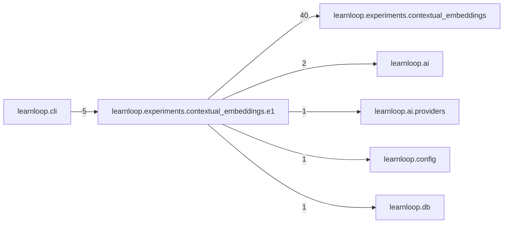

# `learnloop.experiments.contextual_embeddings.e1` package map

> [!info] Generated package map
> This map is generated from live modules and their static imports. Follow module links for source-level facts and canonical concept/workflow links for system behavior.

Up: [[Module Catalog]]

## Responsibility

Experiment E1: the local pplx v2-context-9b batch pilot over E0's bank and finalists.

For system intent, use [[Architecture Overview]].

^package-purpose

## Module index

| Module | Purpose | Status | Direct importers | Direct test files |
|---|---|---:|---:|---:|
| [[Reference/Modules/learnloop/experiments/contextual_embeddings/e1/__init__|learnloop.experiments.contextual_embeddings.e1]] | [[Reference/Modules/learnloop/experiments/contextual_embeddings/e1/__init__#^module-purpose|purpose]] | `ACTIVE` | 0 | 0 |
| [[Reference/Modules/learnloop/experiments/contextual_embeddings/e1/decide|learnloop.experiments.contextual_embeddings.e1.decide]] | [[Reference/Modules/learnloop/experiments/contextual_embeddings/e1/decide#^module-purpose|purpose]] | `ACTIVE` | 1 | 0 |
| [[Reference/Modules/learnloop/experiments/contextual_embeddings/e1/gpu_meter|learnloop.experiments.contextual_embeddings.e1.gpu_meter]] | [[Reference/Modules/learnloop/experiments/contextual_embeddings/e1/gpu_meter#^module-purpose|purpose]] | `ACTIVE` | 2 | 3 |
| [[Reference/Modules/learnloop/experiments/contextual_embeddings/e1/ledger|learnloop.experiments.contextual_embeddings.e1.ledger]] | [[Reference/Modules/learnloop/experiments/contextual_embeddings/e1/ledger#^module-purpose|purpose]] | `ACTIVE` | 2 | 1 |
| [[Reference/Modules/learnloop/experiments/contextual_embeddings/e1/local|learnloop.experiments.contextual_embeddings.e1.local]] | [[Reference/Modules/learnloop/experiments/contextual_embeddings/e1/local#^module-purpose|purpose]] | `ACTIVE` | 3 | 2 |
| [[Reference/Modules/learnloop/experiments/contextual_embeddings/e1/pins|learnloop.experiments.contextual_embeddings.e1.pins]] | [[Reference/Modules/learnloop/experiments/contextual_embeddings/e1/pins#^module-purpose|purpose]] | `ACTIVE` | 8 | 3 |
| [[Reference/Modules/learnloop/experiments/contextual_embeddings/e1/plan|learnloop.experiments.contextual_embeddings.e1.plan]] | [[Reference/Modules/learnloop/experiments/contextual_embeddings/e1/plan#^module-purpose|purpose]] | `ACTIVE` | 2 | 0 |
| [[Reference/Modules/learnloop/experiments/contextual_embeddings/e1/replay|learnloop.experiments.contextual_embeddings.e1.replay]] | [[Reference/Modules/learnloop/experiments/contextual_embeddings/e1/replay#^module-purpose|purpose]] | `ACTIVE` | 3 | 1 |
| [[Reference/Modules/learnloop/experiments/contextual_embeddings/e1/report|learnloop.experiments.contextual_embeddings.e1.report]] | [[Reference/Modules/learnloop/experiments/contextual_embeddings/e1/report#^module-purpose|purpose]] | `ACTIVE` | 1 | 1 |
| [[Reference/Modules/learnloop/experiments/contextual_embeddings/e1/run|learnloop.experiments.contextual_embeddings.e1.run]] | [[Reference/Modules/learnloop/experiments/contextual_embeddings/e1/run#^module-purpose|purpose]] | `ACTIVE` | 1 | 1 |
| [[Reference/Modules/learnloop/experiments/contextual_embeddings/e1/supplement|learnloop.experiments.contextual_embeddings.e1.supplement]] | [[Reference/Modules/learnloop/experiments/contextual_embeddings/e1/supplement#^module-purpose|purpose]] | `ACTIVE` | 1 | 2 |
| [[Reference/Modules/learnloop/experiments/contextual_embeddings/e1/worker|learnloop.experiments.contextual_embeddings.e1.worker]] | [[Reference/Modules/learnloop/experiments/contextual_embeddings/e1/worker#^module-purpose|purpose]] | `ACTIVE` | 2 | 2 |

## Cross-package dependencies

### This package imports

- [[Reference/Modules/learnloop/experiments/contextual_embeddings/_package|learnloop.experiments.contextual_embeddings]] — 40 static module edges
- [[Reference/Modules/learnloop/ai/_package|learnloop.ai]] — 2 static module edges
- [[Reference/Modules/learnloop/ai/providers/_package|learnloop.ai.providers]] — 1 static module edge
- [[Reference/Modules/learnloop/config/_package|learnloop.config]] — 1 static module edge
- [[Reference/Modules/learnloop/db/_package|learnloop.db]] — 1 static module edge

### Packages that import this package

- [[Reference/Modules/learnloop/cli/_package|learnloop.cli]] — 5 static module edges

### Dependency neighborhood

This diagram compresses package-level static imports; edge labels are distinct module-to-module import counts.



Interpretation: arrow direction is static import direction and the label is the number of distinct module-to-module edges. It shows coupling pressure, not runtime call frequency or ownership permission.

## Workflow entry points

- [[Initialize a Vault]]
- [[Start a Learning Cycle]]

## Find and filter

Use Obsidian's native search:

```query
path:"Reference/Modules/learnloop/experiments/contextual_embeddings/e1" tag:#docs/module
```

To change this package, start with a module's [[#Module index|purpose link]], then follow its callers, tests, and modification guidance. Re-run the generator after source changes.
