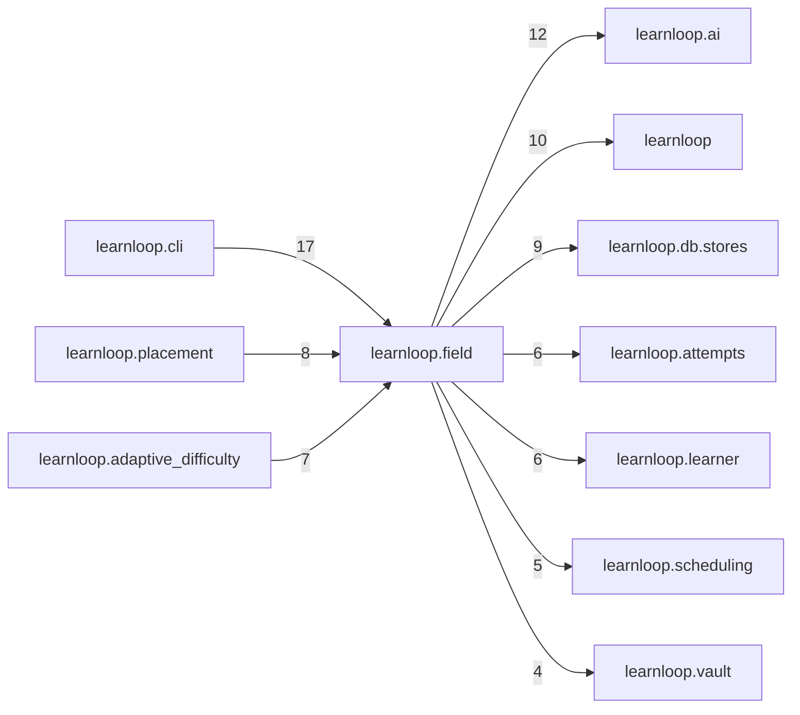

# `learnloop.field` package map

> [!info] Generated package map
> This map is generated from live modules and their static imports. Follow module links for source-level facts and canonical concept/workflow links for system behavior.

Up: [[Module Catalog]]

## Responsibility

Replay-only learner-field contracts (the LearnerPredictor contract, signals, outcomes); no serving policy or evidence writes.

For system intent, use [[Architecture Overview]].

^package-purpose

## Module index

| Module | Purpose | Status | Direct importers | Direct test files |
|---|---|---:|---:|---:|
| [[Reference/Modules/learnloop/field/__init__|learnloop.field]] | [[Reference/Modules/learnloop/field/__init__#^module-purpose|purpose]] | `ACTIVE` | 0 | 0 |
| [[Reference/Modules/learnloop/field/answer_signals|learnloop.field.answer_signals]] | [[Reference/Modules/learnloop/field/answer_signals#^module-purpose|purpose]] | `ACTIVE` | 2 | 3 |
| [[Reference/Modules/learnloop/field/classification|learnloop.field.classification]] | [[Reference/Modules/learnloop/field/classification#^module-purpose|purpose]] | `ACTIVE` | 1 | 3 |
| [[Reference/Modules/learnloop/field/decider|learnloop.field.decider]] | [[Reference/Modules/learnloop/field/decider#^module-purpose|purpose]] | `ACTIVE` | 1 | 1 |
| [[Reference/Modules/learnloop/field/evaluation|learnloop.field.evaluation]] | [[Reference/Modules/learnloop/field/evaluation#^module-purpose|purpose]] | `ACTIVE` | 5 | 8 |
| [[Reference/Modules/learnloop/field/item_content|learnloop.field.item_content]] | [[Reference/Modules/learnloop/field/item_content#^module-purpose|purpose]] | `ACTIVE` | 1 | 1 |
| [[Reference/Modules/learnloop/field/memory|learnloop.field.memory]] | [[Reference/Modules/learnloop/field/memory#^module-purpose|purpose]] | `ACTIVE` | 1 | 3 |
| [[Reference/Modules/learnloop/field/outcomes|learnloop.field.outcomes]] | [[Reference/Modules/learnloop/field/outcomes#^module-purpose|purpose]] | `ACTIVE` | 6 | 18 |
| [[Reference/Modules/learnloop/field/predictors|learnloop.field.predictors]] | [[Reference/Modules/learnloop/field/predictors#^module-purpose|purpose]] | `ACTIVE` | 8 | 11 |
| [[Reference/Modules/learnloop/field/priors|learnloop.field.priors]] | [[Reference/Modules/learnloop/field/priors#^module-purpose|purpose]] | `ACTIVE` | 1 | 2 |
| [[Reference/Modules/learnloop/field/probability_arms|learnloop.field.probability_arms]] | [[Reference/Modules/learnloop/field/probability_arms#^module-purpose|purpose]] | `ACTIVE` | 5 | 3 |
| [[Reference/Modules/learnloop/field/probability_prep|learnloop.field.probability_prep]] | [[Reference/Modules/learnloop/field/probability_prep#^module-purpose|purpose]] | `ACTIVE` | 1 | 2 |
| [[Reference/Modules/learnloop/field/probability_states|learnloop.field.probability_states]] | [[Reference/Modules/learnloop/field/probability_states#^module-purpose|purpose]] | `ACTIVE` | 2 | 2 |
| [[Reference/Modules/learnloop/field/signals|learnloop.field.signals]] | [[Reference/Modules/learnloop/field/signals#^module-purpose|purpose]] | `ACTIVE` | 6 | 12 |
| [[Reference/Modules/learnloop/field/success_head|learnloop.field.success_head]] | [[Reference/Modules/learnloop/field/success_head#^module-purpose|purpose]] | `ACTIVE` | 3 | 3 |
| [[Reference/Modules/learnloop/field/success_head_analysis|learnloop.field.success_head_analysis]] | [[Reference/Modules/learnloop/field/success_head_analysis#^module-purpose|purpose]] | `ACTIVE` | 1 | 1 |
| [[Reference/Modules/learnloop/field/types|learnloop.field.types]] | [[Reference/Modules/learnloop/field/types#^module-purpose|purpose]] | `ACTIVE` | 18 | 16 |
| [[Reference/Modules/learnloop/field/workbench_signals|learnloop.field.workbench_signals]] | [[Reference/Modules/learnloop/field/workbench_signals#^module-purpose|purpose]] | `ACTIVE` | 3 | 1 |

## Cross-package dependencies

### This package imports

- [[Reference/Modules/learnloop/ai/_package|learnloop.ai]] — 12 static module edges
- [[Reference/Modules/learnloop/_package|learnloop]] — 10 static module edges
- [[Reference/Modules/learnloop/db/stores/_package|learnloop.db.stores]] — 9 static module edges
- [[Reference/Modules/learnloop/attempts/_package|learnloop.attempts]] — 6 static module edges
- [[Reference/Modules/learnloop/learner/_package|learnloop.learner]] — 6 static module edges
- [[Reference/Modules/learnloop/scheduling/_package|learnloop.scheduling]] — 5 static module edges
- [[Reference/Modules/learnloop/vault/_package|learnloop.vault]] — 4 static module edges
- [[Reference/Modules/learnloop/config/_package|learnloop.config]] — 3 static module edges
- [[Reference/Modules/learnloop/db/_package|learnloop.db]] — 1 static module edge
- [[Reference/Modules/learnloop/diagnosis/_package|learnloop.diagnosis]] — 1 static module edge
- [[Reference/Modules/learnloop/diagnosis/split/_package|learnloop.diagnosis.split]] — 1 static module edge
- [[Reference/Modules/learnloop/diagnosis/text_gaps/_package|learnloop.diagnosis.text_gaps]] — 1 static module edge
- [[Reference/Modules/learnloop/params/_package|learnloop.params]] — 1 static module edge
- [[Reference/Modules/learnloop/substrate/_package|learnloop.substrate]] — 1 static module edge

### Packages that import this package

- [[Reference/Modules/learnloop/cli/_package|learnloop.cli]] — 17 static module edges
- [[Reference/Modules/learnloop/placement/_package|learnloop.placement]] — 8 static module edges
- [[Reference/Modules/learnloop/adaptive_difficulty/_package|learnloop.adaptive_difficulty]] — 7 static module edges
- [[Reference/Modules/learnloop/substrate/_package|learnloop.substrate]] — 1 static module edge

### Dependency neighborhood

This diagram compresses package-level static imports; edge labels are distinct module-to-module import counts.



Interpretation: arrow direction is static import direction and the label is the number of distinct module-to-module edges. It shows coupling pressure, not runtime call frequency or ownership permission.

## Workflow entry points

- [[Initialize a Vault]]
- [[Start a Learning Cycle]]

## Find and filter

Use Obsidian's native search:

```query
path:"Reference/Modules/learnloop/field" tag:#docs/module
```

To change this package, start with a module's [[#Module index|purpose link]], then follow its callers, tests, and modification guidance. Re-run the generator after source changes.
