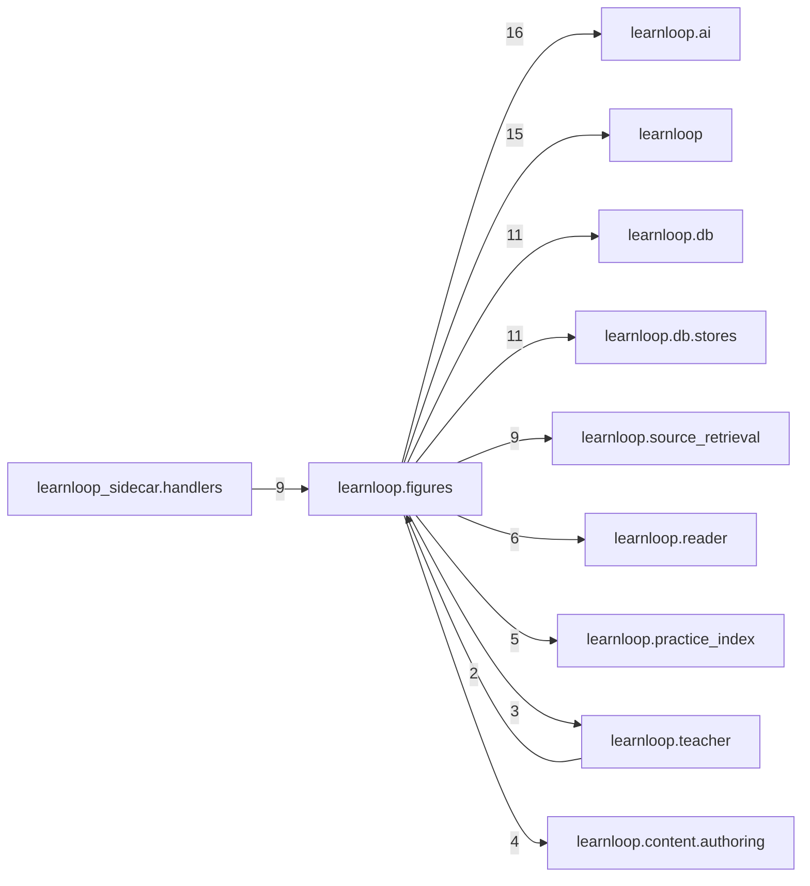

# `learnloop.figures` package map

> [!info] Generated package map
> This map is generated from live modules and their static imports. Follow module links for source-level facts and canonical concept/workflow links for system behavior.

Up: [[Module Catalog]]

## Responsibility

Explorable figures: declarative specs and sketches, their authoring routes, verification, labels, help records and the figure service.

For system intent, use [[Architecture Overview]].

^package-purpose

## Module index

| Module | Purpose | Status | Direct importers | Direct test files |
|---|---|---:|---:|---:|
| [[Reference/Modules/learnloop/figures/__init__|learnloop.figures]] | [[Reference/Modules/learnloop/figures/__init__#^module-purpose|purpose]] | `ACTIVE` | 0 | 0 |
| [[Reference/Modules/learnloop/figures/foreground|learnloop.figures.foreground]] | [[Reference/Modules/learnloop/figures/foreground#^module-purpose|purpose]] | `ACTIVE` | 5 | 2 |
| [[Reference/Modules/learnloop/figures/grammar|learnloop.figures.grammar]] | [[Reference/Modules/learnloop/figures/grammar#^module-purpose|purpose]] | `ACTIVE` | 6 | 8 |
| [[Reference/Modules/learnloop/figures/help|learnloop.figures.help]] | [[Reference/Modules/learnloop/figures/help#^module-purpose|purpose]] | `ACTIVE` | 3 | 2 |
| [[Reference/Modules/learnloop/figures/labels|learnloop.figures.labels]] | [[Reference/Modules/learnloop/figures/labels#^module-purpose|purpose]] | `ACTIVE` | 3 | 1 |
| [[Reference/Modules/learnloop/figures/learner_state|learnloop.figures.learner_state]] | [[Reference/Modules/learnloop/figures/learner_state#^module-purpose|purpose]] | `ACTIVE` | 3 | 4 |
| [[Reference/Modules/learnloop/figures/manim_figure|learnloop.figures.manim_figure]] | [[Reference/Modules/learnloop/figures/manim_figure#^module-purpose|purpose]] | `ACTIVE` | 2 | 4 |
| [[Reference/Modules/learnloop/figures/power|learnloop.figures.power]] | [[Reference/Modules/learnloop/figures/power#^module-purpose|purpose]] | `ACTIVE` | 5 | 2 |
| [[Reference/Modules/learnloop/figures/prefetch|learnloop.figures.prefetch]] | [[Reference/Modules/learnloop/figures/prefetch#^module-purpose|purpose]] | `ACTIVE` | 1 | 2 |
| [[Reference/Modules/learnloop/figures/prefetch_ledger|learnloop.figures.prefetch_ledger]] | [[Reference/Modules/learnloop/figures/prefetch_ledger#^module-purpose|purpose]] | `ACTIVE` | 3 | 2 |
| [[Reference/Modules/learnloop/figures/prefetch_model|learnloop.figures.prefetch_model]] | [[Reference/Modules/learnloop/figures/prefetch_model#^module-purpose|purpose]] | `ACTIVE` | 2 | 2 |
| [[Reference/Modules/learnloop/figures/rich|learnloop.figures.rich]] | [[Reference/Modules/learnloop/figures/rich#^module-purpose|purpose]] | `ACTIVE` | 5 | 11 |
| [[Reference/Modules/learnloop/figures/routes|learnloop.figures.routes]] | [[Reference/Modules/learnloop/figures/routes#^module-purpose|purpose]] | `ACTIVE` | 3 | 12 |
| [[Reference/Modules/learnloop/figures/service|learnloop.figures.service]] | [[Reference/Modules/learnloop/figures/service#^module-purpose|purpose]] | `ACTIVE` | 9 | 27 |
| [[Reference/Modules/learnloop/figures/sketch|learnloop.figures.sketch]] | [[Reference/Modules/learnloop/figures/sketch#^module-purpose|purpose]] | `ACTIVE` | 4 | 7 |
| [[Reference/Modules/learnloop/figures/sketch_engine|learnloop.figures.sketch_engine]] | [[Reference/Modules/learnloop/figures/sketch_engine#^module-purpose|purpose]] | `ACTIVE` | 2 | 7 |
| [[Reference/Modules/learnloop/figures/sketch_verify|learnloop.figures.sketch_verify]] | [[Reference/Modules/learnloop/figures/sketch_verify#^module-purpose|purpose]] | `ACTIVE` | 1 | 6 |
| [[Reference/Modules/learnloop/figures/spec|learnloop.figures.spec]] | [[Reference/Modules/learnloop/figures/spec#^module-purpose|purpose]] | `ACTIVE` | 5 | 13 |
| [[Reference/Modules/learnloop/figures/verify|learnloop.figures.verify]] | [[Reference/Modules/learnloop/figures/verify#^module-purpose|purpose]] | `ACTIVE` | 3 | 10 |

## Cross-package dependencies

### This package imports

- [[Reference/Modules/learnloop/ai/_package|learnloop.ai]] — 16 static module edges
- [[Reference/Modules/learnloop/_package|learnloop]] — 15 static module edges
- [[Reference/Modules/learnloop/db/_package|learnloop.db]] — 11 static module edges
- [[Reference/Modules/learnloop/db/stores/_package|learnloop.db.stores]] — 11 static module edges
- [[Reference/Modules/learnloop/source_retrieval/_package|learnloop.source_retrieval]] — 9 static module edges
- [[Reference/Modules/learnloop/reader/_package|learnloop.reader]] — 6 static module edges
- [[Reference/Modules/learnloop/practice_index/_package|learnloop.practice_index]] — 5 static module edges
- [[Reference/Modules/learnloop/content/authoring/_package|learnloop.content.authoring]] — 4 static module edges
- [[Reference/Modules/learnloop/teacher/_package|learnloop.teacher]] — 3 static module edges
- [[Reference/Modules/learnloop/ai/chatgpt_plan/_package|learnloop.ai.chatgpt_plan]] — 1 static module edge
- [[Reference/Modules/learnloop/content/sources/_package|learnloop.content.sources]] — 1 static module edge
- [[Reference/Modules/learnloop/daily_plan/_package|learnloop.daily_plan]] — 1 static module edge
- [[Reference/Modules/learnloop/diagnosis/text_gaps/_package|learnloop.diagnosis.text_gaps]] — 1 static module edge
- [[Reference/Modules/learnloop/tutor/_package|learnloop.tutor]] — 1 static module edge

### Packages that import this package

- [[Reference/Modules/learnloop_sidecar/handlers/_package|learnloop_sidecar.handlers]] — 9 static module edges
- [[Reference/Modules/learnloop_sidecar/_package|learnloop_sidecar]] — 4 static module edges
- [[Reference/Modules/learnloop/teacher/_package|learnloop.teacher]] — 2 static module edges
- [[Reference/Modules/learnloop/cli/_package|learnloop.cli]] — 1 static module edge
- [[Reference/Modules/learnloop/content/pipeline/_package|learnloop.content.pipeline]] — 1 static module edge

### Dependency neighborhood

This diagram compresses package-level static imports; edge labels are distinct module-to-module import counts.



Interpretation: arrow direction is static import direction and the label is the number of distinct module-to-module edges. It shows coupling pressure, not runtime call frequency or ownership permission.

## Workflow entry points

- [[Initialize a Vault]]
- [[Start a Learning Cycle]]

## Find and filter

Use Obsidian's native search:

```query
path:"Reference/Modules/learnloop/figures" tag:#docs/module
```

To change this package, start with a module's [[#Module index|purpose link]], then follow its callers, tests, and modification guidance. Re-run the generator after source changes.
