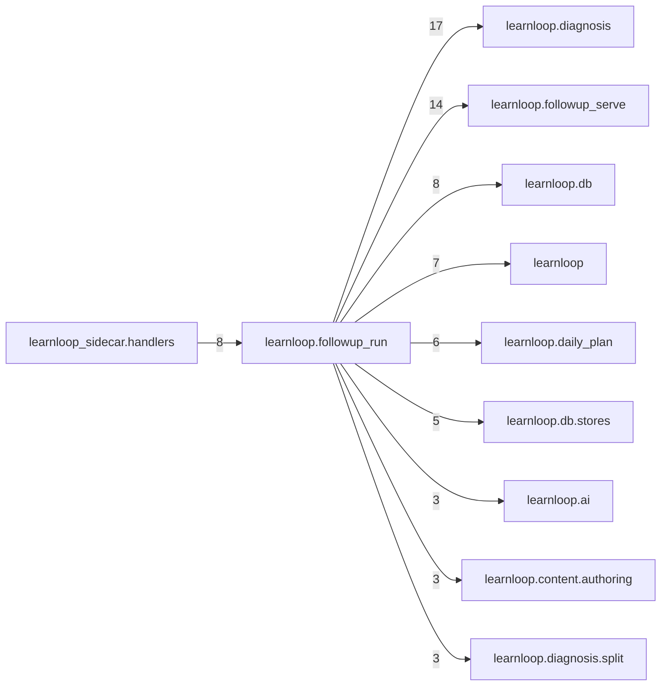

# `learnloop.followup_run` package map

> [!info] Generated package map
> This map is generated from live modules and their static imports. Follow module links for source-level facts and canonical concept/workflow links for system behavior.

Up: [[Module Catalog]]

## Responsibility

FG1's composition, imported only by the sidecar: lanes, the frontier authoring operation, machine admission, the router's itemless decision, what the feedback screen and Next read, and the generation worker.

For system intent, use [[Architecture Overview]].

^package-purpose

## Module index

| Module | Purpose | Status | Direct importers | Direct test files |
|---|---|---:|---:|---:|
| [[Reference/Modules/learnloop/followup_run/__init__|learnloop.followup_run]] | [[Reference/Modules/learnloop/followup_run/__init__#^module-purpose|purpose]] | `ACTIVE` | 0 | 0 |
| [[Reference/Modules/learnloop/followup_run/admission|learnloop.followup_run.admission]] | [[Reference/Modules/learnloop/followup_run/admission#^module-purpose|purpose]] | `ACTIVE` | 1 | 2 |
| [[Reference/Modules/learnloop/followup_run/authoring|learnloop.followup_run.authoring]] | [[Reference/Modules/learnloop/followup_run/authoring#^module-purpose|purpose]] | `ACTIVE` | 2 | 4 |
| [[Reference/Modules/learnloop/followup_run/decision_view|learnloop.followup_run.decision_view]] | [[Reference/Modules/learnloop/followup_run/decision_view#^module-purpose|purpose]] | `ACTIVE` | 2 | 2 |
| [[Reference/Modules/learnloop/followup_run/jobs|learnloop.followup_run.jobs]] | [[Reference/Modules/learnloop/followup_run/jobs#^module-purpose|purpose]] | `ACTIVE` | 3 | 5 |
| [[Reference/Modules/learnloop/followup_run/lanes|learnloop.followup_run.lanes]] | [[Reference/Modules/learnloop/followup_run/lanes#^module-purpose|purpose]] | `ACTIVE` | 3 | 3 |
| [[Reference/Modules/learnloop/followup_run/marks|learnloop.followup_run.marks]] | [[Reference/Modules/learnloop/followup_run/marks#^module-purpose|purpose]] | `ACTIVE` | 2 | 2 |
| [[Reference/Modules/learnloop/followup_run/router|learnloop.followup_run.router]] | [[Reference/Modules/learnloop/followup_run/router#^module-purpose|purpose]] | `ACTIVE` | 2 | 6 |
| [[Reference/Modules/learnloop/followup_run/serving|learnloop.followup_run.serving]] | [[Reference/Modules/learnloop/followup_run/serving#^module-purpose|purpose]] | `ACTIVE` | 6 | 2 |

## Cross-package dependencies

### This package imports

- [[Reference/Modules/learnloop/diagnosis/_package|learnloop.diagnosis]] — 17 static module edges
- [[Reference/Modules/learnloop/followup_serve/_package|learnloop.followup_serve]] — 14 static module edges
- [[Reference/Modules/learnloop/db/_package|learnloop.db]] — 8 static module edges
- [[Reference/Modules/learnloop/_package|learnloop]] — 7 static module edges
- [[Reference/Modules/learnloop/daily_plan/_package|learnloop.daily_plan]] — 6 static module edges
- [[Reference/Modules/learnloop/db/stores/_package|learnloop.db.stores]] — 5 static module edges
- [[Reference/Modules/learnloop/ai/_package|learnloop.ai]] — 3 static module edges
- [[Reference/Modules/learnloop/content/authoring/_package|learnloop.content.authoring]] — 3 static module edges
- [[Reference/Modules/learnloop/diagnosis/split/_package|learnloop.diagnosis.split]] — 3 static module edges
- [[Reference/Modules/learnloop/vault/_package|learnloop.vault]] — 2 static module edges
- [[Reference/Modules/learnloop/attempts/_package|learnloop.attempts]] — 1 static module edge
- [[Reference/Modules/learnloop/content/proposals/_package|learnloop.content.proposals]] — 1 static module edge
- [[Reference/Modules/learnloop/data_capture/_package|learnloop.data_capture]] — 1 static module edge
- [[Reference/Modules/learnloop/instructional/_package|learnloop.instructional]] — 1 static module edge
- [[Reference/Modules/learnloop/router/_package|learnloop.router]] — 1 static module edge

### Packages that import this package

- [[Reference/Modules/learnloop_sidecar/handlers/_package|learnloop_sidecar.handlers]] — 8 static module edges
- [[Reference/Modules/learnloop_sidecar/_package|learnloop_sidecar]] — 2 static module edges

### Dependency neighborhood

This diagram compresses package-level static imports; edge labels are distinct module-to-module import counts.



Interpretation: arrow direction is static import direction and the label is the number of distinct module-to-module edges. It shows coupling pressure, not runtime call frequency or ownership permission.

## Workflow entry points

- [[Initialize a Vault]]
- [[Start a Learning Cycle]]

## Find and filter

Use Obsidian's native search:

```query
path:"Reference/Modules/learnloop/followup_run" tag:#docs/module
```

To change this package, start with a module's [[#Module index|purpose link]], then follow its callers, tests, and modification guidance. Re-run the generator after source changes.
