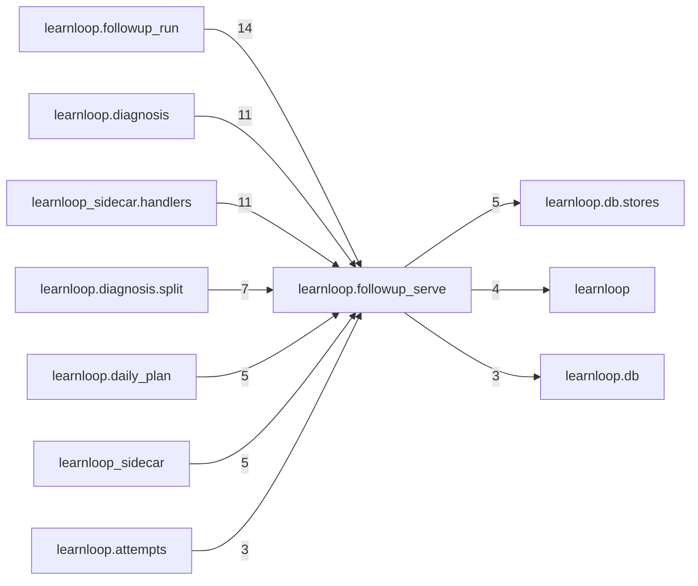

# `learnloop.followup_serve` package map

> [!info] Generated package map
> This map is generated from live modules and their static imports. Follow module links for source-level facts and canonical concept/workflow links for system behavior.

Up: [[Module Catalog]]

## Responsibility

FG1's leaf: the kill switch, the durable workflow's record, the generation queue's writes and the generated probe's single-use identity, read by the domain packages.

For system intent, use [[Architecture Overview]].

^package-purpose

## Module index

| Module | Purpose | Status | Direct importers | Direct test files |
|---|---|---:|---:|---:|
| [[Reference/Modules/learnloop/followup_serve/__init__|learnloop.followup_serve]] | [[Reference/Modules/learnloop/followup_serve/__init__#^module-purpose|purpose]] | `ACTIVE` | 0 | 0 |
| [[Reference/Modules/learnloop/followup_serve/gates|learnloop.followup_serve.gates]] | [[Reference/Modules/learnloop/followup_serve/gates#^module-purpose|purpose]] | `ACTIVE` | 22 | 5 |
| [[Reference/Modules/learnloop/followup_serve/identity|learnloop.followup_serve.identity]] | [[Reference/Modules/learnloop/followup_serve/identity#^module-purpose|purpose]] | `ACTIVE` | 15 | 10 |
| [[Reference/Modules/learnloop/followup_serve/marks|learnloop.followup_serve.marks]] | [[Reference/Modules/learnloop/followup_serve/marks#^module-purpose|purpose]] | `ACTIVE` | 7 | 2 |
| [[Reference/Modules/learnloop/followup_serve/queue|learnloop.followup_serve.queue]] | [[Reference/Modules/learnloop/followup_serve/queue#^module-purpose|purpose]] | `ACTIVE` | 7 | 2 |
| [[Reference/Modules/learnloop/followup_serve/workflow|learnloop.followup_serve.workflow]] | [[Reference/Modules/learnloop/followup_serve/workflow#^module-purpose|purpose]] | `ACTIVE` | 16 | 15 |

## Cross-package dependencies

### This package imports

- [[Reference/Modules/learnloop/db/stores/_package|learnloop.db.stores]] — 5 static module edges
- [[Reference/Modules/learnloop/_package|learnloop]] — 4 static module edges
- [[Reference/Modules/learnloop/db/_package|learnloop.db]] — 3 static module edges

### Packages that import this package

- [[Reference/Modules/learnloop/followup_run/_package|learnloop.followup_run]] — 14 static module edges
- [[Reference/Modules/learnloop/diagnosis/_package|learnloop.diagnosis]] — 11 static module edges
- [[Reference/Modules/learnloop_sidecar/handlers/_package|learnloop_sidecar.handlers]] — 11 static module edges
- [[Reference/Modules/learnloop/diagnosis/split/_package|learnloop.diagnosis.split]] — 7 static module edges
- [[Reference/Modules/learnloop/daily_plan/_package|learnloop.daily_plan]] — 5 static module edges
- [[Reference/Modules/learnloop_sidecar/_package|learnloop_sidecar]] — 5 static module edges
- [[Reference/Modules/learnloop/attempts/_package|learnloop.attempts]] — 3 static module edges
- [[Reference/Modules/learnloop/ops/_package|learnloop.ops]] — 2 static module edges
- [[Reference/Modules/learnloop/scheduling/_package|learnloop.scheduling]] — 2 static module edges
- [[Reference/Modules/learnloop/substrate/_package|learnloop.substrate]] — 2 static module edges
- [[Reference/Modules/learnloop/goals/_package|learnloop.goals]] — 1 static module edge
- [[Reference/Modules/learnloop/teacher/_package|learnloop.teacher]] — 1 static module edge

### Dependency neighborhood

This diagram compresses package-level static imports; edge labels are distinct module-to-module import counts.



Interpretation: arrow direction is static import direction and the label is the number of distinct module-to-module edges. It shows coupling pressure, not runtime call frequency or ownership permission.

## Workflow entry points

- [[Initialize a Vault]]
- [[Start a Learning Cycle]]

## Find and filter

Use Obsidian's native search:

```query
path:"Reference/Modules/learnloop/followup_serve" tag:#docs/module
```

To change this package, start with a module's [[#Module index|purpose link]], then follow its callers, tests, and modification guidance. Re-run the generator after source changes.
