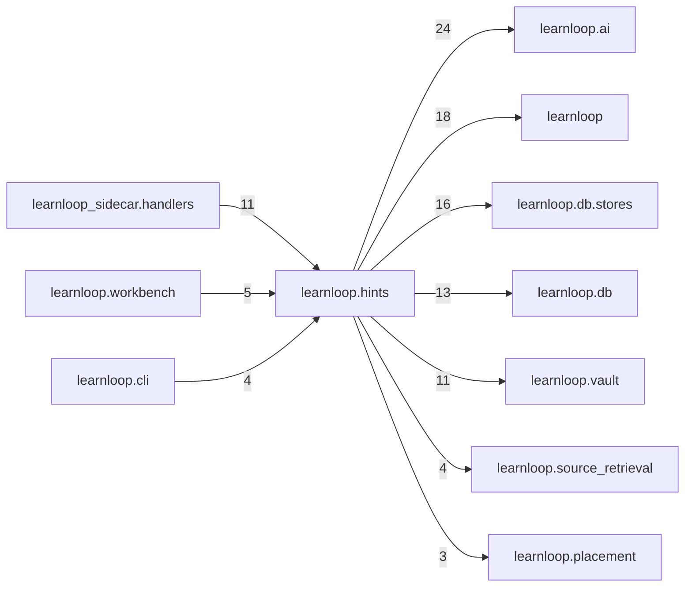

# `learnloop.hints` package map

> [!info] Generated package map
> This map is generated from live modules and their static imports. Follow module links for source-level facts and canonical concept/workflow links for system behavior.

Up: [[Module Catalog]]

## Responsibility

Adaptive hints: telemetry and report, approach maps, the hint service and its outcomes.

For system intent, use [[Architecture Overview]].

^package-purpose

## Module index

| Module | Purpose | Status | Direct importers | Direct test files |
|---|---|---:|---:|---:|
| [[Reference/Modules/learnloop/hints/__init__|learnloop.hints]] | [[Reference/Modules/learnloop/hints/__init__#^module-purpose|purpose]] | `ACTIVE` | 0 | 0 |
| [[Reference/Modules/learnloop/hints/chooser|learnloop.hints.chooser]] | [[Reference/Modules/learnloop/hints/chooser#^module-purpose|purpose]] | `ACTIVE` | 2 | 4 |
| [[Reference/Modules/learnloop/hints/contracts|learnloop.hints.contracts]] | [[Reference/Modules/learnloop/hints/contracts#^module-purpose|purpose]] | `ACTIVE` | 4 | 4 |
| [[Reference/Modules/learnloop/hints/discriminating|learnloop.hints.discriminating]] | [[Reference/Modules/learnloop/hints/discriminating#^module-purpose|purpose]] | `ACTIVE` | 3 | 3 |
| [[Reference/Modules/learnloop/hints/kinds|learnloop.hints.kinds]] | [[Reference/Modules/learnloop/hints/kinds#^module-purpose|purpose]] | `ACTIVE` | 7 | 6 |
| [[Reference/Modules/learnloop/hints/map_builder|learnloop.hints.map_builder]] | [[Reference/Modules/learnloop/hints/map_builder#^module-purpose|purpose]] | `ACTIVE` | 12 | 25 |
| [[Reference/Modules/learnloop/hints/map_report|learnloop.hints.map_report]] | [[Reference/Modules/learnloop/hints/map_report#^module-purpose|purpose]] | `ACTIVE` | 1 | 0 |
| [[Reference/Modules/learnloop/hints/map_seeds|learnloop.hints.map_seeds]] | [[Reference/Modules/learnloop/hints/map_seeds#^module-purpose|purpose]] | `ACTIVE` | 2 | 2 |
| [[Reference/Modules/learnloop/hints/maps|learnloop.hints.maps]] | [[Reference/Modules/learnloop/hints/maps#^module-purpose|purpose]] | `ACTIVE` | 5 | 2 |
| [[Reference/Modules/learnloop/hints/options|learnloop.hints.options]] | [[Reference/Modules/learnloop/hints/options#^module-purpose|purpose]] | `ACTIVE` | 3 | 2 |
| [[Reference/Modules/learnloop/hints/outcome|learnloop.hints.outcome]] | [[Reference/Modules/learnloop/hints/outcome#^module-purpose|purpose]] | `ACTIVE` | 2 | 6 |
| [[Reference/Modules/learnloop/hints/report|learnloop.hints.report]] | [[Reference/Modules/learnloop/hints/report#^module-purpose|purpose]] | `ACTIVE` | 1 | 5 |
| [[Reference/Modules/learnloop/hints/report_adaptive|learnloop.hints.report_adaptive]] | [[Reference/Modules/learnloop/hints/report_adaptive#^module-purpose|purpose]] | `ACTIVE` | 3 | 0 |
| [[Reference/Modules/learnloop/hints/report_workbench|learnloop.hints.report_workbench]] | [[Reference/Modules/learnloop/hints/report_workbench#^module-purpose|purpose]] | `ACTIVE` | 2 | 7 |
| [[Reference/Modules/learnloop/hints/service|learnloop.hints.service]] | [[Reference/Modules/learnloop/hints/service#^module-purpose|purpose]] | `ACTIVE` | 4 | 16 |
| [[Reference/Modules/learnloop/hints/state|learnloop.hints.state]] | [[Reference/Modules/learnloop/hints/state#^module-purpose|purpose]] | `ACTIVE` | 5 | 7 |
| [[Reference/Modules/learnloop/hints/telemetry|learnloop.hints.telemetry]] | [[Reference/Modules/learnloop/hints/telemetry#^module-purpose|purpose]] | `ACTIVE` | 1 | 4 |
| [[Reference/Modules/learnloop/hints/workbench|learnloop.hints.workbench]] | [[Reference/Modules/learnloop/hints/workbench#^module-purpose|purpose]] | `ACTIVE` | 5 | 8 |
| [[Reference/Modules/learnloop/hints/writer|learnloop.hints.writer]] | [[Reference/Modules/learnloop/hints/writer#^module-purpose|purpose]] | `ACTIVE` | 5 | 7 |

## Cross-package dependencies

### This package imports

- [[Reference/Modules/learnloop/ai/_package|learnloop.ai]] — 24 static module edges
- [[Reference/Modules/learnloop/_package|learnloop]] — 18 static module edges
- [[Reference/Modules/learnloop/db/stores/_package|learnloop.db.stores]] — 16 static module edges
- [[Reference/Modules/learnloop/db/_package|learnloop.db]] — 13 static module edges
- [[Reference/Modules/learnloop/vault/_package|learnloop.vault]] — 11 static module edges
- [[Reference/Modules/learnloop/source_retrieval/_package|learnloop.source_retrieval]] — 4 static module edges
- [[Reference/Modules/learnloop/placement/_package|learnloop.placement]] — 3 static module edges
- [[Reference/Modules/learnloop/practice_index/_package|learnloop.practice_index]] — 3 static module edges
- [[Reference/Modules/learnloop/tutor/_package|learnloop.tutor]] — 3 static module edges
- [[Reference/Modules/learnloop/attempts/_package|learnloop.attempts]] — 1 static module edge
- [[Reference/Modules/learnloop/diagnosis/_package|learnloop.diagnosis]] — 1 static module edge

### Packages that import this package

- [[Reference/Modules/learnloop_sidecar/handlers/_package|learnloop_sidecar.handlers]] — 11 static module edges
- [[Reference/Modules/learnloop/workbench/_package|learnloop.workbench]] — 5 static module edges
- [[Reference/Modules/learnloop/cli/_package|learnloop.cli]] — 4 static module edges
- [[Reference/Modules/learnloop/adaptive_difficulty/_package|learnloop.adaptive_difficulty]] — 2 static module edges
- [[Reference/Modules/learnloop_sidecar/_package|learnloop_sidecar]] — 2 static module edges
- [[Reference/Modules/learnloop/instructional/_package|learnloop.instructional]] — 1 static module edge

### Dependency neighborhood

This diagram compresses package-level static imports; edge labels are distinct module-to-module import counts.



Interpretation: arrow direction is static import direction and the label is the number of distinct module-to-module edges. It shows coupling pressure, not runtime call frequency or ownership permission.

## Workflow entry points

- [[Initialize a Vault]]
- [[Start a Learning Cycle]]

## Find and filter

Use Obsidian's native search:

```query
path:"Reference/Modules/learnloop/hints" tag:#docs/module
```

To change this package, start with a module's [[#Module index|purpose link]], then follow its callers, tests, and modification guidance. Re-run the generator after source changes.
