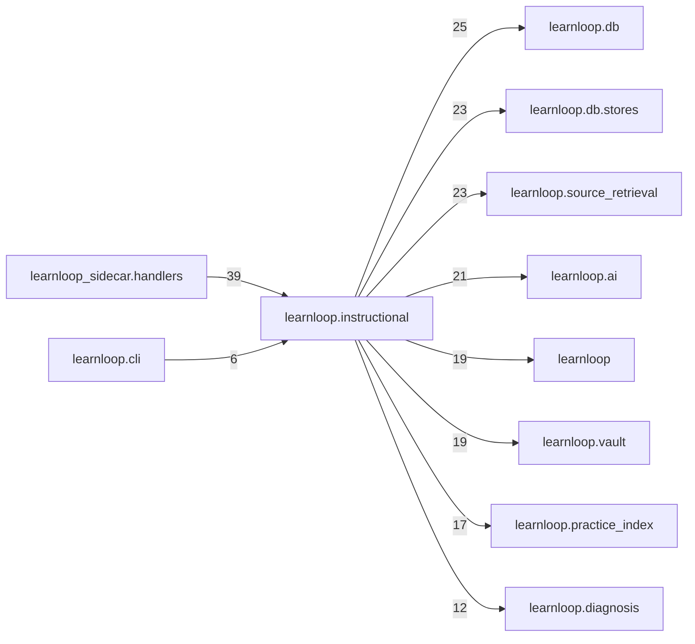

# `learnloop.instructional` package map

> [!info] Generated package map
> This map is generated from live modules and their static imports. Follow module links for source-level facts and canonical concept/workflow links for system behavior.

Up: [[Module Catalog]]

## Responsibility

Canonical sources as a shared instructional service: a composition layer for the tutor's offers, source exercises, exposure and the tools.

For system intent, use [[Architecture Overview]].

^package-purpose

## Module index

| Module | Purpose | Status | Direct importers | Direct test files |
|---|---|---:|---:|---:|
| [[Reference/Modules/learnloop/instructional/__init__|learnloop.instructional]] | [[Reference/Modules/learnloop/instructional/__init__#^module-purpose|purpose]] | `ACTIVE` | 0 | 0 |
| [[Reference/Modules/learnloop/instructional/discriminating|learnloop.instructional.discriminating]] | [[Reference/Modules/learnloop/instructional/discriminating#^module-purpose|purpose]] | `ACTIVE` | 2 | 2 |
| [[Reference/Modules/learnloop/instructional/exercises|learnloop.instructional.exercises]] | [[Reference/Modules/learnloop/instructional/exercises#^module-purpose|purpose]] | `ACTIVE` | 4 | 6 |
| [[Reference/Modules/learnloop/instructional/exposure|learnloop.instructional.exposure]] | [[Reference/Modules/learnloop/instructional/exposure#^module-purpose|purpose]] | `ACTIVE` | 4 | 7 |
| [[Reference/Modules/learnloop/instructional/harvest|learnloop.instructional.harvest]] | [[Reference/Modules/learnloop/instructional/harvest#^module-purpose|purpose]] | `ACTIVE` | 1 | 4 |
| [[Reference/Modules/learnloop/instructional/interventions|learnloop.instructional.interventions]] | [[Reference/Modules/learnloop/instructional/interventions#^module-purpose|purpose]] | `ACTIVE` | 10 | 5 |
| [[Reference/Modules/learnloop/instructional/needs|learnloop.instructional.needs]] | [[Reference/Modules/learnloop/instructional/needs#^module-purpose|purpose]] | `ACTIVE` | 4 | 4 |
| [[Reference/Modules/learnloop/instructional/offers|learnloop.instructional.offers]] | [[Reference/Modules/learnloop/instructional/offers#^module-purpose|purpose]] | `ACTIVE` | 1 | 1 |
| [[Reference/Modules/learnloop/instructional/policy|learnloop.instructional.policy]] | [[Reference/Modules/learnloop/instructional/policy#^module-purpose|purpose]] | `ACTIVE` | 14 | 17 |
| [[Reference/Modules/learnloop/instructional/practice|learnloop.instructional.practice]] | [[Reference/Modules/learnloop/instructional/practice#^module-purpose|purpose]] | `ACTIVE` | 7 | 9 |
| [[Reference/Modules/learnloop/instructional/reader_digest|learnloop.instructional.reader_digest]] | [[Reference/Modules/learnloop/instructional/reader_digest#^module-purpose|purpose]] | `ACTIVE` | 2 | 5 |
| [[Reference/Modules/learnloop/instructional/reader_followups|learnloop.instructional.reader_followups]] | [[Reference/Modules/learnloop/instructional/reader_followups#^module-purpose|purpose]] | `ACTIVE` | 3 | 16 |
| [[Reference/Modules/learnloop/instructional/screen|learnloop.instructional.screen]] | [[Reference/Modules/learnloop/instructional/screen#^module-purpose|purpose]] | `ACTIVE` | 3 | 2 |
| [[Reference/Modules/learnloop/instructional/sources|learnloop.instructional.sources]] | [[Reference/Modules/learnloop/instructional/sources#^module-purpose|purpose]] | `ACTIVE` | 9 | 24 |
| [[Reference/Modules/learnloop/instructional/tools|learnloop.instructional.tools]] | [[Reference/Modules/learnloop/instructional/tools#^module-purpose|purpose]] | `ACTIVE` | 5 | 15 |
| [[Reference/Modules/learnloop/instructional/validation|learnloop.instructional.validation]] | [[Reference/Modules/learnloop/instructional/validation#^module-purpose|purpose]] | `ACTIVE` | 2 | 1 |
| [[Reference/Modules/learnloop/instructional/valuation|learnloop.instructional.valuation]] | [[Reference/Modules/learnloop/instructional/valuation#^module-purpose|purpose]] | `ACTIVE` | 6 | 7 |
| [[Reference/Modules/learnloop/instructional/wiring|learnloop.instructional.wiring]] | [[Reference/Modules/learnloop/instructional/wiring#^module-purpose|purpose]] | `ACTIVE` | 7 | 2 |

## Cross-package dependencies

### This package imports

- [[Reference/Modules/learnloop/db/_package|learnloop.db]] — 25 static module edges
- [[Reference/Modules/learnloop/db/stores/_package|learnloop.db.stores]] — 23 static module edges
- [[Reference/Modules/learnloop/source_retrieval/_package|learnloop.source_retrieval]] — 23 static module edges
- [[Reference/Modules/learnloop/ai/_package|learnloop.ai]] — 21 static module edges
- [[Reference/Modules/learnloop/_package|learnloop]] — 19 static module edges
- [[Reference/Modules/learnloop/vault/_package|learnloop.vault]] — 19 static module edges
- [[Reference/Modules/learnloop/practice_index/_package|learnloop.practice_index]] — 17 static module edges
- [[Reference/Modules/learnloop/diagnosis/_package|learnloop.diagnosis]] — 12 static module edges
- [[Reference/Modules/learnloop/reader/_package|learnloop.reader]] — 6 static module edges
- [[Reference/Modules/learnloop/content/sources/_package|learnloop.content.sources]] — 4 static module edges
- [[Reference/Modules/learnloop/scheduling/intent/_package|learnloop.scheduling.intent]] — 4 static module edges
- [[Reference/Modules/learnloop/content/authoring/_package|learnloop.content.authoring]] — 3 static module edges
- [[Reference/Modules/learnloop/scheduling/_package|learnloop.scheduling]] — 3 static module edges
- [[Reference/Modules/learnloop/substrate/_package|learnloop.substrate]] — 3 static module edges
- [[Reference/Modules/learnloop/attempts/_package|learnloop.attempts]] — 2 static module edges
- [[Reference/Modules/learnloop/ingest/_package|learnloop.ingest]] — 2 static module edges
- [[Reference/Modules/learnloop/ai/providers/_package|learnloop.ai.providers]] — 1 static module edge
- [[Reference/Modules/learnloop/curriculum/_package|learnloop.curriculum]] — 1 static module edge
- [[Reference/Modules/learnloop/hints/_package|learnloop.hints]] — 1 static module edge
- [[Reference/Modules/learnloop/learner/_package|learnloop.learner]] — 1 static module edge
- [[Reference/Modules/learnloop/params/_package|learnloop.params]] — 1 static module edge
- [[Reference/Modules/learnloop/placement/_package|learnloop.placement]] — 1 static module edge
- [[Reference/Modules/learnloop/router_objective/_package|learnloop.router_objective]] — 1 static module edge
- [[Reference/Modules/learnloop/tutor/_package|learnloop.tutor]] — 1 static module edge

### Packages that import this package

- [[Reference/Modules/learnloop_sidecar/handlers/_package|learnloop_sidecar.handlers]] — 39 static module edges
- [[Reference/Modules/learnloop/cli/_package|learnloop.cli]] — 6 static module edges
- [[Reference/Modules/learnloop/remote/_package|learnloop.remote]] — 3 static module edges
- [[Reference/Modules/learnloop/workbench/_package|learnloop.workbench]] — 2 static module edges
- [[Reference/Modules/learnloop/followup_run/_package|learnloop.followup_run]] — 1 static module edge
- [[Reference/Modules/learnloop/teacher/_package|learnloop.teacher]] — 1 static module edge

### Dependency neighborhood

This diagram compresses package-level static imports; edge labels are distinct module-to-module import counts.



Interpretation: arrow direction is static import direction and the label is the number of distinct module-to-module edges. It shows coupling pressure, not runtime call frequency or ownership permission.

## Workflow entry points

- [[Initialize a Vault]]
- [[Start a Learning Cycle]]

## Find and filter

Use Obsidian's native search:

```query
path:"Reference/Modules/learnloop/instructional" tag:#docs/module
```

To change this package, start with a module's [[#Module index|purpose link]], then follow its callers, tests, and modification guidance. Re-run the generator after source changes.
