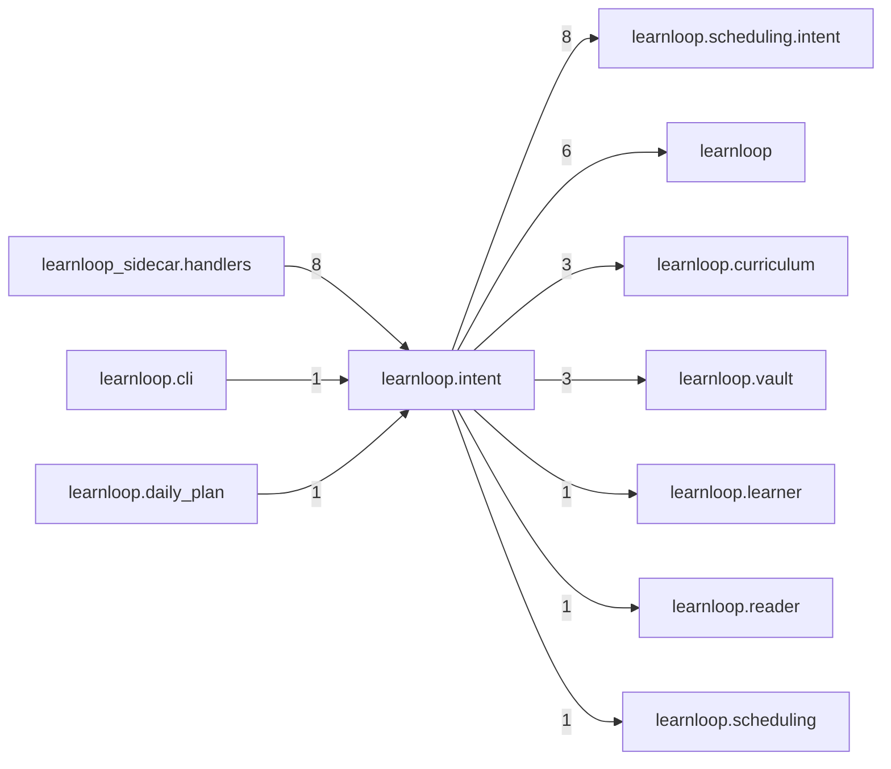

# `learnloop.intent` package map

> [!info] Generated package map
> This map is generated from live modules and their static imports. Follow module links for source-level facts and canonical concept/workflow links for system behavior.

Up: [[Module Catalog]]

## Responsibility

The single intent control: commitments carrying intent, optional deadlines and settled checks.

For system intent, use [[Architecture Overview]].

^package-purpose

## Module index

| Module | Purpose | Status | Direct importers | Direct test files |
|---|---|---:|---:|---:|
| [[Reference/Modules/learnloop/intent/__init__|learnloop.intent]] | [[Reference/Modules/learnloop/intent/__init__#^module-purpose|purpose]] | `ACTIVE` | 0 | 0 |
| [[Reference/Modules/learnloop/intent/checks|learnloop.intent.checks]] | [[Reference/Modules/learnloop/intent/checks#^module-purpose|purpose]] | `ACTIVE` | 6 | 13 |
| [[Reference/Modules/learnloop/intent/control|learnloop.intent.control]] | [[Reference/Modules/learnloop/intent/control#^module-purpose|purpose]] | `ACTIVE` | 4 | 13 |
| [[Reference/Modules/learnloop/intent/deadline|learnloop.intent.deadline]] | [[Reference/Modules/learnloop/intent/deadline#^module-purpose|purpose]] | `ACTIVE` | 1 | 3 |
| [[Reference/Modules/learnloop/intent/report|learnloop.intent.report]] | [[Reference/Modules/learnloop/intent/report#^module-purpose|purpose]] | `ACTIVE` | 1 | 1 |

## Cross-package dependencies

### This package imports

- [[Reference/Modules/learnloop/scheduling/intent/_package|learnloop.scheduling.intent]] — 8 static module edges
- [[Reference/Modules/learnloop/_package|learnloop]] — 6 static module edges
- [[Reference/Modules/learnloop/curriculum/_package|learnloop.curriculum]] — 3 static module edges
- [[Reference/Modules/learnloop/vault/_package|learnloop.vault]] — 3 static module edges
- [[Reference/Modules/learnloop/learner/_package|learnloop.learner]] — 1 static module edge
- [[Reference/Modules/learnloop/reader/_package|learnloop.reader]] — 1 static module edge
- [[Reference/Modules/learnloop/scheduling/_package|learnloop.scheduling]] — 1 static module edge

### Packages that import this package

- [[Reference/Modules/learnloop_sidecar/handlers/_package|learnloop_sidecar.handlers]] — 8 static module edges
- [[Reference/Modules/learnloop/cli/_package|learnloop.cli]] — 1 static module edge
- [[Reference/Modules/learnloop/daily_plan/_package|learnloop.daily_plan]] — 1 static module edge
- [[Reference/Modules/learnloop/source_retrieval/_package|learnloop.source_retrieval]] — 1 static module edge

### Dependency neighborhood

This diagram compresses package-level static imports; edge labels are distinct module-to-module import counts.



Interpretation: arrow direction is static import direction and the label is the number of distinct module-to-module edges. It shows coupling pressure, not runtime call frequency or ownership permission.

## Workflow entry points

- [[Initialize a Vault]]
- [[Start a Learning Cycle]]

## Find and filter

Use Obsidian's native search:

```query
path:"Reference/Modules/learnloop/intent" tag:#docs/module
```

To change this package, start with a module's [[#Module index|purpose link]], then follow its callers, tests, and modification guidance. Re-run the generator after source changes.
