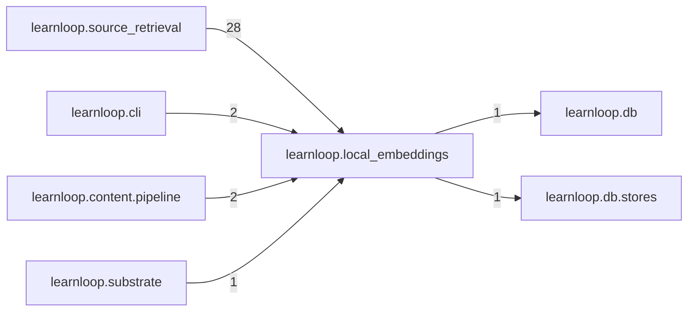

# `learnloop.local_embeddings` package map

> [!info] Generated package map
> This map is generated from live modules and their static imports. Follow module links for source-level facts and canonical concept/workflow links for system behavior.

Up: [[Module Catalog]]

## Responsibility

Local contextual source retrieval: the local document space's pins, capped batch worker, GPU meter, locks and owner-run commands.

For system intent, use [[Architecture Overview]].

^package-purpose

## Module index

| Module | Purpose | Status | Direct importers | Direct test files |
|---|---|---:|---:|---:|
| [[Reference/Modules/learnloop/local_embeddings/__init__|learnloop.local_embeddings]] | [[Reference/Modules/learnloop/local_embeddings/__init__#^module-purpose|purpose]] | `ACTIVE` | 0 | 0 |
| [[Reference/Modules/learnloop/local_embeddings/cache|learnloop.local_embeddings.cache]] | [[Reference/Modules/learnloop/local_embeddings/cache#^module-purpose|purpose]] | `ACTIVE` | 3 | 1 |
| [[Reference/Modules/learnloop/local_embeddings/fusion|learnloop.local_embeddings.fusion]] | [[Reference/Modules/learnloop/local_embeddings/fusion#^module-purpose|purpose]] | `ACTIVE` | 5 | 2 |
| [[Reference/Modules/learnloop/local_embeddings/gpu_meter|learnloop.local_embeddings.gpu_meter]] | [[Reference/Modules/learnloop/local_embeddings/gpu_meter#^module-purpose|purpose]] | `ACTIVE` | 3 | 2 |
| [[Reference/Modules/learnloop/local_embeddings/identity|learnloop.local_embeddings.identity]] | [[Reference/Modules/learnloop/local_embeddings/identity#^module-purpose|purpose]] | `ACTIVE` | 3 | 0 |
| [[Reference/Modules/learnloop/local_embeddings/launcher|learnloop.local_embeddings.launcher]] | [[Reference/Modules/learnloop/local_embeddings/launcher#^module-purpose|purpose]] | `ACTIVE` | 3 | 2 |
| [[Reference/Modules/learnloop/local_embeddings/pins|learnloop.local_embeddings.pins]] | [[Reference/Modules/learnloop/local_embeddings/pins#^module-purpose|purpose]] | `ACTIVE` | 8 | 5 |
| [[Reference/Modules/learnloop/local_embeddings/setup|learnloop.local_embeddings.setup]] | [[Reference/Modules/learnloop/local_embeddings/setup#^module-purpose|purpose]] | `ACTIVE` | 3 | 1 |
| [[Reference/Modules/learnloop/local_embeddings/student_decision|learnloop.local_embeddings.student_decision]] | [[Reference/Modules/learnloop/local_embeddings/student_decision#^module-purpose|purpose]] | `ACTIVE` | 2 | 1 |
| [[Reference/Modules/learnloop/local_embeddings/student_pins|learnloop.local_embeddings.student_pins]] | [[Reference/Modules/learnloop/local_embeddings/student_pins#^module-purpose|purpose]] | `ACTIVE` | 5 | 3 |
| [[Reference/Modules/learnloop/local_embeddings/student_server|learnloop.local_embeddings.student_server]] | [[Reference/Modules/learnloop/local_embeddings/student_server#^module-purpose|purpose]] | `ACTIVE` | 1 | 2 |
| [[Reference/Modules/learnloop/local_embeddings/student_trainer|learnloop.local_embeddings.student_trainer]] | [[Reference/Modules/learnloop/local_embeddings/student_trainer#^module-purpose|purpose]] | `ACTIVE` | 2 | 3 |
| [[Reference/Modules/learnloop/local_embeddings/worker|learnloop.local_embeddings.worker]] | [[Reference/Modules/learnloop/local_embeddings/worker#^module-purpose|purpose]] | `ACTIVE` | 5 | 4 |

## Cross-package dependencies

### This package imports

- [[Reference/Modules/learnloop/db/_package|learnloop.db]] — 1 static module edge
- [[Reference/Modules/learnloop/db/stores/_package|learnloop.db.stores]] — 1 static module edge

### Packages that import this package

- [[Reference/Modules/learnloop/source_retrieval/_package|learnloop.source_retrieval]] — 28 static module edges
- [[Reference/Modules/learnloop/cli/_package|learnloop.cli]] — 2 static module edges
- [[Reference/Modules/learnloop/content/pipeline/_package|learnloop.content.pipeline]] — 2 static module edges
- [[Reference/Modules/learnloop/substrate/_package|learnloop.substrate]] — 1 static module edge

### Dependency neighborhood

This diagram compresses package-level static imports; edge labels are distinct module-to-module import counts.



Interpretation: arrow direction is static import direction and the label is the number of distinct module-to-module edges. It shows coupling pressure, not runtime call frequency or ownership permission.

## Workflow entry points

- [[Initialize a Vault]]
- [[Start a Learning Cycle]]

## Find and filter

Use Obsidian's native search:

```query
path:"Reference/Modules/learnloop/local_embeddings" tag:#docs/module
```

To change this package, start with a module's [[#Module index|purpose link]], then follow its callers, tests, and modification guidance. Re-run the generator after source changes.
