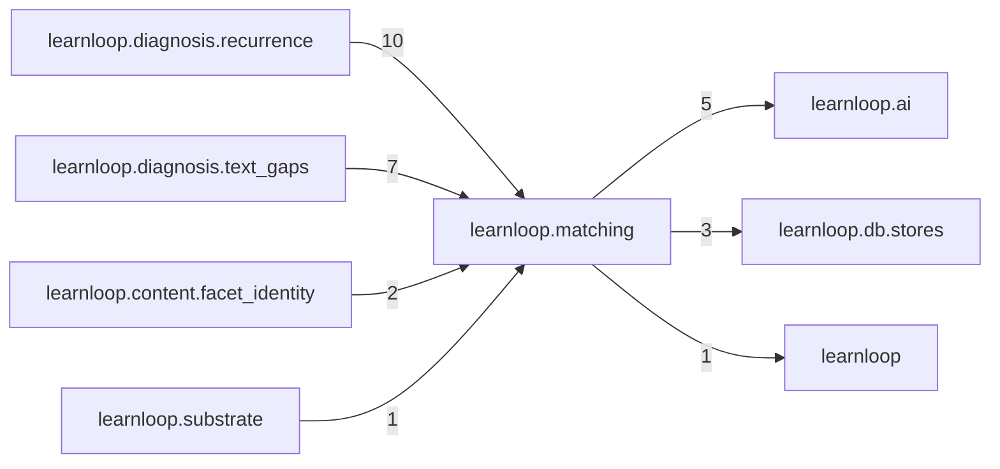

# `learnloop.matching` package map

> [!info] Generated package map
> This map is generated from live modules and their static imports. Follow module links for source-level facts and canonical concept/workflow links for system behavior.

Up: [[Module Catalog]]

## Responsibility

The one 'same or different?' step: registered match kinds, embedding shortlists and LLM judges, recorded in the judgment ledger.

For system intent, use [[Architecture Overview]].

^package-purpose

## Module index

| Module | Purpose | Status | Direct importers | Direct test files |
|---|---|---:|---:|---:|
| [[Reference/Modules/learnloop/matching/__init__|learnloop.matching]] | [[Reference/Modules/learnloop/matching/__init__#^module-purpose|purpose]] | `ACTIVE` | 0 | 1 |
| [[Reference/Modules/learnloop/matching/judge|learnloop.matching.judge]] | [[Reference/Modules/learnloop/matching/judge#^module-purpose|purpose]] | `ACTIVE` | 8 | 5 |
| [[Reference/Modules/learnloop/matching/kinds|learnloop.matching.kinds]] | [[Reference/Modules/learnloop/matching/kinds#^module-purpose|purpose]] | `ACTIVE` | 9 | 3 |
| [[Reference/Modules/learnloop/matching/shortlist|learnloop.matching.shortlist]] | [[Reference/Modules/learnloop/matching/shortlist#^module-purpose|purpose]] | `ACTIVE` | 6 | 3 |
| [[Reference/Modules/learnloop/matching/union|learnloop.matching.union]] | [[Reference/Modules/learnloop/matching/union#^module-purpose|purpose]] | `ACTIVE` | 4 | 2 |

## Cross-package dependencies

### This package imports

- [[Reference/Modules/learnloop/ai/_package|learnloop.ai]] — 5 static module edges
- [[Reference/Modules/learnloop/db/stores/_package|learnloop.db.stores]] — 3 static module edges
- [[Reference/Modules/learnloop/_package|learnloop]] — 1 static module edge

### Packages that import this package

- [[Reference/Modules/learnloop/diagnosis/recurrence/_package|learnloop.diagnosis.recurrence]] — 10 static module edges
- [[Reference/Modules/learnloop/diagnosis/text_gaps/_package|learnloop.diagnosis.text_gaps]] — 7 static module edges
- [[Reference/Modules/learnloop/content/facet_identity/_package|learnloop.content.facet_identity]] — 2 static module edges
- [[Reference/Modules/learnloop/substrate/_package|learnloop.substrate]] — 1 static module edge

### Dependency neighborhood

This diagram compresses package-level static imports; edge labels are distinct module-to-module import counts.



Interpretation: arrow direction is static import direction and the label is the number of distinct module-to-module edges. It shows coupling pressure, not runtime call frequency or ownership permission.

## Workflow entry points

- [[Initialize a Vault]]
- [[Start a Learning Cycle]]

## Find and filter

Use Obsidian's native search:

```query
path:"Reference/Modules/learnloop/matching" tag:#docs/module
```

To change this package, start with a module's [[#Module index|purpose link]], then follow its callers, tests, and modification guidance. Re-run the generator after source changes.
