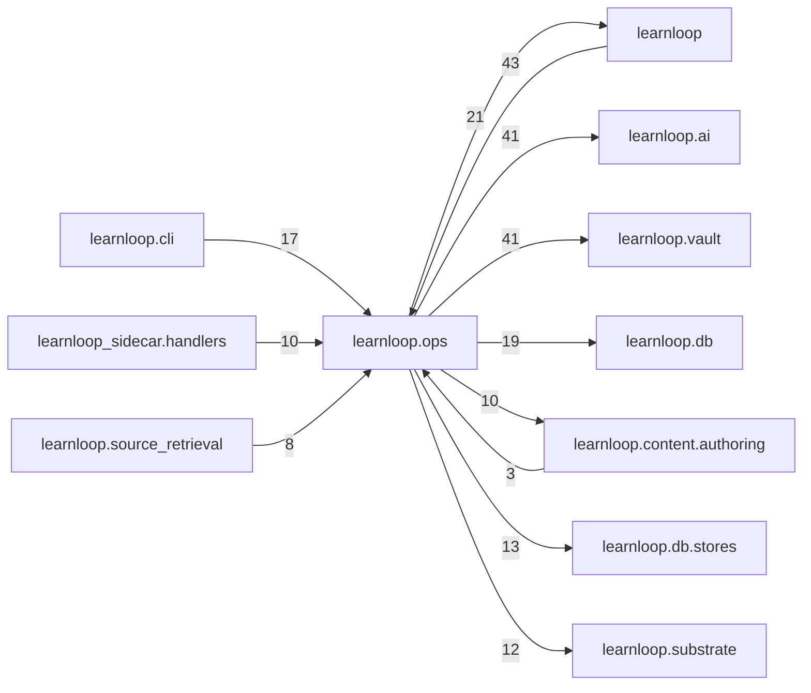

# `learnloop.ops` package map

> [!info] Generated package map
> This map is generated from live modules and their static imports. Follow module links for source-level facts and canonical concept/workflow links for system behavior.

Up: [[Module Catalog]]

## Responsibility

Vault diagnostics, locks, settings, startup, upgrades, and operator-facing maintenance.

For system intent, use [[State and Persistence]], [[Configuration]].

^package-purpose

## Module index

| Module | Purpose | Status | Direct importers | Direct test files |
|---|---|---:|---:|---:|
| [[Reference/Modules/learnloop/ops/__init__|learnloop.ops]] | [[Reference/Modules/learnloop/ops/__init__#^module-purpose|purpose]] | `ACTIVE` | 0 | 0 |
| [[Reference/Modules/learnloop/ops/capture_report|learnloop.ops.capture_report]] | [[Reference/Modules/learnloop/ops/capture_report#^module-purpose|purpose]] | `ACTIVE` | 1 | 8 |
| [[Reference/Modules/learnloop/ops/content_fixes|learnloop.ops.content_fixes]] | [[Reference/Modules/learnloop/ops/content_fixes#^module-purpose|purpose]] | `ACTIVE` | 1 | 1 |
| [[Reference/Modules/learnloop/ops/debug_time|learnloop.ops.debug_time]] | [[Reference/Modules/learnloop/ops/debug_time#^module-purpose|purpose]] | `ACTIVE` | 1 | 0 |
| [[Reference/Modules/learnloop/ops/debug_time_store|learnloop.ops.debug_time_store]] | [[Reference/Modules/learnloop/ops/debug_time_store#^module-purpose|purpose]] | `ACTIVE` | 1 | 0 |
| [[Reference/Modules/learnloop/ops/doctor|learnloop.ops.doctor]] | [[Reference/Modules/learnloop/ops/doctor#^module-purpose|purpose]] | `ACTIVE` | 2 | 47 |
| [[Reference/Modules/learnloop/ops/embedding_backfill|learnloop.ops.embedding_backfill]] | [[Reference/Modules/learnloop/ops/embedding_backfill#^module-purpose|purpose]] | `ACTIVE` | 13 | 20 |
| [[Reference/Modules/learnloop/ops/embedding_compare|learnloop.ops.embedding_compare]] | [[Reference/Modules/learnloop/ops/embedding_compare#^module-purpose|purpose]] | `ACTIVE` | 3 | 9 |
| [[Reference/Modules/learnloop/ops/family_proposals|learnloop.ops.family_proposals]] | [[Reference/Modules/learnloop/ops/family_proposals#^module-purpose|purpose]] | `ACTIVE` | 2 | 3 |
| [[Reference/Modules/learnloop/ops/graph_nomination_report|learnloop.ops.graph_nomination_report]] | [[Reference/Modules/learnloop/ops/graph_nomination_report#^module-purpose|purpose]] | `ACTIVE` | 1 | 1 |
| [[Reference/Modules/learnloop/ops/maintenance_feed|learnloop.ops.maintenance_feed]] | [[Reference/Modules/learnloop/ops/maintenance_feed#^module-purpose|purpose]] | `ACTIVE` | 3 | 7 |
| [[Reference/Modules/learnloop/ops/pf_calls|learnloop.ops.pf_calls]] | [[Reference/Modules/learnloop/ops/pf_calls#^module-purpose|purpose]] | `ACTIVE` | 10 | 11 |
| [[Reference/Modules/learnloop/ops/pf_generation|learnloop.ops.pf_generation]] | [[Reference/Modules/learnloop/ops/pf_generation#^module-purpose|purpose]] | `ACTIVE` | 2 | 9 |
| [[Reference/Modules/learnloop/ops/pf_publish|learnloop.ops.pf_publish]] | [[Reference/Modules/learnloop/ops/pf_publish#^module-purpose|purpose]] | `ACTIVE` | 1 | 4 |
| [[Reference/Modules/learnloop/ops/pf_reports|learnloop.ops.pf_reports]] | [[Reference/Modules/learnloop/ops/pf_reports#^module-purpose|purpose]] | `ACTIVE` | 1 | 2 |
| [[Reference/Modules/learnloop/ops/pf_selection|learnloop.ops.pf_selection]] | [[Reference/Modules/learnloop/ops/pf_selection#^module-purpose|purpose]] | `ACTIVE` | 1 | 0 |
| [[Reference/Modules/learnloop/ops/pf_verify|learnloop.ops.pf_verify]] | [[Reference/Modules/learnloop/ops/pf_verify#^module-purpose|purpose]] | `ACTIVE` | 2 | 1 |
| [[Reference/Modules/learnloop/ops/plan_transport|learnloop.ops.plan_transport]] | [[Reference/Modules/learnloop/ops/plan_transport#^module-purpose|purpose]] | `ACTIVE` | 2 | 1 |
| [[Reference/Modules/learnloop/ops/settings_store|learnloop.ops.settings_store]] | [[Reference/Modules/learnloop/ops/settings_store#^module-purpose|purpose]] | `ACTIVE` | 9 | 10 |
| [[Reference/Modules/learnloop/ops/startup|learnloop.ops.startup]] | [[Reference/Modules/learnloop/ops/startup#^module-purpose|purpose]] | `ACTIVE` | 3 | 3 |
| [[Reference/Modules/learnloop/ops/vault_lock|learnloop.ops.vault_lock]] | [[Reference/Modules/learnloop/ops/vault_lock#^module-purpose|purpose]] | `ACTIVE` | 2 | 2 |
| [[Reference/Modules/learnloop/ops/vault_upgrade|learnloop.ops.vault_upgrade]] | [[Reference/Modules/learnloop/ops/vault_upgrade#^module-purpose|purpose]] | `ACTIVE` | 45 | 20 |

## Child package maps

- [[Reference/Modules/learnloop/ops/contamination/_package|learnloop.ops.contamination]] — Contamination detectors as shadow flags, run offline on the owner's command beside the live lexical floor.

## Cross-package dependencies

### This package imports

- [[Reference/Modules/learnloop/ai/_package|learnloop.ai]] — 41 static module edges
- [[Reference/Modules/learnloop/vault/_package|learnloop.vault]] — 41 static module edges
- [[Reference/Modules/learnloop/_package|learnloop]] — 21 static module edges
- [[Reference/Modules/learnloop/db/_package|learnloop.db]] — 19 static module edges
- [[Reference/Modules/learnloop/db/stores/_package|learnloop.db.stores]] — 13 static module edges
- [[Reference/Modules/learnloop/substrate/_package|learnloop.substrate]] — 12 static module edges
- [[Reference/Modules/learnloop/content/authoring/_package|learnloop.content.authoring]] — 10 static module edges
- [[Reference/Modules/learnloop/config/_package|learnloop.config]] — 7 static module edges
- [[Reference/Modules/learnloop/learner/_package|learnloop.learner]] — 6 static module edges
- [[Reference/Modules/learnloop/content/proposals/_package|learnloop.content.proposals]] — 4 static module edges
- [[Reference/Modules/learnloop/content/sources/_package|learnloop.content.sources]] — 4 static module edges
- [[Reference/Modules/learnloop/content/synthesis/_package|learnloop.content.synthesis]] — 4 static module edges
- [[Reference/Modules/learnloop/router_objective/_package|learnloop.router_objective]] — 4 static module edges
- [[Reference/Modules/learnloop/ai/chatgpt_plan/_package|learnloop.ai.chatgpt_plan]] — 3 static module edges
- [[Reference/Modules/learnloop/attempts/_package|learnloop.attempts]] — 3 static module edges
- [[Reference/Modules/learnloop/diagnosis/_package|learnloop.diagnosis]] — 3 static module edges
- [[Reference/Modules/learnloop/ai/providers/_package|learnloop.ai.providers]] — 2 static module edges
- [[Reference/Modules/learnloop/content/pipeline/_package|learnloop.content.pipeline]] — 2 static module edges
- [[Reference/Modules/learnloop/data_capture/_package|learnloop.data_capture]] — 2 static module edges
- [[Reference/Modules/learnloop/followup_serve/_package|learnloop.followup_serve]] — 2 static module edges
- [[Reference/Modules/learnloop/router/_package|learnloop.router]] — 2 static module edges
- [[Reference/Modules/learnloop/content/facet_identity/_package|learnloop.content.facet_identity]] — 1 static module edge
- [[Reference/Modules/learnloop/curriculum/_package|learnloop.curriculum]] — 1 static module edge
- [[Reference/Modules/learnloop/goals/_package|learnloop.goals]] — 1 static module edge
- [[Reference/Modules/learnloop/ingest/_package|learnloop.ingest]] — 1 static module edge
- [[Reference/Modules/learnloop/params/_package|learnloop.params]] — 1 static module edge
- [[Reference/Modules/learnloop/projects/_package|learnloop.projects]] — 1 static module edge

### Packages that import this package

- [[Reference/Modules/learnloop/_package|learnloop]] — 43 static module edges
- [[Reference/Modules/learnloop/cli/_package|learnloop.cli]] — 17 static module edges
- [[Reference/Modules/learnloop_sidecar/handlers/_package|learnloop_sidecar.handlers]] — 10 static module edges
- [[Reference/Modules/learnloop/source_retrieval/_package|learnloop.source_retrieval]] — 8 static module edges
- [[Reference/Modules/learnloop/content/authoring/_package|learnloop.content.authoring]] — 3 static module edges
- [[Reference/Modules/learnloop/practice_index/_package|learnloop.practice_index]] — 2 static module edges
- [[Reference/Modules/learnloop/content/proposals/_package|learnloop.content.proposals]] — 1 static module edge
- [[Reference/Modules/learnloop/daily_plan/_package|learnloop.daily_plan]] — 1 static module edge
- [[Reference/Modules/learnloop/diagnosis/_package|learnloop.diagnosis]] — 1 static module edge
- [[Reference/Modules/learnloop/diagnosis/recurrence/_package|learnloop.diagnosis.recurrence]] — 1 static module edge
- [[Reference/Modules/learnloop/diagnosis/split/_package|learnloop.diagnosis.split]] — 1 static module edge
- [[Reference/Modules/learnloop/learner/_package|learnloop.learner]] — 1 static module edge
- [[Reference/Modules/learnloop/tui/_package|learnloop.tui]] — 1 static module edge
- [[Reference/Modules/learnloop_sidecar/_package|learnloop_sidecar]] — 1 static module edge

### Dependency neighborhood

This diagram compresses package-level static imports; edge labels are distinct module-to-module import counts.



Interpretation: arrow direction is static import direction and the label is the number of distinct module-to-module edges. It shows coupling pressure, not runtime call frequency or ownership permission.

## Workflow entry points

- [[Initialize a Vault]]
- [[Inspect Persistent State]]

## Find and filter

Use Obsidian's native search:

```query
path:"Reference/Modules/learnloop/ops" tag:#docs/module
```

To change this package, start with a module's [[#Module index|purpose link]], then follow its callers, tests, and modification guidance. Re-run the generator after source changes.
