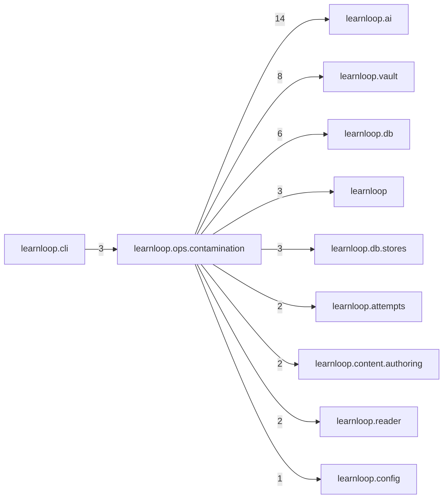

# `learnloop.ops.contamination` package map

> [!info] Generated package map
> This map is generated from live modules and their static imports. Follow module links for source-level facts and canonical concept/workflow links for system behavior.

Up: [[Module Catalog]]

## Responsibility

Contamination detectors as shadow flags, run offline on the owner's command beside the live lexical floor.

For system intent, use [[State and Persistence]], [[Configuration]].

^package-purpose

## Module index

| Module | Purpose | Status | Direct importers | Direct test files |
|---|---|---:|---:|---:|
| [[Reference/Modules/learnloop/ops/contamination/__init__|learnloop.ops.contamination]] | [[Reference/Modules/learnloop/ops/contamination/__init__#^module-purpose|purpose]] | `ACTIVE` | 0 | 0 |
| [[Reference/Modules/learnloop/ops/contamination/decider|learnloop.ops.contamination.decider]] | [[Reference/Modules/learnloop/ops/contamination/decider#^module-purpose|purpose]] | `ACTIVE` | 1 | 0 |
| [[Reference/Modules/learnloop/ops/contamination/detectors|learnloop.ops.contamination.detectors]] | [[Reference/Modules/learnloop/ops/contamination/detectors#^module-purpose|purpose]] | `ACTIVE` | 3 | 1 |
| [[Reference/Modules/learnloop/ops/contamination/judge|learnloop.ops.contamination.judge]] | [[Reference/Modules/learnloop/ops/contamination/judge#^module-purpose|purpose]] | `ACTIVE` | 2 | 2 |
| [[Reference/Modules/learnloop/ops/contamination/recipes|learnloop.ops.contamination.recipes]] | [[Reference/Modules/learnloop/ops/contamination/recipes#^module-purpose|purpose]] | `ACTIVE` | 4 | 2 |
| [[Reference/Modules/learnloop/ops/contamination/report|learnloop.ops.contamination.report]] | [[Reference/Modules/learnloop/ops/contamination/report#^module-purpose|purpose]] | `ACTIVE` | 2 | 1 |
| [[Reference/Modules/learnloop/ops/contamination/symbolic|learnloop.ops.contamination.symbolic]] | [[Reference/Modules/learnloop/ops/contamination/symbolic#^module-purpose|purpose]] | `ACTIVE` | 2 | 1 |

## Cross-package dependencies

### This package imports

- [[Reference/Modules/learnloop/ai/_package|learnloop.ai]] — 14 static module edges
- [[Reference/Modules/learnloop/vault/_package|learnloop.vault]] — 8 static module edges
- [[Reference/Modules/learnloop/db/_package|learnloop.db]] — 6 static module edges
- [[Reference/Modules/learnloop/_package|learnloop]] — 3 static module edges
- [[Reference/Modules/learnloop/db/stores/_package|learnloop.db.stores]] — 3 static module edges
- [[Reference/Modules/learnloop/attempts/_package|learnloop.attempts]] — 2 static module edges
- [[Reference/Modules/learnloop/content/authoring/_package|learnloop.content.authoring]] — 2 static module edges
- [[Reference/Modules/learnloop/reader/_package|learnloop.reader]] — 2 static module edges
- [[Reference/Modules/learnloop/config/_package|learnloop.config]] — 1 static module edge
- [[Reference/Modules/learnloop/substrate/_package|learnloop.substrate]] — 1 static module edge
- [[Reference/Modules/learnloop/tutor/_package|learnloop.tutor]] — 1 static module edge

### Packages that import this package

- [[Reference/Modules/learnloop/cli/_package|learnloop.cli]] — 3 static module edges

### Dependency neighborhood

This diagram compresses package-level static imports; edge labels are distinct module-to-module import counts.



Interpretation: arrow direction is static import direction and the label is the number of distinct module-to-module edges. It shows coupling pressure, not runtime call frequency or ownership permission.

## Workflow entry points

- [[Initialize a Vault]]
- [[Inspect Persistent State]]

## Find and filter

Use Obsidian's native search:

```query
path:"Reference/Modules/learnloop/ops/contamination" tag:#docs/module
```

To change this package, start with a module's [[#Module index|purpose link]], then follow its callers, tests, and modification guidance. Re-run the generator after source changes.
