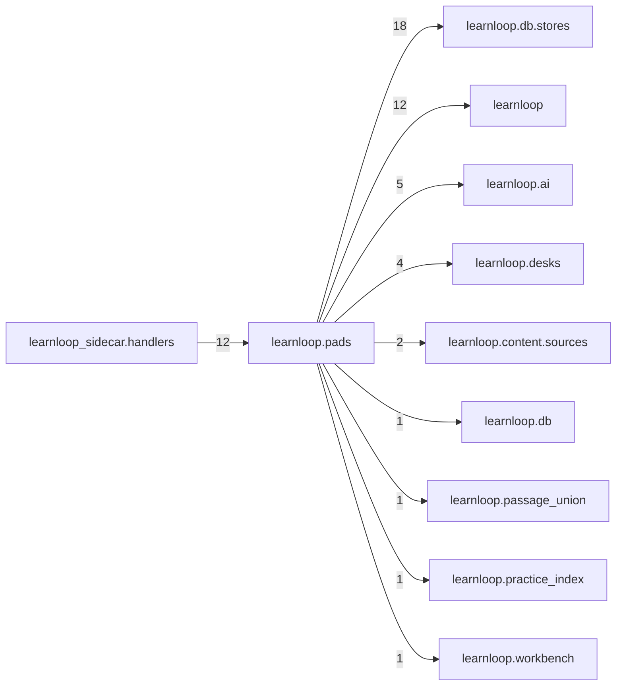

# `learnloop.pads` package map

> [!info] Generated package map
> This map is generated from live modules and their static imports. Follow module links for source-level facts and canonical concept/workflow links for system behavior.

Up: [[Module Catalog]]

## Responsibility

The Reader workbench's scratchpads: pads, their append-only block versions and anchors. The learner's own writing, never evidence; its exits to learner-text gaps and attempts are explicit.

For system intent, use [[Architecture Overview]].

^package-purpose

## Module index

| Module | Purpose | Status | Direct importers | Direct test files |
|---|---|---:|---:|---:|
| [[Reference/Modules/learnloop/pads/__init__|learnloop.pads]] | [[Reference/Modules/learnloop/pads/__init__#^module-purpose|purpose]] | `ACTIVE` | 0 | 0 |
| [[Reference/Modules/learnloop/pads/blocks|learnloop.pads.blocks]] | [[Reference/Modules/learnloop/pads/blocks#^module-purpose|purpose]] | `ACTIVE` | 1 | 4 |
| [[Reference/Modules/learnloop/pads/carried|learnloop.pads.carried]] | [[Reference/Modules/learnloop/pads/carried#^module-purpose|purpose]] | `ACTIVE` | 1 | 1 |
| [[Reference/Modules/learnloop/pads/drain|learnloop.pads.drain]] | [[Reference/Modules/learnloop/pads/drain#^module-purpose|purpose]] | `ACTIVE` | 1 | 1 |
| [[Reference/Modules/learnloop/pads/emission|learnloop.pads.emission]] | [[Reference/Modules/learnloop/pads/emission#^module-purpose|purpose]] | `ACTIVE` | 7 | 3 |
| [[Reference/Modules/learnloop/pads/ink|learnloop.pads.ink]] | [[Reference/Modules/learnloop/pads/ink#^module-purpose|purpose]] | `ACTIVE` | 3 | 5 |
| [[Reference/Modules/learnloop/pads/ink_render|learnloop.pads.ink_render]] | [[Reference/Modules/learnloop/pads/ink_render#^module-purpose|purpose]] | `ACTIVE` | 2 | 2 |
| [[Reference/Modules/learnloop/pads/ink_transcribe|learnloop.pads.ink_transcribe]] | [[Reference/Modules/learnloop/pads/ink_transcribe#^module-purpose|purpose]] | `ACTIVE` | 1 | 3 |
| [[Reference/Modules/learnloop/pads/proposals|learnloop.pads.proposals]] | [[Reference/Modules/learnloop/pads/proposals#^module-purpose|purpose]] | `ACTIVE` | 2 | 2 |
| [[Reference/Modules/learnloop/pads/quoting|learnloop.pads.quoting]] | [[Reference/Modules/learnloop/pads/quoting#^module-purpose|purpose]] | `ACTIVE` | 2 | 1 |
| [[Reference/Modules/learnloop/pads/submission|learnloop.pads.submission]] | [[Reference/Modules/learnloop/pads/submission#^module-purpose|purpose]] | `ACTIVE` | 2 | 1 |

## Cross-package dependencies

### This package imports

- [[Reference/Modules/learnloop/db/stores/_package|learnloop.db.stores]] — 18 static module edges
- [[Reference/Modules/learnloop/_package|learnloop]] — 12 static module edges
- [[Reference/Modules/learnloop/ai/_package|learnloop.ai]] — 5 static module edges
- [[Reference/Modules/learnloop/desks/_package|learnloop.desks]] — 4 static module edges
- [[Reference/Modules/learnloop/content/sources/_package|learnloop.content.sources]] — 2 static module edges
- [[Reference/Modules/learnloop/db/_package|learnloop.db]] — 1 static module edge
- [[Reference/Modules/learnloop/passage_union/_package|learnloop.passage_union]] — 1 static module edge
- [[Reference/Modules/learnloop/practice_index/_package|learnloop.practice_index]] — 1 static module edge
- [[Reference/Modules/learnloop/workbench/_package|learnloop.workbench]] — 1 static module edge

### Packages that import this package

- [[Reference/Modules/learnloop_sidecar/handlers/_package|learnloop_sidecar.handlers]] — 12 static module edges
- [[Reference/Modules/learnloop_sidecar/_package|learnloop_sidecar]] — 1 static module edge

### Dependency neighborhood

This diagram compresses package-level static imports; edge labels are distinct module-to-module import counts.



Interpretation: arrow direction is static import direction and the label is the number of distinct module-to-module edges. It shows coupling pressure, not runtime call frequency or ownership permission.

## Workflow entry points

- [[Initialize a Vault]]
- [[Start a Learning Cycle]]

## Find and filter

Use Obsidian's native search:

```query
path:"Reference/Modules/learnloop/pads" tag:#docs/module
```

To change this package, start with a module's [[#Module index|purpose link]], then follow its callers, tests, and modification guidance. Re-run the generator after source changes.
