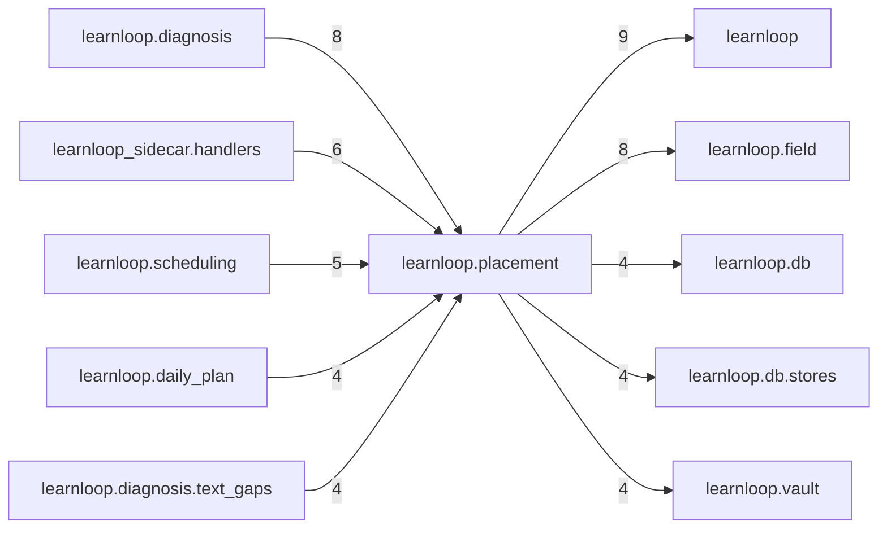

# `learnloop.placement` package map

> [!info] Generated package map
> This map is generated from live modules and their static imports. Follow module links for source-level facts and canonical concept/workflow links for system behavior.

Up: [[Module Catalog]]

## Responsibility

Placement for new material through the LearnerPredictor contract; writes only its own receipts, never evidence.

For system intent, use [[Architecture Overview]].

^package-purpose

## Module index

| Module | Purpose | Status | Direct importers | Direct test files |
|---|---|---:|---:|---:|
| [[Reference/Modules/learnloop/placement/__init__|learnloop.placement]] | [[Reference/Modules/learnloop/placement/__init__#^module-purpose|purpose]] | `ACTIVE` | 0 | 0 |
| [[Reference/Modules/learnloop/placement/claim_check|learnloop.placement.claim_check]] | [[Reference/Modules/learnloop/placement/claim_check#^module-purpose|purpose]] | `ACTIVE` | 1 | 2 |
| [[Reference/Modules/learnloop/placement/decisions|learnloop.placement.decisions]] | [[Reference/Modules/learnloop/placement/decisions#^module-purpose|purpose]] | `ACTIVE` | 4 | 15 |
| [[Reference/Modules/learnloop/placement/field_receipts|learnloop.placement.field_receipts]] | [[Reference/Modules/learnloop/placement/field_receipts#^module-purpose|purpose]] | `ACTIVE` | 1 | 0 |
| [[Reference/Modules/learnloop/placement/predictor|learnloop.placement.predictor]] | [[Reference/Modules/learnloop/placement/predictor#^module-purpose|purpose]] | `ACTIVE` | 8 | 4 |
| [[Reference/Modules/learnloop/placement/report|learnloop.placement.report]] | [[Reference/Modules/learnloop/placement/report#^module-purpose|purpose]] | `ACTIVE` | 1 | 2 |
| [[Reference/Modules/learnloop/placement/rules|learnloop.placement.rules]] | [[Reference/Modules/learnloop/placement/rules#^module-purpose|purpose]] | `ACTIVE` | 4 | 7 |
| [[Reference/Modules/learnloop/placement/signals|learnloop.placement.signals]] | [[Reference/Modules/learnloop/placement/signals#^module-purpose|purpose]] | `ACTIVE` | 3 | 3 |
| [[Reference/Modules/learnloop/placement/state|learnloop.placement.state]] | [[Reference/Modules/learnloop/placement/state#^module-purpose|purpose]] | `ACTIVE` | 33 | 30 |

## Cross-package dependencies

### This package imports

- [[Reference/Modules/learnloop/_package|learnloop]] — 9 static module edges
- [[Reference/Modules/learnloop/field/_package|learnloop.field]] — 8 static module edges
- [[Reference/Modules/learnloop/db/_package|learnloop.db]] — 4 static module edges
- [[Reference/Modules/learnloop/db/stores/_package|learnloop.db.stores]] — 4 static module edges
- [[Reference/Modules/learnloop/vault/_package|learnloop.vault]] — 4 static module edges
- [[Reference/Modules/learnloop/learner/_package|learnloop.learner]] — 2 static module edges
- [[Reference/Modules/learnloop/attempts/_package|learnloop.attempts]] — 1 static module edge

### Packages that import this package

- [[Reference/Modules/learnloop/diagnosis/_package|learnloop.diagnosis]] — 8 static module edges
- [[Reference/Modules/learnloop_sidecar/handlers/_package|learnloop_sidecar.handlers]] — 6 static module edges
- [[Reference/Modules/learnloop/scheduling/_package|learnloop.scheduling]] — 5 static module edges
- [[Reference/Modules/learnloop/daily_plan/_package|learnloop.daily_plan]] — 4 static module edges
- [[Reference/Modules/learnloop/diagnosis/text_gaps/_package|learnloop.diagnosis.text_gaps]] — 4 static module edges
- [[Reference/Modules/learnloop/cli/_package|learnloop.cli]] — 3 static module edges
- [[Reference/Modules/learnloop/hints/_package|learnloop.hints]] — 3 static module edges
- [[Reference/Modules/learnloop/attempts/_package|learnloop.attempts]] — 2 static module edges
- [[Reference/Modules/learnloop/content/authoring/_package|learnloop.content.authoring]] — 2 static module edges
- [[Reference/Modules/learnloop/source_retrieval/_package|learnloop.source_retrieval]] — 2 static module edges
- [[Reference/Modules/learnloop/adaptive_difficulty/_package|learnloop.adaptive_difficulty]] — 1 static module edge
- [[Reference/Modules/learnloop/instructional/_package|learnloop.instructional]] — 1 static module edge
- [[Reference/Modules/learnloop/substrate/_package|learnloop.substrate]] — 1 static module edge
- [[Reference/Modules/learnloop/tui/screens/_package|learnloop.tui.screens]] — 1 static module edge
- [[Reference/Modules/learnloop/tutor/_package|learnloop.tutor]] — 1 static module edge

### Dependency neighborhood

This diagram compresses package-level static imports; edge labels are distinct module-to-module import counts.



Interpretation: arrow direction is static import direction and the label is the number of distinct module-to-module edges. It shows coupling pressure, not runtime call frequency or ownership permission.

## Workflow entry points

- [[Initialize a Vault]]
- [[Start a Learning Cycle]]

## Find and filter

Use Obsidian's native search:

```query
path:"Reference/Modules/learnloop/placement" tag:#docs/module
```

To change this package, start with a module's [[#Module index|purpose link]], then follow its callers, tests, and modification guidance. Re-run the generator after source changes.
