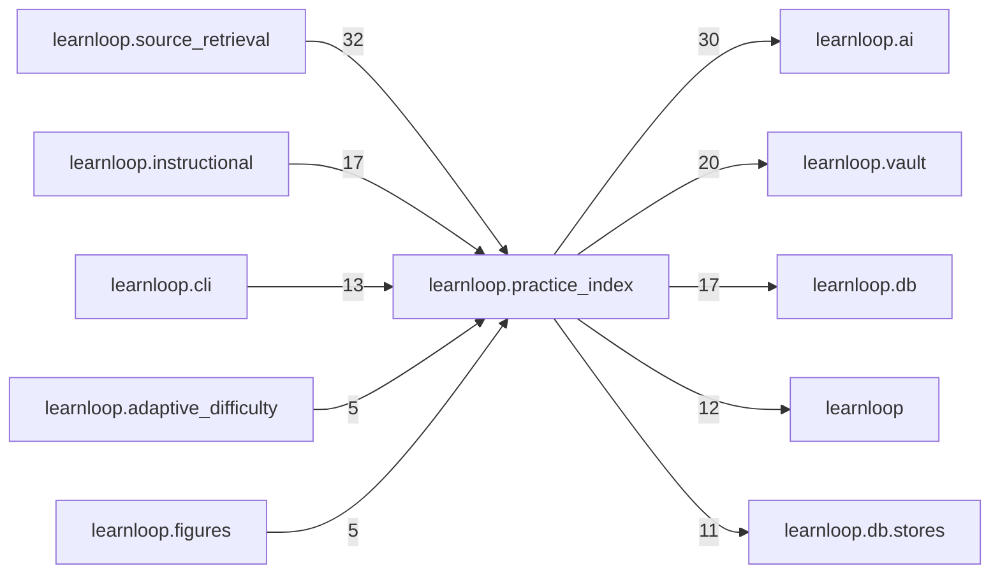

# `learnloop.practice_index` package map

> [!info] Generated package map
> This map is generated from live modules and their static imports. Follow module links for source-level facts and canonical concept/workflow links for system behavior.

Up: [[Module Catalog]]

## Responsibility

The practice index: facet dossiers and find_practice (recall by search, an LLM decides, the scheduler admits).

For system intent, use [[Architecture Overview]].

^package-purpose

## Module index

| Module | Purpose | Status | Direct importers | Direct test files |
|---|---|---:|---:|---:|
| [[Reference/Modules/learnloop/practice_index/__init__|learnloop.practice_index]] | [[Reference/Modules/learnloop/practice_index/__init__#^module-purpose|purpose]] | `ACTIVE` | 0 | 0 |
| [[Reference/Modules/learnloop/practice_index/admission|learnloop.practice_index.admission]] | [[Reference/Modules/learnloop/practice_index/admission#^module-purpose|purpose]] | `ACTIVE` | 2 | 2 |
| [[Reference/Modules/learnloop/practice_index/catalog|learnloop.practice_index.catalog]] | [[Reference/Modules/learnloop/practice_index/catalog#^module-purpose|purpose]] | `ACTIVE` | 7 | 0 |
| [[Reference/Modules/learnloop/practice_index/contracts|learnloop.practice_index.contracts]] | [[Reference/Modules/learnloop/practice_index/contracts#^module-purpose|purpose]] | `ACTIVE` | 3 | 5 |
| [[Reference/Modules/learnloop/practice_index/coverage|learnloop.practice_index.coverage]] | [[Reference/Modules/learnloop/practice_index/coverage#^module-purpose|purpose]] | `ACTIVE` | 3 | 0 |
| [[Reference/Modules/learnloop/practice_index/dossiers|learnloop.practice_index.dossiers]] | [[Reference/Modules/learnloop/practice_index/dossiers#^module-purpose|purpose]] | `ACTIVE` | 2 | 4 |
| [[Reference/Modules/learnloop/practice_index/evaluation|learnloop.practice_index.evaluation]] | [[Reference/Modules/learnloop/practice_index/evaluation#^module-purpose|purpose]] | `ACTIVE` | 3 | 3 |
| [[Reference/Modules/learnloop/practice_index/listwise|learnloop.practice_index.listwise]] | [[Reference/Modules/learnloop/practice_index/listwise#^module-purpose|purpose]] | `ACTIVE` | 13 | 3 |
| [[Reference/Modules/learnloop/practice_index/paid|learnloop.practice_index.paid]] | [[Reference/Modules/learnloop/practice_index/paid#^module-purpose|purpose]] | `ACTIVE` | 46 | 22 |
| [[Reference/Modules/learnloop/practice_index/query_vectors|learnloop.practice_index.query_vectors]] | [[Reference/Modules/learnloop/practice_index/query_vectors#^module-purpose|purpose]] | `ACTIVE` | 8 | 0 |
| [[Reference/Modules/learnloop/practice_index/retrieval|learnloop.practice_index.retrieval]] | [[Reference/Modules/learnloop/practice_index/retrieval#^module-purpose|purpose]] | `ACTIVE` | 12 | 15 |
| [[Reference/Modules/learnloop/practice_index/text|learnloop.practice_index.text]] | [[Reference/Modules/learnloop/practice_index/text#^module-purpose|purpose]] | `ACTIVE` | 5 | 3 |
| [[Reference/Modules/learnloop/practice_index/tool|learnloop.practice_index.tool]] | [[Reference/Modules/learnloop/practice_index/tool#^module-purpose|purpose]] | `ACTIVE` | 1 | 2 |
| [[Reference/Modules/learnloop/practice_index/usage|learnloop.practice_index.usage]] | [[Reference/Modules/learnloop/practice_index/usage#^module-purpose|purpose]] | `ACTIVE` | 4 | 4 |

## Cross-package dependencies

### This package imports

- [[Reference/Modules/learnloop/ai/_package|learnloop.ai]] — 30 static module edges
- [[Reference/Modules/learnloop/vault/_package|learnloop.vault]] — 20 static module edges
- [[Reference/Modules/learnloop/db/_package|learnloop.db]] — 17 static module edges
- [[Reference/Modules/learnloop/_package|learnloop]] — 12 static module edges
- [[Reference/Modules/learnloop/db/stores/_package|learnloop.db.stores]] — 11 static module edges
- [[Reference/Modules/learnloop/diagnosis/_package|learnloop.diagnosis]] — 3 static module edges
- [[Reference/Modules/learnloop/ops/_package|learnloop.ops]] — 2 static module edges
- [[Reference/Modules/learnloop/attempts/_package|learnloop.attempts]] — 1 static module edge
- [[Reference/Modules/learnloop/goals/_package|learnloop.goals]] — 1 static module edge
- [[Reference/Modules/learnloop/ingest/_package|learnloop.ingest]] — 1 static module edge
- [[Reference/Modules/learnloop/scheduling/_package|learnloop.scheduling]] — 1 static module edge
- [[Reference/Modules/learnloop/substrate/_package|learnloop.substrate]] — 1 static module edge

### Packages that import this package

- [[Reference/Modules/learnloop/source_retrieval/_package|learnloop.source_retrieval]] — 32 static module edges
- [[Reference/Modules/learnloop/instructional/_package|learnloop.instructional]] — 17 static module edges
- [[Reference/Modules/learnloop/cli/_package|learnloop.cli]] — 13 static module edges
- [[Reference/Modules/learnloop/adaptive_difficulty/_package|learnloop.adaptive_difficulty]] — 5 static module edges
- [[Reference/Modules/learnloop/figures/_package|learnloop.figures]] — 5 static module edges
- [[Reference/Modules/learnloop_sidecar/handlers/_package|learnloop_sidecar.handlers]] — 5 static module edges
- [[Reference/Modules/learnloop/hints/_package|learnloop.hints]] — 3 static module edges
- [[Reference/Modules/learnloop/workbench/_package|learnloop.workbench]] — 3 static module edges
- [[Reference/Modules/learnloop/content/authoring/_package|learnloop.content.authoring]] — 2 static module edges
- [[Reference/Modules/learnloop/remote/_package|learnloop.remote]] — 2 static module edges
- [[Reference/Modules/learnloop/content/pipeline/_package|learnloop.content.pipeline]] — 1 static module edge

### Dependency neighborhood

This diagram compresses package-level static imports; edge labels are distinct module-to-module import counts.



Interpretation: arrow direction is static import direction and the label is the number of distinct module-to-module edges. It shows coupling pressure, not runtime call frequency or ownership permission.

## Workflow entry points

- [[Initialize a Vault]]
- [[Start a Learning Cycle]]

## Find and filter

Use Obsidian's native search:

```query
path:"Reference/Modules/learnloop/practice_index" tag:#docs/module
```

To change this package, start with a module's [[#Module index|purpose link]], then follow its callers, tests, and modification guidance. Re-run the generator after source changes.
