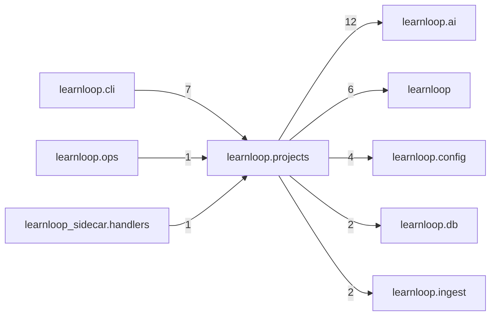

# `learnloop.projects` package map

> [!info] Generated package map
> This map is generated from live modules and their static imports. Follow module links for source-level facts and canonical concept/workflow links for system behavior.

Up: [[Module Catalog]]

## Responsibility

Project understanding: captured agent-written diffs and delayed comprehension probes on them.

For system intent, use [[Architecture Overview]].

^package-purpose

## Module index

| Module | Purpose | Status | Direct importers | Direct test files |
|---|---|---:|---:|---:|
| [[Reference/Modules/learnloop/projects/__init__|learnloop.projects]] | [[Reference/Modules/learnloop/projects/__init__#^module-purpose|purpose]] | `ACTIVE` | 0 | 0 |
| [[Reference/Modules/learnloop/projects/ai_contracts|learnloop.projects.ai_contracts]] | [[Reference/Modules/learnloop/projects/ai_contracts#^module-purpose|purpose]] | `ACTIVE` | 2 | 6 |
| [[Reference/Modules/learnloop/projects/ai_runtime|learnloop.projects.ai_runtime]] | [[Reference/Modules/learnloop/projects/ai_runtime#^module-purpose|purpose]] | `ACTIVE` | 2 | 9 |
| [[Reference/Modules/learnloop/projects/capture|learnloop.projects.capture]] | [[Reference/Modules/learnloop/projects/capture#^module-purpose|purpose]] | `ACTIVE` | 5 | 9 |
| [[Reference/Modules/learnloop/projects/experiment_store|learnloop.projects.experiment_store]] | [[Reference/Modules/learnloop/projects/experiment_store#^module-purpose|purpose]] | `ACTIVE` | 6 | 11 |
| [[Reference/Modules/learnloop/projects/git|learnloop.projects.git]] | [[Reference/Modules/learnloop/projects/git#^module-purpose|purpose]] | `ACTIVE` | 3 | 0 |
| [[Reference/Modules/learnloop/projects/hooks|learnloop.projects.hooks]] | [[Reference/Modules/learnloop/projects/hooks#^module-purpose|purpose]] | `ACTIVE` | 1 | 1 |
| [[Reference/Modules/learnloop/projects/probes|learnloop.projects.probes]] | [[Reference/Modules/learnloop/projects/probes#^module-purpose|purpose]] | `ACTIVE` | 1 | 5 |
| [[Reference/Modules/learnloop/projects/redaction|learnloop.projects.redaction]] | [[Reference/Modules/learnloop/projects/redaction#^module-purpose|purpose]] | `ACTIVE` | 2 | 1 |
| [[Reference/Modules/learnloop/projects/report|learnloop.projects.report]] | [[Reference/Modules/learnloop/projects/report#^module-purpose|purpose]] | `ACTIVE` | 1 | 1 |

## Cross-package dependencies

### This package imports

- [[Reference/Modules/learnloop/ai/_package|learnloop.ai]] — 12 static module edges
- [[Reference/Modules/learnloop/_package|learnloop]] — 6 static module edges
- [[Reference/Modules/learnloop/config/_package|learnloop.config]] — 4 static module edges
- [[Reference/Modules/learnloop/db/_package|learnloop.db]] — 2 static module edges
- [[Reference/Modules/learnloop/ingest/_package|learnloop.ingest]] — 2 static module edges

### Packages that import this package

- [[Reference/Modules/learnloop/cli/_package|learnloop.cli]] — 7 static module edges
- [[Reference/Modules/learnloop/ops/_package|learnloop.ops]] — 1 static module edge
- [[Reference/Modules/learnloop_sidecar/handlers/_package|learnloop_sidecar.handlers]] — 1 static module edge

### Dependency neighborhood

This diagram compresses package-level static imports; edge labels are distinct module-to-module import counts.



Interpretation: arrow direction is static import direction and the label is the number of distinct module-to-module edges. It shows coupling pressure, not runtime call frequency or ownership permission.

## Workflow entry points

- [[Initialize a Vault]]
- [[Start a Learning Cycle]]

## Find and filter

Use Obsidian's native search:

```query
path:"Reference/Modules/learnloop/projects" tag:#docs/module
```

To change this package, start with a module's [[#Module index|purpose link]], then follow its callers, tests, and modification guidance. Re-run the generator after source changes.
