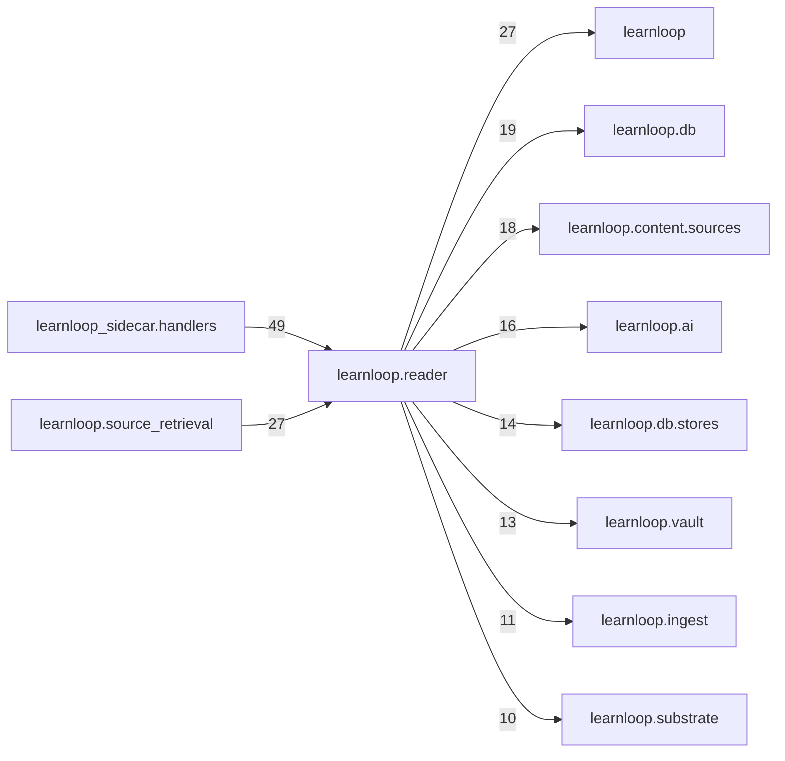

# `learnloop.reader` package map

> [!info] Generated package map
> This map is generated from live modules and their static imports. Follow module links for source-level facts and canonical concept/workflow links for system behavior.

Up: [[Module Catalog]]

## Responsibility

Reader-mode source exploration, annotations, quick checks, and authoring handoffs.

For system intent, use [[Learning System]].

^package-purpose

## Module index

| Module | Purpose | Status | Direct importers | Direct test files |
|---|---|---:|---:|---:|
| [[Reference/Modules/learnloop/reader/__init__|learnloop.reader]] | [[Reference/Modules/learnloop/reader/__init__#^module-purpose|purpose]] | `ACTIVE` | 0 | 0 |
| [[Reference/Modules/learnloop/reader/active_reading|learnloop.reader.active_reading]] | [[Reference/Modules/learnloop/reader/active_reading#^module-purpose|purpose]] | `ACTIVE` | 1 | 2 |
| [[Reference/Modules/learnloop/reader/ai_contracts|learnloop.reader.ai_contracts]] | [[Reference/Modules/learnloop/reader/ai_contracts#^module-purpose|purpose]] | `ACTIVE` | 2 | 11 |
| [[Reference/Modules/learnloop/reader/annotations|learnloop.reader.annotations]] | [[Reference/Modules/learnloop/reader/annotations#^module-purpose|purpose]] | `ACTIVE` | 5 | 10 |
| [[Reference/Modules/learnloop/reader/as_printed|learnloop.reader.as_printed]] | [[Reference/Modules/learnloop/reader/as_printed#^module-purpose|purpose]] | `ACTIVE` | 2 | 7 |
| [[Reference/Modules/learnloop/reader/phone_media|learnloop.reader.phone_media]] | [[Reference/Modules/learnloop/reader/phone_media#^module-purpose|purpose]] | `ACTIVE` | 2 | 2 |
| [[Reference/Modules/learnloop/reader/reader_authoring|learnloop.reader.reader_authoring]] | [[Reference/Modules/learnloop/reader/reader_authoring#^module-purpose|purpose]] | `ACTIVE` | 2 | 7 |
| [[Reference/Modules/learnloop/reader/reader_capture|learnloop.reader.reader_capture]] | [[Reference/Modules/learnloop/reader/reader_capture#^module-purpose|purpose]] | `ACTIVE` | 2 | 7 |
| [[Reference/Modules/learnloop/reader/reader_cues|learnloop.reader.reader_cues]] | [[Reference/Modules/learnloop/reader/reader_cues#^module-purpose|purpose]] | `ACTIVE` | 4 | 5 |
| [[Reference/Modules/learnloop/reader/reader_dialogue|learnloop.reader.reader_dialogue]] | [[Reference/Modules/learnloop/reader/reader_dialogue#^module-purpose|purpose]] | `ACTIVE` | 19 | 25 |
| [[Reference/Modules/learnloop/reader/reader_guidance|learnloop.reader.reader_guidance]] | [[Reference/Modules/learnloop/reader/reader_guidance#^module-purpose|purpose]] | `ACTIVE` | 15 | 24 |
| [[Reference/Modules/learnloop/reader/reader_inquiry|learnloop.reader.reader_inquiry]] | [[Reference/Modules/learnloop/reader/reader_inquiry#^module-purpose|purpose]] | `ACTIVE` | 1 | 21 |
| [[Reference/Modules/learnloop/reader/reader_intent|learnloop.reader.reader_intent]] | [[Reference/Modules/learnloop/reader/reader_intent#^module-purpose|purpose]] | `ACTIVE` | 1 | 10 |
| [[Reference/Modules/learnloop/reader/reader_observations|learnloop.reader.reader_observations]] | [[Reference/Modules/learnloop/reader/reader_observations#^module-purpose|purpose]] | `ACTIVE` | 2 | 3 |
| [[Reference/Modules/learnloop/reader/reader_progression|learnloop.reader.reader_progression]] | [[Reference/Modules/learnloop/reader/reader_progression#^module-purpose|purpose]] | `ACTIVE` | 20 | 8 |
| [[Reference/Modules/learnloop/reader/reader_quick_check|learnloop.reader.reader_quick_check]] | [[Reference/Modules/learnloop/reader/reader_quick_check#^module-purpose|purpose]] | `ACTIVE` | 4 | 15 |
| [[Reference/Modules/learnloop/reader/reader_report|learnloop.reader.reader_report]] | [[Reference/Modules/learnloop/reader/reader_report#^module-purpose|purpose]] | `ACTIVE` | 1 | 22 |
| [[Reference/Modules/learnloop/reader/reader_requests|learnloop.reader.reader_requests]] | [[Reference/Modules/learnloop/reader/reader_requests#^module-purpose|purpose]] | `ACTIVE` | 4 | 9 |
| [[Reference/Modules/learnloop/reader/reader_restoration|learnloop.reader.reader_restoration]] | [[Reference/Modules/learnloop/reader/reader_restoration#^module-purpose|purpose]] | `ACTIVE` | 1 | 2 |
| [[Reference/Modules/learnloop/reader/reader_sessions|learnloop.reader.reader_sessions]] | [[Reference/Modules/learnloop/reader/reader_sessions#^module-purpose|purpose]] | `ACTIVE` | 6 | 9 |
| [[Reference/Modules/learnloop/reader/recap|learnloop.reader.recap]] | [[Reference/Modules/learnloop/reader/recap#^module-purpose|purpose]] | `ACTIVE` | 7 | 11 |
| [[Reference/Modules/learnloop/reader/source_identity|learnloop.reader.source_identity]] | [[Reference/Modules/learnloop/reader/source_identity#^module-purpose|purpose]] | `ACTIVE` | 2 | 2 |
| [[Reference/Modules/learnloop/reader/source_objects|learnloop.reader.source_objects]] | [[Reference/Modules/learnloop/reader/source_objects#^module-purpose|purpose]] | `ACTIVE` | 6 | 9 |
| [[Reference/Modules/learnloop/reader/source_render_views|learnloop.reader.source_render_views]] | [[Reference/Modules/learnloop/reader/source_render_views#^module-purpose|purpose]] | `ACTIVE` | 3 | 4 |
| [[Reference/Modules/learnloop/reader/source_review|learnloop.reader.source_review]] | [[Reference/Modules/learnloop/reader/source_review#^module-purpose|purpose]] | `ACTIVE` | 1 | 1 |
| [[Reference/Modules/learnloop/reader/source_roles|learnloop.reader.source_roles]] | [[Reference/Modules/learnloop/reader/source_roles#^module-purpose|purpose]] | `ACTIVE` | 8 | 6 |
| [[Reference/Modules/learnloop/reader/source_search|learnloop.reader.source_search]] | [[Reference/Modules/learnloop/reader/source_search#^module-purpose|purpose]] | `ACTIVE` | 3 | 2 |
| [[Reference/Modules/learnloop/reader/span_view|learnloop.reader.span_view]] | [[Reference/Modules/learnloop/reader/span_view#^module-purpose|purpose]] | `ACTIVE` | 9 | 8 |
| [[Reference/Modules/learnloop/reader/workbench|learnloop.reader.workbench]] | [[Reference/Modules/learnloop/reader/workbench#^module-purpose|purpose]] | `ACTIVE` | 12 | 18 |

## Cross-package dependencies

### This package imports

- [[Reference/Modules/learnloop/_package|learnloop]] — 27 static module edges
- [[Reference/Modules/learnloop/db/_package|learnloop.db]] — 19 static module edges
- [[Reference/Modules/learnloop/content/sources/_package|learnloop.content.sources]] — 18 static module edges
- [[Reference/Modules/learnloop/ai/_package|learnloop.ai]] — 16 static module edges
- [[Reference/Modules/learnloop/db/stores/_package|learnloop.db.stores]] — 14 static module edges
- [[Reference/Modules/learnloop/vault/_package|learnloop.vault]] — 13 static module edges
- [[Reference/Modules/learnloop/ingest/_package|learnloop.ingest]] — 11 static module edges
- [[Reference/Modules/learnloop/substrate/_package|learnloop.substrate]] — 10 static module edges
- [[Reference/Modules/learnloop/attempts/_package|learnloop.attempts]] — 8 static module edges
- [[Reference/Modules/learnloop/curriculum/_package|learnloop.curriculum]] — 8 static module edges
- [[Reference/Modules/learnloop/content/authoring/_package|learnloop.content.authoring]] — 3 static module edges
- [[Reference/Modules/learnloop/tutor/_package|learnloop.tutor]] — 3 static module edges
- [[Reference/Modules/learnloop/goals/_package|learnloop.goals]] — 2 static module edges
- [[Reference/Modules/learnloop/learner/_package|learnloop.learner]] — 2 static module edges
- [[Reference/Modules/learnloop/config/_package|learnloop.config]] — 1 static module edge
- [[Reference/Modules/learnloop/content/pipeline/_package|learnloop.content.pipeline]] — 1 static module edge
- [[Reference/Modules/learnloop/data_capture/_package|learnloop.data_capture]] — 1 static module edge
- [[Reference/Modules/learnloop/diagnosis/text_gaps/_package|learnloop.diagnosis.text_gaps]] — 1 static module edge
- [[Reference/Modules/learnloop/router_objective/_package|learnloop.router_objective]] — 1 static module edge
- [[Reference/Modules/learnloop/scheduling/_package|learnloop.scheduling]] — 1 static module edge

### Packages that import this package

- [[Reference/Modules/learnloop_sidecar/handlers/_package|learnloop_sidecar.handlers]] — 49 static module edges
- [[Reference/Modules/learnloop/source_retrieval/_package|learnloop.source_retrieval]] — 27 static module edges
- [[Reference/Modules/learnloop/figures/_package|learnloop.figures]] — 7 static module edges
- [[Reference/Modules/learnloop/daily_plan/_package|learnloop.daily_plan]] — 6 static module edges
- [[Reference/Modules/learnloop/instructional/_package|learnloop.instructional]] — 6 static module edges
- [[Reference/Modules/learnloop/content/pipeline/_package|learnloop.content.pipeline]] — 4 static module edges
- [[Reference/Modules/learnloop_sidecar/_package|learnloop_sidecar]] — 4 static module edges
- [[Reference/Modules/learnloop/adaptive_difficulty/_package|learnloop.adaptive_difficulty]] — 2 static module edges
- [[Reference/Modules/learnloop/ops/contamination/_package|learnloop.ops.contamination]] — 2 static module edges
- [[Reference/Modules/learnloop/tutor/_package|learnloop.tutor]] — 2 static module edges
- [[Reference/Modules/learnloop/workbench/_package|learnloop.workbench]] — 2 static module edges
- [[Reference/Modules/learnloop/cli/_package|learnloop.cli]] — 1 static module edge
- [[Reference/Modules/learnloop/content/authoring/_package|learnloop.content.authoring]] — 1 static module edge
- [[Reference/Modules/learnloop/diagnosis/_package|learnloop.diagnosis]] — 1 static module edge
- [[Reference/Modules/learnloop/diagnosis/text_gaps/_package|learnloop.diagnosis.text_gaps]] — 1 static module edge
- [[Reference/Modules/learnloop/intent/_package|learnloop.intent]] — 1 static module edge

### Dependency neighborhood

This diagram compresses package-level static imports; edge labels are distinct module-to-module import counts.



Interpretation: arrow direction is static import direction and the label is the number of distinct module-to-module edges. It shows coupling pressure, not runtime call frequency or ownership permission.

## Workflow entry points

- [[Import Canonical Sources]]
- [[Start a Learning Cycle]]

## Find and filter

Use Obsidian's native search:

```query
path:"Reference/Modules/learnloop/reader" tag:#docs/module
```

To change this package, start with a module's [[#Module index|purpose link]], then follow its callers, tests, and modification guidance. Re-run the generator after source changes.
