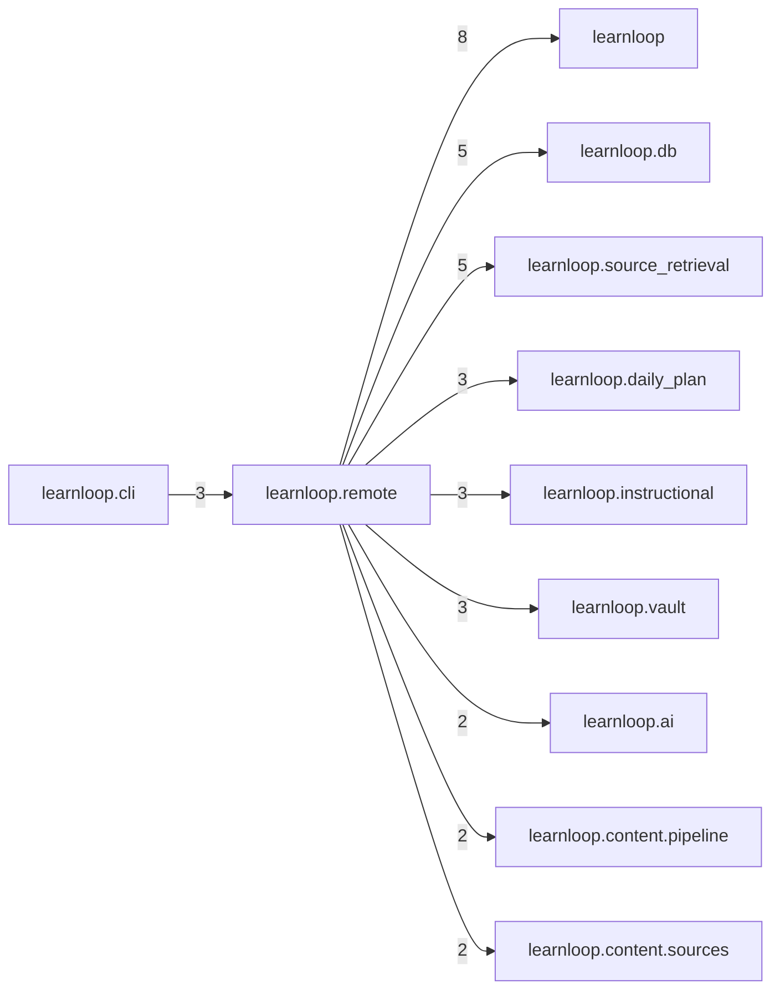

# `learnloop.remote` package map

> [!info] Generated package map
> This map is generated from live modules and their static imports. Follow module links for source-level facts and canonical concept/workflow links for system behavior.

Up: [[Module Catalog]]

## Responsibility

Application services for frontends outside the desktop (the MCP chat adapter's only door); no learning policy of its own.

For system intent, use [[Architecture Overview]].

^package-purpose

## Module index

| Module | Purpose | Status | Direct importers | Direct test files |
|---|---|---:|---:|---:|
| [[Reference/Modules/learnloop/remote/__init__|learnloop.remote]] | [[Reference/Modules/learnloop/remote/__init__#^module-purpose|purpose]] | `ACTIVE` | 0 | 0 |
| [[Reference/Modules/learnloop/remote/endpoint_token|learnloop.remote.endpoint_token]] | [[Reference/Modules/learnloop/remote/endpoint_token#^module-purpose|purpose]] | `ACTIVE` | 2 | 3 |
| [[Reference/Modules/learnloop/remote/errors|learnloop.remote.errors]] | [[Reference/Modules/learnloop/remote/errors#^module-purpose|purpose]] | `ACTIVE` | 2 | 0 |
| [[Reference/Modules/learnloop/remote/runtime|learnloop.remote.runtime]] | [[Reference/Modules/learnloop/remote/runtime#^module-purpose|purpose]] | `ACTIVE` | 1 | 11 |
| [[Reference/Modules/learnloop/remote/sources|learnloop.remote.sources]] | [[Reference/Modules/learnloop/remote/sources#^module-purpose|purpose]] | `ACTIVE` | 0 | 0 |
| [[Reference/Modules/learnloop/remote/telemetry|learnloop.remote.telemetry]] | [[Reference/Modules/learnloop/remote/telemetry#^module-purpose|purpose]] | `ACTIVE` | 2 | 1 |
| [[Reference/Modules/learnloop/remote/views|learnloop.remote.views]] | [[Reference/Modules/learnloop/remote/views#^module-purpose|purpose]] | `ACTIVE` | 0 | 2 |

## Cross-package dependencies

### This package imports

- [[Reference/Modules/learnloop/_package|learnloop]] — 8 static module edges
- [[Reference/Modules/learnloop/db/_package|learnloop.db]] — 5 static module edges
- [[Reference/Modules/learnloop/source_retrieval/_package|learnloop.source_retrieval]] — 5 static module edges
- [[Reference/Modules/learnloop/daily_plan/_package|learnloop.daily_plan]] — 3 static module edges
- [[Reference/Modules/learnloop/instructional/_package|learnloop.instructional]] — 3 static module edges
- [[Reference/Modules/learnloop/vault/_package|learnloop.vault]] — 3 static module edges
- [[Reference/Modules/learnloop/ai/_package|learnloop.ai]] — 2 static module edges
- [[Reference/Modules/learnloop/content/pipeline/_package|learnloop.content.pipeline]] — 2 static module edges
- [[Reference/Modules/learnloop/content/sources/_package|learnloop.content.sources]] — 2 static module edges
- [[Reference/Modules/learnloop/practice_index/_package|learnloop.practice_index]] — 2 static module edges
- [[Reference/Modules/learnloop/attempts/_package|learnloop.attempts]] — 1 static module edge
- [[Reference/Modules/learnloop/config/_package|learnloop.config]] — 1 static module edge
- [[Reference/Modules/learnloop/db/stores/_package|learnloop.db.stores]] — 1 static module edge
- [[Reference/Modules/learnloop/goals/_package|learnloop.goals]] — 1 static module edge
- [[Reference/Modules/learnloop/ingest/_package|learnloop.ingest]] — 1 static module edge
- [[Reference/Modules/learnloop/router_objective/_package|learnloop.router_objective]] — 1 static module edge

### Packages that import this package

- [[Reference/Modules/learnloop/cli/_package|learnloop.cli]] — 3 static module edges

### Dependency neighborhood

This diagram compresses package-level static imports; edge labels are distinct module-to-module import counts.



Interpretation: arrow direction is static import direction and the label is the number of distinct module-to-module edges. It shows coupling pressure, not runtime call frequency or ownership permission.

## Workflow entry points

- [[Initialize a Vault]]
- [[Start a Learning Cycle]]

## Find and filter

Use Obsidian's native search:

```query
path:"Reference/Modules/learnloop/remote" tag:#docs/module
```

To change this package, start with a module's [[#Module index|purpose link]], then follow its callers, tests, and modification guidance. Re-run the generator after source changes.
