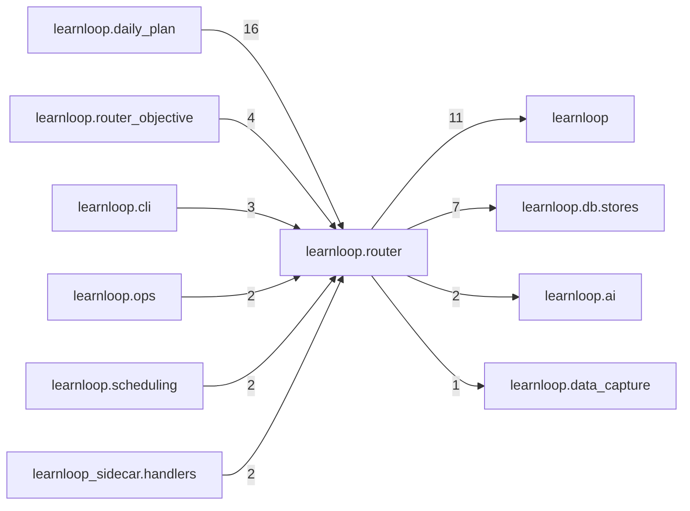

# `learnloop.router` package map

> [!info] Generated package map
> This map is generated from live modules and their static imports. Follow module links for source-level facts and canonical concept/workflow links for system behavior.

Up: [[Module Catalog]]

## Responsibility

The action router: decisions logged on today's serving paths and their derived outcomes; a leaf that chooses nothing yet.

For system intent, use [[Architecture Overview]].

^package-purpose

## Module index

| Module | Purpose | Status | Direct importers | Direct test files |
|---|---|---:|---:|---:|
| [[Reference/Modules/learnloop/router/__init__|learnloop.router]] | [[Reference/Modules/learnloop/router/__init__#^module-purpose|purpose]] | `ACTIVE` | 0 | 0 |
| [[Reference/Modules/learnloop/router/agreement|learnloop.router.agreement]] | [[Reference/Modules/learnloop/router/agreement#^module-purpose|purpose]] | `ACTIVE` | 1 | 1 |
| [[Reference/Modules/learnloop/router/card|learnloop.router.card]] | [[Reference/Modules/learnloop/router/card#^module-purpose|purpose]] | `ACTIVE` | 1 | 13 |
| [[Reference/Modules/learnloop/router/decisions|learnloop.router.decisions]] | [[Reference/Modules/learnloop/router/decisions#^module-purpose|purpose]] | `ACTIVE` | 2 | 3 |
| [[Reference/Modules/learnloop/router/first_delayed_success|learnloop.router.first_delayed_success]] | [[Reference/Modules/learnloop/router/first_delayed_success#^module-purpose|purpose]] | `ACTIVE` | 2 | 4 |
| [[Reference/Modules/learnloop/router/lesson_suggestions|learnloop.router.lesson_suggestions]] | [[Reference/Modules/learnloop/router/lesson_suggestions#^module-purpose|purpose]] | `ACTIVE` | 1 | 7 |
| [[Reference/Modules/learnloop/router/mixture|learnloop.router.mixture]] | [[Reference/Modules/learnloop/router/mixture#^module-purpose|purpose]] | `ACTIVE` | 9 | 9 |
| [[Reference/Modules/learnloop/router/outcomes|learnloop.router.outcomes]] | [[Reference/Modules/learnloop/router/outcomes#^module-purpose|purpose]] | `ACTIVE` | 6 | 20 |
| [[Reference/Modules/learnloop/router/plan_log|learnloop.router.plan_log]] | [[Reference/Modules/learnloop/router/plan_log#^module-purpose|purpose]] | `ACTIVE` | 3 | 2 |
| [[Reference/Modules/learnloop/router/requests|learnloop.router.requests]] | [[Reference/Modules/learnloop/router/requests#^module-purpose|purpose]] | `ACTIVE` | 3 | 4 |
| [[Reference/Modules/learnloop/router/suggestion_report|learnloop.router.suggestion_report]] | [[Reference/Modules/learnloop/router/suggestion_report#^module-purpose|purpose]] | `ACTIVE` | 1 | 2 |
| [[Reference/Modules/learnloop/router/why|learnloop.router.why]] | [[Reference/Modules/learnloop/router/why#^module-purpose|purpose]] | `ACTIVE` | 5 | 5 |

## Cross-package dependencies

### This package imports

- [[Reference/Modules/learnloop/_package|learnloop]] — 11 static module edges
- [[Reference/Modules/learnloop/db/stores/_package|learnloop.db.stores]] — 7 static module edges
- [[Reference/Modules/learnloop/ai/_package|learnloop.ai]] — 2 static module edges
- [[Reference/Modules/learnloop/data_capture/_package|learnloop.data_capture]] — 1 static module edge
- [[Reference/Modules/learnloop/vault/_package|learnloop.vault]] — 1 static module edge

### Packages that import this package

- [[Reference/Modules/learnloop/daily_plan/_package|learnloop.daily_plan]] — 16 static module edges
- [[Reference/Modules/learnloop/router_objective/_package|learnloop.router_objective]] — 4 static module edges
- [[Reference/Modules/learnloop/cli/_package|learnloop.cli]] — 3 static module edges
- [[Reference/Modules/learnloop/ops/_package|learnloop.ops]] — 2 static module edges
- [[Reference/Modules/learnloop/scheduling/_package|learnloop.scheduling]] — 2 static module edges
- [[Reference/Modules/learnloop_sidecar/handlers/_package|learnloop_sidecar.handlers]] — 2 static module edges
- [[Reference/Modules/learnloop/diagnosis/_package|learnloop.diagnosis]] — 1 static module edge
- [[Reference/Modules/learnloop/followup_run/_package|learnloop.followup_run]] — 1 static module edge
- [[Reference/Modules/learnloop/substrate/_package|learnloop.substrate]] — 1 static module edge

### Dependency neighborhood

This diagram compresses package-level static imports; edge labels are distinct module-to-module import counts.



Interpretation: arrow direction is static import direction and the label is the number of distinct module-to-module edges. It shows coupling pressure, not runtime call frequency or ownership permission.

## Workflow entry points

- [[Initialize a Vault]]
- [[Start a Learning Cycle]]

## Find and filter

Use Obsidian's native search:

```query
path:"Reference/Modules/learnloop/router" tag:#docs/module
```

To change this package, start with a module's [[#Module index|purpose link]], then follow its callers, tests, and modification guidance. Re-run the generator after source changes.
