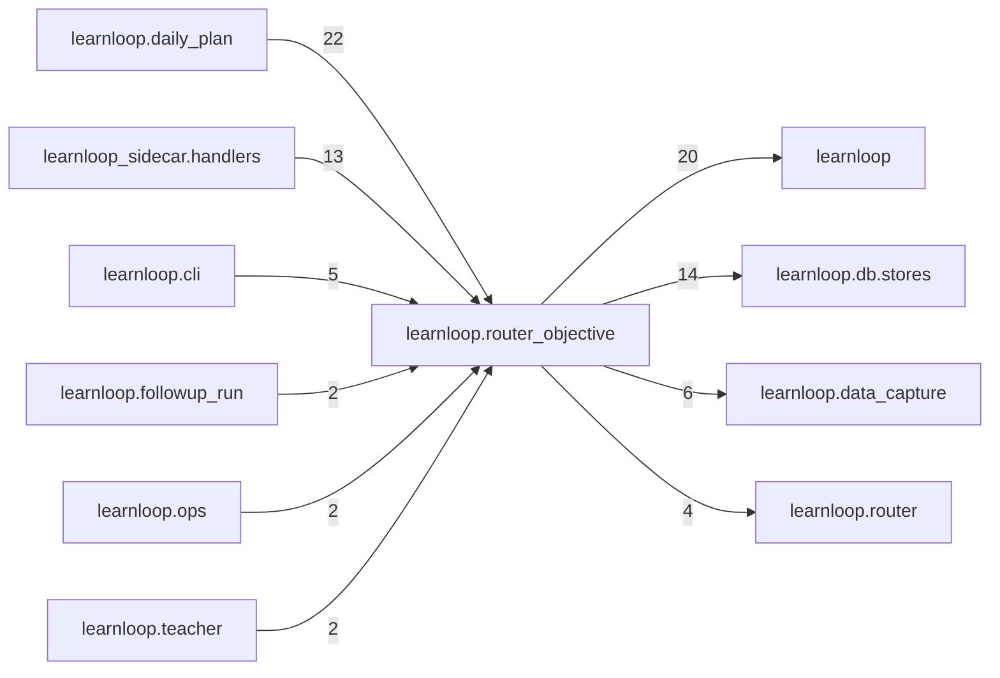

# `learnloop.router_objective` package map

> [!info] Generated package map
> This map is generated from live modules and their static imports. Follow module links for source-level facts and canonical concept/workflow links for system behavior.

Up: [[Module Catalog]]

## Responsibility

The router objective's logging (spec_router_objective_v1 §4, RO0): additive receipts at every version behind [router_objective] receipts, read by nothing serving, scheduling or certification.

For system intent, use [[Architecture Overview]].

^package-purpose

## Module index

| Module | Purpose | Status | Direct importers | Direct test files |
|---|---|---:|---:|---:|
| [[Reference/Modules/learnloop/router_objective/__init__|learnloop.router_objective]] | [[Reference/Modules/learnloop/router_objective/__init__#^module-purpose|purpose]] | `ACTIVE` | 0 | 0 |
| [[Reference/Modules/learnloop/router_objective/ask_availability|learnloop.router_objective.ask_availability]] | [[Reference/Modules/learnloop/router_objective/ask_availability#^module-purpose|purpose]] | `ACTIVE` | 2 | 2 |
| [[Reference/Modules/learnloop/router_objective/assignments|learnloop.router_objective.assignments]] | [[Reference/Modules/learnloop/router_objective/assignments#^module-purpose|purpose]] | `ACTIVE` | 6 | 8 |
| [[Reference/Modules/learnloop/router_objective/calibration_report|learnloop.router_objective.calibration_report]] | [[Reference/Modules/learnloop/router_objective/calibration_report#^module-purpose|purpose]] | `ACTIVE` | 1 | 1 |
| [[Reference/Modules/learnloop/router_objective/checks|learnloop.router_objective.checks]] | [[Reference/Modules/learnloop/router_objective/checks#^module-purpose|purpose]] | `ACTIVE` | 8 | 10 |
| [[Reference/Modules/learnloop/router_objective/cold_timing|learnloop.router_objective.cold_timing]] | [[Reference/Modules/learnloop/router_objective/cold_timing#^module-purpose|purpose]] | `ACTIVE` | 1 | 2 |
| [[Reference/Modules/learnloop/router_objective/combiner_data|learnloop.router_objective.combiner_data]] | [[Reference/Modules/learnloop/router_objective/combiner_data#^module-purpose|purpose]] | `ACTIVE` | 1 | 2 |
| [[Reference/Modules/learnloop/router_objective/decision_state|learnloop.router_objective.decision_state]] | [[Reference/Modules/learnloop/router_objective/decision_state#^module-purpose|purpose]] | `ACTIVE` | 6 | 3 |
| [[Reference/Modules/learnloop/router_objective/exposure|learnloop.router_objective.exposure]] | [[Reference/Modules/learnloop/router_objective/exposure#^module-purpose|purpose]] | `ACTIVE` | 12 | 2 |
| [[Reference/Modules/learnloop/router_objective/forecast_resolve|learnloop.router_objective.forecast_resolve]] | [[Reference/Modules/learnloop/router_objective/forecast_resolve#^module-purpose|purpose]] | `ACTIVE` | 2 | 1 |
| [[Reference/Modules/learnloop/router_objective/goal_lifecycle|learnloop.router_objective.goal_lifecycle]] | [[Reference/Modules/learnloop/router_objective/goal_lifecycle#^module-purpose|purpose]] | `ACTIVE` | 1 | 3 |
| [[Reference/Modules/learnloop/router_objective/goal_read|learnloop.router_objective.goal_read]] | [[Reference/Modules/learnloop/router_objective/goal_read#^module-purpose|purpose]] | `ACTIVE` | 1 | 3 |
| [[Reference/Modules/learnloop/router_objective/learned_tail|learnloop.router_objective.learned_tail]] | [[Reference/Modules/learnloop/router_objective/learned_tail#^module-purpose|purpose]] | `ACTIVE` | 3 | 7 |
| [[Reference/Modules/learnloop/router_objective/memory|learnloop.router_objective.memory]] | [[Reference/Modules/learnloop/router_objective/memory#^module-purpose|purpose]] | `ACTIVE` | 3 | 10 |
| [[Reference/Modules/learnloop/router_objective/mix|learnloop.router_objective.mix]] | [[Reference/Modules/learnloop/router_objective/mix#^module-purpose|purpose]] | `ACTIVE` | 1 | 5 |
| [[Reference/Modules/learnloop/router_objective/objective_report|learnloop.router_objective.objective_report]] | [[Reference/Modules/learnloop/router_objective/objective_report#^module-purpose|purpose]] | `ACTIVE` | 1 | 3 |
| [[Reference/Modules/learnloop/router_objective/picks|learnloop.router_objective.picks]] | [[Reference/Modules/learnloop/router_objective/picks#^module-purpose|purpose]] | `ACTIVE` | 3 | 1 |
| [[Reference/Modules/learnloop/router_objective/price|learnloop.router_objective.price]] | [[Reference/Modules/learnloop/router_objective/price#^module-purpose|purpose]] | `ACTIVE` | 5 | 3 |
| [[Reference/Modules/learnloop/router_objective/question_state|learnloop.router_objective.question_state]] | [[Reference/Modules/learnloop/router_objective/question_state#^module-purpose|purpose]] | `ACTIVE` | 1 | 1 |
| [[Reference/Modules/learnloop/router_objective/report|learnloop.router_objective.report]] | [[Reference/Modules/learnloop/router_objective/report#^module-purpose|purpose]] | `ACTIVE` | 1 | 0 |
| [[Reference/Modules/learnloop/router_objective/scores|learnloop.router_objective.scores]] | [[Reference/Modules/learnloop/router_objective/scores#^module-purpose|purpose]] | `ACTIVE` | 4 | 7 |
| [[Reference/Modules/learnloop/router_objective/sessions|learnloop.router_objective.sessions]] | [[Reference/Modules/learnloop/router_objective/sessions#^module-purpose|purpose]] | `ACTIVE` | 2 | 3 |
| [[Reference/Modules/learnloop/router_objective/stop_coin|learnloop.router_objective.stop_coin]] | [[Reference/Modules/learnloop/router_objective/stop_coin#^module-purpose|purpose]] | `ACTIVE` | 6 | 7 |
| [[Reference/Modules/learnloop/router_objective/tail_data|learnloop.router_objective.tail_data]] | [[Reference/Modules/learnloop/router_objective/tail_data#^module-purpose|purpose]] | `ACTIVE` | 3 | 10 |
| [[Reference/Modules/learnloop/router_objective/tail_report|learnloop.router_objective.tail_report]] | [[Reference/Modules/learnloop/router_objective/tail_report#^module-purpose|purpose]] | `ACTIVE` | 1 | 1 |
| [[Reference/Modules/learnloop/router_objective/tail_serve|learnloop.router_objective.tail_serve]] | [[Reference/Modules/learnloop/router_objective/tail_serve#^module-purpose|purpose]] | `ACTIVE` | 1 | 6 |
| [[Reference/Modules/learnloop/router_objective/trace|learnloop.router_objective.trace]] | [[Reference/Modules/learnloop/router_objective/trace#^module-purpose|purpose]] | `ACTIVE` | 5 | 4 |
| [[Reference/Modules/learnloop/router_objective/trajectory|learnloop.router_objective.trajectory]] | [[Reference/Modules/learnloop/router_objective/trajectory#^module-purpose|purpose]] | `ACTIVE` | 2 | 2 |
| [[Reference/Modules/learnloop/router_objective/value|learnloop.router_objective.value]] | [[Reference/Modules/learnloop/router_objective/value#^module-purpose|purpose]] | `ACTIVE` | 2 | 16 |
| [[Reference/Modules/learnloop/router_objective/weight|learnloop.router_objective.weight]] | [[Reference/Modules/learnloop/router_objective/weight#^module-purpose|purpose]] | `ACTIVE` | 3 | 4 |

## Cross-package dependencies

### This package imports

- [[Reference/Modules/learnloop/_package|learnloop]] — 20 static module edges
- [[Reference/Modules/learnloop/db/stores/_package|learnloop.db.stores]] — 14 static module edges
- [[Reference/Modules/learnloop/data_capture/_package|learnloop.data_capture]] — 6 static module edges
- [[Reference/Modules/learnloop/router/_package|learnloop.router]] — 4 static module edges
- [[Reference/Modules/learnloop/adaptive_difficulty/_package|learnloop.adaptive_difficulty]] — 1 static module edge
- [[Reference/Modules/learnloop/params/_package|learnloop.params]] — 1 static module edge

### Packages that import this package

- [[Reference/Modules/learnloop/daily_plan/_package|learnloop.daily_plan]] — 22 static module edges
- [[Reference/Modules/learnloop_sidecar/handlers/_package|learnloop_sidecar.handlers]] — 13 static module edges
- [[Reference/Modules/learnloop/cli/_package|learnloop.cli]] — 5 static module edges
- [[Reference/Modules/learnloop/followup_run/_package|learnloop.followup_run]] — 2 static module edges
- [[Reference/Modules/learnloop/ops/_package|learnloop.ops]] — 2 static module edges
- [[Reference/Modules/learnloop/teacher/_package|learnloop.teacher]] — 2 static module edges
- [[Reference/Modules/learnloop/diagnosis/_package|learnloop.diagnosis]] — 1 static module edge
- [[Reference/Modules/learnloop/instructional/_package|learnloop.instructional]] — 1 static module edge
- [[Reference/Modules/learnloop/reader/_package|learnloop.reader]] — 1 static module edge
- [[Reference/Modules/learnloop/remote/_package|learnloop.remote]] — 1 static module edge
- [[Reference/Modules/learnloop/scheduling/_package|learnloop.scheduling]] — 1 static module edge
- [[Reference/Modules/learnloop/tutor/_package|learnloop.tutor]] — 1 static module edge
- [[Reference/Modules/learnloop_sidecar/_package|learnloop_sidecar]] — 1 static module edge

### Dependency neighborhood

This diagram compresses package-level static imports; edge labels are distinct module-to-module import counts.



Interpretation: arrow direction is static import direction and the label is the number of distinct module-to-module edges. It shows coupling pressure, not runtime call frequency or ownership permission.

## Workflow entry points

- [[Initialize a Vault]]
- [[Start a Learning Cycle]]

## Find and filter

Use Obsidian's native search:

```query
path:"Reference/Modules/learnloop/router_objective" tag:#docs/module
```

To change this package, start with a module's [[#Module index|purpose link]], then follow its callers, tests, and modification guidance. Re-run the generator after source changes.
