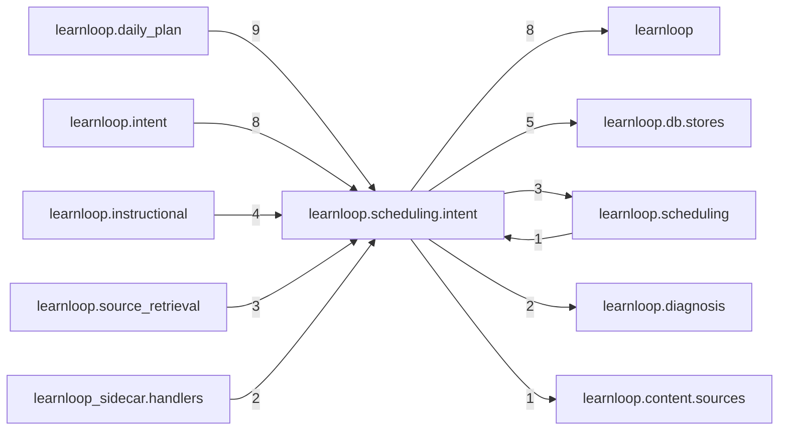

# `learnloop.scheduling.intent` package map

> [!info] Generated package map
> This map is generated from live modules and their static imports. Follow module links for source-level facts and canonical concept/workflow links for system behavior.

Up: [[Module Catalog]]

## Responsibility

Intent at serving time: the vocabulary, the most-recent-choice resolution, per-intent recall targets and the per-build view.

For system intent, use [[Learning System]].

^package-purpose

## Module index

| Module | Purpose | Status | Direct importers | Direct test files |
|---|---|---:|---:|---:|
| [[Reference/Modules/learnloop/scheduling/intent/__init__|learnloop.scheduling.intent]] | [[Reference/Modules/learnloop/scheduling/intent/__init__#^module-purpose|purpose]] | `ACTIVE` | 0 | 0 |
| [[Reference/Modules/learnloop/scheduling/intent/feasibility|learnloop.scheduling.intent.feasibility]] | [[Reference/Modules/learnloop/scheduling/intent/feasibility#^module-purpose|purpose]] | `ACTIVE` | 1 | 2 |
| [[Reference/Modules/learnloop/scheduling/intent/followup_gate|learnloop.scheduling.intent.followup_gate]] | [[Reference/Modules/learnloop/scheduling/intent/followup_gate#^module-purpose|purpose]] | `ACTIVE` | 2 | 6 |
| [[Reference/Modules/learnloop/scheduling/intent/model|learnloop.scheduling.intent.model]] | [[Reference/Modules/learnloop/scheduling/intent/model#^module-purpose|purpose]] | `ACTIVE` | 8 | 4 |
| [[Reference/Modules/learnloop/scheduling/intent/recall_targets|learnloop.scheduling.intent.recall_targets]] | [[Reference/Modules/learnloop/scheduling/intent/recall_targets#^module-purpose|purpose]] | `ACTIVE` | 5 | 2 |
| [[Reference/Modules/learnloop/scheduling/intent/resolution|learnloop.scheduling.intent.resolution]] | [[Reference/Modules/learnloop/scheduling/intent/resolution#^module-purpose|purpose]] | `ACTIVE` | 8 | 4 |
| [[Reference/Modules/learnloop/scheduling/intent/serving|learnloop.scheduling.intent.serving]] | [[Reference/Modules/learnloop/scheduling/intent/serving#^module-purpose|purpose]] | `ACTIVE` | 9 | 16 |

## Cross-package dependencies

### This package imports

- [[Reference/Modules/learnloop/_package|learnloop]] — 8 static module edges
- [[Reference/Modules/learnloop/db/stores/_package|learnloop.db.stores]] — 5 static module edges
- [[Reference/Modules/learnloop/scheduling/_package|learnloop.scheduling]] — 3 static module edges
- [[Reference/Modules/learnloop/diagnosis/_package|learnloop.diagnosis]] — 2 static module edges
- [[Reference/Modules/learnloop/content/sources/_package|learnloop.content.sources]] — 1 static module edge
- [[Reference/Modules/learnloop/db/_package|learnloop.db]] — 1 static module edge
- [[Reference/Modules/learnloop/goals/_package|learnloop.goals]] — 1 static module edge
- [[Reference/Modules/learnloop/params/_package|learnloop.params]] — 1 static module edge

### Packages that import this package

- [[Reference/Modules/learnloop/daily_plan/_package|learnloop.daily_plan]] — 9 static module edges
- [[Reference/Modules/learnloop/intent/_package|learnloop.intent]] — 8 static module edges
- [[Reference/Modules/learnloop/instructional/_package|learnloop.instructional]] — 4 static module edges
- [[Reference/Modules/learnloop/source_retrieval/_package|learnloop.source_retrieval]] — 3 static module edges
- [[Reference/Modules/learnloop_sidecar/handlers/_package|learnloop_sidecar.handlers]] — 2 static module edges
- [[Reference/Modules/learnloop/scheduling/_package|learnloop.scheduling]] — 1 static module edge

### Dependency neighborhood

This diagram compresses package-level static imports; edge labels are distinct module-to-module import counts.



Interpretation: arrow direction is static import direction and the label is the number of distinct module-to-module edges. It shows coupling pressure, not runtime call frequency or ownership permission.

## Workflow entry points

- [[Start a Learning Cycle]]

## Find and filter

Use Obsidian's native search:

```query
path:"Reference/Modules/learnloop/scheduling/intent" tag:#docs/module
```

To change this package, start with a module's [[#Module index|purpose link]], then follow its callers, tests, and modification guidance. Re-run the generator after source changes.
